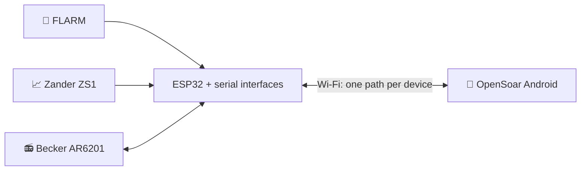

# ✈️ FLARM, Zander and Becker to OpenSoar

One ESP32 Wi-Fi bridge that connects a FLARM, a Zander ZS1 vario and a Becker AR6201 radio to OpenSoar on an Android device in the glider.

> [!NOTE]
> **Status:** planning and bench design — nothing is built yet.
> **Current focus:** 🔧 hardware selection and wiring. Software work waits until the hardware design is finished.

📑 **On this page:** <kbd>[1 · 🎯 What it does](#what-it-does)</kbd> <kbd>[2 · 🚦 Project status](#status)</kbd> <kbd>[3 · 🗺️ Documentation map](#documentation)</kbd> <kbd>[4 · ⚠️ Safety](#safety)</kbd>

---

## 1. 🎯 What it does

| Device | What the bridge does |
| --- | --- |
| 📡 FLARM | Sends traffic and navigation data to OpenSoar |
| 📈 Zander ZS1 | Sends flight and navigation data to OpenSoar |
| 📻 Becker AR6201 | Puts the selected airfield frequency into standby; reports radio status where supported |

The bridge never changes the active frequency, and the radio's own controls keep working. Not planned: active tuning, frequency swap, volume and squelch.

---

## 2. 🚦 Project status

| Stage | Status |
| --- | --- |
| 🔬 Research and documentation | ✅ Done |
| 🔧 Hardware selection and wiring | 🟡 **In progress** — parts and wiring decided, bench checks open |
| 🛩️ Existing installation details | 🟡 Waiting for equipment information |
| 💻 Firmware and driver changes | ⏸️ On hold until the hardware is finished |
| ✈️ Aircraft integration | ⬜ Later |

**Next step:** work through the [bench hardware checks](docs/project/open-items.md#bench-hardware).

---

## 3. 🗺️ Documentation map

| | Section | Pages | What you find there |
| :-: | --- | --- | --- |
| 🔧 | **Hardware** | [🔌 Wiring](docs/hardware/wiring.md) · [🧱 Modules and parts](docs/hardware/modules.md) | Pin-by-pin wiring, power, bench bring-up, module details, parts list |
| 🧩 | **Design** | [🏗️ Architecture](docs/design/architecture.md) · [🎯 Requirements](docs/design/requirements.md) | How the bridge is built and why; requirements, assumptions, risks |
| 📋 | **Project** | [🗺️ Roadmap](docs/project/roadmap.md) · [❓ Open items](docs/project/open-items.md) · [🛩️ Existing installation](docs/project/existing-installation.md) | Work plan, everything still missing, the bridge already in the aircraft |
| 🔬 | **Research** | [📚 Sources](docs/research/sources.md) · [📻 Becker driver](docs/research/becker-driver.md) · [📶 Bridge firmware](docs/research/bridge-firmware.md) · [🗂️ Reviews](docs/research/reviews) | Evidence, driver and firmware analysis, dated review records |

Working on the repository? Read the [work instructions](AGENTS.md) first.

---

## 4. ⚠️ Safety

> [!WARNING]
> Nothing here is verified on real hardware. Do the [bench checks](docs/project/open-items.md#bench-hardware) before connecting any aircraft equipment. The existing installation stays untouched as a backup.

---

<kbd>[⬆️ Back to top](#top)</kbd>
