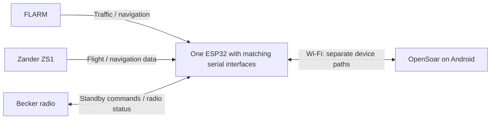

# FLARM, Zander and Becker to OpenSoar

Connect **FLARM, the Zander ZS1 and the Becker radio to OpenSoar on Android through one ESP32 Wi-Fi bridge**. Bring navigation data into OpenSoar and send a selected airfield frequency to the radio’s standby slot.

## What the project should deliver

| Device | Function in OpenSoar |
| --- | --- |
| FLARM | Receive traffic and available navigation data. |
| Zander ZS1 | Receive the instrument’s navigation and flight data. |
| Becker radio | Set standby from the selected airfield and receive radio status where supported. |

Preserve the active radio frequency, local radio controls and existing navigation functions. Distinguish a sent command from a confirmed change and report failure or unknown state clearly.

## Architecture overview

The bridge carries device data; OpenSoar handles radio commands and state. Navigation return paths remain to be checked. The detailed [connection diagram and device pin tables](docs/connections.md) show the proposed converters, UART routing and cabling.

## Current status and next step

Architecture and hardware planning for a **new, separate bridge**, keeping the existing hardware unchanged as a backup. The board, wiring and firmware are still proposals; radio operation and navigation coexistence have not been tested. The bench board candidate is an ESP32-DevKitC V4 with WROOM-32E.

Next, confirm the radio revisions, FLARM model, instrument connections, navigation return traffic and power supply, then specify the new hardware to match those interfaces. The existing setup provides the compatibility and navigation baseline. Implementation and bench verification follow that comparison.

The first version covers navigation reception and standby tuning. Direct active tuning, swap, volume/squelch control and aircraft installation are deferred.

## Documentation

| Document | Contents |
| --- | --- |
| [Connections and pinning](docs/connections.md) | Connection diagram, per-device pin tables, converters and cabling |
| [Architecture and decisions](docs/architecture.md) | Board proposal, responsibilities, alternatives and open choices |
| [Project baseline](docs/project-baseline.md) | Requirements, installed equipment, unknowns and risks |
| [Roadmap](docs/roadmap.md) | Work queue and verification milestones |
| [Sources and evidence](docs/sources.md) | Pinned references and limits of the findings |
| [Technical investigation](docs/technical-investigation.md) | Driver findings and hardware/manual research |
| [Related projects](docs/related-projects.md) | Reuse candidates and earlier comparisons |

Contributor workflow is in [AGENTS.md](AGENTS.md).
