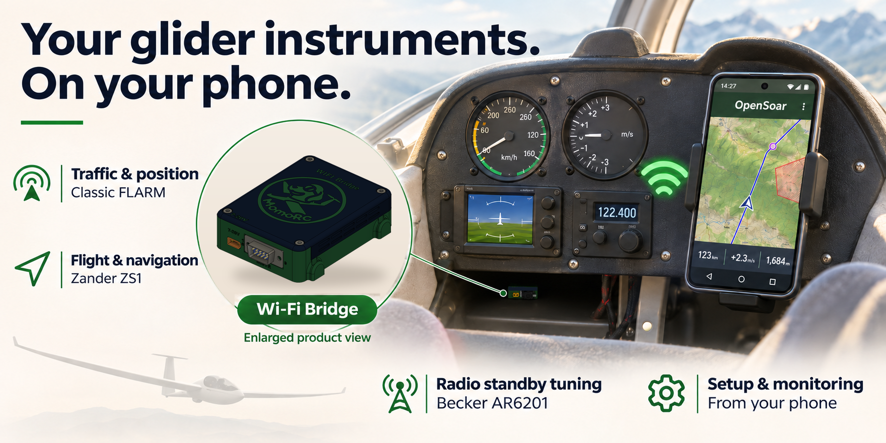
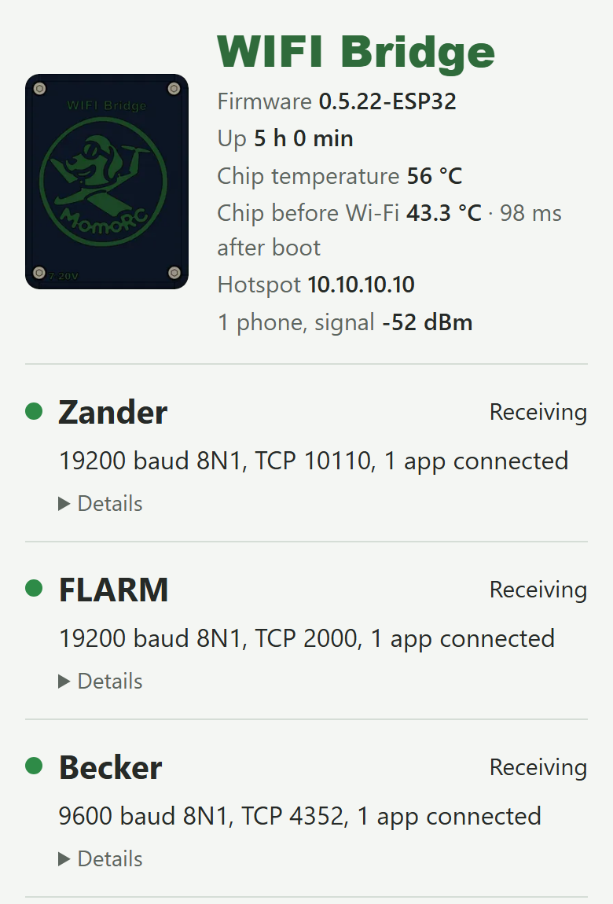

# ✈️ Wi-Fi Bridge: Glider Avionics to OpenSoar

  

A small ESP32 box in the glider collects data from the cockpit instruments and sends it over Wi-Fi to OpenSoar on a phone or tablet. No cables run to the phone.

<a href="docs/manual/user-manual.md"><picture><source media="(prefers-color-scheme: dark)" srcset="docs/images/nav/card-use-dark.svg"></picture></a>
<a href="docs/hardware/build-guide.md"><picture><source media="(prefers-color-scheme: dark)" srcset="docs/images/nav/card-build-dark.svg"></picture></a>
<a href="docs/README.md"><picture><source media="(prefers-color-scheme: dark)" srcset="docs/images/nav/card-reference-dark.svg"></picture></a>

---

## 1. 🎯 What it does

| Device | What you get in OpenSoar |
| --- | --- |
| 📈 Glider computer: Zander ZS1 | Flight and navigation data |
| 📡 Collision warning: Classic FLARM | Traffic and position |
| 📻 Radio: Becker AR6201 | The built-in OpenSoar Becker driver reaches the radio over its own port; standby tuning follows once the protocol is confirmed |

Check and set it up from the phone's browser: live status per device, settings, a data monitor and a log ([web pages](docs/manual/user-manual.md#web-pages)).

 

---

## 2. 🚦 Status

> [!NOTE]
> **Status:** the bench bridge is built and passed all bench checks; the firmware is in bench acceptance. Aircraft installation comes later. Details: [roadmap](docs/project/roadmap.md#work-packages).

---

## 3. ⚠️ Safety

> [!WARNING]
> Keep aircraft equipment disconnected during bench checks. Aircraft connection requires separate approval and verification of the installed wiring and radio revision. The existing installation stays untouched as a backup.

Working on the repository? Read the [work instructions](AGENTS.md) first.

---

<kbd>[⬆️ Back to top](#top)</kbd>
