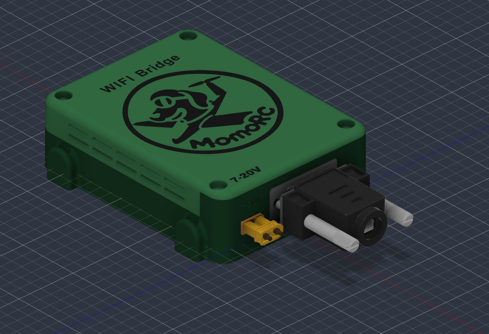
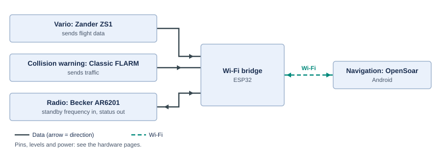

# ✈️ Wi-Fi Bridge: Glider Avionics to OpenSoar

**FLARM · Zander ZS1 glider computer · Becker AR6201 radio → OpenSoar on Android**

A small ESP32 box in the glider that collects data from the cockpit instruments and sends it over Wi-Fi to OpenSoar on a phone or tablet. No cables run to the Android device.

- 📡 **Traffic:** FLARM collision-warning and position data appear in OpenSoar.
- 📈 **Flight data:** the Zander ZS1 sends flight and navigation data.
- 📻 **Radio:** pick an airfield in OpenSoar and its frequency goes into the Becker radio's standby slot.

> [!NOTE]
> **Status:** planning and bench design — nothing is built yet.
> **Current focus:** 🔧 hardware selection and wiring. Software work waits until the hardware design is finished.

📑 **On this page:** <kbd>[1 · 🎯 What it does](#what-it-does)</kbd> <kbd>[2 · 🚦 Project status](#status)</kbd> <kbd>[3 · 🗺️ Documentation map](#documentation)</kbd> <kbd>[4 · ⚠️ Safety](#safety)</kbd>

---

## 1. 🎯 What it does

| Device | What the bridge does |
| --- | --- |
| 📈 Glider computer: Zander ZS1 | Sends flight and navigation data to OpenSoar |
| 📡 Collision warning: Classic FLARM | Sends traffic and navigation data to OpenSoar |
| 📻 Radio: Becker AR6201 | Puts the selected airfield frequency into standby; reports radio status where supported |

The bridge never changes the active frequency, and the radio's own controls keep working. Not planned: active tuning, frequency swap, volume and squelch.

---

## 2. 🚦 Project status

| Stage | Status |
| --- | --- |
| 🔬 Research and documentation | ✅ Done |
| 🔧 Hardware selection and wiring | 🟡 **In progress** — parts and wiring decided, bench checks open |
| 🛩️ Existing installation details | 🟡 Waiting for equipment information |
| 💻 Firmware and driver changes | ⏸️ On hold until the hardware is finished |
| ✈️ Aircraft integration | ⬜ Later |

**Next step:** work through the [bench hardware checks](docs/project/open-items.md#bench-hardware).

---

## 3. 🗺️ Documentation map

| | Section | Page | What you find there |
| :-: | --- | --- | --- |
| 🔧 | **Hardware** | [🔌 Signal wiring](docs/hardware/wiring.md) | Pin-by-pin signal wiring and bench bring-up |
| | | [⚡ Power and grounding](docs/hardware/power.md) | Supply, ground loops and currents |
| | | [🧱 Modules and parts](docs/hardware/modules.md) | Module details, parts list |
| | | [📦 Housing](docs/hardware/housing.md) | Mechanical design |
| | | [📐 CAD downloads and credits](cad/reference/README.md) | Reference models, original sources and reuse terms |
| 🧩 | **Design** | [🏗️ Architecture](docs/design/architecture.md) | How the bridge is built and why |
| | | [🎯 Requirements](docs/design/requirements.md) | Requirements, assumptions, risks |
| 📋 | **Project** | [🗺️ Roadmap](docs/project/roadmap.md) | Work plan |
| | | [💶 Hardware cost](docs/project/cost.md) | Cost breakdown for one bridge |
| | | [❓ Open items](docs/project/open-items.md) | Everything still missing |
| | | [🛩️ Existing installation](docs/project/existing-installation.md) | The bridge already in the aircraft |
| 🔬 | **Research** | [📚 Sources](docs/research/sources.md) | Evidence |
| | | [📻 Becker driver](docs/research/becker-driver.md) | Driver analysis |
| | | [📶 Bridge firmware](docs/research/bridge-firmware.md) | Firmware analysis |
| | | [🗂️ Reviews](docs/research/reviews) | Dated review records |

Working on the repository? Read the [work instructions](AGENTS.md) first.

---

## 4. ⚠️ Safety

> [!WARNING]
> Nothing here is verified on real hardware. Do the [bench checks](docs/project/open-items.md#bench-hardware) before connecting any aircraft equipment. The existing installation stays untouched as a backup.

---

<kbd>[⬆️ Back to top](#top)</kbd>
