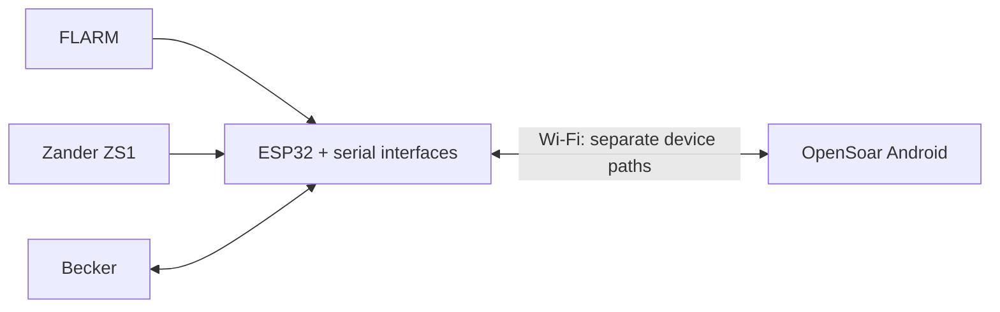

# FLARM, Zander and Becker to OpenSoar

One ESP32 Wi-Fi bridge that connects a FLARM, a Zander ZS1 and a Becker AR6201 radio to OpenSoar on Android.

## What it does

| Device | Function |
| --- | --- |
| FLARM | Traffic and navigation data to OpenSoar |
| Zander ZS1 | Flight and navigation data to OpenSoar |
| Becker AR6201 | Selected airfield frequency → standby; radio status where supported |

The bridge preserves the active frequency, the radio's local controls and both navigation feeds. Not in scope: active tuning, swap, volume and squelch.

## Status

| Stage | Status |
| --- | --- |
| Research and documentation | ✅ Documented; Becker send defect reproduced on host |
| Existing installation and interfaces | 🟡 Open: equipment identity and settings needed |
| Bench hardware design | 🟡 Parts selected; electrical checks open |
| Firmware and driver changes | ⬜ Planned; not approved |
| Aircraft integration | ⬜ Deferred |

**Next step:** confirm the installed equipment — [open items, WP1](docs/open-items.md#installed-equipment-wp1).

> [!WARNING]
> Planning stage. Nothing is verified on hardware. Complete the [open hardware checks](docs/open-items.md#bench-hardware-wp3) before connecting anything.

## Start here

| I want to… | Go to |
| --- | --- |
| Wire or build it | [Connections](docs/connections.md) · [Module specs](docs/module-specs.md) |
| Understand the design | [Architecture](docs/architecture.md) · [Requirements and risks](docs/requirements.md) |
| See what is open | [Open items](docs/open-items.md) · [Roadmap](docs/roadmap.md) · [Existing installation](docs/existing-installation.md) |
| Check the evidence | [Sources](docs/sources.md) · [Becker driver research](docs/becker-driver.md) · [Reviews](docs/reviews) · [Bridge firmware candidates](docs/bridge-firmware.md) |
| Contribute | [Work instructions](AGENTS.md) |
