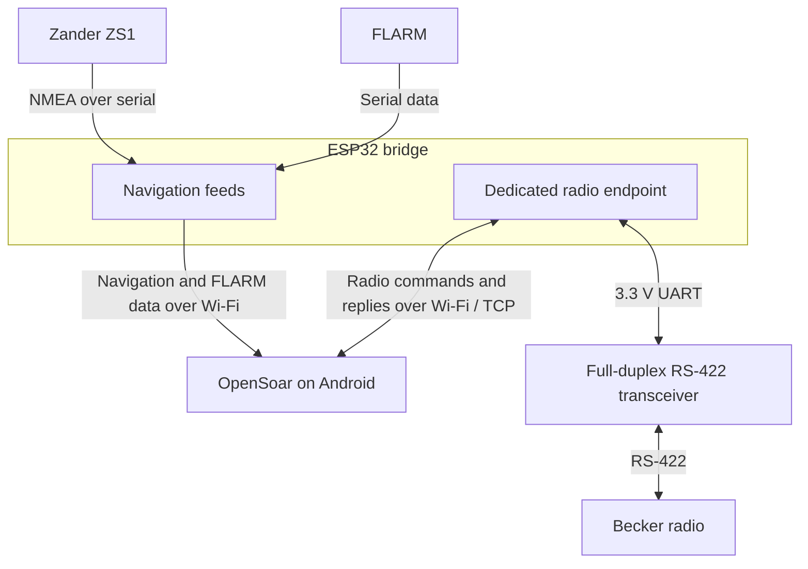

# Becker AR6201 to OpenSoar

This project aims to let a pilot select an airfield in OpenSoar on Android and load its frequency into the Becker radio’s **standby** slot. An ESP32 would carry the radio’s commands and replies between Wi-Fi and the serial interface. The goal is a low-cost, reproducible integration that reuses existing open-source software and preserves the glider’s navigation feeds.

**Project status:** Investigation and architecture planning. The project notes report that OpenSoar receives navigation data over Wi-Fi from the existing ESP32 in a DG200. Remote frequency control, the physical radio interface, and compatibility with the installed radio have yet to be demonstrated. The initial source review is documented in [Technical investigation](docs/technical-investigation.md), including pinned revisions, confirmed defects, bridge options, and open checks.

## Existing installation

| Component | Reported role | What needs checking |
| --- | --- | --- |
| Zander ZS1 | Supplies NMEA navigation data to the ESP32 | Record the current feed as a regression baseline |
| FLARM | Supplies an additional serial feed to the ESP32 | Identify the data format and how OpenSoar consumes it |
| ESP32 | Distributes serial data over Wi-Fi | Identify the board and firmware, available UARTs, and support for forwarding TCP data back to serial |
| Android / OpenSoar | Receives navigation data over Wi-Fi | Verify that the deployed build can run the AR62xx driver over TCP alongside the navigation inputs |
| Becker radio | Target for standby tuning and status readback | Confirm model, hardware revision, and firmware. The original notes mention both AR6102 and AR6201 |

Larus wind sensor integration is a possible later extension.

## Proposed architecture

Give radio traffic its own bidirectional TCP endpoint and keep it separate from the existing Zander and FLARM feeds. Evaluate separate navigation endpoints if the current setup needs them. OpenSoar handles protocol framing, commands, and responses. The bridge forwards the radio stream byte for byte in both directions, including zero bytes and control bytes, without NMEA parsing or line ending conversion. TCP can split a frame across reads or deliver several frames in one read, so the receiver must handle both.

The diagram shows logical paths. UART count, pin assignments, TCP ports, serial settings, and the radio connector depend on the hardware and firmware investigation. Prefer reusing the installed ESP32 if it can carry the radio traffic independently and preserve the navigation feeds. Otherwise, evaluate adapting an existing bridge before writing dedicated firmware.

## Related projects

See [Related projects and reuse investigation](docs/related-projects.md) for additional Becker drivers, historical XCSoar work, and ESP32 bridge candidates.

## Driver findings

The upstream AR62xx driver has code for active and standby frequency commands, channel conversion, response parsing, and CRC-16 with polynomial `0x8005`. Its frequency command carries both active and standby values, so a standby update must preserve the actual active value. Verify how the driver learns both values on startup and after reconnecting. [OpenSoar AR62xx driver source](https://github.com/August2111/OpenSoar/blob/master/src/Device/Driver/AR62xx.cpp)

In the inspected upstream source, `AR62xxDevice::Send()` sets its response to `ACK` immediately after writing. The code can therefore report success without a reply from the radio. Review whether the write preserves the entire binary frame and whether the receive path can distinguish acknowledgments from payload bytes when TCP reads are split or combined. These are source findings and review targets. Behavior on the installed OpenSoar build and radio remains unverified. [OpenSoar AR62xx driver source](https://github.com/August2111/OpenSoar/blob/master/src/Device/Driver/AR62xx.cpp)

## Engineering constraints

- Use a transceiver compatible with 3.3 V ESP32 UART logic and the confirmed radio interface. Keep RS-422, RS-232, and incompatible logic levels off the ESP32 GPIO.
- Verify the connector, pinout, signal directions, serial settings, and remote-control configuration in the installation manual for the exact radio revision before wiring. [Becker manuals and downloads](https://becker-avionics.com/manual-instructions-downloads/)
- Preserve the Zander and FLARM feeds during radio traffic, disconnections, and reconnects. The radio’s local controls must remain usable if the bridge fails or loses power.
- Distinguish a completed TCP write, an acknowledgment from the radio, and a verified frequency change. Handle rejection, timeout, and disconnect explicitly.
- Run simulation and bench tests before defining an aircraft installation procedure. Resolve electrical protection, avionics compatibility, and applicable approvals before making changes to installed avionics.

## Work plan

| Phase | Deliverable |
| --- | --- |
| 1. Investigate | Identify the installed hardware and firmware. Record the deployed OpenSoar version, applicable Becker manual, protocol details, and current navigation feed behavior. |
| 2. Select a bridge | Evaluate the existing firmware and the AlphaLima candidates for byte transparency, UART availability, recovery behavior, and licensing. Record the chosen configuration. [ESP32 Serial Bridge](https://github.com/AlphaLima/ESP32-Serial-Bridge) · [ESP32 Serial Bridge Pro](https://github.com/AlphaLima/ESP32-Serial-Bridge-Pro) |
| 3. Simulate and implement | Make a host-side Becker simulator and automated checks the first executable deliverable. Use them to guide any targeted driver changes and bridge adaptation. Add diagnostics for connections, serial errors, and reconnects. |
| 4. Verify and document | Test the radio on the bench, then document the firmware, wiring, configuration, reproduction steps, limitations, and prerequisites for aircraft integration. |

## Test and acceptance plan

| Stage | Evidence required |
| --- | --- |
| Host simulator | Check command framing and CRC, channel conversion, and active/standby updates. Exercise ACK, NAK, no reply, malformed frames, split and combined TCP reads, startup state, and reconnects. Verify binary forwarding with embedded zero and control bytes. |
| Physical bench | Select an airfield in OpenSoar and send its frequency over Wi-Fi. Observe the expected RS-422 command, a genuine radio reply, the correct standby frequency on the radio, and an unchanged active frequency. Verify status readback where supported. |
| Coexistence and failure recovery | Verify Zander and FLARM reception during radio traffic and reconnects. Confirm that unsupported commands and connection errors are reported and the local radio controls work with the bridge disconnected or powered off. |

Publish the tested hardware and software versions, configuration, and results so another builder can reproduce the bench setup. Keep simulated behavior and physical observations separate in the test record.
