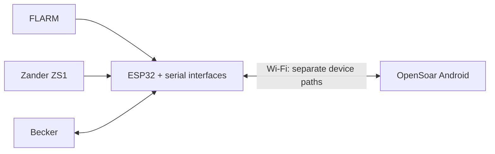

# FLARM, Zander and Becker to OpenSoar

One ESP32 Wi-Fi bridge for OpenSoar on Android.

## Plan status

| Stage | Status |
| --- | --- |
| Research / bench design | Documented; send regression host-tested |
| Next: finalize design | Equipment/board/BEC details, interfaces, protection and firmware open |
| Implementation / bench acceptance | Pending |
| Aircraft integration | Deferred |

[Work queue](docs/roadmap.md).

## Scope

| Device | Function |
| --- | --- |
| FLARM | Traffic/navigation input |
| Zander ZS1 | Flight/navigation input |
| Becker | Selected airfield → standby; radio status where supported |

Preserve active frequency, local controls and navigation. Report unknown state and failures.

## Architecture overview

| Item | Current state |
| --- | --- |
| Build | New bridge; existing assembly/harness retained as backup |
| Selected hardware | AZ-Delivery WROOM-32; 2 × HW-044; 5 V BEC; board-derived 3.3 V |
| Proposed radio interface | Full-duplex RS-422, THVD1451D |
| Deferred controls | Active tuning, swap, volume/squelch |

## Documentation

| Document | Contents |
| --- | --- |
| [Connections](docs/connections.md) | Device wiring, pin tables, power |
| [Bench reference](docs/bench-build.md) | BOM, converter internals, protection, checks |
| [Architecture](docs/architecture.md) | Current design and selections |
| [Baseline](docs/project-baseline.md) | Requirements, inventory, risks |
| [Installation claim review](docs/reviews/2026-11-09-installation-claims.md) | Tom's report, PDF versions, supported data and open questions |
| [Roadmap](docs/roadmap.md) | Work queue |
| [Sources](docs/sources.md) | Evidence and revisions |
| [Investigation](docs/technical-investigation.md) | Driver and interface findings |
| [Related projects](docs/related-projects.md) | Reuse candidates |
| [Contributor instructions](AGENTS.md) | Workflow |
