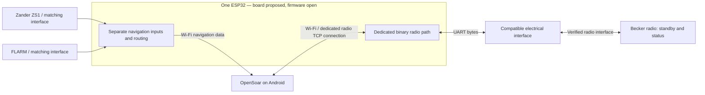

# Becker AR6201 to OpenSoar

Select an airfield in OpenSoar on Android and transfer its frequency to the Becker radio's **standby** slot while preserving the active frequency and existing Zander/FLARM feeds. An ESP32 Wi-Fi/serial bridge is the proposed transport. Prefer reuse of the existing installation and available software.

**Status — 2026-11-08:** Documentation and investigation only. This repository contains no firmware, simulator or automated runtime tests. Navigation reception is reported in earlier project notes; radio control and compatibility with the installed equipment have not been demonstrated. Even the exact radio model/revision remains to be confirmed.

## Agreed first-version goal

Agreed with the owner on 2026-11-08:

- Transfer the selected airfield channel from OpenSoar to Becker **standby**, preserving the actual active channel.
- Preserve existing Zander/FLARM reception and keep the radio's local controls usable.
- Distinguish a sent command from a confirmed radio change; show failure or unknown state honestly.
- Reuse suitable installed hardware and existing software where practical, with bench verification before aircraft integration.

Use **one ESP32** for navigation and radio. Firmware selection remains open. Direct active tuning, swap, volume/squelch control and aircraft installation are outside the first-version scope. Detailed requirements remain in the [project baseline](docs/project-baseline.md#scope-and-requirements).

## Architecture overview — proposed

This is a logical overview, not a wiring diagram or a verified map of the installation. Navigation inputs may already be combined. The owner selected one ESP32. Separate navigation inputs are proposed; existing connections and any return traffic must be checked with Tom. The bench board candidate is an ESP32-DevKitC V4 with ESP32-WROOM-32E. The electrical interface, power supply, pins and serial settings must match the identified equipment.

OpenSoar would handle Becker commands and radio state; the bridge would carry binary bytes in both directions without mixing radio, navigation or diagnostic traffic. See [architecture and open decisions](docs/architecture.md), including the [proposed pinning and cabling](docs/architecture.md#pinning-and-cabling-proposal-for-comparison-with-the-installation).

Planning targets the latest listed OpenSoar release, **7.46.26 as checked on 2026-11-08**; this does not identify the installed version. Tom will supply the radio identity/revisions, FLARM model, wiring and power details when available.

## Start here

**Next: WP1 — record the existing installation.** Identify the radio, ESP32 and installed OpenSoar build; document current connections and missing evidence. Do not select replacement firmware or wiring from an example diagram. The [bounded WP1 task](docs/roadmap.md#wp1--existing-installation-first-priority) defines the inputs, output and completion criteria.

| Document | Owns |
| --- | --- |
| [Project baseline](docs/project-baseline.md) | Requirements, installed-system inventory, assumptions and risks |
| [Sources and evidence](docs/sources.md) | Evidence labels, pinned sources, rechecked facts and verification limits |
| [Architecture and decisions](docs/architecture.md) | Logical proposal, alternatives and decision status |
| [Roadmap and workflow](docs/roadmap.md) | Prioritized work packages, milestones and acceptance checks |
| [Codex instructions](AGENTS.md) | How to carry out one authorized work package |
| [Technical investigation](docs/technical-investigation.md) | Detailed source findings and hardware-reference leads |
| [Related projects](docs/related-projects.md) | Previous reuse investigation; candidates, not selected dependencies |
| [Documentation review](docs/reviews/2026-11-08-documentation.md) | Changes, preservation record and verification of this cleanup |

The pinned OpenSoar driver contains a write without an explicit binary length and locally assigns ACK after writing. These are source observations, not a successful radio test; see [F02–F04](docs/sources.md#rechecked-facts). No connector pinout, baud rate, bridge selection or aircraft installation is approved by this documentation.
