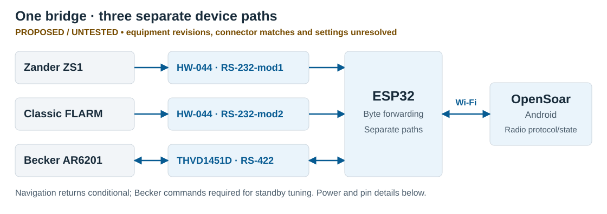
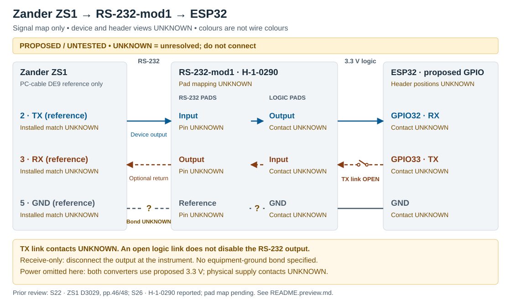
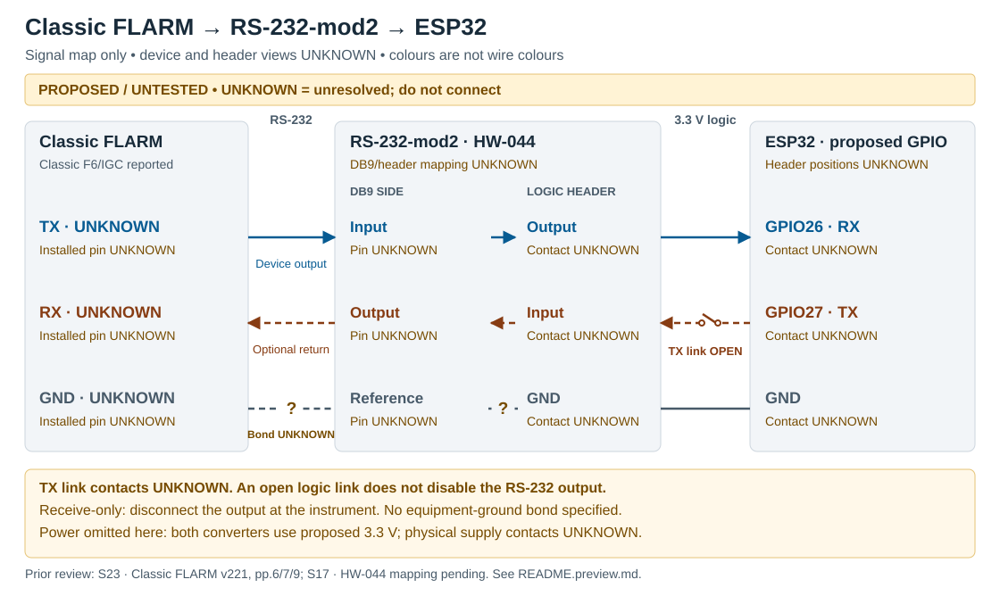

# FLARM, Zander and Becker to OpenSoar

One ESP32 Wi-Fi bridge for traffic, navigation and planned standby-frequency control in OpenSoar on Android.

> [!NOTE]
> **Temporary review preview — not the main README.** Presentation proposal only; current hardware selection follows the README and connection guide. Drawings below are proposed, untested signal maps, not connector-face or construction drawings. **UNKNOWN = unresolved; do not connect.**

## Current status

| Stage | Evidence / status |
| --- | --- |
| Investigation and bench design | Documented; equipment/interface matching still open |
| Software verification | Measured: isolated send regression on host, using synthetic cases; [test scope](docs/reviews/2026-11-08-becker-send.md) |
| Bridge implementation and bench acceptance | Pending; firmware unselected |
| Aircraft integration | Deferred; separate authorization required |

Source review and host tests do not establish physical radio acceptance. Preserve active frequency, local controls and navigation; report unknown/stale state and failures.

## System overview

New bridge and harness; existing assembly, firmware and harness retained as backup. Radio framing/state belongs in OpenSoar; the bridge forwards bytes on separate device paths. Navigation return paths are conditional. Serial settings and new-build network endpoints remain unverified.

## Scope and compatibility

| Device / component | Intended role | Current match |
| --- | --- | --- |
| Classic FLARM | Traffic/navigation input; return path if required | F6/IGC reported; exact port, firmware, cable and settings UNKNOWN |
| Zander ZS1 | Flight/navigation input; optional RMC return | Version and actual cable/conversion map UNKNOWN |
| Becker AR6201-(022) | Selected airfield → standby; radio status where supported | Model reported; installed article/HW/SW and J1 wiring match UNKNOWN |
| AZ-Delivery ESP32 WROOM-32 | Wi-Fi / serial bridge | Family selected; exact board, regulator and physical header positions UNKNOWN |
| 2 × Hailege H-1-0290 | Separate Zander and FLARM RS-232 interfaces | Selected (S26); reported 9.4 × 15.9 mm, MAX3232CSE; ICs, pad mapping and 3.3 V operation require checks |
| THVD1451D / SOIC-8 breakout | Full-duplex Becker RS-422 interface | Proposed; breakout contacts, reference bonding and termination UNKNOWN; no galvanic isolation |
| 5 V BEC → ESP32 → 3.3 V converters | New bridge power | Path selected; exact BEC, limits, budget and protection incomplete |

Active tuning, swap and volume/squelch controls are deferred. [Requirements and inventory](docs/project-baseline.md) · [Architecture and selections](docs/architecture.md).

## Start here

| Task | Read |
| --- | --- |
| Review the proposed wiring presentation | [Connection previews below](#connection-previews) |
| Check current connection evidence | [Existing connection guide](docs/connections.md) · [Sources](docs/sources.md) |
| Identify parts and plan bench checks | [Bench reference](docs/bench-build.md); protection/harness BOM not purchase-ready |
| Review firmware and protocol work | [Architecture](docs/architecture.md) · [Investigation](docs/technical-investigation.md); no ready-to-flash bridge release |

### Connection previews

Read each drawing **device → converter → ESP32**. Blue arrows carry device output; brown dashed arrows carry commands/returns. Colours identify functions, **not wire colours**. A broken reference line marked `?` is unresolved, not a specified bond. Solid arrows also remain proposed and untested.

GPIO numbers are proposed functions, **not physical header positions**. Every ESP32 header position is UNKNOWN. TX links start open; both link contacts are UNKNOWN. An open logic TX link **does not disable** a converter's line driver. Instrument supplies remain separate from bridge power.

<strong>Zander ZS1 — PC-cable reference and optional return</strong>

| Path | ZS1 PC-cable DE9 reference | H-1-0290 / RS-232-mod1 | ESP32 proposal |
| --- | --- | --- | --- |
| Device output → | 2 · TX; installed match **UNKNOWN** | RS-232 input pad **UNKNOWN** → logic output contact **UNKNOWN** | GPIO32 · RX; header **UNKNOWN** |
| Optional RMC return ← | 3 · RX; installed match **UNKNOWN** | RS-232 output pad **UNKNOWN** ← logic input contact **UNKNOWN** | GPIO33 · TX via open TX link; header **UNKNOWN** |
| Reference / ground | 5 · GND; installed match **UNKNOWN** | Ground pad and equipment bond **UNKNOWN**; logic GND contact **UNKNOWN** | GND header **UNKNOWN** |

**Pin-view status:** device mating face/wire side, H-1-0290 contact view and exact ESP32 header layout UNKNOWN. PC-cable numbering is **not** rear-panel connector B numbering. The unmatched S25 crop labels B2 GND, B3 RX-PC, B4 TX-PC; it is not substituted here.

**Prior review:** [S22, ZS1 handbook D3029, 2004-09-16, pp.46/48](docs/reference/ZS1_Deutsch.pdf#page=46). Installed version, cable and settings remain UNKNOWN. [Current Zander evidence](docs/connections.md#zander-zs1).

<strong>Classic FLARM — installed contacts remain UNKNOWN</strong>

| Path | Installed FLARM data port | H-1-0290 / RS-232-mod2 | ESP32 proposal |
| --- | --- | --- | --- |
| Device output → | TX pin **UNKNOWN** | RS-232 input pad **UNKNOWN** → logic output contact **UNKNOWN** | GPIO26 · RX; header **UNKNOWN** |
| Optional return ← | RX pin **UNKNOWN** | RS-232 output pad **UNKNOWN** ← logic input contact **UNKNOWN** | GPIO27 · TX via open TX link; header **UNKNOWN** |
| Reference / ground | GND pin **UNKNOWN** | Ground pad and equipment bond **UNKNOWN**; logic GND contact **UNKNOWN** | GND header **UNKNOWN** |

**Pin-view status:** actual device connector/view, H-1-0290 contact view and ESP32 header layout UNKNOWN. Preserve existing displays and required returns; no assumed passive splitter.

**Prior review:** [S23, Classic installation manual v221, 2016-12-18, p.6](https://www.flarm.com/wp-content/uploads/2024/04/FLARM_InstallationManual_D.pdf#page=6): conditional RJ45 Power/Data reference TX 5, RX 6, GND 7/8 (also 4), supply 1/2. IGC numbering is reversed relative to common numbering. Match the manual's plug view and actual cable before assigning installed pins. [Current FLARM evidence](docs/connections.md#flarm).

For both H-1-0290 modules, trace each RS-232 pad to its IC and logic pad before using arrow/level markings. For receive-only use, disconnect the RS-232 output at the instrument. [Module identification checks](docs/bench-build.md#h-1-0290-identification).

<strong>Becker — separate differential pairs and logic signals</strong>

| Path | Conditional Becker J1 reference | THVD1451D **IC** pins | ESP32 proposal |
| --- | --- | --- | --- |
| Status pair → | 2 · TX2+ / 9 · TX2−; installed match **UNKNOWN** | 8 · A / 7 · B → receiver → 2 · R | GPIO16 · RX; header **UNKNOWN** |
| Command pair ← | 3 · RX2+ / 10 · RX2−; installed match **UNKNOWN** | 5 · Y / 6 · Z ← driver ← 3 · D | GPIO17 · TX via open TX link; header **UNKNOWN** |
| Equipment reference | 21 · D_GND; installed match **UNKNOWN** | Equipment-reference bond **UNKNOWN** | No bond specified |
| Local logic ground | — | 4 · GND; breakout contact **UNKNOWN** | GND header **UNKNOWN** |

Each differential pair is **two wires in matching order**. IC numbers are not breakout-header numbers. All breakout contacts, termination and shielding remain UNKNOWN. Commands are required for standby tuning; omitting them supports receive-only monitoring at most. Keep the radio unplugged pending checks; the proposed transceiver is always enabled and has no galvanic isolation.

**Pin-view status:** installed J1 mating face/wire side, breakout orientation/contact map and ESP32 header layout UNKNOWN. No physical connector-face diagram is inferred.

**Prior review:** [S10, Becker DV14307.03 Issue 06, §2.5.3.2 p.59](https://www.becker-avionics.com/wp-content/uploads/00_Literature/6200_Series_IO_en.pdf#page=59); [S18, THVD1451D SLLSEY3E Rev. E, May 2019, p.6](https://www.ti.com/lit/ds/symlink/thvd1451.pdf#page=6). [Current Becker evidence](docs/connections.md#becker-radio) · [Circuit/decoupling/pull-ups](docs/bench-build.md#rs-422-circuit).

<strong>Power — selected rails, unresolved contacts and protection</strong>

| From | To | Open item |
| --- | --- | --- |
| Reported nominal 12 V source | Input protection → BEC | Source range, fuse/reverse protection and transient clamp ratings **UNKNOWN**; clamp is a shunt to return |
| BEC 5 V output | Output protection if required → ESP32 5 V input | Protection, board/BEC limits and input contact **UNKNOWN** |
| BEC output return | ESP32 GND | Header contact and source-return design **UNKNOWN** |
| Board-derived 3.3 V | Both H-1-0290 VCC pads; THVD1451D IC pin 1 VCC | ESP32, module and breakout contacts **UNKNOWN**; current budget unverified |
| Common logic GND | Both H-1-0290 GND pads; THVD1451D IC pin 4 GND | Physical contacts **UNKNOWN**; equipment bonding separate and unresolved |

Disconnect BEC 5 V before USB powering. Existing instrument feeds remain unchanged. [Power design and checks](docs/bench-build.md#power-protection-and-budget) · [Current power connections](docs/connections.md#power).

## Next step

Complete **WP1 installation matching**: equipment revisions, connector/cable views, actual port settings and navigation returns. Then resolve board/BEC identification, H-1-0290 continuity, radio reference/termination and protection before build acceptance. [Roadmap — single work queue](docs/roadmap.md#wp1--existing-installation-first-priority).

## References and contributions

| Reference | Purpose |
| --- | --- |
| [Baseline](docs/project-baseline.md) | Requirements, inventory and risks |
| [Sources](docs/sources.md) | Evidence labels, manual revisions and source locations |
| [Architecture](docs/architecture.md) | Design responsibilities, selections and open decisions |
| [Related projects](docs/related-projects.md) | Reuse candidates |
| [Issues](https://github.com/MomoRC-tech/Becker-AR6201-to-OpenSoar/issues) · [Contributor instructions](AGENTS.md) | Corrections and workflow; use sanitized evidence with exact revisions |

Repository license remains undecided. Third-party manuals and references retain their own rights.

Preview provenance and verification — 2026-11-09

Original presentation-only snapshot of the connection/bench/source documents at `ced7c4b`; hardware findings retained as **prior review**, equipment identities as **reported**, routes/GPIOs as **proposed**. No new electrical evidence or firmware selection. This preview is not a second work queue or an accepted replacement for the existing guide.

Original editable SVG drawings use WireViz's [labelled pin-to-pin presentation](https://github.com/wireviz/WireViz/blob/master/tutorial/readme.md#03---pinouts-shielding-templates-i) and SparkFun's [diagram-plus-table approach](https://github.com/sparkfun/SparkFun_BlueSMiRF-v2/blob/main/docs/hardware-assembly.md) as visual references; no third-party artwork/code copied. Google [Material 3 accessibility guidance](https://developer.android.com/develop/ui/compose/designsystems/material3#accessibility) informs contrast and text hierarchy; technical signal labels and explicit UNKNOWN states take precedence over decorative colour.

Original preview verification: 27 relative file/anchor links, SVG structure and whitespace checked; all four diagrams and the README opening layout visually reviewed in local renders. Pin paths compared with the existing connection tables; all 38 pre-existing tracked files unchanged by hash comparison. Local Markdown rendering approximates GitHub; live GitHub layout not tested. No application builds or device tests. Presentation acceptance pending. H-1-0290 selection/labels updated under [S26 / WP3](docs/roadmap.md#bounded-wp3-rs-232-board-selection--2026-11-09); original verification counts apply only to the preview creation.

