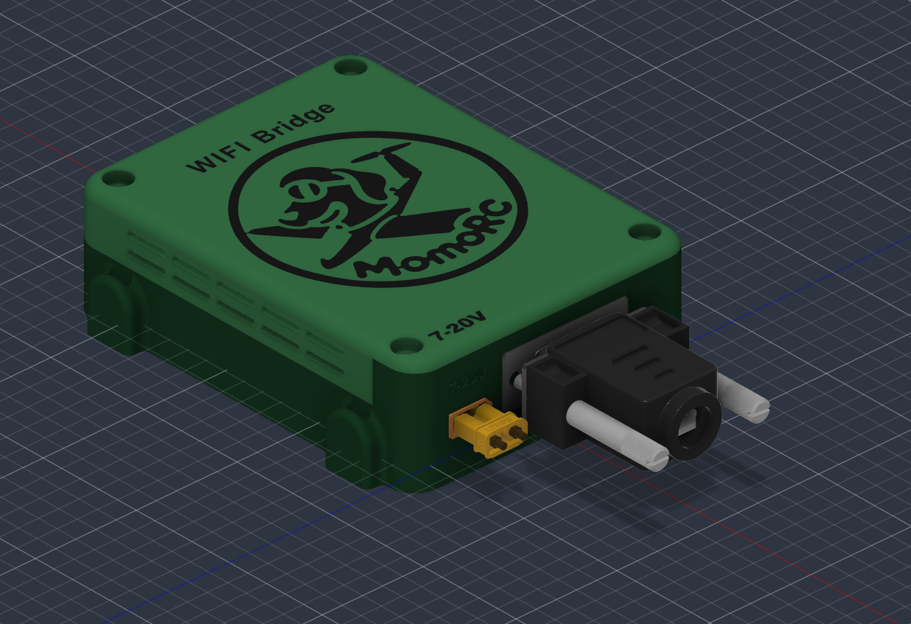
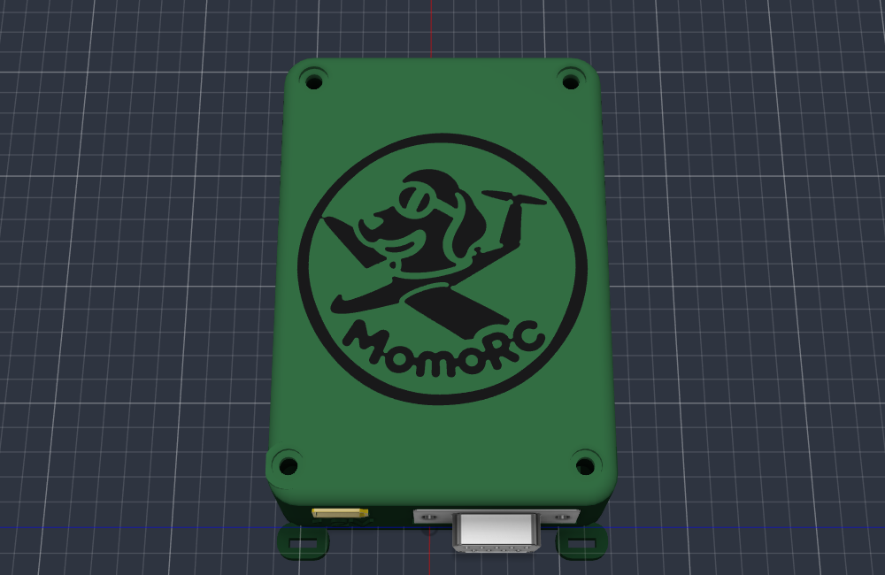
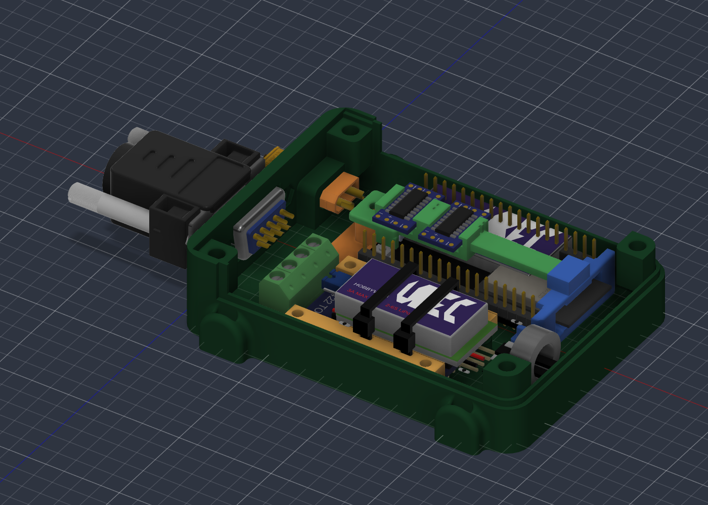
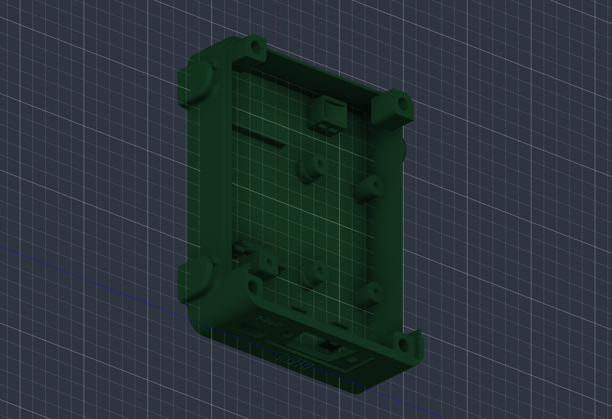
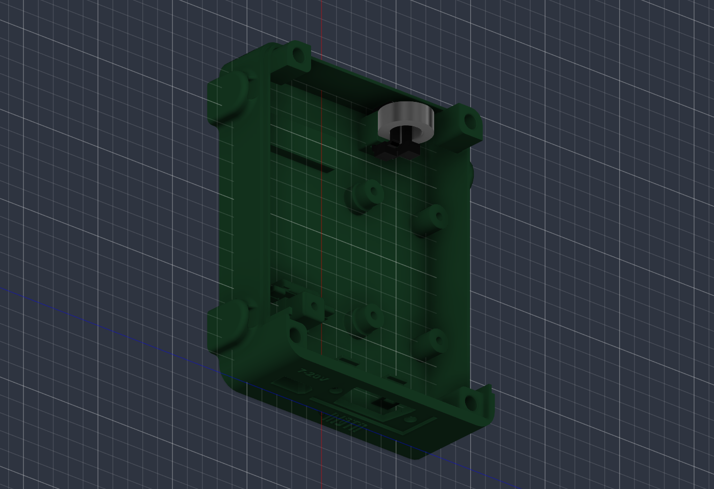
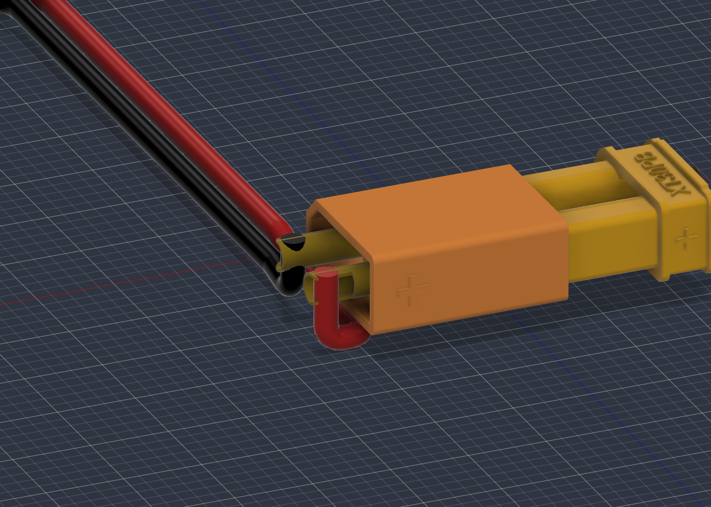
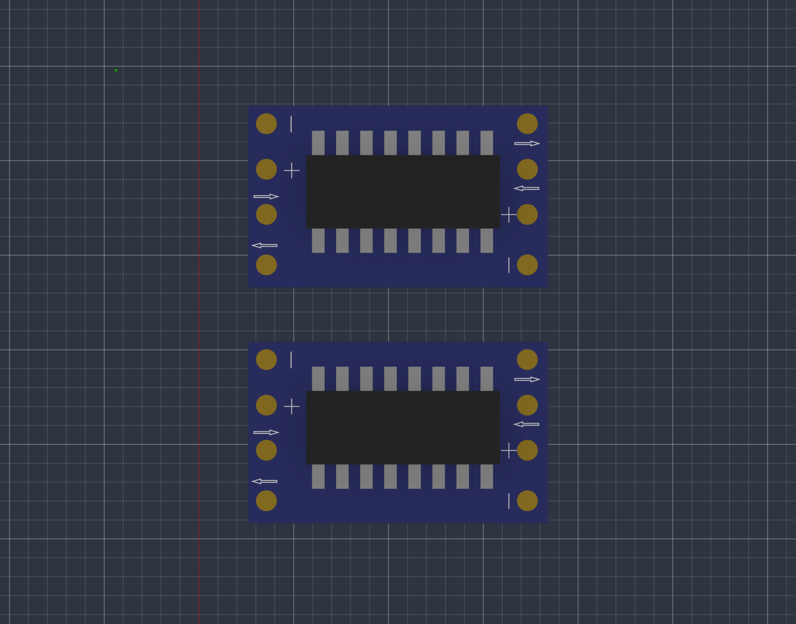
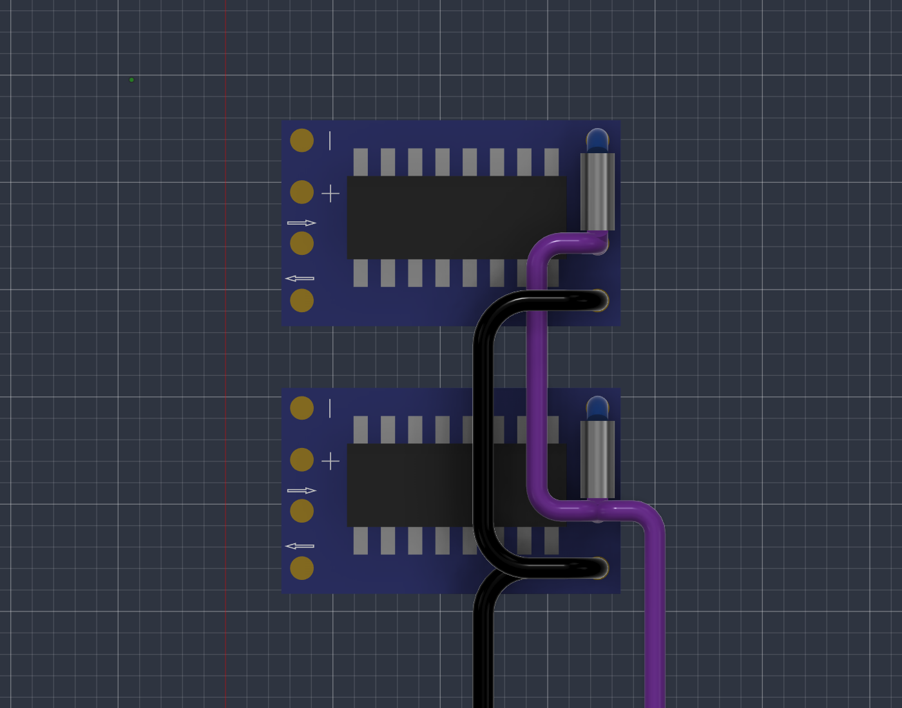

# Housing body v1 (prototype)

The enclosure fit revision uses [layout v4](../layout-v4/README.md) with a restored floor datum, revised connector wall, rounded corners around the front insert seats, an integral ESP32 antenna holder and the hood. Open `Housing body - Wire Generator harness` in Fusion or use the [standalone archive](housing-enclosure-fit.f3d) for the current bench design (S136). See the [design rules](../../../docs/hardware/housing.md#rules) and [physical fit checks](../../../docs/project/open-items.md#housing).

<b>🖼️ Show the base with the hood off</b> (click to expand)

<b>🖼️ Show the previous ferrite cradle and tie routing</b> (click to expand)

| File | Use |
| --- | --- |
| [housing-enclosure-fit.f3d](housing-enclosure-fit.f3d) | Standalone housing v16 assembly with the selected Wire Generator harness, continuous schematic ferrite leads, saved wire colours and RS-422 pair bands (S93), embedded board references, the integral ESP32 antenna holder, the [reinforced floor guides](../../../docs/hardware/housing.md#floor-guide), the single-tie ferrite cradle, the provisional DE-9 stops, the module ground J3-1 → mod2 R4 as a native sweep (S101), the shield-supported RS-232 clamp and revised base (S102), and the supply voltage sense: R-V1 at the XT30, the grey wire to J2-5, R-V2 and C-V beside the J2 header (S128), with the documented colours restored on seven combined conductors (S129) and C-V as a ceramic disc against the side wall (S130), and the module receive wires on the R1 pads (S136). Open with *File › Open › Open from my computer* |
| [housing-base.f3d](housing-base.f3d), `housing-hood.f3d` | Fusion part archives. Toggle the optional ESP32 nose support in the base archive. Edit hood lettering in the full assembly, which contains the insert references |
| [housing-base.3mf](housing-base.3mf), [housing-hood.3mf](housing-hood.3mf), [housing-logo-insert.3mf](housing-logo-insert.3mf) | Print meshes at Z = 0. Base floor down. Hood and logo top down in shared coordinates. Load hood and logo together as one object with two parts. Assign deep blue to the hood and the base's dark green to the logo and text |
| [housing-base-with-esp32-support.3mf](housing-base-with-esp32-support.3mf) | Optional base print with the breakaway support platform under the ESP32 retaining nose (S89). Slice floor down with support allowed to start on the model. Remove the slicer support and snap off the platform before inserting the ESP32 |
| [rs232-clamp.3mf](rs232-clamp.3mf) | Shield-supported RS-232 clamp (S102). Print top up in PETG with support under the arm and slot plate. Check the shield seat and both board slots on a test print |
| `housing-logo-insert.f3d`, `housing-logo-insert.step` | Logo and "7-20V" insert as its own part |
| `housing-base.step`, `housing-hood.step` | Solid models in the layout frame |
| [routing-study.json](routing-study.json) | Housing v16 CAD lengths, reference waypoints and [harness cutting table](../../../docs/hardware/housing.md#harness-cutting) inputs |
| [routing-verification.json](routing-verification.json) | Native geometry and export checks for S64 and S87 |

| Part | Main dimensions (mm) |
| --- | --- |
| Base tray | Outside 92 × 70 (78 wide over the tie loops), floor 2.5, side walls to Y 10 plus a 1.75 mm seam lip (inner 0.9). Connector wall 3.0 thick to Y 20. The hood seats on the post tops, the wall shoulder and the connector-wall and corner tops |
| Hood | Outside 92 × 70, top at Y 22.5, top 2.5 thick with four 4.6 mm thick spots over the posts. Top edges R3, vertical corners R6 (inner corners R4), skirt 0.9 over the lip with 0.2 gap |
| Corner posts | 8 × 8, tops at Y 17.9, inserts Ø4.0 × 6.7 deep with 0.2 entry chamfers. Insert centres (X, Z) are (7, −23.5), (7, 34.5), (85.8, −23.3) and (85.8, 34.3). Free faces end at Y 8 with a 45° underside and R2 free vertical edges. The inside front corners above and below the post seats are R4, with R3.8 mating relief on the hood |
| Cover screws | Four DIN 912 M3 × 6 screws. Counterbores Ø6.0 × 3.1, heads flush, 1.5 under each head, Ø3.4 clearance. Each screw reaches 4.5 into its insert |
| Connector wall | XT30 pocket 10.55 × 5.25, centre (Y, Z) = (6.5, −12.3), through the 3 mm wall and 5 mm-deep collar. DE-9 centre (Y, Z) = (10, 11.5). Flange recess 31.6 × 13.2 × 1.0, D-shaped cutout 19.9 × 11.5 narrowing to 16.7 at the bottom, two Ø3.4 holes at 25.0 spacing. See the [provisional nut stops](../../../docs/hardware/housing.md#connectors) |
| Labels | See the [housing marking dimensions](../../../docs/hardware/housing.md#rules). The hood inserts are readable from the connector end |
| Logo | MomoRC logo Ø56, a 0.6 mm insert flush with the hood top (two-colour print, the hood has the matching 0.6 mm recess), upright seen from the connector end; traced from the owner's bitmap with white lines widened and black slivers removed so every feature is at least 0.8 wide |
| Vents | 2 rows × 5 slots per long side, 10 × 1.5 with R0.5 corners (Fusion feature "Vent slot corners R0.5"), 2 mm ribs, at Y 12.5 and 16.5 |
| Tie loops | 4 × rounded pads on the long side walls, centres X 14 and 78: 12 long × 4 out, floor underside to Y 8.5 (half-round top R6), outer edges R1.5, wall blend R1.5; vertical tunnel 5.4 × 1.9 against the wall face, open top and bottom, corners R0.5, entries rounded R0.6 (top) and R0.5 (bed side), for 4.8 mm ties |

- Colours in the Fusion assembly (S171): deep blue hood (`#162E59`) with logo and text in the base's dark green (`#1E5F34`). Standalone part files and preview images show the earlier palette.
- Dimensions are in millimetres. X starts at the outside of the connector wall, Y rises from the floor top (Y 0), and Z runs across. The floor underside is at Y −2.5.
- The antenna-end holder is part of `Base tray`. Expand `Base tray` in Fusion and toggle `ESP32 holder - breakaway support platform` to show or hide the print-only component. The v16 release opens with the platform visible (S93). To edit the removable USB clamp, activate its component under `ESP32 holder with RS-232 clamp`. To edit the carrier, activate `UBEC carrier` under `MAX490 and UBEC stack`.
- Mating plug: the [XT30PB-F](../../reference/amass-xt30-family/README.md) STEP model sits plugged onto the XT30 on the outside of the connector wall (reference component `XT30 female (reference)` in the Connector side group): mating face against the male front face (0.5 mm outside the wall), centred on the pocket, turned 180° about the plug axis from the first placement so the polarity matches the male, solder tails pointing away from the box; no intersection with the base, hood, connector plate, DE-9 or XT30 male (Fusion check). Included in the full Fusion assembly.
- Inside height is 20 mm. The ESP32 and MAX490 PCB undersides are 4.5 mm above the floor, with a 7.45 mm gap between the facing edges. The ferrite sits in the [integral cradle](../../../docs/hardware/housing.md#ferrite-cradle).
- With the base floor down, the DE-9 opening bridges 19.9 mm and the XT30 pocket bridges 10.55 mm. See S82 in the [source register](../../../docs/research/sources.md#source-register) and the [physical fit checks](../../../docs/project/open-items.md#housing).

- Harness colors: **GND black, +12 V red, +5 V orange**, 3.3 V pink, [individual signal colours](../../../docs/hardware/housing.md#harness-cutting). XT30 input colors match the molded +/− marks and the UBEC reference leads; output A/B colors follow the UBEC reference. Physical polarity still needs a bench check. The junction bodies reserve space only.

<b>🖼️ Show the XT30 polarity detail</b> (click to expand)

<b>🖼️ Show the earlier RS-232 pad check</b> (click to expand)

