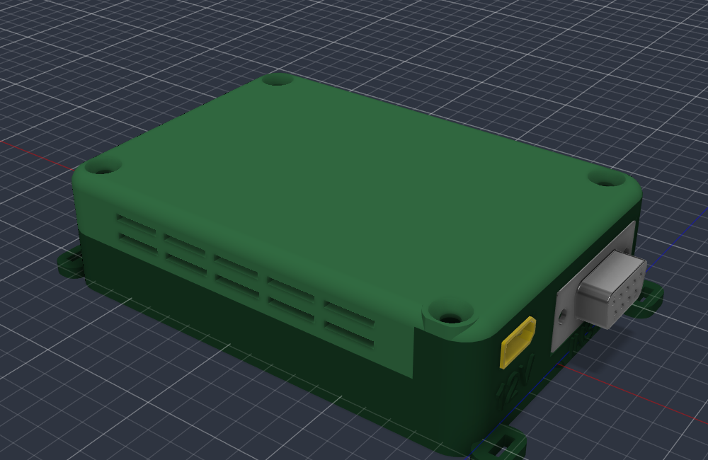
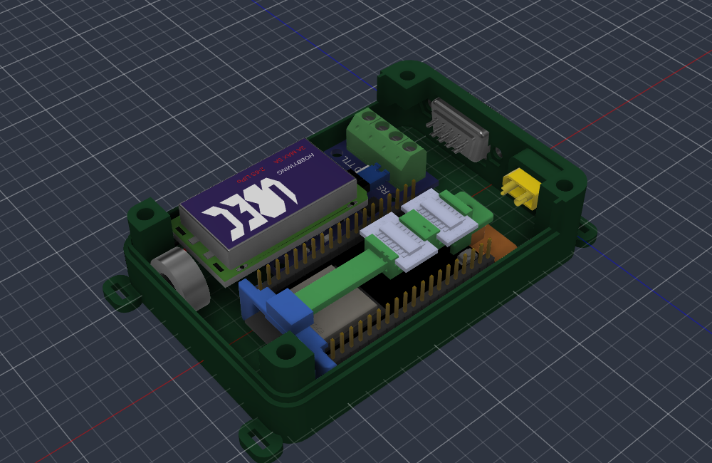

# Housing body v1 (prototype)

First housing prototype on [layout v4](../layout-v4/README.md): base tray with connector wall and corner posts, and the hood. Rules: [housing § 2](../../../docs/hardware/housing.md#rules). Built in Autodesk Fusion through MCP, 2026-11-13, in the document `Housing body - prototype v1` (a copy of `Housing layout - compact v4` with the XT30 moved 3.2 mm inward and the ferrite-ring placeholder 2 mm inward). Not printed yet.

<b>🖼️ Show the base with the hood off</b> (click to expand)

| File | Use |
| --- | --- |
| `housing-base.f3d`, `housing-hood.f3d` | Fusion archives of the two parts; open with *File › Open › Open from my computer* |
| `housing-base.3mf`, `housing-hood.3mf` | Print-ready meshes: base floor down, hood top down |
| `housing-base.step`, `housing-hood.step` | Solid models in the layout frame |

| Part | Main dimensions (mm) |
| --- | --- |
| Base tray | Outside 92 × 64 (104 long with the ears), floor 2.5, side walls to 10 above the floor top plus a 2 mm seam lip (inner 0.9); connector wall 3.0 and its corners full height to 20 |
| Hood | Outside 92 × 64, top 22.5 above the floor top, top 2.5 thick, top edges R3, vertical corners R6 (inner corners R4); skirt 0.9 over the lip with 0.2 gap |
| Corner posts | 8 × 8 (far posts rounded R3.8 to follow the inner corner, 2.0 mm around each insert), inserts Ø4.0 × 6.7 deep from the post tops (20 above the floor); XT30 corner merged with the XT30 collar; DE-9 corner hangs from 13.3 above the floor on a 45° gusset, insert hole open at the bottom |
| Cover screws | ISO 10642 M3 × 8 countersunk, 90° countersink about Ø7.0 in the hood top, Ø3.4 clearance |
| Connector wall | XT30 pocket 10.55 × 5.25 through wall and collar (centre Z −16.3, Y 14.5), collar 5 mm deep with R2 edges; DE-9 recess 31.6 × 13.2 × 1.0, cutout 19.9 × 11.5, holes Ø3.4 at 25.0, nut pockets 5.6 across flats × 1.0 deep from the inner face |
| Labels | Raised 0.6: "12V" (5 mm) below the XT30, "INSTR" (4 mm) below the DE-9 |
| Vents | 2 rows × 5 slots per long side, 10 × 1.5, 2 mm ribs, 12.5 and 16.5 above the floor top |
| Ears | 4 × (6 out × 10 wide × 2.5, flush with the floor underside and the side faces) off both short ends, slots 5.4 × 1.9 for 4.8 mm ties, 2 mm from the wall face |

- Colours in Fusion and STEP: base dark green, hood a lighter green.
- Units: millimetres. Layout frame: X from the outer face of the connector wall, Y up from the floor top, Z across.
- Clash check in Fusion: no intersection with the holders, boards or connectors, except 0.3 mm³ with the XT30 reference model at its top face (model tolerance) and 0.5 mm³ with a small part of the oversized UBEC reference model at the far post on the MAX490 side.
- Placeholders: inside height 20 mm and the UBEC, MAX490 and ring positions come from layout v4 before the parts were measured. MAX490 posts, UBEC bridge and wire routing are not modelled; the hood is flat (no lower ring area or cut-off corner yet).
- Print checks: printed floor down, the DE-9 cutout top is a 19.9 mm bridge and the XT30 pocket top a 10.55 mm bridge (both were fit-tested printed flat, and the rule limit is 10 mm). The countersink at the XT30 corner sits in a small flat pad, because it is only 4 mm from the side face and would otherwise break into the R3 top edge.
