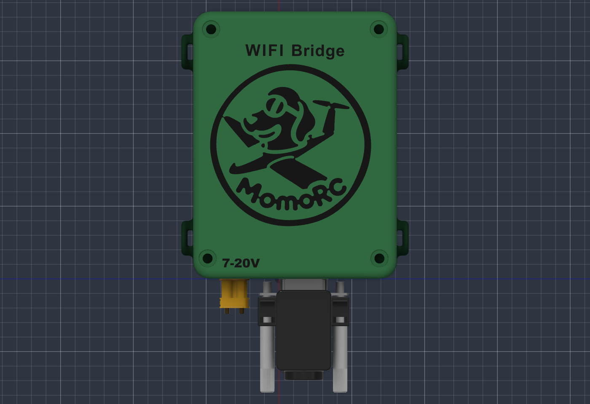
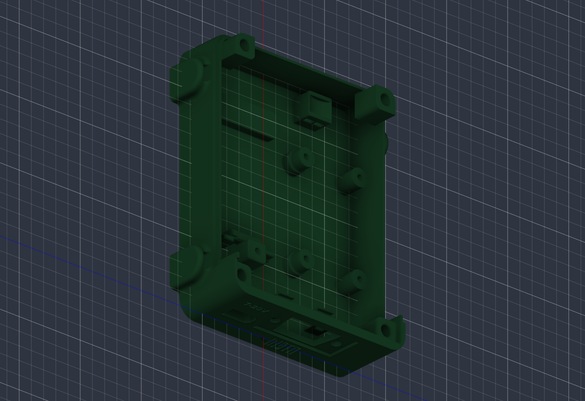
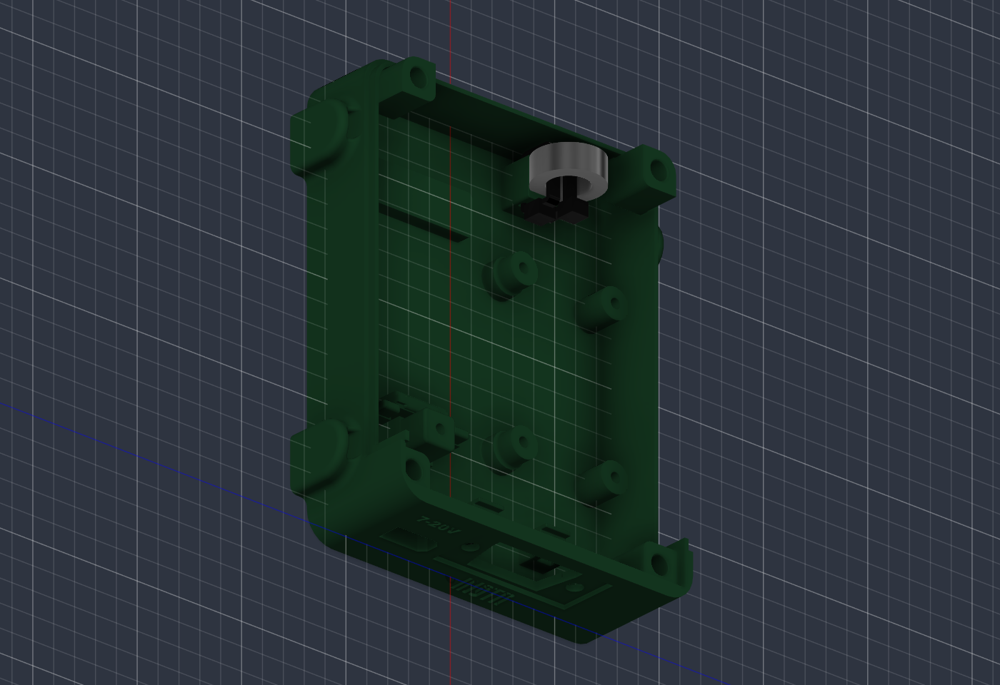
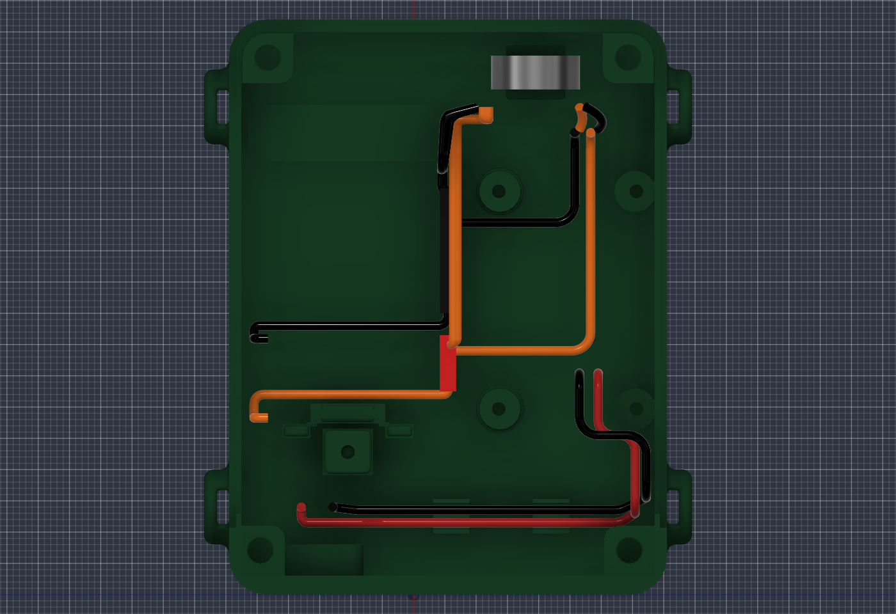
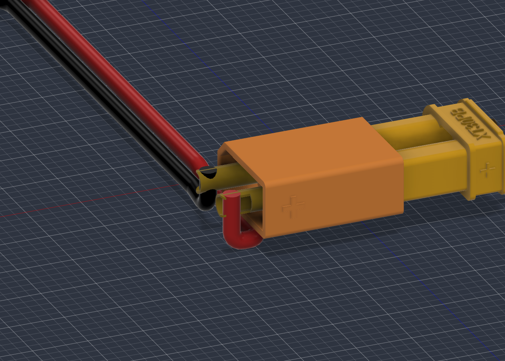
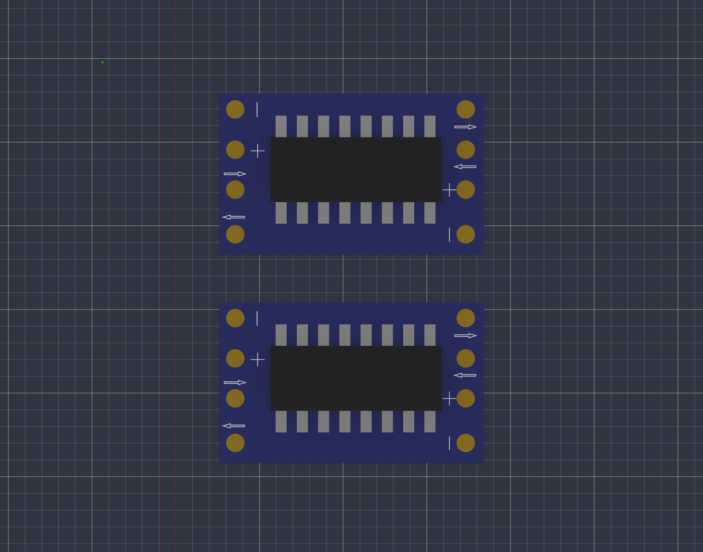
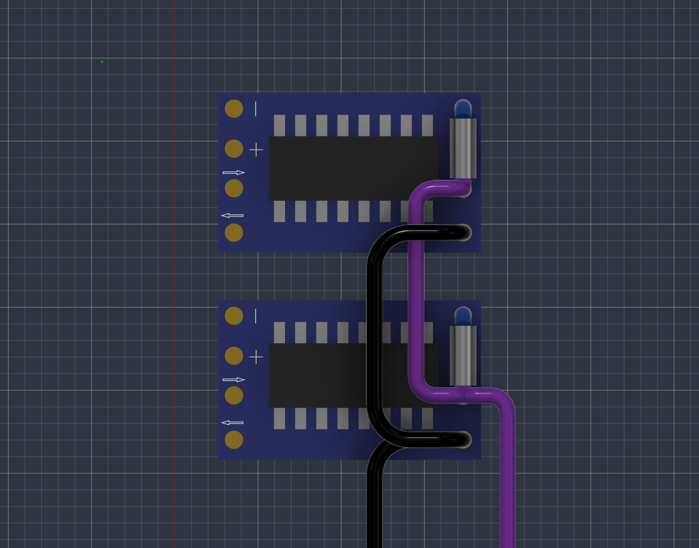

# Housing body v1 (prototype)

The housing uses [layout v4](../layout-v4/README.md) with a base tray, connector wall, corner posts and hood. Fusion `Housing body - prototype v1` v77 has a deeper base and a wider MAX490 side for cable routing. See the [design rules](../../../docs/hardware/housing.md#rules) and [physical fit checks](../../../docs/project/open-items.md#housing).

<b>🖼️ Show the base with the hood off</b> (click to expand)

<b>🖼️ Show the ferrite cradle and tie routing</b> (click to expand)

| File | Use |
| --- | --- |
| [housing-assembly.f3d](housing-assembly.f3d) | Full editable Fusion assembly with a hideable cable-harness component, the [measured UBEC](../../reference/ubec-hobbywing-3a/README.md), [measured ferrite ring](../../../docs/hardware/housing.md#contents) and a local copy of the MAX490 board. Open with *File › Open › Open from my computer*. |
| `housing-base.f3d`, `housing-hood.f3d` | Fusion archives of the two parts; the base includes the ESP32 USB support, MAX490 floor posts, ferrite cradle and two cable saddles. Open with *File › Open › Open from my computer* |
| `housing-base.3mf`, `housing-hood.3mf`, `housing-logo-insert.3mf` | Print-ready meshes, Z up: base floor down; hood and logo insert top down in the same coordinates. Load hood and logo insert together as one object with two parts (dark grey filament for the logo) |
| `housing-logo-insert.f3d`, `housing-logo-insert.step` | Logo and "7-20V" insert as its own part |
| `housing-base.step`, `housing-hood.step` | Solid models in the layout frame |
| [routing-study.json](routing-study.json) | Provisional wire diameters, baseline lengths and v77 lateral shifts |
| [routing-verification.json](routing-verification.json) | Native geometry and export checks for S64 |

| Part | Main dimensions (mm) |
| --- | --- |
| Base tray | Outside 92 × 70 (78 wide over the tie loops), floor 2.5, side walls to 13 above the floor top plus a 1.75 mm seam lip (inner 0.9); connector wall 3.0 and its corners full height to Y 20.0, flat against the hood top underside. Set 0.25 back from the hood wherever it is not a seat: lip top and the two corner ends where the hood side walls butt on; the hood sits on the post tops, the wall shoulder at Y 10 and the connector-wall and corner tops at Y 20.0 |
| Hood | Outside 92 × 70, top 25.5 above the floor top, top 2.5 thick with four thick spots 4.6 thick (down to Y 17.9) over the posts, top edges R3, vertical corners R6 (inner corners R4); skirt 0.9 over the lip with 0.2 gap |
| Corner posts | 8 × 8 (far posts rounded R3.8 to follow the inner corner, 2.0 mm around each insert), tops 20.9 above the floor, inserts Ø4.0 × 6.7 deep, entries chamfered 0.2; at the connector end the side and connector walls stay full height (Y 20.0) around the post top. Insert centres (X, Z): (7, −24.5), (7, 34.5), (85.8, −23.3), (85.8, 34.3). Posts hang from the walls: free faces end at Y 8, the underside rises 45° from the walls to there (printable without support); free vertical edges R2. The XT30 corner post sits on the XT30 collar |
| Cover screws | DIN 912 M3 × 6 (head Ø5.4 × 2.9), counterbore Ø6.0 × 3.1 in the hood thick spots (at the XT30 corner the thick spot reaches 1.0 further out and down to 19.35 into a 1.0 × 0.9 rebate (floor 19.1) in the base side wall top at X 3–11, so the counterbore keeps 0.8 of wall), heads flush, 1.5 under the head, Ø3.4 clearance; screw reaches 4.5 into the insert, tip 2.2 above the hole bottom |
| Connector wall | XT30 pocket 10.55 × 5.25 through wall and collar (centre Z −15.3, Y 6.5), its two corners at the chamfered side filled 45° with 1.3 legs (0.2 clear of the chamfers); collar 5 mm deep, from the floor to 2 above the pocket, 2 mm wall toward the corner post, top free edge R2; DE-9 (centre Z 8.5, Y 10) recess 31.6 × 13.2 × 1.0, D-shaped cutout 11.5 high, 19.9 wide for the top 2.5 and narrowing to 16.7 at the bottom (sides 10° like the rear body, 0.25 clear), holes Ø3.4 at 25.0, nut pockets 5.6 across flats × 1.0 deep from the inner face |
| Labels | See the [housing marking dimensions](../../../docs/hardware/housing.md#rules). The hood inserts are readable from the connector end |
| Logo | MomoRC logo Ø56, a 0.6 mm dark grey insert flush with the hood top (two-colour print, the hood has the matching 0.6 mm recess), upright seen from the connector end; traced from the owner's bitmap with white lines widened and black slivers removed so every feature is at least 0.8 wide |
| Vents | 2 rows × 5 slots per long side, 10 × 1.5 with R0.5 corners (Fusion feature "Vent slot corners R0.5"), 2 mm ribs, at Y 12.5 and 16.5 |
| Tie loops | 4 × rounded pads on the long side walls, centres X 14 and 78: 12 long × 4 out, floor underside to Y 8.5 (half-round top R6), outer edges R1.5, wall blend R1.5; vertical tunnel 5.4 × 1.9 against the wall face, open top and bottom, corners R0.5, entries rounded R0.6 (top) and R0.5 (bed side), for 4.8 mm ties |

- Colours in Fusion and STEP: base dark green, hood a lighter green. Logo insert dark grey.
- Units: millimetres. Layout frame: X from the outer face of the connector wall, Y up from the original floor datum, Z across. The floor top is at Y −3 and the underside at Y −5.5.
- Fusion archive: 75 occurrences and 409 timeline items, including the hideable harness, separate 5V-J/GND-J space envelopes, all five resistors, the MAX490 board’s 150 bodies, UBEC carrier, upright ferrite and cable-tie fit envelopes. The four screw reference solids are omitted. Carrier/post verification: [carrier model notes](../ubec-carrier/README.md).
- Mating plug: the [XT30PB-F](../../reference/amass-xt30-family/README.md) STEP model sits plugged onto the XT30 on the outside of the connector wall (reference component `XT30 female (reference)` in the Connector side group): mating face against the male front face (0.5 mm outside the wall), centred on the pocket, turned 180° about the plug axis from the first placement so the polarity matches the male, solder tails pointing away from the box; no intersection with the base, hood, connector plate, DE-9 or XT30 male (Fusion check). Included in the full Fusion assembly.
- Layout: inside height 23 mm. The UBEC sits on the [four-screw carrier](../ubec-carrier/README.md); the ferrite sits upright in the [integral cradle](../../../docs/hardware/housing.md#ferrite-cradle), with two ties through its centre. The ring model is the bare core; the winding envelope was checked separately. Lead approaches and departures are modelled; actual ferrite turns are not. The hood is flat.
- Print checks: printed floor down, the DE-9 cutout top is a 19.9 mm bridge and the XT30 pocket top a 10.55 mm bridge (both were fit-tested printed flat, and the rule limit is 10 mm). The connector face has 2.7 mm of wall between the XT30 pocket and the DE-9 recess; the XT30 collar stays 0.8 mm clear of the nearer DE-9 nut pocket.

- **Resize verification:** the hood seats without solid overlap. The ESP32 and MAX490 PCB undersides are 7.5 mm above the floor, with a 7.45 mm gap between the facing PCB edges. The adjusted harness envelopes clear the enclosure and carrier driver paths. See S64 in the [source register](../../../docs/research/sources.md#source-register) and the [physical fit checks](../../../docs/project/open-items.md#housing).

- Harness colors: **GND black, +12 V red, +5 V orange**, 3.3 V violet, logic blue. XT30 input colors match the molded +/− marks and the UBEC reference leads; output A/B colors follow the UBEC reference. Physical polarity still needs a bench check. The junction bodies reserve space only.

<b>🖼️ Show the floor routing and cable saddles</b> (click to expand)

<b>🖼️ Show the XT30 polarity detail</b> (click to expand)

<b>🖼️ Show the RS-232 pad check</b> (click to expand)

