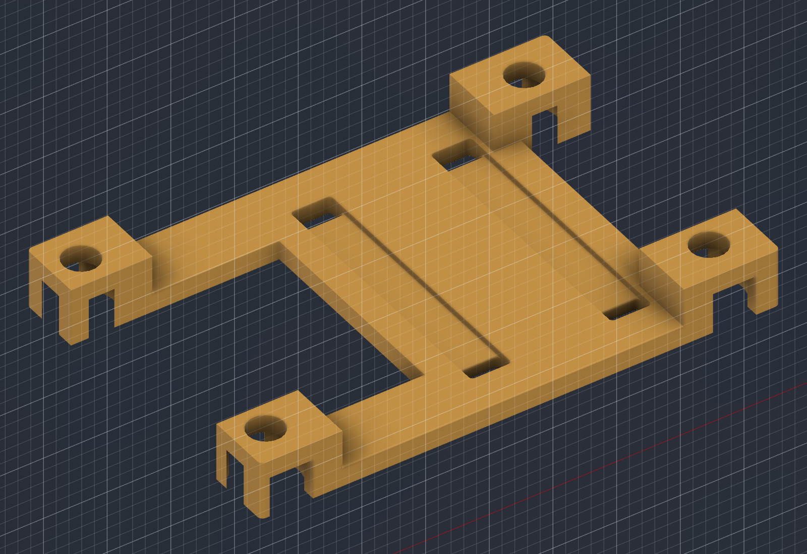
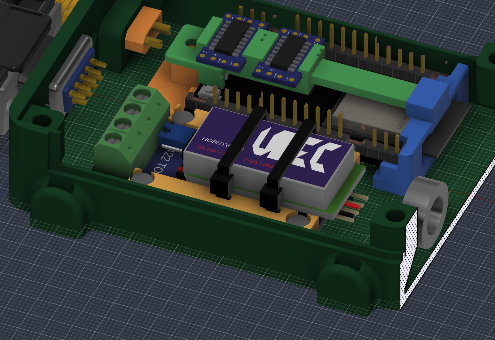

# UBEC carrier

Four-screw carrier above the MAX490 board, with two cable ties holding the UBEC. Dimensions, fasteners and assembly instructions: [housing § 2.4](../../../docs/hardware/housing.md#ubec-carrier).

| File | Use |
| --- | --- |
| [ubec-carrier.f3d](ubec-carrier.f3d) | Editable Fusion part, 22 timeline items |
| [ubec-carrier.step](ubec-carrier.step) | Solid model |
| [ubec-carrier.3mf](ubec-carrier.3mf) | Print mesh, millimetres, contact face on Z = 0; print as placed |
| [Housing assembly](../housing-body-v1/housing-assembly.f3d) | Installed carrier, raised UBEC, updated floor posts, screw and tie fit envelopes |

- Print in PETG with the housing settings, solid walls and **supports off**. The screw-seat roofs bridge at most 5.2 mm. This orientation is designed for support-free printing; it has not been sliced or printed.
- Screw bodies are smooth fit envelopes, not threads. Tie heads are assumed 4 × 4 × 3 mm envelopes, not a selected manufacturer's model.
- **Verification, 2026-11-13:** Fusion recompute passed for the added features; carrier archive reopened as one solid with its 22-item timeline. The final base archive includes the post-to-wall webs. The assembly archive reopened with all 67 occurrences and 269 timeline items, matching all live body names, volumes and bounds, with no external references. Carrier and updated base meshes checked for closed edges after welding coincident mesh vertices and for Z = 0 bed placement. Targeted assembly checks found only intended surface contacts with reference lettering/silkscreen, detailed in S53 in the [source register](../../../docs/research/sources.md#source-register). Physical fit, actual tie heads, thread holding, vibration and loaded temperature have not been tested. Fit checks: [open items](../../../docs/project/open-items.md#housing).
