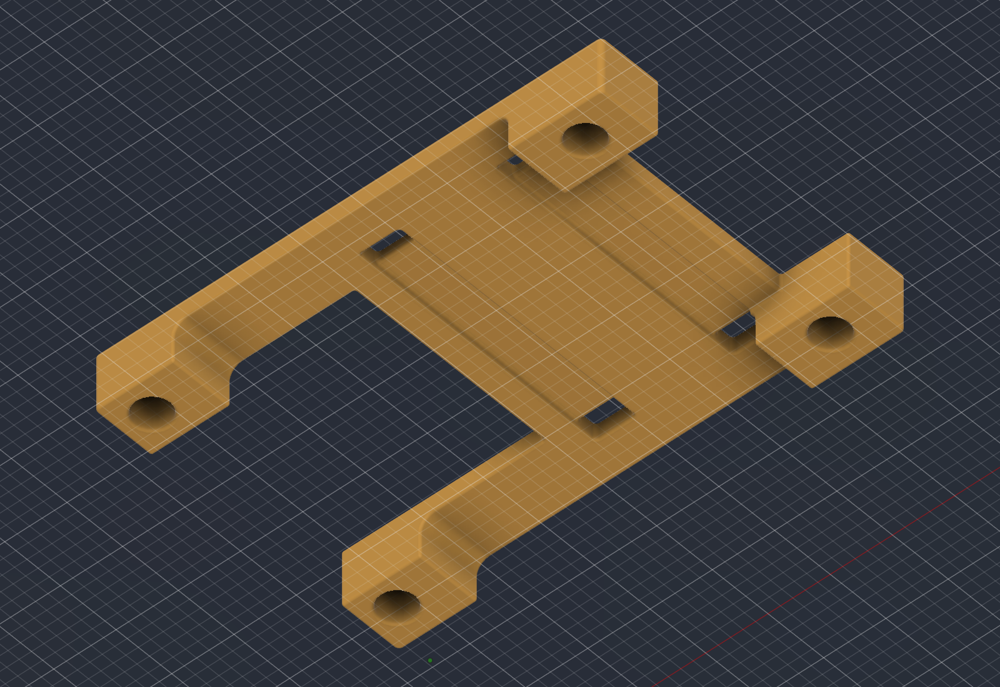

# UBEC carrier

Four-screw carrier above the MAX490 board, with two cable ties holding the UBEC. Dimensions, fasteners and assembly instructions: [housing § 2.4](../../../docs/hardware/housing.md#ubec-carrier).

| File | Use |
| --- | --- |
| [ubec-carrier.f3d](ubec-carrier.f3d) | Editable Fusion part |
| [ubec-carrier.step](ubec-carrier.step) | Solid model |
| [ubec-carrier.3mf](ubec-carrier.3mf) | Print mesh, millimetres, contact face on Z = 0; print as placed |
| [Housing assembly](../housing-body-v1/housing-assembly.f3d) | Installed carrier with flush, offset screw seats, raised UBEC, updated floor posts and tie fit envelopes |

Installed view: [current open housing assembly](../housing-body-v1/preview-open.png).

- Print in PETG with the housing settings, solid walls and **supports off**. The full-height legs start on the bed in the supplied orientation ([print dimensions](../../../docs/hardware/housing.md#ubec-carrier)). Support-free printing is intended; the part has not been sliced or printed.
- The assembly omits the four screw reference solids; the shared screws are still required for assembly. Tie heads are assumed 4 × 4 × 3 mm envelopes, not a selected manufacturer's model.
- **Current export verification, 2026-11-14:** the carrier archive reopened and recomputed as one solid. STEP reimport volume agrees within 0.001 mm³; the print mesh has closed, consistently oriented edges, no degenerate triangles and its bed face at Z = 0. The assembly retains the owner's existing carrier and tie-envelope geometry. Evidence: S59 in the [source register](../../../docs/research/sources.md#source-register); full assembly checks: [housing model notes](../housing-body-v1/README.md). Slicing, physical fit, thread holding, vibration and loaded temperature were not tested. Fit checks: [open items](../../../docs/project/open-items.md#housing).
