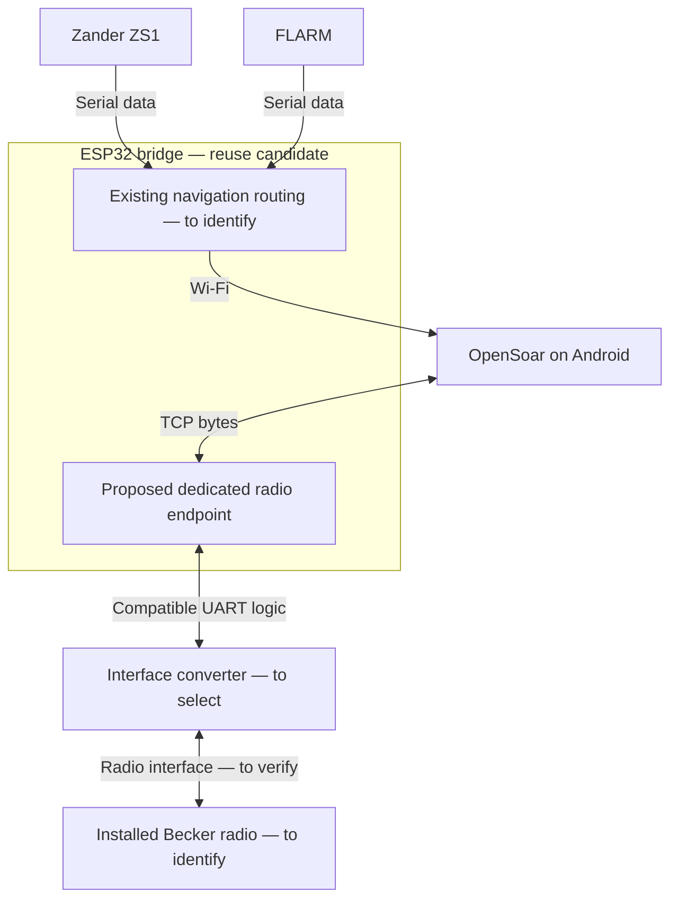

# Architecture and decisions

Updated 2026-11-08. **Proposed architecture only.** The actual installation is still unknown; its inventory belongs in [Project baseline](project-baseline.md#existing-installation--wp1-record).

## Logical proposal

OpenSoar would own radio framing, channel conversion and state/response handling. The bridge would forward counted binary bytes both ways, including zero and control bytes. It must tolerate arbitrary TCP read boundaries without injecting diagnostics or navigation data. The diagram does not allocate UARTs, pins, IP addresses or ports and does not authorize wiring. Three separate navigation/radio endpoints are not established as necessary.

The leading electrical candidate is a compatible 3.3 V UART/full-duplex RS-422 converter, conditional on WP1/WP2. The LXNAV RS232-to-RS422 adapter is a product-specific reference, not proof that the ESP32 needs an RS232 stage. See the preserved [manual findings](technical-investigation.md#follow-up-source-verification-2026-11-08).

## Decision record

Status vocabulary: **proposed → accepted → implemented → verified**, or **rejected/superseded**. Record decision date, owner authorization, evidence and replacement ID when status changes. Acceptance of a proposal is distinct from implementation authorization and bench acceptance.

### ADR-00 — repository as project record

- Status: **accepted for documentation workflow**, 2026-11-08, authorized by the repository-cleanup request.
- Decision: use the linked baseline, sources, architecture and roadmap as the shared record. Chat conclusions become project inputs only after evidence/status is recorded here. Keep one roadmap instead of a second backlog in chat or a new planning service.
- Consequence: each completed package updates only affected records and links its evidence. Existing detailed research remains available.

### ADR-01 — separate transparent radio path

- Status: **proposed**, not implemented.
- Choice: one bidirectional radio endpoint, isolated from existing navigation routing; keep protocol/state handling in OpenSoar. Prefer adapting the installed firmware if it meets R02/R03.
- Alternatives: a separate ESP32 dedicated to the radio; adapt a reviewed small bridge; use a larger configurable bridge; implement radio protocol/state in bridge firmware. The last option expands responsibilities and duplicates driver work.
- Tradeoff: reuse can minimize hardware changes, but spare UARTs and reliable buffering are unknown. A dedicated bridge adds hardware but may isolate resource contention.
- Decision gate: WP1 inventory plus WP2 interface evidence and WP3 routing/resource/license comparison. Record selected option and reasons before implementing it.

### ADR-02 — implementation and reuse baseline

- Status: **proposed**, selection open.
- Bounded source evaluation completed 2026-11-08: [Yuri versus basic AlphaLima](reviews/2026-11-08-yuri-bridge.md). Yuri remains the first external candidate based on bounded reads and routing; it still needs radio-only ownership, isolated diagnostics and checked bounded forwarding. Installed firmware comparison and owner selection remain open.
- Use pinned OpenSoaring source S01/S02 as the review baseline; verify the installed build separately. Investigate targeted upstream driver fixes before creating a permanent application fork.
- Candidate evaluation order: installed firmware first; Yuri-rage fork as the first small external bridge candidate; basic AlphaLima for comparison; DroneBridge as a dedicated-link alternative. This is the earlier research recommendation, not a tested ranking. Pro, XCVario and historical drivers remain references in [Related projects](related-projects.md).
- Decision gate: WP3 chooses firmware only after compatibility, required fixes, licenses and reproducibility are documented. WP4 records the minimal driver change plan. No replacement or code copying is approved by listing a candidate.
