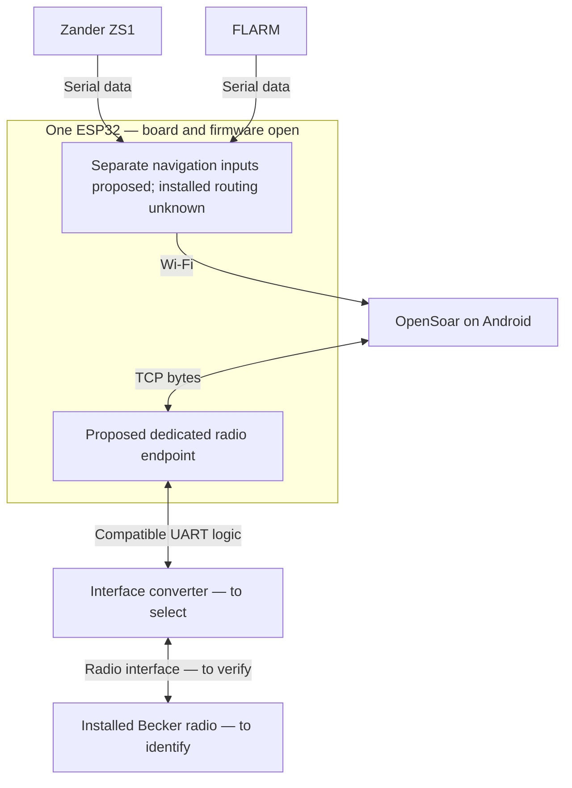

# Architecture and decisions

Updated 2026-11-08. **One ESP32 accepted as an owner constraint; board, interfaces and detailed routing remain proposed.** The actual installation is still unknown; its inventory belongs in [Project baseline](project-baseline.md#existing-installation--wp1-record).

## Logical proposal

OpenSoar would own radio framing, channel conversion and state/response handling. The bridge would forward counted binary bytes both ways, including zero and control bytes. It must tolerate arbitrary TCP read boundaries without injecting diagnostics or navigation data. The diagram does not allocate UARTs, pins, IP addresses or ports and does not authorize wiring. Three separate navigation/radio endpoints are not established as necessary.

The leading electrical candidate is a compatible 3.3 V UART/full-duplex RS-422 converter, conditional on WP1/WP2. The LXNAV RS232-to-RS422 adapter is a product-specific reference, not proof that the ESP32 needs an RS232 stage. See the preserved [manual findings](technical-investigation.md#follow-up-source-verification-2026-11-08).

## Hardware proposal — one ESP32

Proposed 2026-11-08, based on S08/S09. No purchase, wiring or firmware changes authorized. Recommend **Espressif ESP32-DevKitC V4 with ESP32-WROOM-32E** as a bench development board: it stays close to the classic ESP32 targeted by both bridge sketches and provides three hardware UARTs. Use the exact WROOM board variant; WROVER reserves GPIO16/17 internally. This development board is not an accepted aircraft installation design.

Prefer separate Zander and FLARM serial inputs and a bidirectional radio UART, with separate network device connections initially. This avoids a new NMEA multiplexer. Existing combined routing may be retained if Tom's evidence shows it is needed and preserves all required messages. OpenSoar's simultaneous device configuration and GPS-source priority still need verification.

### Candidate GPIO allocation

ESP32-side GPIO numbers only, not equipment connector pins. This is a resource-feasibility proposal derived from Espressif's GPIO matrix and board header documentation, not tested wiring.

| Function | UART | ESP32 RX | ESP32 TX | Condition |
| --- | --- | --- | --- | --- |
| Zander | UART0 | GPIO32 | GPIO33 reserved | Prefer receive-only if existing operation permits; do not connect TX until return-traffic need is resolved. |
| FLARM | UART1 | GPIO26 | GPIO27 reserved | Same condition; preserve existing declarations/settings workflows if required. |
| Becker | UART2 | GPIO16 | GPIO17 | Bidirectional through the matched electrical interface; WROOM variant required. |

The reviewed Yuri/AlphaLima defaults use RX/TX pairs 21/1, 16/17 and 15/4. Those are examples, not required assignments. This proposal keeps equipment away from GPIO1/3 used by USB/programming and avoids GPIO15, a boot-strapping pin. All three UART controllers are allocated: moving UART0 to GPIO32/33 does **not** create an extra debug UART. Application/framework/OTA Serial output must be disabled or moved outside equipment streams. UART0 boot/programming behavior and remapping must be checked on the chosen board before attaching equipment. Leave the proposed navigation TX paths physically disconnected only after confirming no existing return path is required.

### Interfaces and connector evidence

- **Zander:** the manufacturer-authored ZS1 manual D3029, 16.09.2004, page 46 (third-party mirror, S09) describes NMEA output on the PC cable's 9-pin D-sub pin 2 and ground on pin 5; optional NMEA input is pin 3. This refers to that PC connector, not the instrument's rear connector. The optional input accepts RMC only: do not assume it forwards FLARM traffic. A 3.3 V MAX3232-class RS-232 interface is a candidate, pending confirmation of the actual cable and electrical interface. Do not tie device transmitters together.
- **FLARM:** FTD-012 section 5 describes configurable RS-232 ports; the exact model's installation manual must supply connector orientation, pin numbers, power pins and port capabilities. Some Classic extension ports supply only PFLAU, so a spare socket is not automatically a full traffic/GPS source. Prefer a suitable documented data port, preserving current displays and loads; do not assume a passive splitter is acceptable. A 3.3 V RS-232 receiver/transceiver is proposed.
- **Becker:** retain the conditional 3.3 V UART/full-duplex RS-422 interface proposal. THVD1451 is a component-level candidate with separate transmit/receive pairs, not a selected module or finished circuit. Existing Becker manual pin findings remain **prior review** until Tom identifies the matching radio revision. Do not substitute a two-wire half-duplex RS-485 board. Termination, polarity, grounding, protection and isolation remain to be designed from the matched manual and installation.
- **Power:** use one documented board supply path for bench work. Aircraft supply voltage, protection and converter requirements await Tom. A regulated 5 V board input is a possible later approach, not authorization to attach aircraft power; avoid simultaneous USB/header powering. Isolation and enclosure choices remain open.

### Pinning and cabling proposal for comparison with the installation

Owner requested this proposal on 2026-11-08 before Tom's inspection. **Board, wiring and firmware choices remain open.** The following is a candidate connection schedule, not an instruction to connect equipment. GPIO assignments refer to the proposed WROOM DevKitC; module terminal names are functional labels, not guaranteed silkscreen names or IC package pin numbers. Connector mating-face versus solder-side views and cable continuity must be recorded before a final harness drawing is released.

| Cable / signal | Equipment end — conditional reference | Interface path | Proposed ESP32 end |
| --- | --- | --- | --- |
| Z1: Zander data out | PC-cable D-sub pin 2, per S09 manual p.46 | RS-232 receiver input → 3.3 V receiver output | GPIO32 / UART0 RX |
| Z2: optional Zander return | PC-cable D-sub pin 3, per same manual | RS-232 driver output ← 3.3 V driver input | GPIO33 / UART0 TX; reserve, connect only if required |
| ZG: Zander signal reference | PC-cable D-sub pin 5 | Interface signal reference; grounding/isolation design pending | Logic-side GND according to selected interface design |
| F1: FLARM data out | Model-specific TX pin **TBD** | RS-232 receiver input → 3.3 V receiver output | GPIO26 / UART1 RX |
| F2: optional FLARM return | Model-specific RX pin **TBD** | RS-232 driver output ← 3.3 V driver input | GPIO27 / UART1 TX; reserve, connect only if required |
| FG: FLARM signal reference | Model-specific signal-ground pin **TBD** | Interface signal reference; grounding/isolation design pending | Logic-side GND according to selected interface design |
| B1 pair: Becker status to bridge | Candidate J1 pins 2 TX2+ / 9 TX2− | Differential receiver +/− inputs → 3.3 V receiver output | GPIO16 / UART2 RX |
| B2 pair: bridge commands to Becker | Candidate J1 pins 3 RX2+ / 10 RX2− | Differential driver +/− outputs ← 3.3 V driver input | GPIO17 / UART2 TX |
| BG: Becker reference | Candidate J1 pin 21 D_GND | Reference connection to be resolved from matching manual and interface design | No unconditional ground-bond instruction |

Becker numbers above reproduce **prior review** of DV14307.03 Issue 06, section 2.5.3.2, p.59, and the LXNAV product diagram; see [manual evidence](technical-investigation.md#follow-up-source-verification-2026-11-08). They are not confirmed for Tom's radio. D_GND is labelled discrete-line ground; the final grounding decision cannot be made from that label alone. Match radio model/revision, interface availability, connector view and polarity before adopting any row. FLARM connector pins remain deliberately unspecified until its model is identified; Zander numbers apply to the documented PC cable, not an assumed rear-panel pinout.

Proposed cable organization and improvements to evaluate:

- Keep Zander, FLARM and Becker as separately labelled branches with serviceable connectors, strain relief and a documented pin-to-pin schedule. Select connector types and cable lengths after inspecting space and existing harnesses. Do not cut or replace working cables simply to match this proposal.
- Use one twisted pair for B1 and a separate twisted pair for B2 as the proposed RS-422 cable arrangement. Specify cable impedance, termination locations/values, reference conductor and shield bonding only after checking the matched radio/interface requirements and actual cable run. A shield is not a substitute for a defined signal reference.
- Keep 3.3 V logic connections within the bridge assembly as a proposed layout rule; carry the matched equipment-level signals along external branches. RS-232 and RS-422 paths use different converter functions. Do not connect instrument serial outputs directly to GPIO or combine independent TX outputs.
- Preserve required navigation return paths and existing FLARM displays. Receive-only branches are a simplification to evaluate, not an accepted removal of functionality. Document port loading and fan-out before proposing splitters.
- Give power a separate documented branch: source **TBD** → protection/conversion **TBD** → one selected board supply input. Choose conductor sizes, fuse/protection, regulator, grounding/isolation and USB servicing arrangement from the actual supply and load requirements; no aircraft power pin assignment is proposed yet.
- Prefer the proposed GPIO reassignment over the upstream defaults if board checks confirm it: it avoids equipment wiring on USB/programming pins and GPIO15. Preserve the benefit only if firmware diagnostics and startup behavior are also controlled; remapping alone is insufficient.

When Tom's information arrives, compare each row as **retain / improve / incompatible / unresolved**, with evidence, reason and effect on existing functions. Preserve a working arrangement where appropriate; recommend changes when they improve compatibility, maintainability or interference control. An improvement recommendation remains a proposal until accepted; this comparison does not require copying the current installation unchanged.

### OpenSoar baseline and pending inputs

Use latest released OpenSoar as the owner's planning assumption, pinned for this review to **7.46.26 (2026-10-30), b2e745cfddfe0150f6ed7db467ac18c321b38d01**. The release page lists Android builds and labels Becker support WIP. No installation/update was performed; newer releases must be reviewed rather than silently replacing the pinned baseline.

Tom owns the pending equipment information: exact radio model/part and HW/SW revisions, FLARM model and available ports, Zander cable/connector mapping, existing signal paths and any return traffic, power source/voltage, and occupied connections. No deadline assumed. Until available, these proposals establish resource allocation and research leads, not final wiring.

Verification for this increment: reviewed S09 manufacturer board/UART documentation, ZS1 manual text, FLARM ICD section 5 and OpenSoar release index/notes; reused pinned S08 bridge findings and explicitly labelled prior Becker evidence. Checked document consistency, local references and whitespace. No build, firmware change, schematic electrical validation, board test or navigation/radio measurement. Goal agreement and one-board constraint are accepted; board, wiring, firmware and physical acceptance remain open. The added cable schedule was cross-checked against the existing S09 Zander/GPIO references and explicitly labelled prior Becker manual evidence; FLARM pins, cable specifications and final ground/power design remain unresolved.

## Decision record

Status vocabulary: **proposed → accepted → implemented → verified**, or **rejected/superseded**. Record decision date, owner authorization, evidence and replacement ID when status changes. Acceptance of a proposal is distinct from implementation authorization and bench acceptance.

### ADR-00 — repository as project record

- Status: **accepted for documentation workflow**, 2026-11-08, authorized by the repository-cleanup request.
- Decision: use the linked baseline, sources, architecture and roadmap as the shared record. Chat conclusions become project inputs only after evidence/status is recorded here. Keep one roadmap instead of a second backlog in chat or a new planning service.
- Consequence: each completed package updates only affected records and links its evidence. Existing detailed research remains available.

### ADR-01 — separate transparent radio path

- Status: **proposed**, not implemented. Owner accepted the one-ESP32 constraint on 2026-11-08; detailed interfaces and protocol responsibilities remain proposed.
- Choice: one bidirectional radio endpoint, isolated from existing navigation routing; keep protocol/state handling in OpenSoar. Prefer adapting the installed firmware if it meets R02/R03.
- Alternatives: a separate ESP32 dedicated to the radio (historical alternative, outside the current one-board constraint); adapt a reviewed small bridge; use a larger configurable bridge; implement radio protocol/state in bridge firmware. The last option expands responsibilities and duplicates driver work.
- Tradeoff: reuse can minimize hardware changes, but spare UARTs and reliable buffering are unknown. A dedicated bridge adds hardware but may isolate resource contention.
- Decision gate: WP1 inventory plus WP2 interface evidence and WP3 routing/resource/license comparison. Record selected option and reasons before implementing it.

### ADR-02 — implementation and reuse baseline

- Status: **proposed**, selection open.
- Bounded source evaluation completed 2026-11-08: [Yuri versus basic AlphaLima](reviews/2026-11-08-yuri-bridge.md). Yuri remains the first external candidate based on bounded reads and routing; it still needs radio-only ownership, isolated diagnostics and checked bounded forwarding. Installed firmware comparison and owner selection remain open.
- Use pinned OpenSoaring source S01/S02 as the review baseline; verify the installed build separately. Investigate targeted upstream driver fixes before creating a permanent application fork.
- Candidate evaluation order: installed firmware first; Yuri-rage fork as the first small external bridge candidate; basic AlphaLima for comparison; DroneBridge as a dedicated-link alternative. This is the earlier research recommendation, not a tested ranking. Pro, XCVario and historical drivers remain references in [Related projects](related-projects.md).
- Decision gate: WP3 chooses firmware only after compatibility, required fixes, licenses and reproducibility are documented. WP4 records the minimal driver change plan. No replacement or code copying is approved by listing a candidate.
