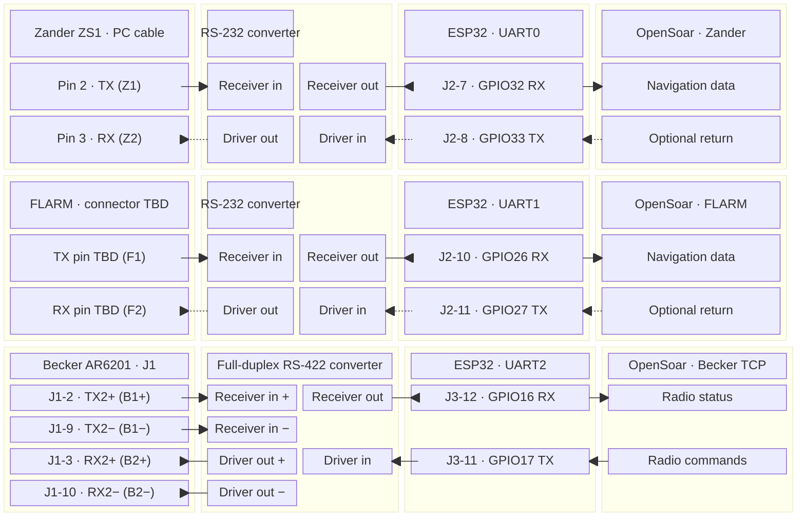
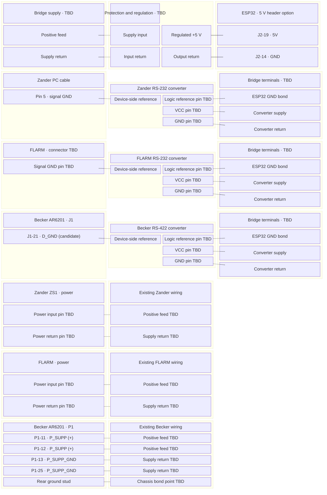

# Pinning, cabling and routing

**Proposal for comparison with Tom’s installation.** Board, interfaces, equipment pins and firmware remain open. This document brings each signal path and its pin table together; the [README](../README.md#architecture-overview) contains the project-level overview.

GPIO numbers refer to the candidate ESP32-DevKitC V4 with WROOM-32E. Equipment pins are conditional references, not verified installed wiring. Converter labels describe functions, not module terminal names or IC package pins. Connector views, actual cable continuity, grounding and serial settings must be resolved before building a harness.

## Connection and routing diagram

### Logical connections

Each terminal has its own box on the device or converter. Arrows show data direction. Dashed arrows mark reserved navigation returns. Converter terminal names describe functions. Confirm the selected module's pin numbers before wiring.

UART0–2 belong to one ESP32. Converter-to-ESP32 signals use 3.3 V logic. OpenSoar connects over Wi-Fi. Network ports, navigation transport and OpenSoar source priorities still need confirmation. Keep navigation and diagnostics out of the Becker connection.

### Bridge power and ground

The drawing covers the bridge and the existing instrument power paths. Dashed lines indicate connections to verify or design. Select one ESP32 supply input. The drawing shows the 5 V header option. Micro USB and the 3.3 V header are alternatives. Converter supply rails, shared grounds, isolation and shielding remain open. See [S09 and S10](sources.md#rechecked-facts).

The Becker P1 pin numbers apply to the variants covered by Issue 06. Match the installed radio before using them. Zander and FLARM power connectors remain TBD. Preserve the existing instrument feeds.

## ESP32 pin allocation

The table lists ESP32 GPIO numbers. The logical drawing adds the corresponding DevKitC header positions from [Espressif’s board documentation (S09)](sources.md#rechecked-facts). The UART assignments remain a proposal.

| Function | UART | ESP32 RX | ESP32 TX | Condition |
| --- | --- | --- | --- | --- |
| Zander | UART0 | GPIO32 | GPIO33 reserved | Prefer receive-only if existing operation permits; do not connect TX until return-traffic need is resolved. |
| FLARM | UART1 | GPIO26 | GPIO27 reserved | Same condition; preserve existing declarations/settings workflows if required. |
| Becker | UART2 | GPIO16 | GPIO17 | Bidirectional through the matched electrical interface; WROOM variant required. |

The reviewed Yuri/AlphaLima defaults use RX/TX pairs 21/1, 16/17 and 15/4. Those are examples, not required assignments. This proposal keeps equipment away from GPIO1/3 used by USB/programming and avoids GPIO15, a boot-strapping pin. All three UART controllers are allocated: moving UART0 to GPIO32/33 does **not** create an extra debug UART. Application/framework/OTA Serial output must be disabled or moved outside equipment streams. UART0 boot/programming behavior and remapping must be checked on the chosen board before attaching equipment. Leave the proposed navigation TX paths physically disconnected only after confirming no existing return path is required.

## Zander ZS1

**Zander:** the manufacturer-authored ZS1 manual D3029, 16.09.2004, page 46 (third-party mirror, S09) describes NMEA output on the PC cable's 9-pin D-sub pin 2 and ground on pin 5; optional NMEA input is pin 3. This refers to that PC connector, not the instrument's rear connector. The optional input accepts RMC only: do not assume it forwards FLARM traffic. A 3.3 V MAX3232-class RS-232 interface is a candidate, pending confirmation of the actual cable and electrical interface. Do not tie device transmitters together.

| Signal | Equipment connector | Converter path | ESP32 pin |
| --- | --- | --- | --- |
| Z1: Zander data out | PC D-sub pin 2: TX | RS-232 in → logic out | GPIO32 / UART0 RX |
| Z2: optional Zander return | PC D-sub pin 3: RX | RS-232 out ← logic in | GPIO33 / UART0 TX (reserved) |
| ZG: Zander signal reference | PC D-sub pin 5: GND | Signal reference (design open) | GND connection TBD |

## FLARM

**FLARM:** FTD-012 section 5 describes configurable RS-232 ports; the exact model's installation manual must supply connector orientation, pin numbers, power pins and port capabilities. Some Classic extension ports supply only PFLAU, so a spare socket is not automatically a full traffic/GPS source. Prefer a suitable documented data port, preserving current displays and loads; do not assume a passive splitter is acceptable. A 3.3 V RS-232 receiver/transceiver is proposed.

| Signal | Equipment connector | Converter path | ESP32 pin |
| --- | --- | --- | --- |
| F1: FLARM data out | Model-specific TX pin **TBD** | RS-232 in → logic out | GPIO26 / UART1 RX |
| F2: optional FLARM return | Model-specific RX pin **TBD** | RS-232 out ← logic in | GPIO27 / UART1 TX (reserved) |
| FG: FLARM signal reference | Model-specific signal-ground pin **TBD** | Signal reference (design open) | GND connection TBD |

## Becker radio

**Becker:** retain the conditional 3.3 V UART/full-duplex RS-422 interface proposal. THVD1451 is a component-level candidate with separate transmit/receive pairs, not a selected module or finished circuit. Existing Becker manual pin findings remain **prior review** until Tom identifies the matching radio revision. Do not substitute a two-wire half-duplex RS-485 board. Termination, polarity, grounding, protection and isolation remain to be designed from the matched manual and installation.

| Signal | Equipment connector | Converter path | ESP32 pin |
| --- | --- | --- | --- |
| B1+ status | J1 pin 2: TX2+ | Receiver + input | GPIO16 via receiver output |
| B1− status | J1 pin 9: TX2− | Receiver − input | Same receiver as B1+ |
| B2+ command | J1 pin 3: RX2+ | Driver + output | GPIO17 via driver input |
| B2− command | J1 pin 10: RX2− | Driver − output | Same driver as B2+ |
| BG: Becker reference | Candidate J1 pin 21 D_GND | Reference design TBD | GND connection TBD |

Becker numbers above reproduce **prior review** of DV14307.03 Issue 06, section 2.5.3.2, p.59, and the LXNAV product diagram; see [manual evidence](technical-investigation.md#follow-up-source-verification-2026-11-08). They are not confirmed for Tom's radio. D_GND is labelled discrete-line ground; the final grounding decision cannot be made from that label alone. Match radio model/revision, interface availability, connector view and polarity before adopting any row. FLARM connector pins remain deliberately unspecified until its model is identified; Zander numbers apply to the documented PC cable, not an assumed rear-panel pinout.

## Power and cable construction

**Power:** use one documented board supply path for bench work. Aircraft supply voltage, protection and converter requirements await Tom. A regulated 5 V board input is a possible later approach, not authorization to attach aircraft power; avoid simultaneous USB/header powering. Isolation and enclosure choices remain open.

- Keep Zander, FLARM and Becker as separately labelled branches with serviceable connectors, strain relief and a documented pin-to-pin schedule. Select connector types and cable lengths after inspecting space and existing harnesses. Do not cut or replace working cables simply to match this proposal.
- Use one twisted pair for B1 and a separate twisted pair for B2 as the proposed RS-422 cable arrangement. Specify cable impedance, termination locations/values, reference conductor and shield bonding only after checking the matched radio/interface requirements and actual cable run. A shield is not a substitute for a defined signal reference.
- Keep 3.3 V logic connections within the bridge assembly as a proposed layout rule; carry the matched equipment-level signals along external branches. RS-232 and RS-422 paths use different converter functions. Do not connect instrument serial outputs directly to GPIO or combine independent TX outputs.
- Preserve required navigation return paths and existing FLARM displays. Receive-only branches are a simplification to evaluate, not an accepted removal of functionality. Document port loading and fan-out before proposing splitters.
- Use the [power and ground drawings](#bridge-power-and-ground) to record the installed feed and return wiring. Choose conductor sizes, protection, regulation, grounding, isolation and USB servicing from the actual supply and load requirements.
- Prefer the proposed GPIO reassignment over the upstream defaults if board checks confirm it: it avoids equipment wiring on USB/programming pins and GPIO15. Preserve the benefit only if firmware diagnostics and startup behavior are also controlled; remapping alone is insufficient.

When Tom's information arrives, compare each row as **retain / improve / incompatible / unresolved**, with evidence, reason and effect on existing functions. Preserve a working arrangement where appropriate; recommend changes when they improve compatibility, maintainability or interference control. An improvement recommendation remains a proposal until accepted; this comparison does not require copying the current installation unchanged.

## Evidence and remaining checks

GPIO and Zander/FLARM references are recorded in [S09](sources.md#rechecked-facts); Yuri/AlphaLima defaults come from [S08](reviews/2026-11-08-yuri-bridge.md). Becker pin references retain their prior-review status. No electrical or device test has been performed. Tom’s equipment identity, occupied connectors, return-traffic needs and power information are needed to resolve the provisional rows.
