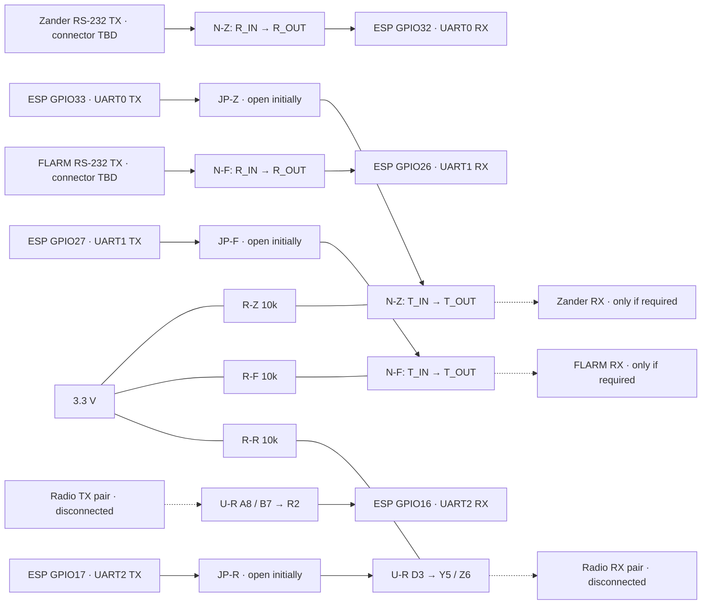
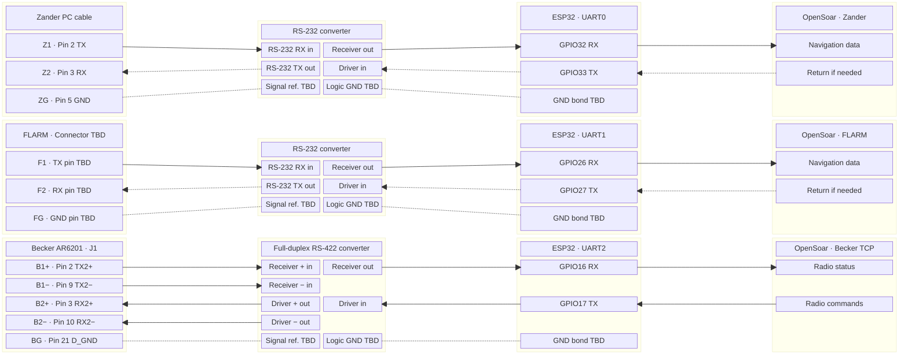
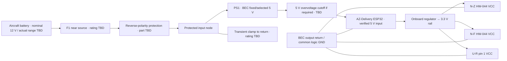
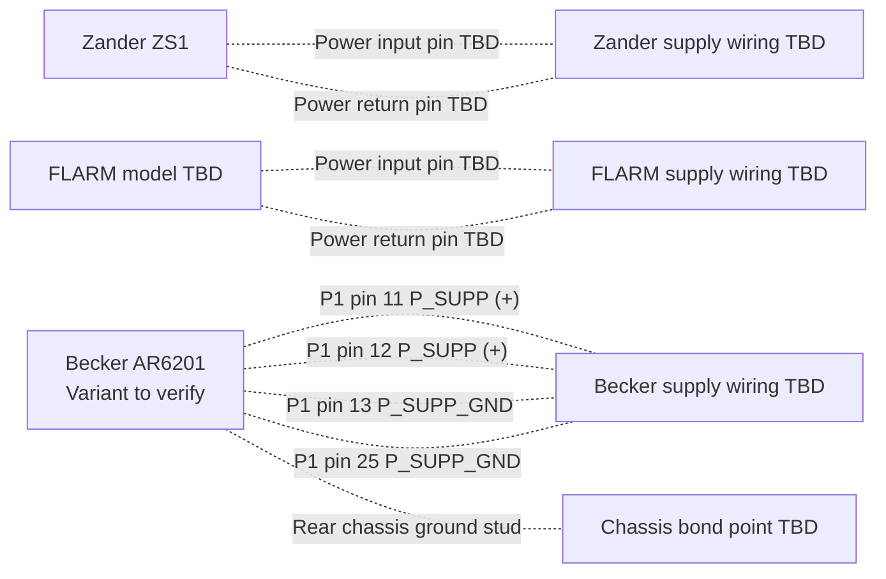

# Pinning, cabling and routing

**Bench design for new, separate hardware; preserve Tom’s existing setup as backup ([ADR-03](architecture.md#adr-03--new-hardware-with-the-existing-setup-as-backup)).** The owner selected an AZ-Delivery ESP32 WROOM-32 board, pictured HW-044 RS-232 modules, a 5 V BEC and the ESP32 board's 3.3 V output for the converters. Exact board/BEC variants and electrical acceptance remain open. The [README](../README.md#architecture-overview) contains the project-level overview.

GPIO numbers below are proposed assignments for the classic ESP32 WROOM-32; physical header positions await the exact AZ-Delivery model. They replace the earlier Espressif WROOM-32E board assumption. Equipment pins remain conditional references. The bench tables distinguish IC pins, module labels and equipment connectors; the general diagram uses functional labels.

## Bench build package — 2026-11-08

Scope: schematic, parts list, connection schedule and proposed checks for R02/R03/R06/R07. This is a document deliverable, not an assembled or tested circuit. S16 records the owner's selections; S17–S19 record component and power references. Instrument connectors stay disconnected during initial tests. Final aircraft power protection, radio matching and navigation return paths are unresolved.

### Parts list

Quantities describe one new bridge. Use separate parts from the backup. Product links identify references, not verified stock, prices or completed purchases.

| Ref / quantity | Part or specification | Status / use |
| --- | --- | --- |
| MCU / 1 | Owner-selected AZ-Delivery ESP32 WROOM-32 board | Selected family; exact model, regulator and header layout still needed. AZ-Delivery Dev Kit C V4 is a reference, not an assumed match (S17) |
| N-Z, N-F / 2 | HW-044 DB9-to-logic modules matching the supplied photo | Selected; apparent MAX3232 marking, VCC/RXD/TXD/GND header. Identify both boards and verify routing/3.3 V operation before use |
| PS1 / 1 | Owner-selected model-aircraft BEC, reported 2S–4S input, set to 5 V | Nominal 12 V aircraft battery source reported; BEC model, actual source range, polarity, output tolerance, ripple and built-in protections TBD; do not substitute the old photographed UBEC's specifications |
| U-R / 1 | TI THVD1451D, SOIC-8 | Proposed bench RS-422 transceiver; full duplex, no enable pin. Requires soldering; not a selected finished radio interface |
| Adapter / 1 | SOIC-8 to 2.54 mm breakout, e.g. Adafruit 1212 | Use its SOIC side; verify pin numbering after soldering. A pack may contain more than one board |
| C-R / 1 | 100 nF ceramic, at least 10 V | Close between U-R pins 1 and 4; HW-044 capacitors are already fitted but their values/condition need inspection |
| R-Z, R-F, R-R / 3 | 10 kΩ, 1%, at least 0.125 W | Proposed pull-ups from each converter's logic data input to 3.3 V; retain an idle input when its TX jumper is open |
| JP-Z, JP-F, JP-R / 3 | Removable 2-pin links, 2.54 mm, with labelled shunts | ESP32 TX-to-converter-input links; initially open. These are not power switches or driver-disable controls |
| Bench interconnect / 1 set | Carrier/prototyping board, insulated wire, headers, standoffs and labelled test points | Solder the transceiver/decoupling locally; keep differential test leads short. No production PCB required for this increment |
| DB9 access / 2 | Breakout connectors mating with the actual HW-044 sockets/plugs | Choose gender after inspection; access contacts by their moulded numbers, not a guessed front/rear view |
| Radio bench terminal / 1 | Labelled 5-way connector for A, B, Y, Z and logic reference | Lab use only; instrument connector and shielding remain TBD |
| F1, reverse-polarity stage, transient/OV protection | See power table below | Functions specified; ratings and exact components held for BEC/source/board data. This part of the BOM is not ready to order |
| Equipment harness, termination, enclosure | Model-specific connectors, cable and resistors | Hold for matched manuals, cable lengths and enclosure space. No fixed 120 Ω termination is assumed |

Bench tools: multimeter, a current-limited supply suitable for the chosen BEC input, and an oscilloscope for startup/ripple and logic-level checks. A logic analyser used later must see logic-level signals only. Availability of these tools has not been confirmed.

### Bench signal schematic

The separate power diagram below supplies all three converters at 3.3 V. Solid arrows are intended signal directions, not measured wiring. N-Z/N-F are functional MAX3232 paths; resolve the actual HW-044 header and DB9 contacts with the table before connecting them.

Opening a TX logic jumper leaves a powered converter driving its idle output. For receive-only navigation, also leave the converter's RS-232 output physically disconnected from the instrument. THVD1451 similarly has no driver-disable input: opening JP-R does not make Y/Z high impedance. The radio cable remains unplugged until its interface and local-control coexistence are established.

### HW-044 identification and connection table

**Unpowered continuity first.** The photo proves the labels and apparent IC family, not the PCB netlist. Do not equate a header marked RXD with either ESP32 RX or TX without tracing it. Locate IC pin 1 by its package mark; the following MAX3232 numbers refer to a 16-pin package, top view (S17). If the marking/package differs, obtain its matching datasheet first.

| Function | MAX3232 channel 1 / channel 2 pins | Connection after confirming the used channel |
| --- | --- | --- |
| Supply | 16 VCC; 15 GND | HW-044 VCC → board 3.3 V; GND → common logic GND; verify continuity |
| Logic output from instrument | 12 R1OUT / 9 R2OUT | Trace to the actual RXD or TXD header contact; connect N-Z to GPIO32, N-F to GPIO26 |
| Logic input toward instrument | 11 T1IN / 10 T2IN | Trace to the other header contact; N-Z ← JP-Z/GPIO33, N-F ← JP-F/GPIO27; 10k pull-up on the converter side |
| RS-232 input | 13 R1IN / 8 R2IN | Trace to DB9 contact and record its number; later receives instrument TX |
| RS-232 output | 14 T1OUT / 7 T2OUT | Trace to DB9 contact and record its number; initially leave off the instrument |
| Reference | 15 GND | Trace to DB9 reference contact; connector shell/shield bonding is a separate question |

Record each board's actual header labels and DB9 numbers before assembly; blanks are unresolved, not defaults. Check for any DB9 contacts tied together or to power. Do not assume a straight-through cable from connector appearance. Navigation reception needs the equipment TX → R_IN → R_OUT → ESP RX path; any return path is checked independently. Supplying the module with 5 V is outside this direct-3.3-V-logic bench design.

### RS-422 circuit and bench netlist

Proposed U-R is **THVD1451D, SOIC-8**, not a pin-compatible assumption about Tom's unidentified blue module. S18 pin diagram was visually checked. Fit C-R between VCC and GND at the IC; connect all bench logic grounds. No galvanic isolation is provided by this circuit.

| U-R pin | Net / connection |
| --- | --- |
| 1 VCC | ESP32 board 3.3 V output; C-R 100 nF to pin 4 |
| 2 R | GPIO16, UART2 RX |
| 3 D | JP-R to GPIO17, UART2 TX; R-R 10k to 3.3 V |
| 4 GND | ESP32 GND and bench reference terminal |
| 5 Y | Non-inverting driver output, bench TX+ |
| 6 Z | Inverting driver output, bench TX− |
| 7 B | Inverting receiver input, bench RX− |
| 8 A | Non-inverting receiver input, bench RX+ |

For a short, isolated local loopback only, connect Y→A and Z→B with no instrument attached. This checks the converter path, not Becker protocol behavior. Final cable termination, protection and radio signal-reference connection require the matched radio manual. Do not fit a resistor across Y/Z merely because an unrelated RS-485 module does so. THVD1452 or a protected module with enable control may be preferable if later interface requirements demand a disabled transmitter; changing it requires a different pin table.

### Proposed build and verification sequence

| Step | Work and pass condition | Stop condition |
| --- | --- | --- |
| 1 Identify | Exact ESP board/regulator, BEC voltage/current ratings, both HW-044 markings and continuity map recorded; U-R adapter orientation checked | Unknown supply pin, module direction or package |
| 2 Power only | Test BEC without electronics first, then under a suitable dummy load; measure startup, steady output, ripple and polarity against the selected board's permitted input. Verify fuse/protection design before using the intended source | Wrong/unstable voltage, unexplained current or missing source/BEC limits |
| 3 Board and converter rails | Add ESP32, then converters individually. Check 5 V/3.3 V during Wi-Fi load, converter activity and warm operation; measure regulator temperature and compare with its datasheet | Rail excursions, reset, excessive temperature or unbudgeted load |
| 4 Logic and loops | With equipment disconnected, verify converter outputs stay within the ESP32 input limits. Later test each UART and converter loop with counted binary patterns including 00, A5, FF and fragmented traffic | Byte loss/change, debug bytes, back-power or incorrect levels |
| 5 Navigation | After WP1/WP2 matching, verify each feed and required return path, then both together against the recorded baseline | Changed device operation or loss of required messages |
| 6 Radio and coexistence | After protocol/software prerequisites, WP7 checks actual standby, unchanged active, local controls and navigation under reconnect/power loss | A successful write alone is insufficient; keep physical acceptance open |

No checks in this table have been executed. UART0 diagnostics must be isolated before any instrument connection; remapping pins does not create an extra UART. Firmware/harness implementation is a later work item.

**Verification for this package:** reconciled S16 selections with the existing GPIO proposal; checked component pin functions and the THVD1451 top-view drawing, document links/anchors and whitespace. No HW-044 vendor schematic was supplied, so its header/DB9 mapping remains a continuity task. Mermaid source reviewed, not visually rendered. No purchases, code changes, electrical measurements or device tests. Exact board/BEC, power protection values, equipment connections and physical acceptance remain open.

## Connection and routing diagram

Each wired endpoint has its own pin or terminal box. Arrowheads on the wires show data direction; dotted arrows mark reserved navigation returns. Dotted lines without arrows mark unresolved ground or reference connections. Signal IDs match the device tables below.

UART0–2 belong to one ESP32. The rightmost links carry data over Wi-Fi.

Data between the converters and the ESP32 uses 3.3 V logic. Reference and shield bonding depend on the selected interfaces and installation.

Separate device connections are proposed to avoid a new navigation multiplexer. Network port numbers, navigation transport and OpenSoar source priorities remain to be configured from the installation evidence. No navigation or diagnostic bytes may enter the Becker connection.

### Bridge power and ground

The owner selected a model-aircraft BEC at **5 V**, feeding the ESP32 board, whose **3.3 V output supplies N-Z, N-F and U-R** (S16). This replaces the earlier generic supply branches. The exact AZ-Delivery board and BEC are still unidentified; use the verified board 5 V input, not an assumed VIN rating or the former Espressif J2 numbering. Initial testing is on the bench with instrument cables disconnected.

The transient clamp is a shunt branch, not a series regulator. Supply return routing across the protection/BEC depends on the chosen parts and whether the BEC is isolated. The drawing specifies functions; it is not a completed protection circuit.

| Function | Proposed requirement | Information needed to select it |
| --- | --- | --- |
| Input fuse F1 | Place near the source to protect the new supply wiring. BEC current limiting does not protect wiring upstream of the BEC | Wire rating, source fault capability, BEC input current/inrush and fuse time/current curve; do not choose from the BEC output amp rating alone |
| Reverse-polarity protection | Protect the BEC input with a correctly rated diode or MOSFET/ideal-diode circuit | Source range, BEC minimum input, current and allowed drop; do not casually put a dropping diode into the regulated 5 V feed |
| Input transient clamp | Assess TVS plus source impedance/fuse coordination for the actual supply environment | Highest normal input, BEC absolute maximum, pulse energy and clamp voltage at relevant current; a TVS standoff label alone is insufficient |
| BEC output overvoltage | Determine whether a sustained fault can exceed the board's 5 V-input limits; add a rated cutoff/eFuse if required | BEC fault behavior and onboard regulator ratings. A fuse alone does not limit voltage; a TVS alone does not guarantee sustained-overvoltage protection |
| Filtering / decoupling | Keep BEC leads and return loops short; follow its capacitor requirements. Add filtering only if measured noise warrants it | BEC stability requirements, startup/ripple and conducted/radiated interference observations; no arbitrary large output capacitor or LC filter selected |
| USB servicing | Owner will enforce one power source at a time: disconnect the BEC's 5 V feed before ordinary USB powering | Accepted manual procedure; no USB power-switching, OR-ing or added back-feed protection circuitry planned |

**3.3 V budget:** using the board regulator is the accepted plan, conditional on current and thermal checks. Espressif's recommendation of at least 500 mA supply capability for the ESP32 is not a promise of 500 mA spare at a development-board header (S19). Budget the ESP32/Wi-Fi load, board peripherals, both HW-044 modules including LEDs, and loaded RS-422 driver. Use the selected regulator's thermal limits and measured load; its nominal current rating alone is insufficient. For a linear regulator, approximate dissipation is `(5.0 - 3.3) × total 3.3 V current`; 300 mA would mean about 0.51 W, an illustration rather than a measurement. Revisit the power design if the board cannot support the load.

The owner reports a nominal 12 V aircraft battery. Battery chemistry, charging/maximum voltage, wiring transients and the exact BEC model remain unknown. The owner reports a 2S–4S BEC input rating; battery chemistry and absolute voltage/transient limits are not established by that label alone. No final fuse, TVS or overvoltage thresholds are specified until the relevant BEC/source/board limits are known. Aircraft power compatibility and installation remain outside this bench package.

### Existing instrument power and ground

Trace these paths during the installation survey and preserve the existing feeds. Becker pin numbers are manual references for the variants covered by Issue 06. Match the installed radio before using them. The Zander and FLARM supply connectors and pins still need confirmation. See [S10](sources.md#rechecked-facts).

## ESP32 pin allocation

ESP32-side GPIO numbers only, not equipment connector pins. This is a resource-feasibility proposal derived from Espressif's GPIO matrix and board header documentation, not tested wiring.

| Function | UART | ESP32 RX | ESP32 TX | Condition |
| --- | --- | --- | --- | --- |
| Zander | UART0 | GPIO32 | GPIO33 reserved | Prefer receive-only if existing operation permits; do not connect TX until return-traffic need is resolved. |
| FLARM | UART1 | GPIO26 | GPIO27 reserved | Same condition; preserve existing declarations/settings workflows if required. |
| Becker | UART2 | GPIO16 | GPIO17 | Bidirectional through the matched electrical interface; WROOM variant required. |

The reviewed Yuri/AlphaLima defaults use RX/TX pairs 21/1, 16/17 and 15/4. Those are examples, not required assignments. This proposal keeps equipment away from GPIO1/3 used by USB/programming and avoids GPIO15, a boot-strapping pin. All three UART controllers are allocated: moving UART0 to GPIO32/33 does **not** create an extra debug UART. Application/framework/OTA Serial output must be disabled or moved outside equipment streams. UART0 boot/programming behavior and remapping must be checked on the chosen board before attaching equipment. Leave the proposed navigation TX paths physically disconnected only after confirming no existing return path is required.

## Zander ZS1

**Zander:** the manufacturer-authored ZS1 manual D3029, 16.09.2004, page 46 (third-party mirror, S09) describes NMEA output on the PC cable's 9-pin D-sub pin 2 and ground on pin 5; optional NMEA input is pin 3. This refers to that PC connector, not the instrument's rear connector. The optional input accepts RMC only: do not assume it forwards FLARM traffic. The owner-selected HW-044 module is planned at 3.3 V, pending module continuity/level checks and confirmation of the actual cable and electrical interface. Do not tie device transmitters together.

| Signal | Equipment connector | Converter path | ESP32 pin |
| --- | --- | --- | --- |
| Z1: Zander data out | PC D-sub pin 2: TX | RS-232 in → logic out | GPIO32 / UART0 RX |
| Z2: optional Zander return | PC D-sub pin 3: RX | RS-232 out ← logic in | GPIO33 / UART0 TX (reserved) |
| ZG: Zander signal reference | PC D-sub pin 5: GND | Signal reference (design open) | GND connection TBD |

## FLARM

**FLARM:** FTD-012 section 5 describes configurable RS-232 ports; the exact model's installation manual must supply connector orientation, pin numbers, power pins and port capabilities. Some Classic extension ports supply only PFLAU, so a spare socket is not automatically a full traffic/GPS source. Prefer a suitable documented data port, preserving current displays and loads; do not assume a passive splitter is acceptable. The owner-selected HW-044 is planned at 3.3 V, pending module checks and confirmation that the selected FLARM port uses this interface.

| Signal | Equipment connector | Converter path | ESP32 pin |
| --- | --- | --- | --- |
| F1: FLARM data out | Model-specific TX pin **TBD** | RS-232 in → logic out | GPIO26 / UART1 RX |
| F2: optional FLARM return | Model-specific RX pin **TBD** | RS-232 out ← logic in | GPIO27 / UART1 TX (reserved) |
| FG: FLARM signal reference | Model-specific signal-ground pin **TBD** | Signal reference (design open) | GND connection TBD |

## Becker radio

**Becker:** retain the conditional 3.3 V UART/full-duplex RS-422 interface proposal. THVD1451 is a component-level candidate with separate transmit/receive pairs, not a selected module or finished circuit. Existing Becker manual pin findings remain **prior review** until Tom identifies the matching radio revision. Do not substitute a two-wire half-duplex RS-485 board. Termination, polarity, grounding, protection and isolation remain to be designed from the matched manual and installation.

| Signal | Equipment connector | Converter path | ESP32 pin |
| --- | --- | --- | --- |
| B1+ status | J1 pin 2: TX2+ | Receiver + input | GPIO16 via receiver output |
| B1− status | J1 pin 9: TX2− | Receiver − input | Same receiver as B1+ |
| B2+ command | J1 pin 3: RX2+ | Driver + output | GPIO17 via driver input |
| B2− command | J1 pin 10: RX2− | Driver − output | Same driver as B2+ |
| BG: Becker reference | Candidate J1 pin 21 D_GND | Reference design TBD | GND connection TBD |

Becker numbers above reproduce **prior review** of DV14307.03 Issue 06, section 2.5.3.2, p.59, and the LXNAV product diagram; see [manual evidence](technical-investigation.md#follow-up-source-verification-2026-11-08). They are not confirmed for Tom's radio. D_GND is labelled discrete-line ground; the final grounding decision cannot be made from that label alone. Match radio model/revision, interface availability, connector view and polarity before adopting any row. FLARM connector pins remain deliberately unspecified until its model is identified; Zander numbers apply to the documented PC cable, not an assumed rear-panel pinout.

## Power and cable construction

**Power:** follow the [BEC power and protection proposal](#bridge-power-and-ground): 5 V into the verified board input and board-derived 3.3 V for converters. Exact parts/ratings await the BEC, board and supply details; avoid simultaneous USB/header powering. Isolation and enclosure choices remain open.

- Keep Zander, FLARM and Becker as separately labelled branches with serviceable connectors, strain relief and a documented pin-to-pin schedule. Select connector types and cable lengths after inspecting space and existing harnesses. Do not cut or replace working cables simply to match this proposal.
- Use one twisted pair for B1 and a separate twisted pair for B2 as the proposed RS-422 cable arrangement. Specify cable impedance, termination locations/values, reference conductor and shield bonding only after checking the matched radio/interface requirements and actual cable run. A shield is not a substitute for a defined signal reference.
- Keep 3.3 V logic connections within the bridge assembly as a proposed layout rule; carry the matched equipment-level signals along external branches. RS-232 and RS-422 paths use different converter functions. Do not connect instrument serial outputs directly to GPIO or combine independent TX outputs.
- Preserve required navigation return paths and existing FLARM displays. Receive-only branches are a simplification to evaluate, not an accepted removal of functionality. Document port loading and fan-out before proposing splitters.
- Use the [power and ground drawings](#bridge-power-and-ground) to record the installed feed and return wiring. Choose conductor sizes, protection, regulation, grounding, isolation and USB servicing from the actual supply and load requirements.
- Prefer the proposed GPIO reassignment over the upstream defaults if board checks confirm it: it avoids equipment wiring on USB/programming pins and GPIO15. Preserve the benefit only if firmware diagnostics and startup behavior are also controlled; remapping alone is insufficient.

When Tom's information arrives, classify each proposed new connection as **compatible / change needed / unresolved**, with evidence, reason and effect on required functions. Preserve the original assembly and harness as backup; provide separate components and cabling for the new bridge. The new design can use different internal wiring while matching the instrument interfaces and preserving navigation functions. Recommendations remain proposals until accepted.

## Evidence and remaining checks

GPIO and Zander/FLARM references are recorded in [S09](sources.md#rechecked-facts); Yuri/AlphaLima defaults come from [S08](reviews/2026-11-08-yuri-bridge.md). Becker pin references retain their prior-review status. No electrical or device test has been performed. Tom’s equipment identity, occupied connectors, return-traffic needs and power information are needed to resolve the provisional rows.
