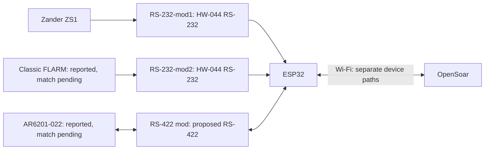
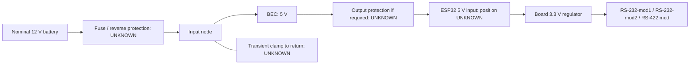

## Pinning, cabling and routing

**Proposed, untested wiring. UNKNOWN = unresolved; do not connect.** GPIO assignments proposed; physical ESP32 header positions UNKNOWN. Existing setup stays as backup.

**RS-232-mod1** = Zander HW-044 · **RS-232-mod2** = FLARM HW-044 · **RS-422 mod** = proposed Becker THVD1451D circuit; no finished module selected.

[BOM and bench checks](bench-build.md). Each table pairs equipment-side wires with ESP32-side wires through the converter. TX links start open; their contact numbers are UNKNOWN.

### Logical connections

Navigation returns: optional, listed below. Serial settings unverified; existing TCP endpoints [reported in baseline](project-baseline.md#pending-configuration), not selected/verified new-build settings. Radio bytes separate from navigation/diagnostics.

### Zander ZS1

| ZS1 PC cable | ↔ | RS-232-mod1 · DB9 | RS-232-mod1 · logic header | ↔ | ESP32 |
| --- | :-: | --- | --- | :-: | --- |
| 2 · TX | → | Input **UNKNOWN** | Output **UNKNOWN** | → | GPIO32 · RX |
| 3 · RX | ← | Output **UNKNOWN** | Input **UNKNOWN** | ← | GPIO33 · TX via Zander TX link |
| 5 · GND | — | Reference **UNKNOWN** | GND | — | GND contact **UNKNOWN** |

Conditional PC-cable DE9 reference; actual cable match pending. Return optional (RMC only); equipment-reference bonding unresolved.

Connector / module / ESP32 pictures and references

| ZS1 connector | RS-232-mod1 | ESP32 |
| --- | --- | --- |
| Matched view missing; private S25 crop unverified | HW-044 contact mapping UNKNOWN | Exact board/header positions UNKNOWN |

**Unmatched drawing crop (S25):** connector **B** labels: 2 GND, 3 RX-PC, 4 TX-PC. Red-circled **A** uses RX-SR/TX-SR and other functions. Revision/view unverified; complete installation drawing and actual cable mapping still needed. This crop does not authorize wiring.

Source: [S22 original handbook](reference/ZS1_Deutsch.pdf), D3029, 16.09.2004, pp.46/48; conditional **PC-cable DE9** reference, not rear-panel B numbering. Cable/interface match pending. The 3037 supplement specifies 4,800 baud with the ZS1 FLARM function off, 19,200 with it on; installed version/setting unverified. RJ45/DE9 shape does not establish voltage or compatible pinning.

### FLARM

| FLARM data port | ↔ | RS-232-mod2 · DB9 | RS-232-mod2 · logic header | ↔ | ESP32 |
| --- | :-: | --- | --- | :-: | --- |
| TX **UNKNOWN** | → | Input **UNKNOWN** | Output **UNKNOWN** | → | GPIO26 · RX |
| RX **UNKNOWN** | ← | Output **UNKNOWN** | Input **UNKNOWN** | ← | GPIO27 · TX via FLARM TX link |
| GND **UNKNOWN** | — | Reference **UNKNOWN** | GND | — | GND contact **UNKNOWN** |

Classic FLARM reported; actual port/view unverified. Return optional; equipment-reference bonding unresolved. Preserve displays; no assumed splitter.

Connector / module / ESP32 pictures and references

| FLARM connector | RS-232-mod2 | ESP32 |
| --- | --- | --- |
| Classic plug view: manual link below; actual cable unverified | HW-044 contact mapping UNKNOWN | Exact board/header positions UNKNOWN |

**PowerFLARM Core examples only; not the reported Classic FLARM.** DE9: device socket left, cable plug right, mating faces. [FTD-033 v1.1, pp.11/14](https://www.flarm.com/wp-content/uploads/2024/04/FTD-033-PowerFLARM-Core-Installation-Manual.pdf#page=11), © FLARM Technology AG. Retained as reference, not installed pinning.

**Conditional Classic reference (S23):** [F6/F7/F8/F9 manual v221, p.6](https://www.flarm.com/wp-content/uploads/2024/04/FLARM_InstallationManual_D.pdf#page=6): RJ45 Power/Data, TX 5, RX 6, ground 7/8 (also 4); supply 1/2. IGC numbering is reversed relative to common numbering: match the manual's plug view and trace the actual cable. Extension is a separate RJ12 socket. Installed pins remain UNKNOWN pending match.

Source: S23, FTD-012 §5 and Classic installation manual pp.6/7/9. RS-232 is not ESP32 GPIO signalling. Confirm baud/output; TCP port 2000 does not establish serial settings. Preserve displays/returns; the Classic manual permits one attached device per data port, so no assumed passive splitter.

Both RS-232 modules: connector photos/mapping pending. RXD/TXD direction requires [unpowered continuity](bench-build.md#hw-044-identification). For receive-only use, disconnect the RS-232 output at the instrument; an open TX link does not disable it.

### Becker radio

| Becker J1* | ↔ | RS-422 mod · line-side IC pins | RS-422 mod · logic IC pin | ↔ | ESP32 |
| --- | :-: | --- | --- | :-: | --- |
| 2 · TX2+ / 9 · TX2− | → | 8 · A / 7 · B | 2 · R | → | GPIO16 · RX |
| 3 · RX2+ / 10 · RX2− | ← | 5 · Y / 6 · Z | 3 · D | ← | GPIO17 · TX via Becker TX link |
| 21 · D_GND | — | Reference **UNKNOWN** | 4 · GND | — | GND contact **UNKNOWN** |

*Conditional J1 reference; installed revision unverified. Paired pins mean **two wires in matching order**. THVD1451D **IC numbers**, not module-header numbers. Breakout contacts, reference bonding and termination UNKNOWN. Keep radio unplugged pending checks; TX link does not disable the transceiver. No galvanic isolation.

Connector / module / ESP32 pictures and references

| Becker connector | RS-422 mod | ESP32 |
| --- | --- | --- |
| Reference rear view below; contacts not numbered | Proposed circuit; finished-module picture unavailable | Exact board/header positions UNKNOWN |

**Reference only — AR62X1/RT62X1 rear view; AR6201-(022) reported, revision UNKNOWN.** Callout 4 identifies J1, not contact 4. Contact numbering is not shown. [DV14307.03 Issue 06, p.57, Fig.18](https://www.becker-avionics.com/wp-content/uploads/00_Literature/6200_Series_IO_en.pdf#page=57), © Becker Avionics GmbH.

Sources: S10, DV14307.03 Issue 06 §2.5.3.2 p.59; S18 THVD1451D. [Circuit details](bench-build.md#rs-422-circuit).

### Power

| From | To | Status |
| --- | --- | --- |
| Protected BEC 5 V output | ESP32 5 V input contact **UNKNOWN** | Board/BEC identification pending |
| BEC output return | ESP32 GND contact **UNKNOWN** | Common logic ground; source return design pending |
| ESP32 3.3 V contact **UNKNOWN** | RS-232-mod1 VCC header | Proposed; module check pending |
| ESP32 3.3 V contact **UNKNOWN** | RS-232-mod2 VCC header | Proposed; module check pending |
| ESP32 3.3 V contact **UNKNOWN** | RS-422 mod IC pin 1, VCC | Proposed |
| ESP32 GND contact **UNKNOWN** | RS-232-mod1 GND header | Proposed; continuity pending |
| ESP32 GND contact **UNKNOWN** | RS-232-mod2 GND header | Proposed; continuity pending |
| ESP32 GND contact **UNKNOWN** | RS-422 mod IC pin 4, GND | Proposed |

Disconnect BEC 5 V before USB powering. [Protection/current budget](bench-build.md#power-protection-and-budget) pending. Keep existing instrument supplies unchanged.

### Open items

| Needed | Resolves |
| --- | --- |
| Device connector photos + exact model/revisions | Correct pin view; FLARM/Zander/Becker applicability |
| Both HW-044 sides, IC markings + continuity map | DB9 ↔ logic-header contacts |
| Exact ESP32 board/BEC + source limits | Header positions, current budget, protection |
| Return-traffic requirements + serial settings | Optional links and port configuration |
| Matched radio interface/reference/termination | Final radio circuit/harness |

Manual crops: [S20](sources.md#connector-reference-drawings). Installed connector matches unverified; no electrical acceptance.
