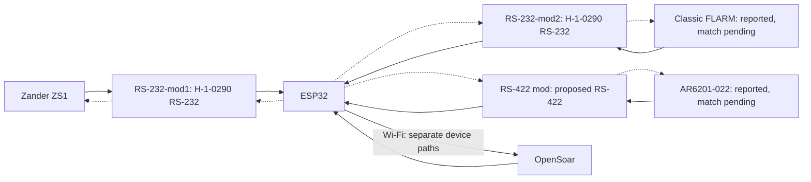
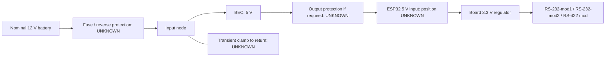

## 🔌 Pinning, cabling and routing

**Proposed, untested wiring. UNKNOWN = unresolved; do not connect.** GPIO assignments proposed; physical ESP32 header positions UNKNOWN. Existing setup stays as backup.

**RS-232-mod1** = Zander Hailege H-1-0290 · **RS-232-mod2** = FLARM Hailege H-1-0290 · **RS-422 mod** = proposed Becker THVD1451D circuit; no finished module selected.

[BOM and bench checks](bench-build.md). Tables show equipment-side and ESP32-side connections. *Italic* rows and dotted arrows = optional device-RX paths (ESP32 → device). TX links start open; their contact numbers are UNKNOWN.

Signals:  receive ·  transmit ·  ground. Labels refer to each endpoint; colours are not wire colours.

### 🧭 Logical connections

Navigation returns: optional, listed below. Serial settings unverified; existing TCP endpoints [reported in baseline](project-baseline.md#pending-configuration), not selected/verified new-build settings. Radio bytes separate from navigation/diagnostics.

### ✈️ Zander ZS1

| ZS1 PC cable | → / ← | RS-232-mod1 · RS-232 pads | RS-232-mod1 · logic pads | → / ← | ESP32 |
| --- | :-: | --- | --- | :-: | --- |
| 2 () | → | Input **UNKNOWN** | Output **UNKNOWN** | → | GPIO32 () |
| *3 ()* (optional) | *←* | *Output **UNKNOWN*** | *Input **UNKNOWN*** | *←* | *GPIO33 () via Zander TX link* |
| 5 () | — | Reference **UNKNOWN** | GND | — | GND contact **UNKNOWN** |

Conditional PC-cable DE9 reference; actual cable match pending. Device RX optional (RMC only); equipment-reference bonding unresolved.

🖼️ Connector / module / ESP32 pictures and references

| ZS1 connector | RS-232-mod1 | ESP32 |
| --- | --- | --- |
| Matched view missing; private S25 crop unverified | H-1-0290 pad mapping UNKNOWN | Exact board/header positions UNKNOWN |

**Unmatched drawing crop (S25):** connector **B** labels: 2 GND, 3 RX-PC, 4 TX-PC. Red-circled **A** uses RX-SR/TX-SR and other functions. Revision/view unverified; complete installation drawing and actual cable mapping still needed. This crop does not authorize wiring.

Source: [S22 original handbook](reference/ZS1_Deutsch.pdf), D3029, 16.09.2004, pp.46/48; conditional **PC-cable DE9** reference, not rear-panel B numbering. Cable/interface match pending. The 3037 supplement specifies 4,800 baud with the ZS1 FLARM function off, 19,200 with it on; installed version/setting unverified. RJ45/DE9 shape does not establish voltage or compatible pinning.

### 📡 FLARM

| FLARM data port | → / ← | RS-232-mod2 · RS-232 pads | RS-232-mod2 · logic pads | → / ← | ESP32 |
| --- | :-: | --- | --- | :-: | --- |
|  **UNKNOWN** | → | Input **UNKNOWN** | Output **UNKNOWN** | → | GPIO26 () |
| * **UNKNOWN*** (optional) | *←* | *Output **UNKNOWN*** | *Input **UNKNOWN*** | *←* | *GPIO27 () via FLARM TX link* |
|  **UNKNOWN** | — | Reference **UNKNOWN** | GND | — | GND contact **UNKNOWN** |

Classic FLARM reported; actual port/view unverified. Device RX optional; equipment-reference bonding unresolved. Preserve displays; no assumed splitter.

🖼️ Connector / module / ESP32 pictures and references

| FLARM connector | RS-232-mod2 | ESP32 |
| --- | --- | --- |
| Classic plug view: manual link below; actual cable unverified | H-1-0290 pad mapping UNKNOWN | Exact board/header positions UNKNOWN |

**PowerFLARM Core examples only; not the reported Classic FLARM.** DE9: device socket left, cable plug right, mating faces. [FTD-033 v1.1, pp.11/14](https://www.flarm.com/wp-content/uploads/2024/04/FTD-033-PowerFLARM-Core-Installation-Manual.pdf#page=11), © FLARM Technology AG. Retained as reference, not installed pinning.

**Conditional Classic reference (S23):** [F6/F7/F8/F9 manual v221, p.6](https://www.flarm.com/wp-content/uploads/2024/04/FLARM_InstallationManual_D.pdf#page=6): RJ45 Power/Data, TX 5, RX 6, ground 7/8 (also 4); supply 1/2. IGC numbering is reversed relative to common numbering: match the manual's plug view and trace the actual cable. Extension is a separate RJ12 socket. Installed pins remain UNKNOWN pending match.

Source: S23, FTD-012 §5 and Classic installation manual pp.6/7/9. RS-232 is not ESP32 GPIO signalling. Confirm baud/output; TCP port 2000 does not establish serial settings. Preserve displays/returns; the Classic manual permits one attached device per data port, so no assumed passive splitter.

Both H-1-0290 boards: pad mapping pending (S26); no onboard DB9. Signal direction requires [unpowered continuity](bench-build.md#h-1-0290-identification). For receive-only use, disconnect the RS-232 output at the instrument; an open TX link does not disable it.

### 📻 Becker radio

| | Becker J1* | → / ← | RS-422 mod · line IC pin | RS-422 mod · logic / TX link | → / ← | ESP32 / TX link |
| :-: | --- | :-: | --- | --- | :-: | --- |
| 🟦 | 2 () | → | 8 () | — | — | — |
| 🟦 | 9 () | → | 7 () | — | — | — |
| 🟦 | — | — | — | 2 () | → | GPIO16 () |
| 🟧 | *3 ()* | *←* | *5 ()* | — | — | — |
| 🟧 | *10 ()* | *←* | *6 ()* | — | — | — |
| 🟧 | — | — | — | *3 ()* | *←* | *TX link: module contact **UNKNOWN*** |
| 🟧 | — | — | — | *TX link: ESP32 contact **UNKNOWN*** | *←* | *GPIO17 ()* |
| ⬜ | 21 () | — | Reference **UNKNOWN** | — | — | — |
| ⬜ | — | — | — | 4 () | — | GND contact **UNKNOWN** |

*Conditional J1 reference; installed revision unverified. 🟦 Status · 🟧 *Commands (optional)* · ⬜ Reference/ground. Each row shows one connection; — = unused cell. **Becker device RX is required for standby tuning; optional only for receive-only monitoring.** THVD1451D **IC numbers**, not module-header numbers. Breakout contacts, reference bonding and termination UNKNOWN. Keep radio unplugged pending checks; TX link does not disable the transceiver. No galvanic isolation.

🖼️ Connector / module / ESP32 pictures and references

| Becker connector | RS-422 mod | ESP32 |
| --- | --- | --- |
| Reference rear view below; contacts not numbered | Proposed circuit; finished-module picture unavailable | Exact board/header positions UNKNOWN |

**Reference only — AR62X1/RT62X1 rear view; AR6201-(022) reported, revision UNKNOWN.** Callout 4 identifies J1, not contact 4. Contact numbering is not shown. [DV14307.03 Issue 06, p.57, Fig.18](https://www.becker-avionics.com/wp-content/uploads/00_Literature/6200_Series_IO_en.pdf#page=57), © Becker Avionics GmbH.

Sources: S10, DV14307.03 Issue 06 §2.5.3.2 p.59; S18 THVD1451D. [Circuit details](bench-build.md#rs-422-circuit).

### ⚡ Power

| From | To | Status |
| --- | --- | --- |
| Protected BEC 5 V output | ESP32 5 V input contact **UNKNOWN** | Board/BEC identification pending |
| BEC output return | ESP32 GND contact **UNKNOWN** | Common logic ground; source return design pending |
| ESP32 3.3 V contact **UNKNOWN** | RS-232-mod1 VCC pad | Proposed; module check pending |
| ESP32 3.3 V contact **UNKNOWN** | RS-232-mod2 VCC pad | Proposed; module check pending |
| ESP32 3.3 V contact **UNKNOWN** | RS-422 mod IC pin 1, VCC | Proposed |
| ESP32 GND contact **UNKNOWN** | RS-232-mod1 GND pad | Proposed; continuity pending |
| ESP32 GND contact **UNKNOWN** | RS-232-mod2 GND pad | Proposed; continuity pending |
| ESP32 GND contact **UNKNOWN** | RS-422 mod IC pin 4, GND | Proposed |

Use one VCC/GND pair per H-1-0290; the listing reports shared power pads on both sides (S26), continuity pending. Disconnect BEC 5 V before USB powering. [Protection/current budget](bench-build.md#power-protection-and-budget) pending. Keep existing instrument supplies unchanged.

### ❓ Open items

| Needed | Resolves |
| --- | --- |
| Device connector photos + exact model/revisions | Correct pin view; FLARM/Zander/Becker applicability |
| Both H-1-0290 sides, IC markings + continuity map | RS-232 ↔ logic pads; equipment cable mapping |
| Exact ESP32 board/BEC + source limits | Header positions, current budget, protection |
| Return-traffic requirements + serial settings | Optional links and port configuration |
| Matched radio interface/reference/termination | Final radio circuit/harness |

Manual crops: [S20](sources.md#connector-reference-drawings). Installed connector matches unverified; no electrical acceptance.
