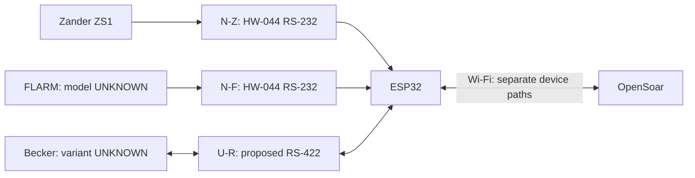
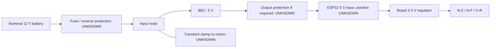

# Pinning, cabling and routing

**Proposed, untested wiring. UNKNOWN = unresolved; do not connect.** GPIO assignments proposed; physical ESP32 header positions UNKNOWN. Existing setup stays as backup.

[BOM, converter internals and bench checks](bench-build.md).

## Logical connections

Navigation returns: optional, listed below. Serial settings/network ports UNKNOWN. Radio bytes separate from navigation/diagnostics.

## Zander ZS1

**Picture pending:** actual PC-cable connector, numbered contacts and viewing side.

| From | To | Function / status |
| --- | --- | --- |
| PC cable pin 2, TX | N-Z DB9 pin **UNKNOWN** | Navigation input |
| N-Z logic-output header contact **UNKNOWN** | ESP32 GPIO32 / UART0 RX | Proposed |
| ESP32 GPIO33 / UART0 TX | JP-Z contact **UNKNOWN** | Optional return; link open initially |
| JP-Z other contact **UNKNOWN** | N-Z logic-input header contact **UNKNOWN** | Optional return |
| N-Z DB9 output pin **UNKNOWN** | PC cable pin 3, RX | Optional return; RMC only |
| PC cable pin 5, GND | N-Z DB9 reference pin **UNKNOWN** | Ground/reference design open |

Source: S09, ZS1 D3029, 16.09.2004, p.46; conditional **PC-cable** reference, not rear-panel pinout. Cable/interface match pending.

## FLARM

**Picture pending:** exact model and selected data-port connector, numbered contacts and viewing side.

| From | To | Function / status |
| --- | --- | --- |
| FLARM TX pin **UNKNOWN** | N-F DB9 input pin **UNKNOWN** | Navigation input |
| N-F logic-output header contact **UNKNOWN** | ESP32 GPIO26 / UART1 RX | Proposed |
| ESP32 GPIO27 / UART1 TX | JP-F contact **UNKNOWN** | Optional return; link open initially |
| JP-F other contact **UNKNOWN** | N-F logic-input header contact **UNKNOWN** | Optional return |
| N-F DB9 output pin **UNKNOWN** | FLARM RX pin **UNKNOWN** | Optional return |
| FLARM reference pin **UNKNOWN** | N-F DB9 reference pin **UNKNOWN** | Ground/reference design open |

Source: S09, FTD-012 §5. Confirm model/RS-232 port; some Classic extension ports provide only PFLAU. Preserve displays/returns; no assumed splitter.

**Both HW-044 adapters:** connector photos/mapping pending. RXD/TXD direction requires [unpowered continuity](bench-build.md#hw-044-identification). For receive-only use, disconnect the RS-232 output at the instrument; an open TX link does not disable it.

## Becker radio

**Picture pending:** installed model/revision, J1 connector and viewing side.

**Conditional manual pins; installed match unverified.** U-R below means **THVD1451D IC pins**, not breakout/header positions (UNKNOWN).

| From | To | Function / status |
| --- | --- | --- |
| Becker J1 pin 2, TX2+ | U-R IC pin 8, A | Radio → receiver + |
| Becker J1 pin 9, TX2− | U-R IC pin 7, B | Radio → receiver − |
| U-R IC pin 2, R | ESP32 GPIO16 / UART2 RX | Logic receive |
| ESP32 GPIO17 / UART2 TX | JP-R contact **UNKNOWN** | Link open initially |
| JP-R other contact **UNKNOWN** | U-R IC pin 3, D | Logic transmit |
| U-R IC pin 5, Y | Becker J1 pin 3, RX2+ | Driver → radio + |
| U-R IC pin 6, Z | Becker J1 pin 10, RX2− | Driver → radio − |
| Becker J1 pin 21, D_GND | Reference connection **UNKNOWN** | Discrete-line ground; bonding unresolved |

Sources: prior review, DV14307.03 Issue 06 §2.5.3.2 p.59; U-R pins S18. [Circuit details](bench-build.md#rs-422-circuit). Full-duplex RS-422; no galvanic isolation. Termination/protection UNKNOWN. Keep radio unplugged pending interface/coexistence checks: U-R remains enabled with JP-R open.

## Power

| From | To | Status |
| --- | --- | --- |
| Protected BEC 5 V output | ESP32 5 V input contact **UNKNOWN** | Board/BEC identification pending |
| BEC output return | ESP32 GND contact **UNKNOWN** | Common logic ground; source return design pending |
| ESP32 3.3 V contact **UNKNOWN** | N-Z VCC header | Proposed; module check pending |
| ESP32 3.3 V contact **UNKNOWN** | N-F VCC header | Proposed; module check pending |
| ESP32 3.3 V contact **UNKNOWN** | U-R IC pin 1, VCC | Proposed |
| ESP32 GND contact **UNKNOWN** | N-Z GND header | Proposed; continuity pending |
| ESP32 GND contact **UNKNOWN** | N-F GND header | Proposed; continuity pending |
| ESP32 GND contact **UNKNOWN** | U-R IC pin 4, GND | Proposed |

Disconnect BEC 5 V before USB powering. [Protection/current budget](bench-build.md#power-protection-and-budget) pending. Keep existing instrument supplies unchanged.

## Open items

| Needed | Resolves |
| --- | --- |
| Device connector photos + exact model/revisions | Correct pin view; FLARM/Zander/Becker applicability |
| Both HW-044 sides, IC markings + continuity map | DB9 ↔ logic-header contacts |
| Exact ESP32 board/BEC + source limits | Header positions, current budget, protection |
| Return-traffic requirements + serial settings | Optional links and port configuration |
| Matched radio interface/reference/termination | Final radio circuit/harness |

Pictures must show connector name, pin numbers and mating/wiring-side orientation. No verified installed-device connector pictures available. Evidence: [S09/S16–S19](sources.md); no electrical acceptance.
