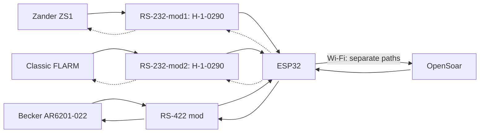
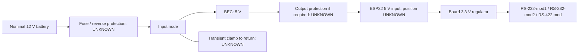

<a id="pinning-cabling-and-routing"></a>

## 🔌 Pinning, cabling and routing

**Proposed wiring. Confirm cable pinouts, converter pads and ESP32 headers before connecting. UNKNOWN = unresolved.**

TX links start open. Leave instrument RX disconnected for receive-only use.

[Bench checks and parts](bench-build.md) · [Sources](sources.md)

<a id="logical-connections"></a>

### 🧭 Logical connections



Dotted arrows show optional navigation returns. Becker commands are required for tuning.

<a id="hailege-board-pad-reference"></a>
<details>
<summary>Hailege board pad reference</summary>


**Inferred pad map.** Orient the chip side as pictured. Confirm continuity before power.

```text
        RS232 / instrument             TTL / ESP32
                +---------------------+
  L1  GND   −   |                     |   ←  TX input   R1
  L2  3.3 V +   |      MAX3232CSE      |   →  RX output  R2
  L3  RX in →   |                     |   +  3.3 V      R3
  L4  TX out←   |                     |   −  GND        R4
                +---------------------+
```

</details>

<a id="zander-zs1"></a>

### ✈️ Zander ZS1


| ZS1 PC cable | → / ← | RS232 pads | TTL pads | → / ← | ESP32 |
| --- | :-: | --- | --- | :-: | --- |
| 2 () | → | **L3** RS232 input | **R2** TTL output | → | GPIO32 () |
| *3 ()* (optional) | *←* | *L4 RS232 output* | *R1 TTL input* | *←* | *GPIO33 () via TX link* |
| 5 () | — | L1 GND† | R4 GND | — | GND contact **UNKNOWN** |

Use the ZS1 PC-cable DE9. Optional RMC requires an enabled, unused RX input. † Confirm signal ground.

<a id="flarm"></a>

### 📡 FLARM


| Classic Power/Data reference† | → / ← | RS232 pads | TTL pads | → / ← | ESP32 |
| --- | :-: | --- | --- | :-: | --- |
| 5 ()† | → | **L3** RS232 input | **R2** TTL output | → | GPIO26 () |
| *6 ()* (optional) | *←* | *L4 RS232 output* | *R1 TTL input* | *←* | *GPIO27 () via TX link* |
| 7/8 ()† | — | L1 GND† | R4 GND | — | GND contact **UNKNOWN** |

† Confirm the Classic Power/Data plug view and IGC numbering. Use a free data port and signal ground. Keep FLARM supply pins separate from converter VCC.

<a id="becker-radio"></a>

### 📻 Becker radio


| | Becker J1* | → / ← | RS422 chip pin | Logic / TX link | → / ← | ESP32 / TX link |
| :-: | --- | :-: | --- | --- | :-: | --- |
| 🟦 | 2 () | → | 8 () | — | — | — |
| 🟦 | 9 () | → | 7 () | — | — | — |
| 🟦 | — | — | — | 2 () | → | GPIO16 () |
| 🟧 | *3 ()* | *←* | *5 ()* | — | — | — |
| 🟧 | *10 ()* | *←* | *6 ()* | — | — | — |
| 🟧 | — | — | — | *3 ()* | *←* | *TX link: module contact **UNKNOWN*** |
| 🟧 | — | — | — | *TX link: ESP32 contact **UNKNOWN*** | *←* | *GPIO17 ()* |
| ⬜ | 21 () | — | Reference **UNKNOWN** | — | — | — |
| ⬜ | — | — | — | 4 () | — | GND contact **UNKNOWN** |

Confirm J1 revision and signal ground. 🟦 Status · 🟧 Commands · ⬜ Ground. The table uses THVD1451D chip pins. Standby tuning requires the command path.

<details>
<summary>Becker rear connector view</summary>


</details>

<a id="power"></a>

### ⚡ Power



| From | To | Status |
| --- | --- | --- |
| Protected BEC 5 V output | ESP32 5 V input contact **UNKNOWN** | Board/BEC identification pending |
| BEC output return | ESP32 GND contact **UNKNOWN** | Common logic ground; source return design pending |
| ESP32 3.3 V contact **UNKNOWN** | RS-232-mod1 R3 (`+`) | Proposed; module check pending |
| ESP32 3.3 V contact **UNKNOWN** | RS-232-mod2 R3 (`+`) | Proposed; module check pending |
| ESP32 3.3 V contact **UNKNOWN** | RS-422 mod IC pin 1, VCC | Proposed |
| ESP32 GND contact **UNKNOWN** | RS-232-mod1 R4 (`−`) | Proposed; continuity pending |
| ESP32 GND contact **UNKNOWN** | RS-232-mod2 R4 (`−`) | Proposed; continuity pending |
| ESP32 GND contact **UNKNOWN** | RS-422 mod IC pin 4, GND | Proposed |

Use one VCC/GND pair per H-1-0290. Disconnect BEC 5 V before USB powering. [Protection and current budget](bench-build.md#power-protection-and-budget).

<a id="open-items"></a>

### ❓ Open items

| Needed | Resolves |
| --- | --- |
| Device connector photos + exact model/revisions | Correct pin view; FLARM/Zander/Becker applicability |
| Both H-1-0290 sides, IC markings + continuity map | Confirm inferred L/R pad map; equipment cable mapping |
| Exact ESP32 board/BEC + source limits | Header positions, current budget, protection |
| Return-traffic requirements + serial settings | Optional links and port configuration |
| Matched radio interface/reference/termination | Final radio circuit/harness |
