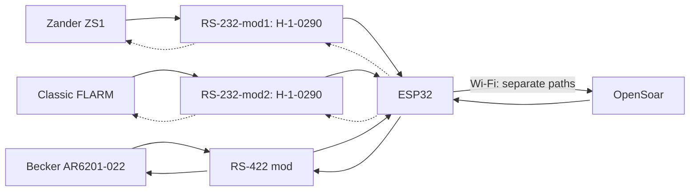
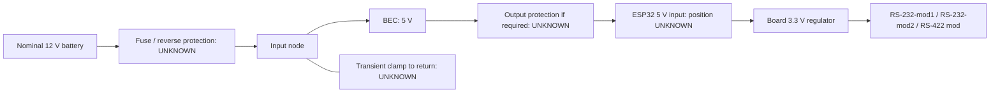

## 🔌 Pinning, cabling and routing

> [!WARNING]
> Confirm cable pinouts, converter pads and ESP32 headers before connecting. UNKNOWN = unresolved.
>
> Zander and FLARM TX links start open. Leave their RX inputs disconnected for receive-only use.

[Bench checks and parts](bench-build.md) · [Sources](sources.md)

---

### 🧭 Logical connections

Dotted arrows show optional navigation returns. Becker commands are required for tuning.

---

Hailege board pad reference

| Chip-side reference | Inferred pad view |
| --- | --- |
|  |  |

Orient the chip side as pictured. Confirm continuity before power. [S26–S27](sources.md#source-register)

---

### ✈️ Zander ZS1

| ZS1 PC cable | → / ← | RS232 pads | TTL pads | → / ← | ESP32 |
| --- | :-: | --- | --- | :-: | --- |
| 2 () | → | **L3** RS232 input | **R2** TTL output | → | GPIO32 () |
| *3 ()* (optional) | *←* | *L4 RS232 output* | *R1 TTL input* | *←* | *GPIO33 () via TX link* |
| 5 () | — | L1 GND† | R4 GND | — | GND contact **UNKNOWN** |

Use the ZS1 PC-cable DE9. Optional RMC requires an enabled, unused RX input. † Confirm signal ground.

Zander PC-cable connector pin view

| Connector reference | Pin view |
| --- | --- |
| Matched cable photo pending. [ZS1 handbook D3029, pp.46/48](reference/ZS1_Deutsch.pdf#page=46) (S22) |  |

---

### 📡 FLARM

| Classic Power/Data reference† | → / ← | RS232 pads | TTL pads | → / ← | ESP32 |
| --- | :-: | --- | --- | :-: | --- |
| 5 ()† | → | **L3** RS232 input | **R2** TTL output | → | GPIO26 () |
| *6 ()* (optional) | *←* | *L4 RS232 output* | *R1 TTL input* | *←* | *GPIO27 () via TX link* |
| 7/8 ()† | — | L1 GND† | R4 GND | — | GND contact **UNKNOWN** |

† Confirm the Classic Power/Data plug view and IGC numbering. Use a free data port and signal ground. Keep FLARM supply pins separate from converter VCC.

Classic FLARM Power/Data connector pin view

| Connector reference | Pin view |
| --- | --- |
| [Classic rear-panel and plug pictures, v221 p.6](https://www.flarm.com/wp-content/uploads/2024/04/FLARM_InstallationManual_D.pdf#page=6) (S23) |  |

IGC numbering runs in the opposite direction to common RJ45 numbering. Match the actual plug to the manual.

---

### 📻 Becker radio

| | Becker J1* | → / ← | RS422 chip pin | Logic pin | → / ← | ESP32 |
| :-: | --- | :-: | --- | --- | :-: | --- |
| 🟦 | 2 () | → | 8 () | — | — | — |
| 🟦 | 9 () | → | 7 () | — | — | — |
| 🟦 | — | — | — | 2 () | → | GPIO16 () |
| 🟧 | 3 () | ← | 5 () | — | — | — |
| 🟧 | 10 () | ← | 6 () | — | — | — |
| 🟧 | — | — | — | 3 () | ← | GPIO17 () |
| ⬜ | 21 () | — | Reference **UNKNOWN** | — | — | — |
| ⬜ | — | — | — | 4 () | — | GND contact **UNKNOWN** |

Confirm J1 revision and signal ground. 🟦 Status · 🟧 Commands · ⬜ Ground. The table uses THVD1451D chip pins. GPIO17 connects directly to D for standby tuning. ESP32 header positions and breakout contacts remain **UNKNOWN**.

Becker rear connector and J1 pin view

| Radio rear reference | J1 mating-face reference |
| --- | --- |
|  |  |

Callout 4 identifies J1. Functions from [Becker DV14307.03 Issue 06, pp.57/59](https://www.becker-avionics.com/wp-content/uploads/00_Literature/6200_Series_IO_en.pdf#page=59) (S10/S20). Socket numbering follows the [Winford BRKDD25F-R-FT Rev. A mating-face drawing](https://www.winford.com/products/cad/brkdd25f-r-ft_rev_a_dwg.pdf). Confirm the moulded numbers on the installed connector.

Pin-view styling follows the [Pinout.xyz examples](https://github.com/pinout-xyz/Pinout.xyz/tree/main/graphics). Colours group functions.

---

### ⚡ Power

| From | To | Status |
| --- | --- | --- |
| Protected BEC 5 V output | ESP32 5 V input contact **UNKNOWN** | Board/BEC identification pending |
| BEC output return | ESP32 GND contact **UNKNOWN** | Common logic ground; source return design pending |
| ESP32 3.3 V contact **UNKNOWN** | RS-232-mod1 R3 (`+`) | Proposed; module check pending |
| ESP32 3.3 V contact **UNKNOWN** | RS-232-mod2 R3 (`+`) | Proposed; module check pending |
| ESP32 3.3 V contact **UNKNOWN** | RS-422 mod IC pin 1, VCC | Proposed |
| ESP32 GND contact **UNKNOWN** | RS-232-mod1 R4 (`−`) | Proposed; continuity pending |
| ESP32 GND contact **UNKNOWN** | RS-232-mod2 R4 (`−`) | Proposed; continuity pending |
| ESP32 GND contact **UNKNOWN** | RS-422 mod IC pin 4, GND | Proposed |

Use one VCC/GND pair per H-1-0290. Disconnect BEC 5 V before USB powering. [Protection and current budget](bench-build.md#power-protection-and-budget).

---

### ❓ Open items

| Needed | Resolves |
| --- | --- |
| Device connector photos + exact model/revisions | Correct pin view; FLARM/Zander/Becker applicability |
| Both H-1-0290 sides, IC markings + continuity map | Confirm inferred L/R pad map; equipment cable mapping |
| Exact ESP32 board/BEC + source limits | Header positions, current budget, protection |
| Return-traffic requirements + serial settings | Optional links and port configuration |
| Matched radio interface/reference/termination | Final radio circuit/harness |
