

## 🔌 Pinning, cabling and routing

> [!WARNING]
> Confirm cable pinouts, converter pads and ESP32 headers before connecting. UNKNOWN = unresolved.
>
> Wire the optional Zander and FLARM return paths directly where required. Leave instrument RX disconnected when the return path is unused.

[Module specs](#module-specs) · [Parts list](#parts-list) · [Sources](sources.md)

---

### 🧭 Logical connections

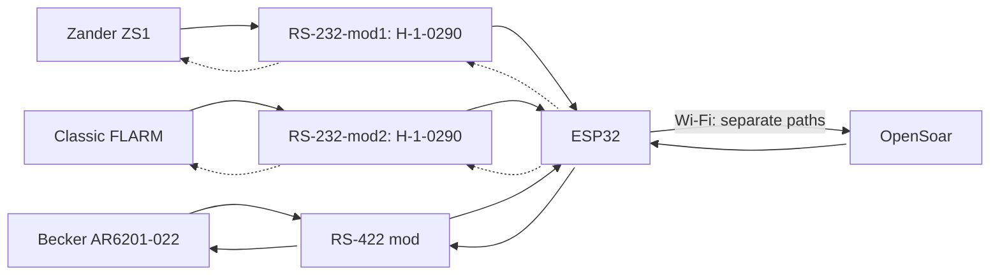

> [!NOTE]
> Dotted arrows show optional navigation returns. Becker commands are required for tuning.

---

### Module specs

Module specs, converter photos and pin diagrams

| Module | Power | Chip | Reported size |
| --- | --- | --- | --- |
| Hailege H-1-0290 (Zander and FLARM) | 3.3 V | MAX3232CSE (reported) | 9.4 × 15.9 mm |
| RS422 TO TTL (Becker) | 5 V per schematic | MAX490ESA (owner-confirmed) | 50 × 27 mm |
| AZ-Delivery ESP32 WROOM dev module | 5 V input, 3.3 V regulator | — | — |
| BEC (model TBD) | 2S–4S input reported, 5 V output | — | — |

[Power module sources (S16–S19)](sources.md#source-register)

#### Hailege H-1-0290 · RS-232

| Chip-side reference | Inferred pad view |
| --- | --- |
| 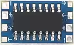 | 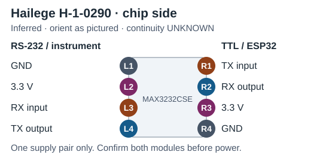 |

[S26–S27](sources.md#source-register)

#### RS422 TO TTL · RS-422

| Chip-side reference | Module pin diagram |
| --- | --- |
| 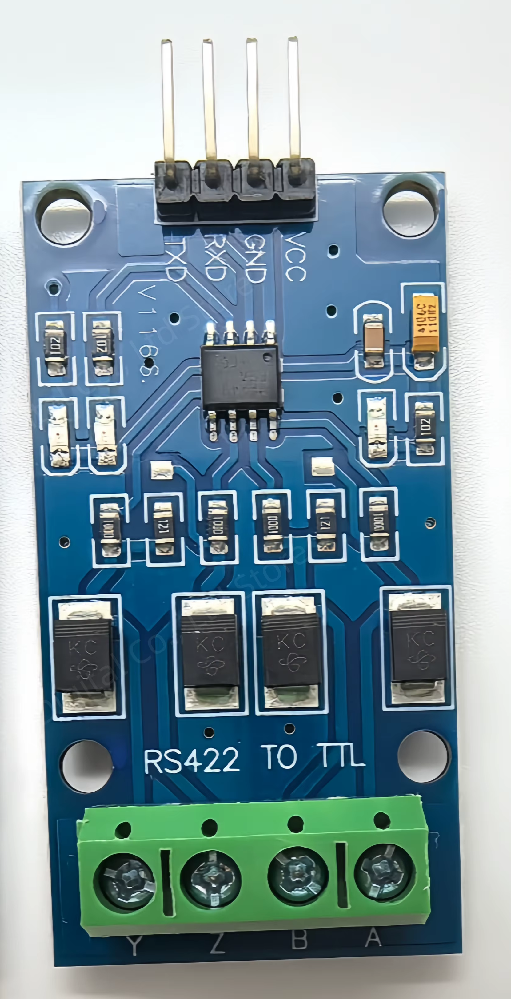 | 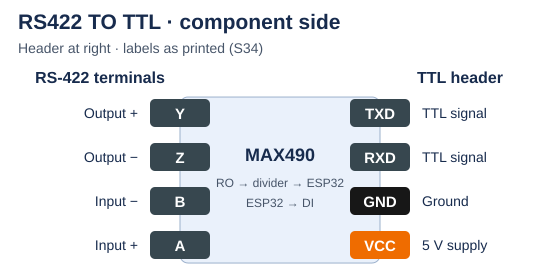 |

[S28–S30](sources.md#source-register)

---

### ✈️ Zander ZS1

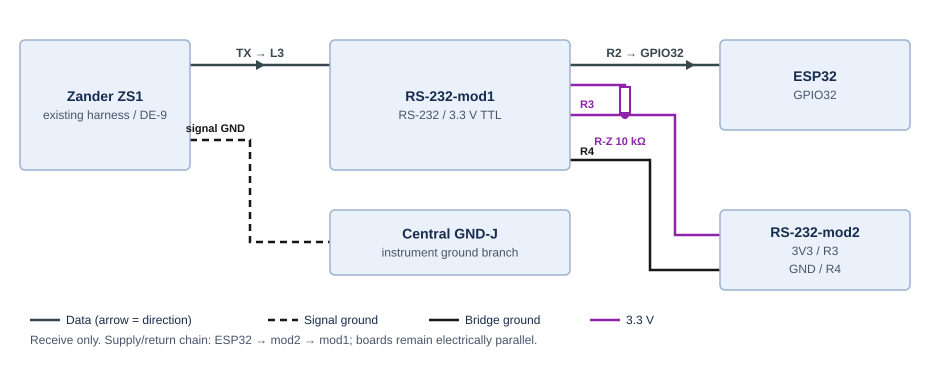

| ZS1 PC cable | → / ← | RS232 pads | TTL pads | → / ← | ESP32 |
| --- | :-: | --- | --- | :-: | --- |
| 2 () | → | **L3** RS232 input | **R2** TTL output | → | GPIO32 () |
| *3 ()* (optional) | *←* | *L4 RS232 output* | *R1 TTL input* | *←* | *GPIO33 ()* |
| 5 () | — | L1 GND† | R4 GND | — | GND contact |

> [!IMPORTANT]
> Use the ZS1 PC-cable DE9. A matched cable photo is pending. Optional RMC requires an enabled, unused RX input. † Confirm signal ground.

Zander PC-cable connector pin view

| Connector reference | Pin view |
| --- | --- |
| [ZS1 handbook D3029, pp.46/48](reference/ZS1_Deutsch.pdf#page=46) (S22) | 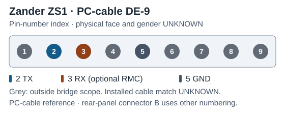 |

---

### 📡 FLARM

| Classic Power/Data reference† | → / ← | RS232 pads | TTL pads | → / ← | ESP32 |
| --- | :-: | --- | --- | :-: | --- |
| 5 ()† | → | **L3** RS232 input | **R2** TTL output | → | GPIO26 () |
| *6 ()* (optional) | *←* | *L4 RS232 output* | *R1 TTL input* | *←* | *GPIO27 ()* |
| 7/8 ()† | — | L1 GND† | R4 GND | — | GND contact |

> [!WARNING]
> † Match the Classic Power/Data plug to the manual. IGC numbering runs in the opposite direction to common RJ45 numbering. Use a free data port and signal ground. Keep FLARM supply pins separate from converter VCC.

Classic FLARM Power/Data connector pin view

| Connector reference | Pin view |
| --- | --- |
| [Classic rear-panel and plug pictures, v221 p.6](https://www.flarm.com/wp-content/uploads/2024/04/FLARM_InstallationManual_D.pdf#page=6) (S23) | 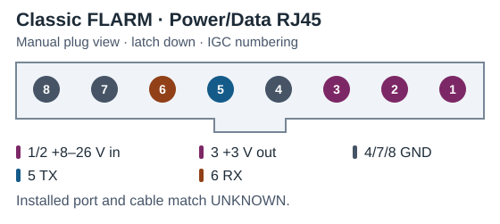 |

---

### 📻 Becker radio

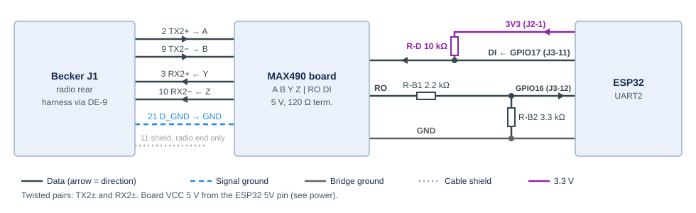

| Becker J1 reference† | → / ← | RS-422 terminals | TTL header | → / ← | ESP32 |
| --- | :-: | --- | --- | :-: | --- |
| 2 TX2+ / 9 TX2− | → | **A / B** input | **RXD** output | → | GPIO16 () via level conversion |
| 3 RX2+ / 10 RX2− | ← | **Y / Z** output | **TXD** input | ← | GPIO17 () (interface TBD) |
| 21 D_GND | — | Bond **UNKNOWN** | — | — | — |
| — | — | — | GND | — | GND contact |

> [!WARNING]
> † Confirm the installed J1 revision, moulded pin numbers and pair polarity. Use separate twisted pairs. Convert the 5 V-domain RXD before GPIO16. Verify GPIO17 compatibility, series resistance, termination, shielding and reference bonding before connecting. [S28–S30](sources.md#source-register) · [Espressif GPIO limits](https://docs.espressif.com/projects/esp-faq/en/latest/hardware-related/hardware-design.html#what-is-the-voltage-tolerance-of-gpios-of-esp-chips)

Becker rear connector and J1 pin view

| Radio rear reference | J1 mating-face reference |
| --- | --- |
| 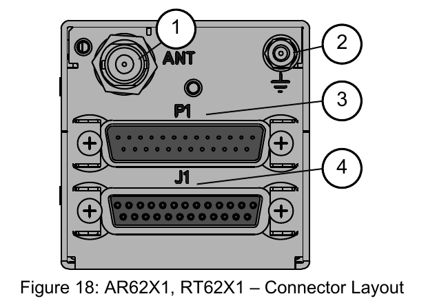 | 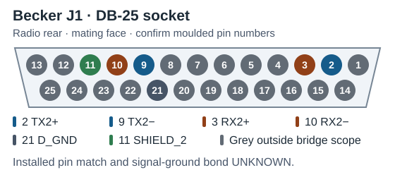 |

Callout 4 identifies J1. Functions from [Becker DV14307.03 Issue 06, pp.57/59](https://www.becker-avionics.com/wp-content/uploads/00_Literature/6200_Series_IO_en.pdf#page=59) (S10/S20). Socket numbering follows the [Winford BRKDD25F-R-FT Rev. A mating-face drawing](https://www.winford.com/products/cad/brkdd25f-r-ft_rev_a_dwg.pdf).

Pin-view styling follows the [Pinout.xyz examples](https://github.com/pinout-xyz/Pinout.xyz/tree/main/graphics). Colours group functions.

---

### ⚡ Power

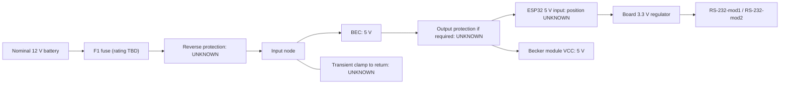

| From | To | Status |
| --- | --- | --- |
| Protected BEC 5 V output | ESP32 5 V input contact **UNKNOWN** | Verify 5 V header position and BEC output |
| BEC output return | ESP32 GND contact | Common logic ground; source return design pending |
| ESP32 3.3 V contact **UNKNOWN** | RS-232-mod1 R3 (`+`) | Proposed; module check pending |
| ESP32 3.3 V contact **UNKNOWN** | RS-232-mod2 R3 (`+`) | Proposed; module check pending |
| Protected BEC 5 V output | RS-422 module VCC | 5 V per board schematic (S29) |
| ESP32 GND contact | RS-232-mod1 R4 (`−`) | Proposed; continuity pending |
| ESP32 GND contact | RS-232-mod2 R4 (`−`) | Proposed; continuity pending |
| ESP32 GND contact | RS-422 module GND contact | Proposed logic return |

> [!WARNING]
> Use one VCC/GND pair per H-1-0290. Disconnect BEC 5 V before USB powering. Preserve existing instrument power feeds.
>
> - Place F1 near the battery on the bridge's positive feed. Use a separate reverse-polarity stage only if the exact BEC lacks adequate reverse-input protection.
> - Coordinate any input transient clamp with the fuse and BEC limits. Evaluate output overvoltage cutoff against BEC faults and ESP32 input limits.
> - Verify BEC polarity, tolerance and ripple. Check regulator current and temperature with Wi-Fi and the 3.3 V loads active. Spare 3.3 V capacity, source voltage range, BEC model and protection ratings remain open. [S16–S19](sources.md#source-register)

#### F1 sizing inputs

| Needed | Check |
| --- | --- |
| BEC model and datasheet | Input range, any specified input fuse, and reverse-input protection |
| Bridge load on the BEC input | Worst-case running current and startup inrush magnitude and duration across the battery voltage range |
| Battery and wiring | Maximum source voltage and prospective fault current. Smallest wire gauge, run length, connector and holder ratings, and temperature/bundling |

> [!IMPORTANT]
> Select the lowest fuse rating that carries the running load with temperature margin and survives startup per its time-current and pulse data. Check that it clears faults before the protected wiring or connectors overheat. Verify DC voltage and interrupt ratings against the source. [S31](sources.md#source-register)

---

### Parts list

Parts for one bridge.

| Ref / quantity | Part or specification | Status / use |
| --- | --- | --- |
| MCU / 1 | AZ-Delivery ESP32 WROOM dev module | [Power](#power) |
| RS-232-mod1, RS-232-mod2 / 2 | Hailege H-1-0290 | [Zander](#zander-zs1) and [FLARM](#flarm) |
| PS1 / 1 | 5 V BEC | [Power](#power) |
| RS-422 mod / 1 | Assembled RS422-to-TTL board | [Becker](#becker-radio) |
| R-Z, R-F / 2 | 10 kΩ, 1%, at least 0.125 W | Proposed idle pull-ups for the Zander and FLARM converter inputs |
| F1 / 1 | DC blade fuse with inline holder (bench candidate: 32 V DC ATO/ATOF) | [Current rating TBD](#f1-sizing-inputs) |
| Reverse-polarity stage / optional | Separate BEC input protection | Only if the BEC lacks adequate reverse-input protection |

> [!IMPORTANT]
> Keep the existing assembly and harness as backup. Hold F1 and holder purchase until the BEC, source and wiring limits are known.

---

### ❓ Open items

| Needed | Resolves |
| --- | --- |
| Device connector photos + exact model/revisions | Correct pin view; FLARM/Zander/Becker applicability |
| Both H-1-0290 sides, IC markings + continuity map | Confirm inferred L/R pad map; equipment cable mapping |
| ESP32 header/regulator checks and BEC/source limits | Header positions, current budget, protection |
| Return-traffic requirements + serial settings | Optional return wiring and port configuration |
| Confirm RS-422 interface levels, series resistance and effective termination | Becker level conversion, termination and reference |
