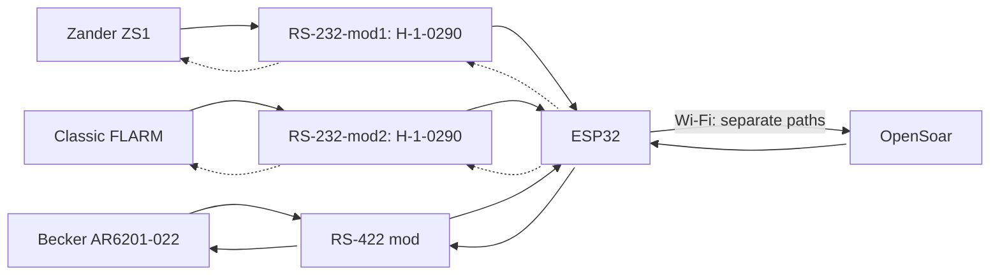
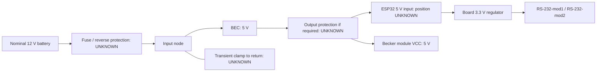

## 🔌 Pinning, cabling and routing

> [!WARNING]
> Confirm cable pinouts, converter pads and ESP32 headers before connecting. UNKNOWN = unresolved.
>
> Wire the optional Zander and FLARM return paths directly where required. Leave instrument RX disconnected when the return path is unused.

Selected board: AZ-Delivery ESP32 WROOM dev module.

[Parts list](#parts-list) · [Sources](sources.md)

---

### 🧭 Logical connections

Dotted arrows show optional navigation returns. Becker commands are required for tuning.

---

Hailege board pad reference

| Chip-side reference | Inferred pad view |
| --- | --- |
|  |  |

Orient the chip side as pictured. Before power, verify IC marking, package and pin 1. Trace all eight pads on both modules, check shared supply and ground pads, and check for shorts. Remap any mismatch.

S27 comparator, channel 2: L3 → IC pin 8, L4 → 7, R1 → 10, R2 → 9, both supply pads → 16 and both grounds → 15. Use the traced channel and IC datasheet to confirm the actual mapping. The reported board size is **9.4 × 15.9 mm**. Pad pitch and clearance remain open. Use 3.3 V for this design. The reported rate recommendation is ≤120 kbps. Actual baud and throughput are unverified. [S17, S26–S27](sources.md#source-register)

---

### ✈️ Zander ZS1

| ZS1 PC cable | → / ← | RS232 pads | TTL pads | → / ← | ESP32 |
| --- | :-: | --- | --- | :-: | --- |
| 2 () | → | **L3** RS232 input | **R2** TTL output | → | GPIO32 () |
| *3 ()* (optional) | *←* | *L4 RS232 output* | *R1 TTL input* | *←* | *GPIO33 ()* |
| 5 () | — | L1 GND† | R4 GND | — | GND contact |

Use the ZS1 PC-cable DE9. Optional RMC requires an enabled, unused RX input. † Confirm signal ground.

Zander PC-cable connector pin view

| Connector reference | Pin view |
| --- | --- |
| Matched cable photo pending. [ZS1 handbook D3029, pp.46/48](reference/ZS1_Deutsch.pdf#page=46) (S22) |  |

---

### 📡 FLARM

| Classic Power/Data reference† | → / ← | RS232 pads | TTL pads | → / ← | ESP32 |
| --- | :-: | --- | --- | :-: | --- |
| 5 ()† | → | **L3** RS232 input | **R2** TTL output | → | GPIO26 () |
| *6 ()* (optional) | *←* | *L4 RS232 output* | *R1 TTL input* | *←* | *GPIO27 ()* |
| 7/8 ()† | — | L1 GND† | R4 GND | — | GND contact |

† Confirm the Classic Power/Data plug view and IGC numbering. Use a free data port and signal ground. Keep FLARM supply pins separate from converter VCC.

Classic FLARM Power/Data connector pin view

| Connector reference | Pin view |
| --- | --- |
| [Classic rear-panel and plug pictures, v221 p.6](https://www.flarm.com/wp-content/uploads/2024/04/FLARM_InstallationManual_D.pdf#page=6) (S23) |  |

IGC numbering runs in the opposite direction to common RJ45 numbering. Match the actual plug to the manual.

---

### 📻 Becker radio

**Selected module:** assembled board marked `RS422 TO TTL`. In the supplied photo, header labels left to right are `TXD`, `RXD`, `GND`, `VCC`. Screw terminals read `Y`, `Z`, `B`, `A`. [S28](sources.md#source-register)

**Chip:** MAX490ESA (owner confirmed). **Reported module specs (S30):** 50 × 27 mm, full duplex, up to 2.5 Mbit/s and up to 1000 m. Power/TX/RX LEDs, TVS diodes, 15 kV ESD protection, 100 Ω current limiting and 120 Ω termination are reported. [S30](sources.md#source-register)

**Board schematic (S29, owner confirmed):** VCC is +5 V. TXD feeds DI (module input) and RXD comes from RO (module output). A/B are receiver inputs and Y/Z are driver outputs. Supply capacitors are shown on the module. Use the board header labels for wiring and the MAX490 datasheet for IC pin numbers. Becker J1 assignments remain conditional on the installed revision.

| Path | Becker J1 reference | RS-422 module | ESP32 |
| --- | --- | --- | --- |
| Status pair | 2 TX2+ / 9 TX2− → | A / B (proposed receive pair) | — |
| Status logic | — | RXD output → | GPIO16 RX via level conversion (design TBD) |
| Command pair | 3 RX2+ / 10 RX2− ← | Y / Z (proposed transmit pair) | — |
| Command logic | — | TXD input ← | GPIO17 TX (level interface TBD) |
| Equipment reference | 21 D_GND | Reference bond **UNKNOWN** | — |
| Logic return | — | GND contact | GND contact |

Use separate TX and RX twisted pairs. Confirm logic levels, termination, shielding and reference bonding before connecting. The drawing labels the series resistors 10 Ω, while the supplied specs state 100 Ω. It also shows open ends on the 120 Ω resistor symbols. The effective termination remains **UNKNOWN**. Treat RXD as a 5 V-domain output and use level conversion before GPIO16. ESP32 GPIO tolerance is 3.6 V. Check GPIO17 drive compatibility with the module input and its 5 V LED circuit. [Espressif GPIO limits](https://docs.espressif.com/projects/esp-faq/en/latest/hardware-related/hardware-design.html#what-is-the-voltage-tolerance-of-gpios-of-esp-chips)

Becker rear connector and J1 pin view

| Radio rear reference | J1 mating-face reference |
| --- | --- |
|  |  |

Callout 4 identifies J1. Functions from [Becker DV14307.03 Issue 06, pp.57/59](https://www.becker-avionics.com/wp-content/uploads/00_Literature/6200_Series_IO_en.pdf#page=59) (S10/S20). Socket numbering follows the [Winford BRKDD25F-R-FT Rev. A mating-face drawing](https://www.winford.com/products/cad/brkdd25f-r-ft_rev_a_dwg.pdf). Confirm the moulded numbers on the installed connector.

Pin-view styling follows the [Pinout.xyz examples](https://github.com/pinout-xyz/Pinout.xyz/tree/main/graphics). Colours group functions.

---

### ⚡ Power

| From | To | Status |
| --- | --- | --- |
| Protected BEC 5 V output | ESP32 5 V input contact **UNKNOWN** | Verify 5 V header position and BEC output |
| BEC output return | ESP32 GND contact | Common logic ground; source return design pending |
| ESP32 3.3 V contact **UNKNOWN** | RS-232-mod1 R3 (`+`) | Proposed; module check pending |
| ESP32 3.3 V contact **UNKNOWN** | RS-232-mod2 R3 (`+`) | Proposed; module check pending |
| Protected BEC 5 V output | RS-422 module VCC | 5 V per board schematic (S29) |
| ESP32 GND contact | RS-232-mod1 R4 (`−`) | Proposed; continuity pending |
| ESP32 GND contact | RS-232-mod2 R4 (`−`) | Proposed; continuity pending |
| ESP32 GND contact | RS-422 module GND contact | Proposed logic return |

Use one VCC/GND pair per H-1-0290. Disconnect BEC 5 V before USB powering. Preserve existing instrument power feeds.

- Size the fuse near the source and select reverse-polarity protection for the actual wiring, BEC input range and inrush. Coordinate the input transient clamp to return with the fuse and BEC limits. Evaluate output overvoltage cutoff against BEC faults and ESP32 input limits.
- Verify the board regulator current and temperature with Wi-Fi and the 3.3 V loads active. Spare 3.3 V capacity, source voltage range, BEC model and protection ratings remain open. [S16–S19](sources.md#source-register)

---

### Parts list

Parts for one bridge. Keep the existing assembly and harness as backup.

| Ref / quantity | Part or specification | Status / use |
| --- | --- | --- |
| MCU / 1 | AZ-Delivery ESP32 WROOM dev module | Owner-selected. Verify header positions and regulator limits |
| RS-232-mod1, RS-232-mod2 / 2 | Hailege H-1-0290 RS-232/logic boards; 9.4 × 15.9 mm each | Selected (S26); reported MAX3232CSE. Verify both ICs, pad routing and 3.3 V operation |
| PS1 / 1 | BEC: reported 2S–4S input; 5 V output | Reported nominal 12 V battery; model, voltage range, polarity, tolerance, ripple/protection TBD. Old UBEC specs inapplicable |
| RS-422 mod / 1 | Assembled RS422-to-TTL board. MAX490ESA (owner confirmed), reported 50 × 27 mm (S28–S30) | 5 V supply per S29. RXD level conversion and TXD interface details open |
| R-Z, R-F / 2 | 10 kΩ, 1%, at least 0.125 W | Proposed idle pull-ups for the Zander and FLARM converter inputs |
| Bridge interconnect / 1 set | Carrier, insulated wire, headers and standoffs | Mount and connect the modules |
| Navigation interconnect / 2 sets | Soldered leads/headers for H-1-0290 pads; equipment-side connectors TBD | Pad pitch, connector type/gender and actual cable mapping require inspection; no onboard DB9 assumed |
| F1, reverse-polarity stage, transient/OV protection | [Power protection](#power) | Hold purchase until BEC, source and board limits are known |
| Equipment harness, termination, enclosure | Model-specific connectors, cable and resistors | Hold for matched manuals, cable lengths and enclosure space. No fixed 120 Ω termination is assumed |

---

### ❓ Open items

| Needed | Resolves |
| --- | --- |
| Device connector photos + exact model/revisions | Correct pin view; FLARM/Zander/Becker applicability |
| Both H-1-0290 sides, IC markings + continuity map | Confirm inferred L/R pad map; equipment cable mapping |
| ESP32 header/regulator checks and BEC/source limits | Header positions, current budget, protection |
| Return-traffic requirements + serial settings | Optional return wiring and port configuration |
| Confirm RS-422 interface levels, series resistance and effective termination | Becker level conversion, termination and reference |
