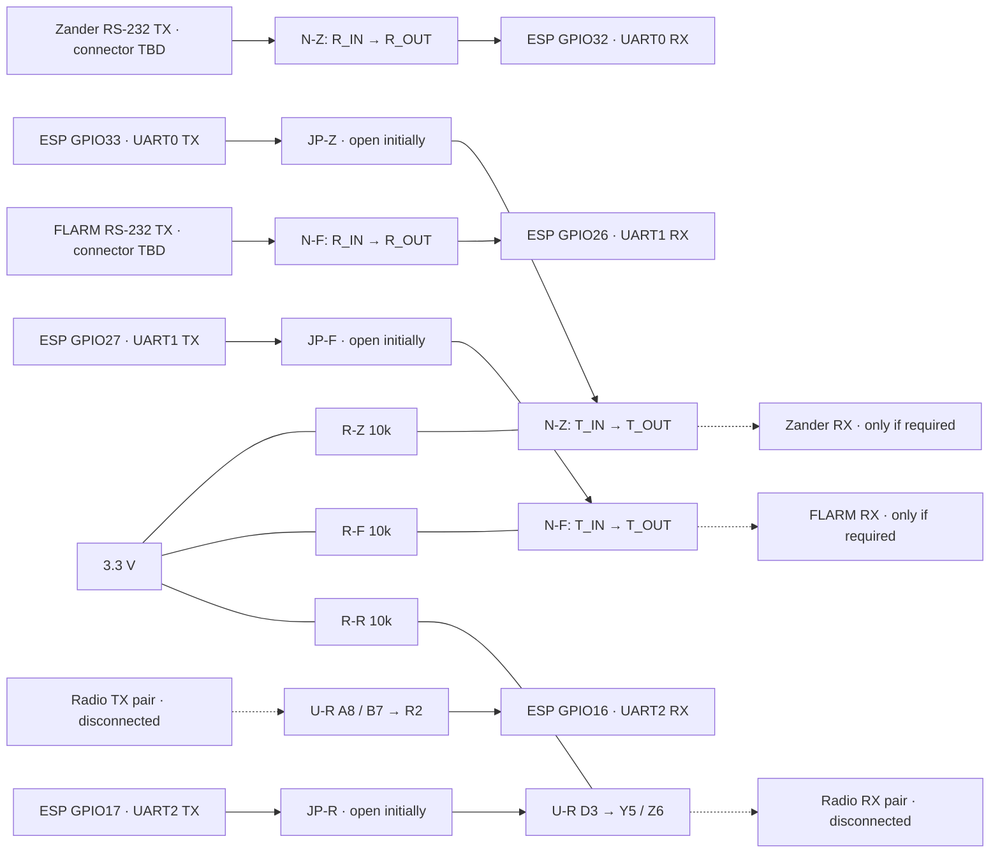
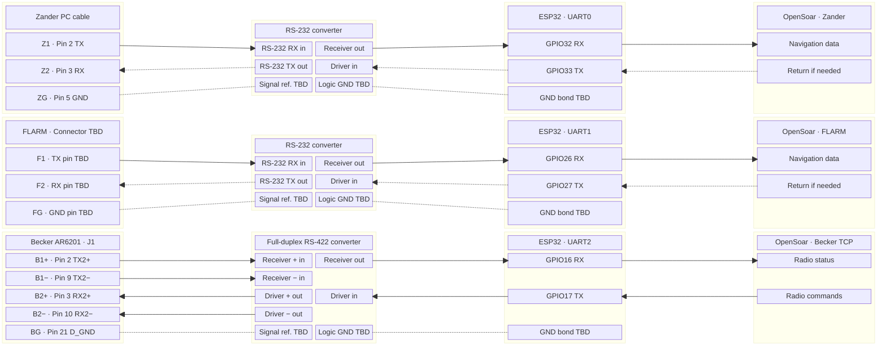
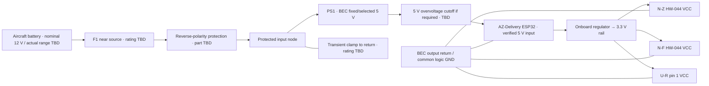
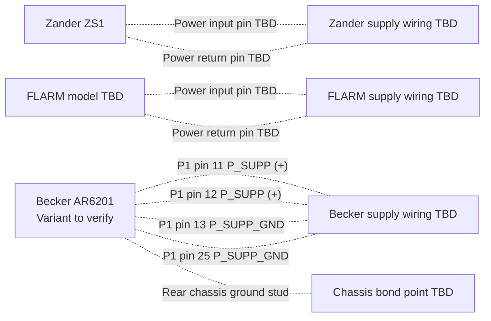

# Pinning, cabling and routing

**Unbuilt bench proposal.** New bridge; existing assembly/harness retained as backup. Selected families: AZ-Delivery WROOM-32, HW-044, 5 V BEC, board-derived 3.3 V. Exact variants and electrical acceptance open.

GPIO assignments proposed for classic WROOM-32; header positions TBD. Equipment pins conditional. IC pins, module labels and equipment connectors are distinct.

## Bench build package — 2026-11-08

R02/R03/R06/R07. References: S16–S19. Initial tests: instruments disconnected. Aircraft protection, radio matching and navigation returns open.

### Parts list

Quantities: one new bridge. Product links are references; no purchases.

| Ref / quantity | Part or specification | Status / use |
| --- | --- | --- |
| MCU / 1 | AZ-Delivery ESP32 WROOM-32 | Selected family; model/regulator/header TBD. S17 vendor board is a reference only |
| N-Z, N-F / 2 | HW-044 DB9-to-logic modules matching the supplied photo | Selected; apparent MAX3232. Verify both ICs, routing and 3.3 V operation |
| PS1 / 1 | BEC: reported 2S–4S input; 5 V output | Reported nominal 12 V battery; model, voltage range, polarity, tolerance, ripple/protection TBD. Old UBEC specs inapplicable |
| U-R / 1 | TI THVD1451D, SOIC-8 | Proposed full-duplex RS-422; always enabled; soldering required |
| Adapter / 1 | SOIC-8 to 2.54 mm breakout, e.g. Adafruit 1212 | Use its SOIC side; verify pin numbering after soldering. A pack may contain more than one board |
| C-R / 1 | 100 nF ceramic, at least 10 V | Close between U-R pins 1 and 4; HW-044 capacitors are already fitted but their values/condition need inspection |
| R-Z, R-F, R-R / 3 | 10 kΩ, 1%, at least 0.125 W | Proposed pull-ups from each converter's logic data input to 3.3 V; retain an idle input when its TX jumper is open |
| JP-Z, JP-F, JP-R / 3 | Removable 2-pin links, 2.54 mm, with labelled shunts | ESP32 TX-to-converter-input links; initially open. These are not power switches or driver-disable controls |
| Bench interconnect / 1 set | Carrier/prototyping board, insulated wire, headers, standoffs and labelled test points | Solder the transceiver/decoupling locally; keep differential test leads short. No production PCB required for this increment |
| DB9 access / 2 | Breakout connectors mating with the actual HW-044 sockets/plugs | Choose gender after inspection; access contacts by their moulded numbers, not a guessed front/rear view |
| Radio bench terminal / 1 | Labelled 5-way connector for A, B, Y, Z and logic reference | Lab use only; instrument connector and shielding remain TBD |
| F1, reverse-polarity stage, transient/OV protection | See power table below | Functions specified; ratings and exact components held for BEC/source/board data. This part of the BOM is not ready to order |
| Equipment harness, termination, enclosure | Model-specific connectors, cable and resistors | Hold for matched manuals, cable lengths and enclosure space. No fixed 120 Ω termination is assumed |

Tools required: multimeter, current-limited BEC-compatible supply, oscilloscope. Logic analyser: logic-level signals only. Availability unknown.

### Bench signal schematic

All converters: 3.3 V. Arrows: proposed direction. N-Z/N-F: functional paths; actual HW-044 nets require continuity checks.

**Open TX jumper ≠ disabled output.** Powered converters still drive idle. Receive-only navigation: disconnect RS-232 output at instrument. THVD1451 Y/Z remain driven; radio cable stays unplugged pending interface/coexistence checks.

### HW-044 identification and connection table

**Unpowered continuity first.** Trace RXD/TXD labels; no assumed direction. MAX3232: 16-pin top view (S17); confirm IC marking/package and pin 1.

| Function | MAX3232 channel 1 / channel 2 pins | Connection after confirming the used channel |
| --- | --- | --- |
| Supply | 16 VCC; 15 GND | HW-044 VCC → board 3.3 V; GND → common logic GND; verify continuity |
| Logic output from instrument | 12 R1OUT / 9 R2OUT | Trace to the actual RXD or TXD header contact; connect N-Z to GPIO32, N-F to GPIO26 |
| Logic input toward instrument | 11 T1IN / 10 T2IN | Trace to the other header contact; N-Z ← JP-Z/GPIO33, N-F ← JP-F/GPIO27; 10k pull-up on the converter side |
| RS-232 input | 13 R1IN / 8 R2IN | Trace to DB9 contact and record its number; later receives instrument TX |
| RS-232 output | 14 T1OUT / 7 T2OUT | Trace to DB9 contact and record its number; initially leave off the instrument |
| Reference | 15 GND | Trace to DB9 reference contact; connector shell/shield bonding is a separate question |

Record header-to-IC-to-DB9 mapping, reference, power and tied contacts for each board. No assumed straight-through cable. Return path checked separately. Module supply: 3.3 V only for this design.

### RS-422 circuit and bench netlist

U-R: **THVD1451D, SOIC-8** (S18), not the unidentified blue module. Local 100 nF decoupling; common bench logic ground; no galvanic isolation.

| U-R pin | Net / connection |
| --- | --- |
| 1 VCC | ESP32 board 3.3 V output; C-R 100 nF to pin 4 |
| 2 R | GPIO16, UART2 RX |
| 3 D | JP-R to GPIO17, UART2 TX; R-R 10k to 3.3 V |
| 4 GND | ESP32 GND and bench reference terminal |
| 5 Y | Non-inverting driver output, bench TX+ |
| 6 Z | Inverting driver output, bench TX− |
| 7 B | Inverting receiver input, bench RX− |
| 8 A | Non-inverting receiver input, bench RX+ |

Local loopback, instruments disconnected: Y→A, Z→B. Tests converter transport only. Termination/protection/reference require matched manual; no assumed 120 Ω resistor. A disabled transmitter requires a different device and pin table.

### Proposed build and verification sequence

| Step | Work and pass condition | Stop condition |
| --- | --- | --- |
| 1 Identify | Exact ESP board/regulator, BEC voltage/current ratings, both HW-044 markings and continuity map recorded; U-R adapter orientation checked | Unknown supply pin, module direction or package |
| 2 Power only | Test BEC without electronics first, then under a suitable dummy load; measure startup, steady output, ripple and polarity against the selected board's permitted input. Verify fuse/protection design before using the intended source | Wrong/unstable voltage, unexplained current or missing source/BEC limits |
| 3 Board and converter rails | Add ESP32, then converters individually. Check 5 V/3.3 V during Wi-Fi load, converter activity and warm operation; measure regulator temperature and compare with its datasheet | Rail excursions, reset, excessive temperature or unbudgeted load |
| 4 Logic and loops | With equipment disconnected, verify converter outputs stay within the ESP32 input limits. Later test each UART and converter loop with counted binary patterns including 00, A5, FF and fragmented traffic | Byte loss/change, debug bytes, back-power or incorrect levels |
| 5 Navigation | After WP1/WP2 matching, verify each feed and required return path, then both together against the recorded baseline | Changed device operation or loss of required messages |
| 6 Radio and coexistence | After protocol/software prerequisites, WP7 checks actual standby, unchanged active, local controls and navigation under reconnect/power loss | A successful write alone is insufficient; keep physical acceptance open |

Sequence unexecuted. Isolate UART0 diagnostics before instrument connection. Firmware/harness implementation pending.

**Verification:** S16 selections/GPIOs and component pins checked; THVD1451 drawing visually checked. HW-044 netlist unavailable. No electrical/device tests; Mermaid source only. Board/BEC, protection and equipment mapping open.

## Connection and routing diagram

Arrows: data direction. Dotted arrows: optional returns. Dotted lines: unresolved references. Signal IDs match device tables.

UART0–2: one ESP32. Rightmost links: Wi-Fi.

Logic: 3.3 V. Reference/shield bonding TBD.

Separate device connections proposed. Ports, navigation transport and GPS priority TBD. No navigation/diagnostics on radio endpoint.

### Bridge power and ground

5 V BEC → verified board input → 3.3 V converters (S16). Exact board/BEC unknown; no assumed VIN rating or header position. Initial tests: instrument cables disconnected.

Transient clamp: shunt to return. Return routing/isolation depends on BEC/protection parts. Protection circuit incomplete.

| Function | Proposed requirement | Information needed to select it |
| --- | --- | --- |
| Input fuse F1 | Near source; protects upstream wiring | Wire/source ratings, BEC input/inrush, fuse curve; not output rating alone |
| Reverse-polarity protection | BEC-input diode/MOSFET protection | Source range, BEC minimum input, current/drop budget |
| Input transient clamp | TVS/source-impedance/fuse coordination | Normal maximum, BEC absolute maximum, pulse energy, loaded clamp voltage |
| BEC output overvoltage | Cutoff/eFuse if sustained BEC fault exceeds board limits | BEC fault behavior/regulator limits; fuse or TVS alone insufficient |
| Filtering / decoupling | Short leads/return loops; BEC-specified capacitors; filtering if measured noise requires | Stability, startup/ripple, interference; filter values TBD |
| USB servicing | Disconnect BEC 5 V before USB powering | Manual procedure; no added switching/OR-ing/back-feed circuitry |

**3.3 V budget:** ESP32/Wi-Fi + board peripherals + 2 × HW-044/LEDs + loaded RS-422 driver. Espressif’s ≥500 mA supply guidance is not spare header capacity (S19). Verify regulator current/thermal limits under load. Linear loss ≈ `(5.0 − 3.3) × total current`; 300 mA → 0.51 W (estimate).

Source: reported nominal 12 V battery; chemistry, actual range/transients and BEC model unknown. Equipment power wiring remains separate from bridge power.

### Existing instrument power and ground

Trace these paths during the installation survey and preserve the existing feeds. Becker pin numbers are manual references for the variants covered by Issue 06. Match the installed radio before using them. The Zander and FLARM supply connectors and pins still need confirmation. See [S10](sources.md#rechecked-facts).

## ESP32 pin allocation

Proposed ESP32 GPIO allocation; equipment connector pins below.

| Function | UART | ESP32 RX | ESP32 TX | Condition |
| --- | --- | --- | --- | --- |
| Zander | UART0 | GPIO32 | GPIO33 reserved | Prefer receive-only if existing operation permits; do not connect TX until return-traffic need is resolved. |
| FLARM | UART1 | GPIO26 | GPIO27 reserved | Same condition; preserve existing declarations/settings workflows if required. |
| Becker | UART2 | GPIO16 | GPIO17 | Bidirectional through the matched electrical interface; WROOM variant required. |

Upstream RX/TX defaults: 21/1, 16/17, 15/4 (S08). Proposal avoids USB/programming GPIO1/3 and strapping GPIO15. All three UARTs allocated; no spare debug UART. Disable/reroute application/framework/OTA output; verify boot/remapping before equipment connection. Preserve required navigation returns.

## Zander ZS1

ZS1 manual D3029, 16.09.2004, p.46 (S09): **PC cable**, not rear connector. Optional input: RMC only; no assumed FLARM forwarding. Confirm actual cable/levels and HW-044 mapping. Never tie transmitters together.

| Signal | Equipment connector | Converter path | ESP32 pin |
| --- | --- | --- | --- |
| Z1: Zander data out | PC D-sub pin 2: TX | RS-232 in → logic out | GPIO32 / UART0 RX |
| Z2: optional Zander return | PC D-sub pin 3: RX | RS-232 out ← logic in | GPIO33 / UART0 TX (reserved) |
| ZG: Zander signal reference | PC D-sub pin 5: GND | Signal reference (design open) | GND connection TBD |

## FLARM

FTD-012 §5 (S09): configurable RS-232. Exact model/port pins TBD; some Classic extension ports output only PFLAU. Preserve displays/loads; no assumed passive splitter. Confirm selected port and HW-044 compatibility.

| Signal | Equipment connector | Converter path | ESP32 pin |
| --- | --- | --- | --- |
| F1: FLARM data out | Model-specific TX pin **TBD** | RS-232 in → logic out | GPIO26 / UART1 RX |
| F2: optional FLARM return | Model-specific RX pin **TBD** | RS-232 out ← logic in | GPIO27 / UART1 TX (reserved) |
| FG: FLARM signal reference | Model-specific signal-ground pin **TBD** | Signal reference (design open) | GND connection TBD |

## Becker radio

**Conditional, prior review:** 3.3 V UART/full-duplex RS-422; not two-wire half-duplex RS-485. Match radio revision before wiring. Termination, polarity, reference, protection and isolation TBD.

| Signal | Equipment connector | Converter path | ESP32 pin |
| --- | --- | --- | --- |
| B1+ status | J1 pin 2: TX2+ | Receiver + input | GPIO16 via receiver output |
| B1− status | J1 pin 9: TX2− | Receiver − input | Same receiver as B1+ |
| B2+ command | J1 pin 3: RX2+ | Driver + output | GPIO17 via driver input |
| B2− command | J1 pin 10: RX2− | Driver − output | Same driver as B2+ |
| BG: Becker reference | Candidate J1 pin 21 D_GND | Reference design TBD | GND connection TBD |

Pin source: DV14307.03 Issue 06 §2.5.3.2 p.59 and LXNAV diagram ([evidence](technical-investigation.md#follow-up-source-verification-2026-11-08)); unconfirmed for installed radio. D_GND = discrete-line ground; bonding unresolved. Confirm connector view/interface availability.

## Power and cable construction

[Power/protection](#bridge-power-and-ground): 5 V board input; 3.3 V converters. Parts/ratings and isolation/enclosure TBD. USB/BEC powering mutually exclusive.

| Cable rule | Requirement |
| --- | --- |
| Branches | Separate labels, connectors, strain relief; new harness; preserve backup |
| RS-422 | Separate TX/RX twisted pairs; impedance/termination/reference/shield TBD |
| Logic | Keep 3.3 V within bridge; matched equipment-level signals externally |
| Navigation | Preserve returns/displays; verify loading before fan-out |
| Power | Size wiring/protection from source and load |
| UART0 | GPIO remap plus diagnostic/startup isolation |

Classify proposed connections: **compatible / change needed / unresolved**, with evidence and affected function.

## Evidence and remaining checks

GPIO/Zander/FLARM: S09; bridge defaults: S08; Becker pins: prior review. No electrical/device tests. Equipment identity, connector occupancy, returns and supply remain open.
