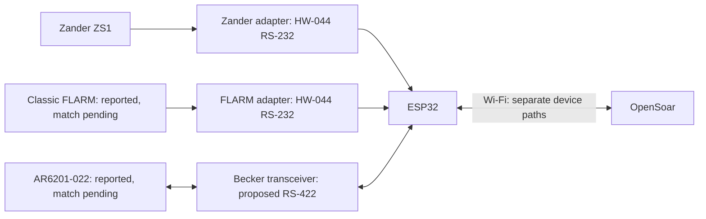
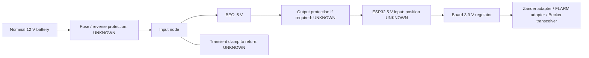

# Pinning, cabling and routing

**Proposed, untested wiring. UNKNOWN = unresolved; do not connect.** GPIO assignments proposed; physical ESP32 header positions UNKNOWN. Existing setup stays as backup.

[BOM, converter internals and bench checks](bench-build.md).

## Logical connections

Navigation returns: optional, listed below. Serial settings unverified; existing TCP endpoints [reported in baseline](project-baseline.md#pending-configuration), not selected/verified new-build settings. Radio bytes separate from navigation/diagnostics.

## Zander ZS1

**Unmatched drawing crop (S25):** connector **B** labels: 2 GND, 3 RX-PC, 4 TX-PC. Red-circled **A** uses RX-SR/TX-SR and other functions. Revision/view unverified; complete installation drawing and actual cable mapping still needed. This crop does not authorize wiring.

| From | To | Function / status |
| --- | --- | --- |
| PC cable pin 2, TX | Zander adapter DB9 pin **UNKNOWN** | Navigation input |
| Zander adapter logic-output header contact **UNKNOWN** | ESP32 GPIO32 / UART0 RX | Proposed |
| ESP32 GPIO33 / UART0 TX | Zander TX link contact **UNKNOWN** | Optional return; link open initially |
| Zander TX link other contact **UNKNOWN** | Zander adapter logic-input header contact **UNKNOWN** | Optional return |
| Zander adapter DB9 output pin **UNKNOWN** | PC cable pin 3, RX | Optional return; RMC only |
| PC cable pin 5, GND | Zander adapter DB9 reference pin **UNKNOWN** | Ground/reference design open |

Source: [S22 original handbook](reference/ZS1_Deutsch.pdf), D3029, 16.09.2004, pp.46/48; conditional **PC-cable DE9** reference, not rear-panel B numbering. Cable/interface match pending. The 3037 supplement specifies 4,800 baud with the ZS1 FLARM function off, 19,200 with it on; installed version/setting unverified. RJ45/DE9 shape does not establish voltage or compatible pinning.

## FLARM

**PowerFLARM Core examples only; not the reported Classic FLARM.** DE9: device socket left, cable plug right, mating faces. [FTD-033 v1.1, pp.11/14](https://www.flarm.com/wp-content/uploads/2024/04/FTD-033-PowerFLARM-Core-Installation-Manual.pdf#page=11), © FLARM Technology AG. Retained as reference, not installed pinning.

**Conditional Classic reference (S23):** [F6/F7/F8/F9 manual v221, p.6](https://www.flarm.com/wp-content/uploads/2024/04/FLARM_InstallationManual_D.pdf#page=6): RJ45 Power/Data, TX 5, RX 6, ground 7/8 (also 4); supply 1/2. IGC numbering is reversed relative to common numbering: match the manual's plug view and trace the actual cable. Extension is a separate RJ12 socket. Installed pins below remain UNKNOWN pending match.

| From | To | Function / status |
| --- | --- | --- |
| FLARM TX pin **UNKNOWN** | FLARM adapter DB9 input pin **UNKNOWN** | Navigation input |
| FLARM adapter logic-output header contact **UNKNOWN** | ESP32 GPIO26 / UART1 RX | Proposed |
| ESP32 GPIO27 / UART1 TX | FLARM TX link contact **UNKNOWN** | Optional return; link open initially |
| FLARM TX link other contact **UNKNOWN** | FLARM adapter logic-input header contact **UNKNOWN** | Optional return |
| FLARM adapter DB9 output pin **UNKNOWN** | FLARM RX pin **UNKNOWN** | Optional return |
| FLARM reference pin **UNKNOWN** | FLARM adapter DB9 reference pin **UNKNOWN** | Ground/reference design open |

Source: S23, FTD-012 §5 and Classic installation manual pp.6/7/9. RS-232 is not ESP32 GPIO signalling. Confirm baud/output; TCP port 2000 does not establish serial settings. Preserve displays/returns; the Classic manual permits one attached device per data port, so no assumed passive splitter.

**Both HW-044 adapters:** connector photos/mapping pending. RXD/TXD direction requires [unpowered continuity](bench-build.md#hw-044-identification). For receive-only use, disconnect the RS-232 output at the instrument; an open TX link does not disable it.

## Becker radio

**Reference only — AR62X1/RT62X1 rear view; AR6201-(022) reported, revision UNKNOWN.** Callout 4 identifies J1, not contact 4. Contact numbering is not shown. [DV14307.03 Issue 06, p.57, Fig.18](https://www.becker-avionics.com/wp-content/uploads/00_Literature/6200_Series_IO_en.pdf#page=57), © Becker Avionics GmbH.

**Conditional manual pins; installed match unverified.** Becker transceiver means **THVD1451D IC pins**, not breakout/header positions (UNKNOWN).

| From | To | Function / status |
| --- | --- | --- |
| Becker J1 pin 2, TX2+ | Becker transceiver IC pin 8, A | Radio → receiver + |
| Becker J1 pin 9, TX2− | Becker transceiver IC pin 7, B | Radio → receiver − |
| Becker transceiver IC pin 2, R | ESP32 GPIO16 / UART2 RX | Logic receive |
| ESP32 GPIO17 / UART2 TX | Becker TX link contact **UNKNOWN** | Link open initially |
| Becker TX link other contact **UNKNOWN** | Becker transceiver IC pin 3, D | Logic transmit |
| Becker transceiver IC pin 5, Y | Becker J1 pin 3, RX2+ | Driver → radio + |
| Becker transceiver IC pin 6, Z | Becker J1 pin 10, RX2− | Driver → radio − |
| Becker J1 pin 21, D_GND | Reference connection **UNKNOWN** | Discrete-line ground; bonding unresolved |

Sources: S10 recheck, DV14307.03 Issue 06 §2.5.3.2 p.59; Becker transceiver pins S18. [Circuit details](bench-build.md#rs-422-circuit). Full-duplex RS-422; no galvanic isolation. Termination/protection UNKNOWN. Keep radio unplugged pending interface/coexistence checks: Becker transceiver remains enabled with Becker TX link open.

## Power

| From | To | Status |
| --- | --- | --- |
| Protected BEC 5 V output | ESP32 5 V input contact **UNKNOWN** | Board/BEC identification pending |
| BEC output return | ESP32 GND contact **UNKNOWN** | Common logic ground; source return design pending |
| ESP32 3.3 V contact **UNKNOWN** | Zander adapter VCC header | Proposed; module check pending |
| ESP32 3.3 V contact **UNKNOWN** | FLARM adapter VCC header | Proposed; module check pending |
| ESP32 3.3 V contact **UNKNOWN** | Becker transceiver IC pin 1, VCC | Proposed |
| ESP32 GND contact **UNKNOWN** | Zander adapter GND header | Proposed; continuity pending |
| ESP32 GND contact **UNKNOWN** | FLARM adapter GND header | Proposed; continuity pending |
| ESP32 GND contact **UNKNOWN** | Becker transceiver IC pin 4, GND | Proposed |

Disconnect BEC 5 V before USB powering. [Protection/current budget](bench-build.md#power-protection-and-budget) pending. Keep existing instrument supplies unchanged.

## Open items

| Needed | Resolves |
| --- | --- |
| Device connector photos + exact model/revisions | Correct pin view; FLARM/Zander/Becker applicability |
| Both HW-044 sides, IC markings + continuity map | DB9 ↔ logic-header contacts |
| Exact ESP32 board/BEC + source limits | Header positions, current budget, protection |
| Return-traffic requirements + serial settings | Optional links and port configuration |
| Matched radio interface/reference/termination | Final radio circuit/harness |

Manual crops: [S20](sources.md#connector-reference-drawings). Installed connector matches unverified; no electrical acceptance.
