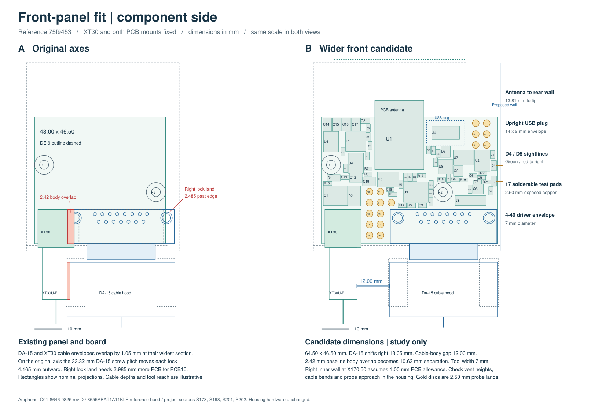
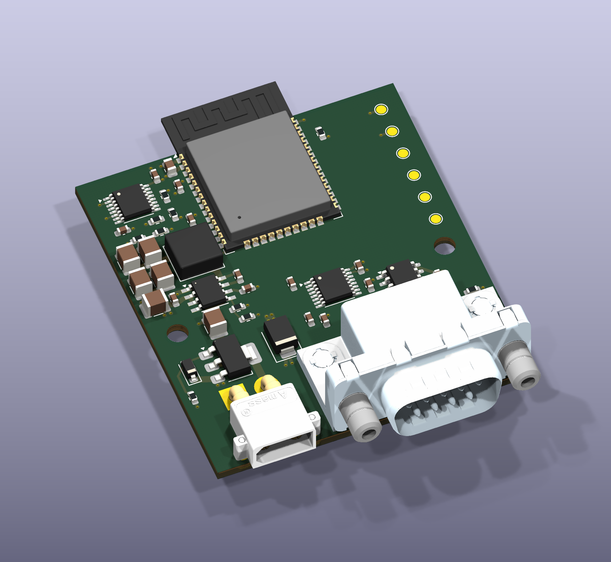
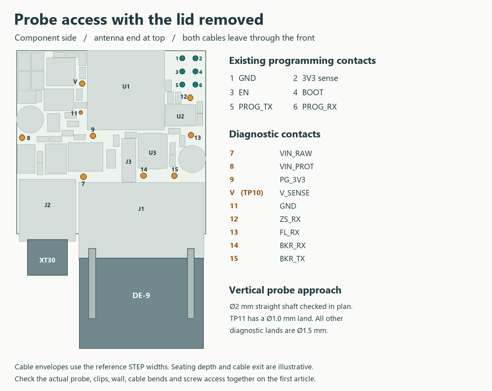

# 🧩 Integrated bridge PCB

🏠 [Overview](../../README.md) › 🧩 Design › **Integrated bridge PCB**

Use this plan to take the module-based bench bridge through a smaller four-layer design, first articles and a repeatable JLCPCB order.

> [!NOTE]
> **Status:** Review the [front-panel placement](#placement-comparison) before routing. The wider candidate uses the original XT30 and mounting positions. The ten-board quote and first article follow mechanical and electrical acceptance.

📑 **On this page:** <kbd>[1 · 🔌 Circuits](#circuits)</kbd> <kbd>[2 · 📐 Housing and layout](#layout)</kbd> <kbd>[3 · 🌡️ Heat and verification](#heat)</kbd> <kbd>[4 · 💶 Production cost](#cost)</kbd> <kbd>[5 · 📦 Production](#production)</kbd>

---

## 1. 🔌 Circuits

The [supplier circuit requirements and schematic comparison](requirements.md#pcb-schematic) cover U1–U5 and the three input-protection devices. The [first-article checks](../project/open-items.md#pcb-study) cover the differences that need measurements.

| Function | Captured circuit | Verification before release |
| --- | --- | --- |
| Controller | ESP32-WROOM-32E-H4 with antenna and shield, no PSRAM. Local decoupling and six top-side 3.3 V logic programming pads. Fixture senses 3.3 V, board powers itself. | Check boot and OTA recovery, unpowered UART injection and instrument-port startup bytes. H4 stock and assembly profile per S170/S175. |
| Navigation | TRS3232EIPWR connects two independent RS-232 ports. Zander uses GPIO32 RX and GPIO33 TX. FLARM uses GPIO26 RX and GPIO27 TX. | Exercise both ports simultaneously at J1. Check polarity, loading and powered-off behaviour in both directions. |
| Becker | SN65HVD1470DR full duplex at 3.3 V. Populate R4 to enable TX; R3 biases DI high, R5 defines DE if link removed. Receiver enabled, no receive termination fitted. SN65HVD35DR alternate subject to qualification. | Verify separate pairs and idle levels through reset and brownout. Compare loaded cable waveforms and bytes in both directions. |
| Supply | External F1, DMP6023LE reverse-polarity MOSFET, 100 kΩ gate network, 12 V gate clamp, provisional SMBJ20A, LMR33610ADDAR synchronous 400 kHz buck to 3.3 V. Draft power stage uses 6.8 µH, two 10 µF/100 V inputs, four 22 µF/25 V outputs. | Scope actual hot clamp and ringing against every input limit. Verify inrush, MOSFET gate, minimum effective capacitance after DC bias and thermal limits. See S172. |
| Battery measurement | R8/R9 divider from protected input to ground, C18 on the divider. While U5 is powered and enabled, PG low selects ground for GPIO34 and PG high selects the divider. At zero supply U5 isolates the signal paths and R12 pulls GPIO34 down. Output bleed preserves nominal ×11 scaling. | Calibrate against XT30 at 7–20 V. Scope GPIO34 and measure injection into unpowered 3.3 V at hot/cold start, hard collapse, reverse input and maximum clamped input. |
| Harness | Right-angle male Amphenol D15P33E4GV00LF and AMASS XT30PW-M30.G.Y. See the [DA-15 pinout](#smaller-dsub). J2 pad 1 is ground and pad 2 is the raw supply. Both J1 shell locks are isolated from board ground. | Check the mating plugs, jackscrews, polarity and housing support with actual parts. S173, S196. |

## 2. 📐 Compact placement

**Front-panel proposal for review.** Both connectors face forward. All 84 electrical footprints and the two original mounting holes are on the candidate drawing. Both MX5050s, the input protection, buck components, USB support, J3 and the 17 probes are placed.

| Dimension | 48.00 × 46.50 mm baseline with DA-15 on the old axis | 64.50 × 46.50 mm candidate |
| --- | --- | --- |
| DA-15 centre X / XT30 centre X | 136.70 / 112.90 mm | 149.75 / 112.90 mm |
| Connector body / mated cable envelope | 2.42 / 1.05 mm overlap | 10.63 / 12.00 mm clear |
| Right DA-15 lock land | Extends 2.485 mm past PCB edge | 0.965 mm copper-to-edge |
| Front and housing | DE-9 screw pitch 24.99 mm | DA-15 pitch 33.32 mm. Proposed right inner wall X170.50, 12.50 mm beyond the reference wall |
| Service with lid off | Fixed H1 and H2 | Ø7 mm driver; 14 × 9 mm USB plug allowance; 13.81 mm antenna tip to rear wall; LEDs face right |

Ten diagnostic solder lands occupy two columns between the front connectors on 4 mm centres (6.50 × 18.50 mm across the lands). TP9 sits alongside TP8. TP1–TP6 retain the programming fixture pattern. The four 22 µF output capacitors now sit in one row on the output side of L1. The longest straight-line span from L1 pad 2 to a bank positive pad is 10.77 mm, down from 40.79 mm. The nearest approach of a centred Ø2 mm probe shaft to another courtyard is 0.799 mm at TP11 beside U5.

[Vector overlay](../images/integrated-front-fit.pdf) · [Cropped vector board view](../images/integrated-front-top.pdf) · [Searchable schematic](../images/integrated-front-schematic.pdf) · [Candidate KiCad project](../../electronics/integrated/front-panel/compact-bridge.kicad_pro). See [S212](../research/sources.md#source-register) for placement checks and the [open items](../project/open-items.md#pcb-study) before routing.

**Archived side-entry study**

| Complete placement | Area / change from DE-9 | Side gap each / antenna tip to rear wall | Ø2 mm probe / Ø7 mm screw tool margin | TP10 to TP11 |
| --- | --- | --- | --- | --- |
| 55 × 55 mm | 3,025 mm² / +35.5% | 0.5 / 5.31 mm | 0.98 / 0.20 mm | 10.82 mm |
| **54 × 57 mm, rejected side-entry study** | **3,078 mm² / +37.9%** | **1.0 / 3.31 mm** | **0.99 / 0.20 mm** | **4.00 mm** |
| 54 × 58 mm | 3,132 mm² / +40.3% | 1.0 / 2.31 mm | 0.99 / 0.20 mm | 4.00 mm |

All three include the protection and supply parts, service circuits and probes. The DA-15 mates at the front, XT30 at the left and USB-C from above. The 54 × 57 mm study reserves a 14 × 9 mm USB plug envelope. The ESP32 antenna projects 6.19 mm past the PCB. Both side-emitting LEDs face right, 1.50 mm from the board edge at their centers. The dimensions are planar clearances against reference envelopes. The side opening shown in these studies conflicts with the front-panel requirement. The older 55 mm extension at its original mounting position crossed the wall by 2 mm.

**Earlier studies at `0304d9b`.** These predate placement of both ideal diodes.

| Placement | Outline / area | Mated connector access | Top-side probe and LED access |
| --- | --- | --- | --- |
| DE-9 baseline at `75f9453` | 48 × 46.5 mm / 2,232 mm² | 2.95 mm projected gap between the reference cable bodies (S198). No upright USB-C. | Six fixture and nine diagnostic pads. No status LEDs. |
| DA-15 and XT30 at front, narrow | 55.75 × 45.25 mm / 2,522.7 mm² | 2.71 mm cable-body gap. Centering the board leaves 0.125 mm per side in the 56 mm study cavity. | Minimum Ø2 mm shaft margin 0.05 mm. LED centers 1.30 mm from the left edge. |
| DA-15 and XT30 at front, wider | 57 × 45 mm / 2,565 mm² | 3.96 mm cable-body gap. A centered board needs 59 mm internal width for 1 mm assembly space per side. | Minimum shaft margin 0.30 mm. LED centers 1.28 mm from the right edge. |
| Front DA-15, side XT30 | 54 × 48 mm / 2,592 mm² | Independent withdrawal directions. Needs a side opening and room for the XT30 cable bend. 1 mm nominal board clearance per side. | Minimum shaft margin 0.05 mm. LEDs 1.71 mm from the right edge. TP10 and its ground are 39.6 mm apart. |

The two front-entry candidates leave 15.06 and 15.31 mm respectively between the antenna tip and the drawn rear wall. Side entry reduces this to 12.31 mm. All three reserve a 14 × 9 mm vertical USB plug approach, a 5 × 13 mm optional J3 mating envelope and individual sites for the USB, auto-reset and LED support parts. All probes clear those reservations in plan. The LEDs face a side wall for viewing through vents where possible. Slot height, viewing angle, real plugs, tool reach and mating loads need the actual enclosure and first article. [Placement evidence S202](../research/sources.md#source-register)

**DE-9 baseline.** 48 × 46.5 mm, four layers and one populated side. This saves 543 mm² (19.6%) from the 50 × 55.5 mm layout. The same-edge DE-9 and XT30 occupy 47.0 mm across their courtyards. Six service pads form a 2 × 3 array at 3.35 mm pitch. The housing study still uses a 72 × 60 × 25 mm exterior. Mated access and mounting are first-article checks.

<b>🖼️ Show populated PCB in 3D</b> (click to expand)

KiCad render of the 48 × 46.5 mm placement. The preview uses Amphenol’s [DE-9 download](https://www.amphenol-cs.cn/media/wysiwyg/files/3d/sd09p33e4gv00lf.zip), the [C431092](https://jlcpcb.com/partdetail/C431092) XT30 family model and a matching KiCad package body for U4. The native J1 footprint includes a portable mechanical envelope. Connector colors are illustrative.

- Keep the ESP32 antenna past the PCB edge, with all-layer clearance to the host board, nearby metal and the mounted harness. Test Wi-Fi and Bluetooth inside the closed housing.
- C13 bridges VIN and GND beside U4. C10 connects directly to BOOT and SW. Fit the stripe on L1 over SW pad 1. Feedback is taken from the output capacitor bank and routed below the inner ground plane.
- A dedicated bottom trace joins J1 pins 3, 6 and 7 to XT30 minus. On the DE-9 baseline the calculated drop from pin 3 was 33 mV at 3.2 A and 85 °C. The external bridge fuse cannot interrupt this return. [Fault paths](../hardware/power.md#wire-breaks)
- On the DE-9 baseline the J1 flange aligns with the board edge, 0.50 mm inside the proposed front wall. The XT30 mouth is recessed about 2.15 mm from the outside of that wall. Allow clearance for the plug body and jackscrews and transfer mating loads to the housing. S173.
- U1 has nine separate paste windows and twelve open Ø0.20 mm holes. U4 has twelve Ø0.254 mm vias under one paste aperture. Send mask, paste and plated drill files together for the [assembler review](../project/open-items.md#pcb-study). S179.

The DA-15 return widths and calculated drops are in the [fabrication settings](#production). The [compact-board review](../research/reviews/2026-11-20-compact-board-physical.md) covers the DE-9 baseline antenna, connector loading, vibration, heat, climate and circuit placement. The [circuit and fabrication review](../research/reviews/2026-11-20-integrated-pcb.md) gives the schematic fault cases and exposed-pad artwork. S186–S190.

### 2.1 Internal I²C expansion and probe access

**Bus selection:** 3.3 V I²C on U1.33 (GPIO21/SDA) and U1.36 (GPIO22/SCL). Both are bidirectional, outside the flash and boot-strap assignments. For I²C, provide pull-ups to the bridge 3.3 V rail and check their combined resistance and rise time with the chosen peripheral. Keep an externally powered peripheral from driving an unpowered bridge. J3 is a normally empty 2.54 mm row. The drawing below shows its DE-9 baseline location. [ESP32 pinout](https://documentation.espressif.com/esp32-wroom-32e_esp32-wroom-32ue_datasheet_en.html) · [Espressif I²C defaults](https://docs.espressif.com/projects/arduino-esp32/en/latest/api/i2c.html)

| Fit or load | Measured in CAD or proposed for test |
| --- | --- |
| Assembly | Leave J3 empty on all ten boards. A standard 1 × 4 vertical pin header can be soldered in later. J3 is excluded from the assembly BOM and placement export. |
| Pinout | From R2 toward J1: **1 GND** (square), **2 3V3 output**, **3 SDA** (GPIO21), **4 SCL** (GPIO22). DE-9 baseline pin 1 center X133.45/Y146.04 mm, 2.54 mm pitch toward +Y. Four Ø1.00 mm plated holes with 1.70 mm lands. |
| Optional header fit | On the DE-9 baseline the 2.54 × 10.16 mm reference body clears R2 by 0.81 mm and J1 by 0.91 mm. Courtyard gaps are 0.05 mm and 0.04 mm respectively. S197. |
| Vertical clearance and retention | The reference pins project 8.54 mm above the PCB and 1.40 mm below a 1.60 mm board. Check the selected socket, extraction space, wire bend, independent restraint and enclosure against the [first-article checks](../project/open-items.md#pcb-study). |
| 3.3 V budget | U4 is rated at 1 A. Reserving 500 mA for the ESP32 supply leaves 500 mA before the transceivers, other loads and thermal margin. Use **50 mA total at the port as a proposed first-article test load** (0.165 W at 3.3 V). Publish usable current only after measuring peak rail sag, startup/inrush and closed-box temperature at 7–20 V with three active streams and the peripheral fitted. |

**Production probe map.** TP1–TP6 form a 2 × 3 fixture on 4.0 mm centers. TP2 senses the board voltage. TP1–TP17 each provide a Ø2.50 mm top-side SMD solder land with an open mask and no stencil aperture. Hand-solder a fine insulated wire to the required net and strain-relieve it at the housing. Keep fixture pads accessible if the pogo adapter is needed. Use J3 for plug-in I²C expansion. [Front-panel pad locations](../images/integrated-front-top.pdf)

| Row from antenna toward J1 | Left pad | Right pad |
| --- | --- | --- |
| 1 | TP1 GND | TP2 3V3 |
| 2 | TP3 EN | TP4 BOOT / GPIO0 |
| 3 | TP5 PROG_TX (ESP32 output) | TP6 PROG_RX (ESP32 input) |

| Board mark | Probe | Measure |
| --- | --- | --- |
| 7 / 8 | TP7 VIN_RAW / TP8 VIN_PROT | Supply before and after reverse-polarity protection |
| 9 | TP9 PG_3V3 | Buck power-good |
| 10 / 11 | TP10 V_SENSE / TP11 GND | U5 output at GPIO34 and a local ground connected to the ground plane, 4.00 mm apart on the DA-15 board |
| 12 / 13 | TP12 ZS_RX / TP13 FL_RX | Zander and FLARM receiver logic |
| 14 / 15 | TP14 BKR_RX / TP15 BKR_TX | Becker receive and transmit logic |
| 16 / 17 | TP16 ZS_TX / TP17 FL_TX | Zander and FLARM transmit logic |

On the DE-9 baseline, TP11 was Ø1.0 mm and the other 14 pads were Ø1.5 mm. [First-article probe checks](../project/open-items.md#pcb-study)

### 2.2 Upright USB-C programming

On the DE-9 baseline, J2 supplies power and TP1–TP6 serve a 3.3 V USB-to-UART pogo fixture. For production, program the WROOM through an upright USB-C port with the lid removed. [PCB12](requirements.md#production-pcb) defines the three supply modes and bench checks.

| Study item | Result |
| --- | --- |
| Selected socket | GCT USB4145-03-0230-C, vertical USB 2.0 data receptacle. Its body stands 7.46 mm high. The four 2.30 mm shell stakes extend a nominal 0.70 mm below the 1.60 mm PCB. Allow support near the socket for the 5–20 N insertion load. |
| Existing outline | The 10.6 × 6.0 mm study envelope found no free position on a 0.25 mm grid at 0° or 90°. Repeating the check with TP1–TP6 removed also found no clear position. A same-outline design needs component rearrangement. |
| Wider layout | A 7 mm extension beside H2 provides the socket envelope and a 6 × 15 mm trial area for electronics. The 55 mm board would cross the drawn right inner wall by 2.0 mm at the present mounting position. Shifting the assembly 2.5 mm left would leave only 0.5 mm per side and move both front cutouts and mounts. |
| Programming circuit | Use the CP2102N QFN24 (4 × 4 mm) between USB-C D+/D− and ESP32 UART0. Use Espressif’s two-transistor auto-reset circuit from DTR/RTS to GPIO0/EN. Allow for ESD protection, VBUS sensing and local decoupling. Keep TP1–TP6 for production and recovery. |
| Production power path | Use one Wuxi Maxinmicro MX5050S6030A1 (ESOP-8L, C54800033) on each input to U4. Feed one from protected XT30 and one from USB VBUS. XT30 takes priority at 7-20 V. Tap the battery divider before the XT30 device. Fit a separate 5.1 kΩ pull-down on each CC pin. Each VS pin connects to its own input. Below 5 V at the USB receptacle, active operation and USB-only startup fall outside the specified range. The owner accepts this cable-drop risk. See [S208](../research/sources.md#source-register), [PCB12](requirements.md#production-pcb) and the [USB bias and bench checks](../project/open-items.md#pcb-study). |

Use the 55 mm extension as a comparison when placing the complete circuit for the [new layout](../project/roadmap.md#work-packages). Check the plug overmold, cable withdrawal, H2 tool access and enclosure support on each candidate. [Open interface choices](../project/open-items.md#pcb-study) · [S201](../research/sources.md#source-register)

### 2.3 Production DA-15 and bench DE-9

The production J1 is the Amphenol **D15P33E4GV00LF** male right-angle DA-15, with two rows, nominal 5 A contacts, a 39.14 mm flange and 33.32 mm between the 4-40 locks. Its mating axis is 6.30 mm above the PCB. Fit a new female DA-15 harness plug. Retain the XT30 and isolate the two J1 board locks from ground.

| Production J1 | Assignment |
| --- | --- |
| 1, 2 | Zander and FLARM instrument TX into the bridge, respectively |
| 3, 6, 7 | Existing instrument returns, each retained on its original number |
| 4, 5 / 8, 9 | 4/5 carry Becker radio TX +/− to bridge U3.12 (A) and U3.11 (B). 8/9 carry bridge U3.9 (Y) and U3.10 (Z) to Becker radio RX +/−. |
| 10 | GPIO33 → U2.11 / T1IN → U2.14 / T1OUT → Zander instrument RX |
| 11 | GPIO27 → U2.10 / T2IN → U2.7 / T2OUT → FLARM instrument RX |
| 12–15 | Spare, no connection |

**Differential routing.** Lengths below are planar copper centerlines between pad centers. Vertical travel through a via is excluded. Plus and minus are measured independently for each USB plug orientation. [S210](../research/sources.md#source-register)

| Signal path | Plus / minus (mm) | Difference | Vias (+ / −) |
| --- | ---: | ---: | ---: |
| USB-C A6/A7 → U8 pins 3/4, via D3 | 16.30 / 14.61 | 1.69 mm | 0 / 0 |
| USB-C B6/B7 → U8 pins 3/4, via D3 | 19.48 / 21.21 | 1.73 mm | 0 / 2 |
| Becker radio TX, J1.4/5 → U3 A/B | 18.56 / 18.53 | 0.03 mm | 1 / 1 |
| Becker radio RX, U3 Y/Z → J1.8/9 | 12.15 / 30.90 | 18.75 mm | 1 / 1 |

The A-side USB path stays on F.Cu over In1 ground. The B-side D− crossover uses In2 locally between the two connector vias. Both Becker pairs transition together to In2. The DA-15 places pins 8 and 9 in different rows, 18.04 mm apart. The driver pair separates on approach to those contacts. The JLC04161H-7628 reference stack gives approximately 93–97 Ω in a straight 0.30 mm pair with a 0.25–0.32 mm gap in the 2D model. The short contact exits, fanouts, component lands and vias change the geometry. The 90 Ω target still needs fabricator confirmation and a hardware check. [Model assumptions S211](../research/sources.md#source-register) [First-article checks](../project/open-items.md#pcb-study)

The module-based bridge uses its existing [DE-9 harness](../hardware/wiring.md#de9-pinout). [DA-15 drawing and cable reference, S202](../research/sources.md#source-register)

---

## 3. 🌡️ Thermal, climate and installation checks

| Check | Procedure |
| --- | --- |
| Energy and thermal load | At the XT30 log input voltage, current peaks and integrated Wh with three loaded Wi-Fi ports, with Bluetooth off, with an additional Bluetooth link and in fallback. Repeat across 7–20 V and under hot closed-box conditions. Probe the buck, inductor, protection device, module, connectors and loaded housing supports. Use the same traffic and phone for any controller comparison. |
| Outdoor storage | Log site temperature and RH, cold surfaces on warm-up and hot parked-canopy conditions. Cycle the unpowered assembly through representative condensation, dry before powering, and check insulation, corrosion, retention, ADC, rail stability and all three streams. Test dry cold starts and sustained hot operation at the measured limits. |
| Limits | XT30 −20…+120 °C operating, TRS3232E −40…+85 °C ambient, H4 up to +105 °C, DE-9 −55…+125 °C, HVD1470 up to +125 °C ambient. Buck limit is junction temperature. Loaded PETG features may govern earlier. Check the matching plugs, capacitors and remaining BOM as well. See S170–S174 and the [housing climate study](../hardware/housing.md#climate). |
| Cleaning and coating | Use a module-compatible cleaner and a single module reflow. If coating is fitted, mask the antenna, connectors, shell bonds and probe pads. |
| Installed use | Ask the responsible certifying staff to assess the actual aircraft, connection to the Becker and any standby-frequency command. Supply wiring, fuse and isolation, failure effects, installed radio/compass interference checks, mounting and continued-maintenance information. S177 records the regulatory context. |

---

## 4. 💶 Ten-board cost comparison

For the DA-15 prototype see the [JLCPCB BOM audit](../research/reviews/2026-11-20-integrated-jlcpcb-bom.md). The six-line DE-9 comparison below uses USD per part on 20 November 2026, before passives, protection, ADC switch, fabrication, assembly, test, freight and tax. S175 covers the five unchanged lines. S196 gives a distributor reference for J1 pending the assembler quote.

| Part | One | Ten, each | Ten, line total |
| --- | ---: | ---: | ---: |
| ESP32-WROOM-32E-H4 | 4.3546 | 3.8993 | 38.99 |
| LMR33610ADDAR | 1.7660 | 1.5783 | 15.78 |
| SN65HVD1470DR | 1.5408 | 1.5016 | 15.02 |
| Amphenol D09P33E4GV00LF (DigiKey) | 3.2300 | 2.7430 | 27.43 |
| TRS3232EIPWR | 0.7770 | 0.6268 | 6.27 |
| AMASS XT30 | 0.3836 | 0.3346 | 3.35 |
| **Subtotal, calculated before rounding** | **12.0520** | **10.6836** | **106.84** |

- The approved HVD1470 saves $3.0424 per board versus the HVD35 at $4.5440. A SIT3491EESD at $0.4293 needs a separate edge-rate and ESD qualification. A 3PEAK TPT3232E-TS3R at $0.4636 changes receiver limits and charge-pump sizing. A $0.8520 LMR51420YDDCR needs a new regulator layout and voltage-valid circuit for the ADC switch.
- Reverse protection costs about $0.78 more per board using the MOSFET network than a series Schottky. At 0.10 A input over 10 h, a 0.4 V diode costs 0.40 Wh versus 0.0035 Wh in a 35 mΩ MOSFET channel, plus gate bias. Verify actual flight draw.
- Quote ten on Standard PCBA with one SMT side, panel rails/fiducials, connector soldering and attrition. The published one-side setup and stencil example totals $33.77 per order. Compare charges for ENIG, optional coating, connector hand fitting, shipping and tax separately. Report cost per accepted unit. S168–S169.

---

## 5. 📦 Production

### 5.1 Saved JLCPCB settings

Open the project in KiCad, then open **PCB Editor → Board Setup** to inspect the settings used for this layout.

| Setting | Value used for the ten-board design | Saved in |
| --- | --- | --- |
| Stackup and finish | JLC04161H-7628, four-layer FR-4, nominal 1.6 mm. Outer copper 35 µm, inner copper 15.2 µm. Green solder mask, white silkscreen, lead-free HASL quote baseline. | [KiCad board](../../electronics/integrated/compact-bridge.kicad_pcb) |
| Tracks and copper | Default track 0.30 mm, minimum width and spacing 0.25 mm, routed-edge clearance 0.50 mm. USB uses 0.25 mm contact exits, 0.30 mm paired runs and 0.36 mm through the ESD section. Becker uses 0.30 mm. J4 contact lands have 0.20 mm gaps and permit 0.225 mm pad-to-track clearance. U8 permits 0.225 mm between its own lands. See the [local rules](../../electronics/integrated/compact-bridge.kicad_dru). Select wider power and return paths for their electrical load. | [KiCad project](../../electronics/integrated/compact-bridge.kicad_pro) |
| Vias and drilling | Default via Ø0.70/0.30 mm land/drill. Minimum via land Ø0.65 mm, annular ring 0.175 mm, hole-to-hole 0.50 mm and hole-to-other-net copper 0.35 mm. Ø0.30 mm is the ordinary drill. U1 and U4 use their separate exposed-pad patterns. | KiCad project and board |
| Mask and legend | Mask opening to other copper 0.12 mm, silk clearance 0.20 mm. New text 1.20 mm high with 0.20 mm strokes. Green mask with 1:1 openings and ordinary vias tented both sides. Aim for ≥0.15 mm drawn webs on new lands where possible. KiCad merges openings below 0.10 mm. | [KiCad board](../../electronics/integrated/compact-bridge.kicad_pcb) and project |

The selected four-layer process lists 0.09/0.09 mm trace/space for 1 oz copper. Dedicated 1.80 mm B.Cu branches join a 2.00 mm trunk to XT30 minus. For J1.3 / .6 / .7 the centerline lengths are 20.74 / 28.96 / 31.70 mm. At 3.2 A, 85 °C and 35 µm copper, their calculated drops are 20.9 / 29.0 / 31.7 mV. At 30 µm they are 24.4 / 33.9 / 37.0 mV. These trace-only estimates omit parallel ground pours, contacts, harness and solder resistance. Measure the complete mated return under load. [S192, S196](../research/sources.md#source-register)

For the ten-board quote, submit the ESP32 (U1) and buck (U4) mask, paste and drill plots together. Their exposed-pad artwork needs a separate assembly decision on via treatment and stencil openings. [JLCPCB stackups](https://jlcpcb.com/impedance) · [Fabrication capabilities](https://jlcpcb.com/capabilities/pcb-capabilities) · [Quote items](../project/open-items.md#pcb-study)

### 5.2 From design to JLCPCB order

| Gate | Work product | Ready to proceed when |
| --- | --- | --- |
| 1 · Freeze interfaces | One-page interface and environmental limits sheet, mated connector drawings and compact fit study | Owner selects hardware choices individually. Record instrument variants, electrical limits, allowed TX states, ground-fault case and thermal test limits. Track missing inputs in [open items](../project/open-items.md#pcb-study). |
| 2 · Capture the circuit | Separate KiCad PCB project. Sheets for power/protection, ESP32/service, navigation and radio. Exact MPN, supplier code, rating, land pattern and fitted/DNP state on each line | Rev A schematic owns its board nets. Compare the netlist against the existing harness contract and firmware pin map. Review worst-case power, fault and logic calculations, ERC and every remaining warning. Check footprints against manufacturer drawings. |
| 3 · Place and route | Four-layer board and STEP export, mated compact housing study, placement and thermal review | Fit with connectors and service fixture, continuous return paths, fault-current capacity, antenna clearance, thermal pad and test access. Check JLC stackup, copper, annular rings, drills, mask/paste, routed slots, board-edge distances and panel rails/fiducials. DRC and schematic/PCB parity pass. |
| 4 · Obtain ten-board quote | One revision-stamped ZIP with Gerbers for every copper, mask, silk, paste and outline layer, plus Excellon plated/non-plated drills. Separate JLC BOM and CPL, dimensioned fabrication and assembly drawings, fitted/DNP and hand-fit list, editable KiCad source and STEP | Reopen plots/drills in an independent viewer. Match fitted designators exactly between BOM and CPL. BOM carries value, footprint, designator and JLC/LCSC code. CPL carries designator, X/Y in mm, rotation and side using one origin. Inspect polarity, pin 1, module antenna direction, connector face and rotations in JLC's placement preview. S169. |
| 5 · Owner order | Dated quote or reproducible ordering pack with stackup, board thickness/copper/finish, mask, assembly side, service tier, quantities, accepted parts, stock snapshot, lead time, shipping and price breakdown | Every fitted part is matched or explicitly listed for local fitting. Record any substitutions, quote validity shown by vendor and assembly-review corrections. Owner reviews the final amount and places the order. Arrange first-article inspection and acceptance before committing the remaining assembly where available. |
| 6 · Accept and repeat | Serialized first-article results against section 3, defects and corrected revision where needed. Bundle flash/recovery instructions and fixture pinout with the release | Run the closed-box thermal, electrical, mechanical and radio tests on actual hardware. Use the accepted revision and a fresh stock/price check for the production order. |

<kbd>[⬆️ Back to top](#top)</kbd> <kbd>[🏠 Overview](../../README.md)</kbd>
