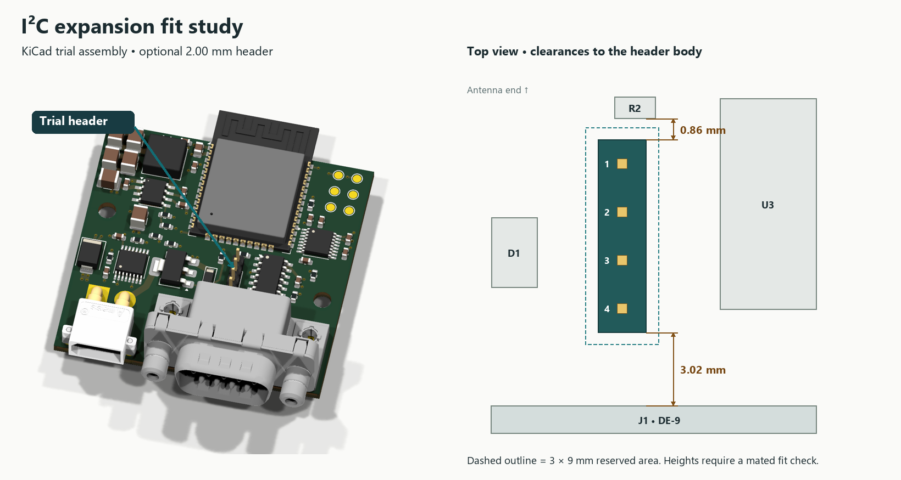

# 🧩 Integrated bridge PCB

🏠 [Overview](../../README.md) › 🧩 Design › **Integrated bridge PCB**

Use this plan to take the module-based bench bridge through a smaller four-layer design, first articles and a repeatable JLCPCB order.

> [!NOTE]
> **Status:** Power and instrument fault returns are routed on the four-layer development board for ten units. Signal routing follows the test-point and expansion review. [Requirements](requirements.md#requirements) · [KiCad project](../../electronics/integrated/compact-bridge.kicad_pro) · [Evidence S173, S178–S180, S189–S190, S196](../research/sources.md#source-register).

📑 **On this page:** <kbd>[1 · 🔌 Circuits](#circuits)</kbd> <kbd>[2 · 📐 Housing and layout](#layout)</kbd> <kbd>[3 · 🌡️ Heat and verification](#heat)</kbd> <kbd>[4 · 💶 Production cost](#cost)</kbd> <kbd>[5 · 📦 Production](#production)</kbd>

---

## 1. 🔌 Circuits

The [supplier circuit requirements and schematic comparison](requirements.md#pcb-schematic) cover U1–U5 and the three input-protection devices. The [first-article checks](../project/open-items.md#pcb-study) cover the differences that need measurements.

| Function | Captured circuit | Verification before release |
| --- | --- | --- |
| Controller | ESP32-WROOM-32E-H4 with antenna and shield, no PSRAM. Local decoupling and six top-side 3.3 V logic programming pads. Fixture senses 3.3 V, board powers itself. | Check boot and OTA recovery, unpowered UART injection and instrument-port startup bytes. H4 stock and assembly profile per S170/S175. |
| Navigation | One TRS3232EIPWR receives Zander and FLARM independently on GPIO32 and GPIO26. | Two simultaneous streams, polarity, loading and powered-off input. |
| Becker | SN65HVD1470DR full duplex at 3.3 V. Populate R4 to enable TX; R3 biases DI high, R5 defines DE if link removed. Receiver enabled, no receive termination fitted. SN65HVD35DR alternate subject to qualification. | Verify separate pairs and idle levels through reset and brownout. Compare loaded cable waveforms and bytes in both directions. |
| Supply | External F1, DMP6023LE reverse-polarity MOSFET, 100 kΩ gate network, 12 V gate clamp, provisional SMBJ20A, LMR33610ADDAR synchronous 400 kHz buck to 3.3 V. Draft power stage uses 6.8 µH, two 10 µF/100 V inputs, four 22 µF/25 V outputs. | Scope actual hot clamp and ringing against every input limit. Verify inrush, MOSFET gate, minimum effective capacitance after DC bias and thermal limits. See S172. |
| Battery measurement | R8/R9 divider from protected input to ground, C18 on the divider. While U5 is powered and enabled, PG low selects ground for GPIO34 and PG high selects the divider. At zero supply U5 isolates the signal paths and R12 pulls GPIO34 down. Output bleed preserves nominal ×11 scaling. | Calibrate against XT30 at 7–20 V. Scope GPIO34 and measure injection into unpowered 3.3 V at hot/cold start, hard collapse, reverse input and maximum clamped input. |
| Harness | Right-angle male Amphenol D09P33E4GV00LF and AMASS XT30PW-M30.G.Y. J1 follows the [DE-9 pinout](../hardware/wiring.md#de9-pinout). J2 pad 1 is ground and pad 2 is the raw supply. Both J1 shell locks are isolated from board ground. | Check the mating plugs, jackscrews, polarity and housing support with actual parts. S173, S196. |

## 2. 📐 Compact placement

**48 × 46.5 mm**, four layers and one populated side. This saves 543 mm² (19.6%) from the 50 × 55.5 mm layout. The same-edge DE-9 and XT30 occupy 47.0 mm across their courtyards. Six service pads form a 2 × 3 array at 3.35 mm pitch. The housing study still uses a 72 × 60 × 25 mm exterior. Mated access and mounting are first-article checks.

<b>🖼️ Show populated PCB in 3D</b> (click to expand)

KiCad render of the 48 × 46.5 mm placement. The preview uses Amphenol’s [DE-9 download](https://www.amphenol-cs.cn/media/wysiwyg/files/3d/sd09p33e4gv00lf.zip), the [C431092](https://jlcpcb.com/partdetail/C431092) XT30 family model and a matching KiCad package body for U4. The native J1 footprint includes a portable mechanical envelope. Connector colors are illustrative.

- Keep the ESP32 antenna past the PCB edge, with all-layer clearance to the host board, nearby metal and the mounted harness. Test Wi-Fi and Bluetooth inside the closed housing.
- C13 bridges VIN and GND beside U4. C10 connects directly to BOOT and SW. Fit the stripe on L1 over SW pad 1. Feedback is taken from the output capacitor bank and routed below the inner ground plane.
- A dedicated bottom trace joins J1 pins 3, 6 and 7 to XT30 minus. From pin 3 the calculated trace drop is 33 mV at 3.2 A and 85 °C. The external bridge fuse cannot interrupt this return. [Fault paths](../hardware/power.md#wire-breaks)
- The J1 flange aligns with the board edge, 0.50 mm inside the proposed front wall. The XT30 mouth is recessed about 2.15 mm from the outside of that wall. Allow clearance for the plug body and jackscrews and transfer mating loads to the housing. S173.
- U1 has nine separate paste windows and twelve open Ø0.20 mm holes. U4 has twelve Ø0.254 mm vias under one paste aperture. Send mask, paste and plated drill files together for the [assembler review](../project/open-items.md#pcb-study). S179.

The [compact-board review](../research/reviews/2026-11-20-compact-board-physical.md) covers the current antenna, connector loading, vibration, heat, climate and circuit placement. The [circuit and fabrication review](../research/reviews/2026-11-20-integrated-pcb.md) gives the schematic fault cases and exposed-pad artwork. S186–S190.

### 2.1 Internal I²C expansion and probe access

**Bus selection:** 3.3 V I²C on U1.33 (GPIO21/SDA) and U1.36 (GPIO22/SCL). Both are bidirectional, outside the flash and boot-strap assignments. For I²C, provide pull-ups to the bridge 3.3 V rail and check their combined resistance and rise time with the chosen peripheral. Keep an externally powered peripheral from driving an unpowered bridge. The development schematic still marks both pins unused pending footprint selection. [ESP32 pinout](https://documentation.espressif.com/esp32-wroom-32e_esp32-wroom-32ue_datasheet_en.html) · [Espressif I²C defaults](https://docs.espressif.com/projects/arduino-esp32/en/latest/api/i2c.html)

| Fit or load | Measured in CAD or proposed for test |
| --- | --- |
| Production board | A 3.0 × 9.0 mm rule area behind J1 reserves component space on both sides. A second 1.8 × 7.8 mm corridor protects the possible lands and drills from future routing on all four layers. Plane pours are allowed. The board carries no J3 pads, drills or connector. |
| Trial pinout | From R2 toward J1: 1 GND, 2 3V3 output, 3 SDA, 4 SCL. Pin 1 center X133.45/Y145.82 mm, 2.00 mm pitch along +Y. The candidate has four Ø0.80 mm finished holes and 1.35 mm lands. Check the intended wire size or header tails before choosing the footprint. |
| Plan clearance | The 2.0 × 8.0 mm header body clears R2 by 0.86 mm and J1 by 3.02 mm. Native courtyard clearance is 0.10 mm at R2 and 2.15 mm at J1. Body to U3 is 3.05 mm and to the U1 antenna rectangle 22.82 mm. A larger plug, daughterboard or bent wire needs its own envelope. |
| Vertical clearance and retention | The generic bare header reaches 6.0 mm above the PCB and 1.2 mm below the underside of a nominal 1.6 mm board. The 25 mm exterior height does not establish headroom above a mated socket. Check PCB mounting height, lid, floor, plug removal and a restraint independent of the solder joints. |
| 3.3 V budget | U4 is rated at 1 A. Reserving 500 mA for the ESP32 supply leaves 500 mA before the transceivers, other loads and thermal margin. Use **50 mA total at the port as a proposed first-article test load** (0.165 W at 3.3 V). Publish usable current only after measuring peak rail sag, startup/inrush and closed-box temperature at 7–20 V with three active streams and the peripheral fitted. |

**Probe map on the present board.** Viewed from the component side with J1 at the bottom, the two columns are 3.35 mm apart. TP2 is a fixture voltage-sense input. J2 powers the bridge.

| Row from antenna toward J1 | Left pad | Right pad |
| --- | --- | --- |
| 1 | TP1 GND | TP2 3V3 |
| 2 | TP3 EN | TP4 BOOT / GPIO0 |
| 3 | TP5 PROG_TX (ESP32 output) | TP6 PROG_RX (ESP32 input) |

For diagnostic pad placement, the native net anchors are J2.2 (VIN_RAW), C19.1 (VIN_PROT), R11.2 (PG_3V3), U1.6 (V_SENSE), U2.12/.9 (ZS_RX/FL_RX) and U3.2/.5 (BKR_RX/BKR_TX). The last four are logic-side signals. U5.4 to U1.6 spans 24.56 mm. Place the ADC probe near GPIO34 with a nearby ground and review the route against the switch node and feedback path. These anchors identify the nets for PCB08. Dedicated labeled diagnostic access and a mated-fixture check follow the fit decision. [Open items](../project/open-items.md#pcb-study) · [S191, S196](../research/sources.md#source-register)

### 2.2 Shallower PCB footprint for the existing DE-9 plug

J1 is the Amphenol **D09P33E4GV00LF**, a male right-angle DE-9 with 5 A contacts, the existing cable pinout, 24.99 mm screw spacing and two UNC 4-40 female locks. Its 30.81 mm flange sits at the front PCB edge. The body extends 12.60 mm onto the board, freeing 2.05 mm of depth (about 63 mm² of rectangular body envelope).

| J1 feature | Dimension from the flange or PCB |
| --- | --- |
| Contact rows and board locks | 8.08 and 10.92 mm behind flange, locks at 9.50 mm. Contact pitch 2.74 mm, stagger 1.37 mm. |
| Mating center | 6.30 mm above PCB top, 0.90 mm lower than the previous J1. Use this height for the panel opening and supports. |
| Cable and shell | Existing female cable plug and screwlocks. Both shell pads are isolated from board GND. |

[Supplier drawing and board checks, S195–S196](../research/sources.md#source-register) · [Mated fit and fault checks](../project/open-items.md#pcb-study)

---

## 3. 🌡️ Thermal, climate and installation checks

| Check | Procedure |
| --- | --- |
| Energy and thermal load | At the XT30 log input voltage, current peaks and integrated Wh with three loaded Wi-Fi ports, with Bluetooth off, with an additional Bluetooth link and in fallback. Repeat across 7–20 V and under hot closed-box conditions. Probe the buck, inductor, protection device, module, connectors and loaded housing supports. Use the same traffic and phone for any controller comparison. |
| Outdoor storage | Log site temperature and RH, cold surfaces on warm-up and hot parked-canopy conditions. Cycle the unpowered assembly through representative condensation, dry before powering, and check insulation, corrosion, retention, ADC, rail stability and all three streams. Test dry cold starts and sustained hot operation at the measured limits. |
| Limits | XT30 −20…+120 °C operating, TRS3232E −40…+85 °C ambient, H4 up to +105 °C, DE-9 −55…+125 °C, HVD1470 up to +125 °C ambient. Buck limit is junction temperature. Loaded PETG features may govern earlier. Check the matching plugs, capacitors and remaining BOM as well. See S170–S174 and the [housing climate study](../hardware/housing.md#climate). |
| Cleaning and coating | Use a module-compatible cleaner and a single module reflow. If coating is fitted, mask the antenna, connectors, shell bonds and probe pads. |
| Installed use | Ask the responsible certifying staff to assess the actual aircraft, connection to the Becker and any standby-frequency command. Supply wiring, fuse and isolation, failure effects, installed radio/compass interference checks, mounting and continued-maintenance information. S177 records the regulatory context. |

---

## 4. 💶 Ten-board cost comparison

Supplier snapshot on 20 November 2026, USD per part. Six major lines only, before passives, protection, ADC switch, fabrication, assembly, test, freight and tax. S175 covers the five unchanged lines. S196 gives a distributor reference for J1 pending the assembler quote.

| Part | One | Ten, each | Ten, line total |
| --- | ---: | ---: | ---: |
| ESP32-WROOM-32E-H4 | 4.3546 | 3.8993 | 38.99 |
| LMR33610ADDAR | 1.7660 | 1.5783 | 15.78 |
| SN65HVD1470DR | 1.5408 | 1.5016 | 15.02 |
| Amphenol D09P33E4GV00LF (DigiKey) | 3.2300 | 2.7430 | 27.43 |
| TRS3232EIPWR | 0.7770 | 0.6268 | 6.27 |
| AMASS XT30 | 0.3836 | 0.3346 | 3.35 |
| **Subtotal, calculated before rounding** | **12.0520** | **10.6836** | **106.84** |

- The approved HVD1470 saves $3.0424 per board versus the HVD35 at $4.5440. A SIT3491EESD at $0.4293 needs a separate edge-rate and ESD qualification. A 3PEAK TPT3232E-TS3R at $0.4636 changes receiver limits and charge-pump sizing. A $0.8520 LMR51420YDDCR needs a new regulator layout and voltage-valid circuit for the ADC switch.
- Reverse protection costs about $0.78 more per board using the MOSFET network than a series Schottky. At 0.10 A input over 10 h, a 0.4 V diode costs 0.40 Wh versus 0.0035 Wh in a 35 mΩ MOSFET channel, plus gate bias. Verify actual flight draw.
- Quote ten on Standard PCBA with one SMT side, panel rails/fiducials, connector soldering and attrition. The published one-side setup and stencil example totals $33.77 per order. Compare charges for ENIG, optional coating, connector hand fitting, shipping and tax separately. Report cost per accepted unit. S168–S169.

---

## 5. 📦 Production

### 5.1 Saved JLCPCB settings

Open the project in KiCad, then open **PCB Editor → Board Setup** to inspect the settings used for this layout.

| Setting | Value used for the ten-board design | Saved in |
| --- | --- | --- |
| Stackup and finish | JLC04161H-7628, four-layer FR-4, nominal 1.6 mm. Outer copper 35 µm, inner copper 15.2 µm. Green solder mask, white silkscreen, lead-free HASL quote baseline. | [KiCad board](../../electronics/integrated/compact-bridge.kicad_pcb) |
| Tracks and copper | Default track 0.30 mm, minimum width and spacing 0.25 mm, routed-edge clearance 0.50 mm. Narrowest existing track 0.28 mm. Select wider power and return paths for their electrical load. | [KiCad project](../../electronics/integrated/compact-bridge.kicad_pro) |
| Vias and drilling | Default via Ø0.70/0.30 mm land/drill. Minimum via land Ø0.65 mm, annular ring 0.175 mm, hole-to-hole 0.50 mm and hole-to-other-net copper 0.35 mm. Ø0.30 mm is the ordinary drill. U1 and U4 use their separate exposed-pad patterns. | KiCad project and board |
| Mask and legend | Mask opening to other copper 0.12 mm, silk clearance 0.20 mm. New text 1.20 mm high with 0.20 mm strokes. Green mask with 1:1 openings and ordinary vias tented both sides. Aim for ≥0.15 mm drawn webs on new lands where possible. KiCad merges openings below 0.10 mm. | [KiCad board](../../electronics/integrated/compact-bridge.kicad_pcb) and project |

The selected four-layer process lists 0.09/0.09 mm trace/space for 1 oz copper. The dedicated B.Cu return is 1.45–2.00 mm wide. A 20% width reduction raises its calculated 3.2 A drop from 32.8 to about 41 mV and loss from 0.105 to 0.131 W at 85 °C, holding copper thickness constant. Measure the complete mated return under load. [S192, S196](../research/sources.md#source-register)

For the ten-board quote, submit the ESP32 (U1) and buck (U4) mask, paste and drill plots together. Their exposed-pad artwork needs a separate assembly decision on via treatment and stencil openings. [JLCPCB stackups](https://jlcpcb.com/impedance) · [Fabrication capabilities](https://jlcpcb.com/capabilities/pcb-capabilities) · [Quote items](../project/open-items.md#pcb-study)

### 5.2 From design to JLCPCB order

| Gate | Work product | Ready to proceed when |
| --- | --- | --- |
| 1 · Freeze interfaces | One-page interface and environmental limits sheet, mated connector drawings and compact fit study | Owner selects hardware choices individually. Record instrument variants, electrical limits, allowed TX states, ground-fault case and thermal test limits. Track missing inputs in [open items](../project/open-items.md#pcb-study). |
| 2 · Capture the circuit | Separate KiCad PCB project. Sheets for power/protection, ESP32/service, navigation and radio. Exact MPN, supplier code, rating, land pattern and fitted/DNP state on each line | Rev A schematic owns its board nets. Compare the netlist against the existing harness contract and firmware pin map. Review worst-case power, fault and logic calculations, ERC and every remaining warning. Check footprints against manufacturer drawings. |
| 3 · Place and route | Four-layer board and STEP export, mated compact housing study, placement and thermal review | Fit with connectors and service fixture, continuous return paths, fault-current capacity, antenna clearance, thermal pad and test access. Check JLC stackup, copper, annular rings, drills, mask/paste, routed slots, board-edge distances and panel rails/fiducials. DRC and schematic/PCB parity pass. |
| 4 · Obtain ten-board quote | One revision-stamped ZIP with Gerbers for every copper, mask, silk, paste and outline layer, plus Excellon plated/non-plated drills. Separate JLC BOM and CPL, dimensioned fabrication and assembly drawings, fitted/DNP and hand-fit list, editable KiCad source and STEP | Reopen plots/drills in an independent viewer. Match fitted designators exactly between BOM and CPL. BOM carries value, footprint, designator and JLC/LCSC code. CPL carries designator, X/Y in mm, rotation and side using one origin. Inspect polarity, pin 1, module antenna direction, connector face and rotations in JLC's placement preview. S169. |
| 5 · Owner order | Dated quote or reproducible ordering pack with stackup, board thickness/copper/finish, mask, assembly side, service tier, quantities, accepted parts, stock snapshot, lead time, shipping and price breakdown | Every fitted part is matched or explicitly listed for local fitting. Record any substitutions, quote validity shown by vendor and assembly-review corrections. Owner reviews the final amount and places the order. Arrange first-article inspection and acceptance before committing the remaining assembly where available. |
| 6 · Accept and repeat | Serialized first-article results against section 3, defects and corrected revision where needed. Bundle flash/recovery instructions and fixture pinout with the release | Run the closed-box thermal, electrical, mechanical and radio tests on actual hardware. Use the accepted revision and a fresh stock/price check for the production order. |

<kbd>[⬆️ Back to top](#top)</kbd> <kbd>[🏠 Overview](../../README.md)</kbd>
