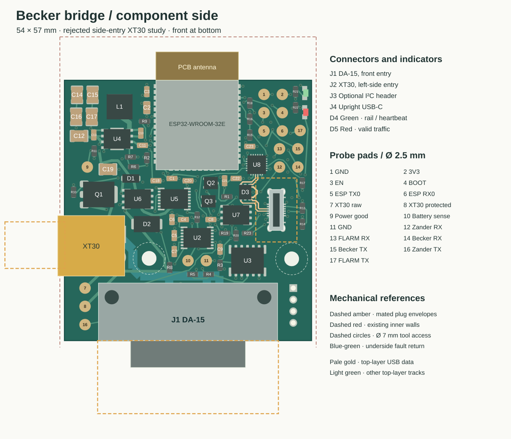
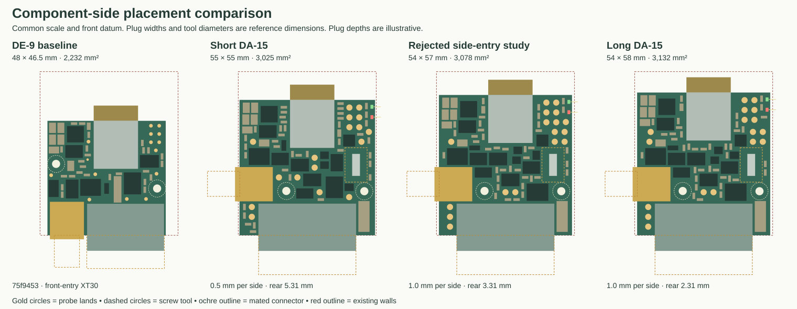
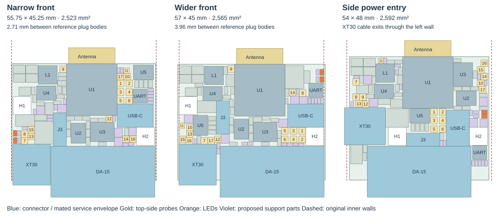
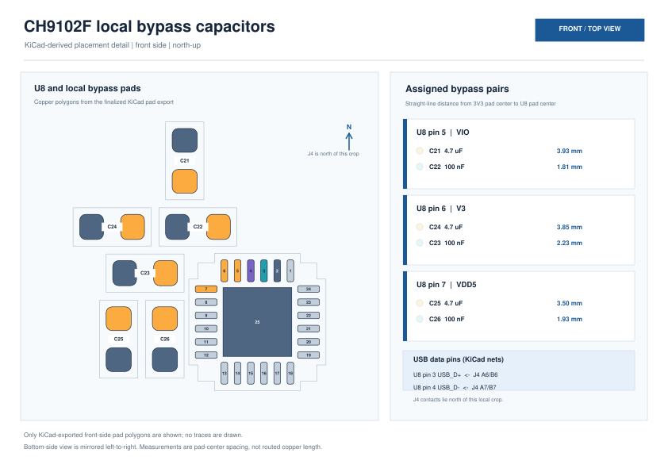
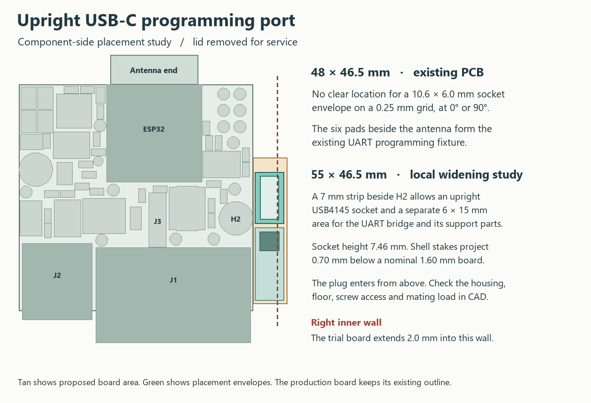

<a id="top"></a>

# 🧩 Integrated bridge PCB

🏠 [Overview](../../README.md) › 🧩 Design › **Integrated bridge PCB**

Use this plan to take the module-based bench bridge through a smaller four-layer design, first articles and a repeatable JLCPCB order.

> [!NOTE]
> **Status:** Review the [front-panel placement](#placement-comparison) before routing. The wider candidate uses the original XT30 and mounting positions. The ten-board quote and first article follow mechanical and electrical acceptance.

📑 **On this page:** <kbd>[1 · 🔌 Circuits](#circuits)</kbd> <kbd>[2 · 📐 Housing and layout](#layout)</kbd> <kbd>[3 · 🌡️ Heat and verification](#heat)</kbd> <kbd>[4 · 💶 Production cost](#cost)</kbd> <kbd>[5 · 📦 Production](#production)</kbd>

---

<a id="circuits"></a>

## 1. 🔌 Circuits

The [supplier circuit requirements and schematic comparison](requirements.md#pcb-schematic) cover U1–U4 and the three input-protection devices. The [first-article checks](../project/open-items.md#pcb-study) cover the differences that need measurements.

| Function | Captured circuit | Verification before release |
| --- | --- | --- |
| Controller | ESP32-WROOM-32E-H4 with antenna and shield, no PSRAM. Local decoupling and six top-side 3.3 V logic programming pads. Fixture senses 3.3 V, board powers itself. | Check boot and OTA recovery, unpowered UART injection and instrument-port startup bytes. H4 stock and assembly profile per S170/S175. |
| Navigation | MaxLinear SP3232EEY-L/TR connects two independent RS-232 ports. Zander uses GPIO32 RX and GPIO33 TX. FLARM uses GPIO26 RX and GPIO27 TX. R24 and R25 pull U2 pins 11 and 10 up to 3.3 V through 10 kΩ each, holding both transmit lines at UART idle during reset. | Exercise both ports simultaneously at J1. Check polarity, loading and powered-off behaviour in both directions. |
| Becker | SIT3491EESD full duplex at 3.3 V. R4 (1 kΩ) and R5 (100 kΩ) hold DE at 3.27 V, which enables TX independently of the SIT3491E’s VIH. Leave R4 unfitted for receive-only. R3 biases DI high. Receiver enabled, no receive termination fitted. | Verify separate pairs and idle levels through reset and brownout. Compare loaded cable waveforms and bytes in both directions. |
| Supply | XT30 7–16 V continuous or nominal 5 V USB. External F1, DMP6023LE reverse protection, 100 kΩ gate network, 12 V gate clamp and SMBJ16A surge diode. TPS62933PDRLR supplies 3.3 V at 500 kHz with a 4.7 µH Sunlord inductor. At VIN, C12 (10 µF 50 V X5R, 1206) and C13 (100 nF) follow TI’s typical input pair. | Check hot clamp and ringing at U4, ripple across C12, startup/inrush, effective capacitance and loaded temperature. S228, S230. |
| Battery measurement | R8 (100 kΩ) from protected XT30 to V_SENSE. R9 (10 kΩ) and C18 (100 nF) connect V_SENSE to ground. GPIO34 and TP10 read the divider directly. Firmware scales the reading by 11. S224. | Calibrate against XT30 at 7–16 V. |
| Harness | Right-angle male Amphenol D15P33E4GV00LF and AMASS XT30PW-M30.G.Y. See the [DA-15 pinout](#smaller-dsub). J2 pad 1 is ground and pad 2 is the raw supply. Both J1 shell locks are isolated from board ground. | Check the mating plugs, jackscrews, polarity and housing support with actual parts. S173, S196. |

<a id="layout"></a>

## 2. 📐 Compact placement

<a id="placement-comparison"></a>

**Front-panel proposal for review.** Both connectors face forward. All 74 electrical footprints and the two original mounting holes are on the candidate drawing. Both MX5050s, the input protection, buck components, USB support, J3 and the 17 probes are placed.


| Dimension | 48.00 × 46.50 mm baseline with DA-15 on the old axis | 64.50 × 46.50 mm candidate |
| --- | --- | --- |
| DA-15 centre X / XT30 centre X | 136.70 / 112.90 mm | 149.75 / 112.90 mm |
| Connector body / mated cable envelope | 2.42 / 1.05 mm overlap | 10.63 / 12.00 mm clear |
| Right DA-15 lock land | Extends 2.485 mm past PCB edge | 0.965 mm copper-to-edge |
| Front and housing | DE-9 screw pitch 24.99 mm | DA-15 pitch 33.32 mm. Proposed right inner wall X170.50, 12.50 mm beyond the reference wall |
| Service with lid off | Fixed H1 and H2 | Ø7 mm driver; 14 × 9 mm USB plug allowance; 13.81 mm antenna tip to rear wall; LEDs face right |

Ten diagnostic solder lands occupy two columns between the front connectors on 4 mm centres (6.50 × 18.50 mm across the lands). TP9 sits alongside TP8. TP1–TP6 retain the programming fixture pattern. C14 and C15 sit on the output side of L1, 4.19 and 2.51 mm from pad 2 to their positive lands. U4 SW to L1 pad 1 spans 3.84 mm. The nearest approach of a centred Ø2 mm probe shaft to another courtyard is 0.916 mm at TP5 beside U2 (S224).

[USB bypass placement detail](../images/integrated-front-usb-bypass.pdf) · [Vector overlay](../images/integrated-front-fit.pdf) · [Cropped vector board view](../images/integrated-front-top.pdf) · [Complete schematic · single-sheet vector PDF](../images/integrated-front-schematic.pdf) · [Candidate KiCad project](../../electronics/integrated/front-panel/compact-bridge.kicad_pro). See [S212](../research/sources.md#source-register) for placement checks and the [open items](../project/open-items.md#pcb-study) before routing.

**Archived side-entry study**





| Complete placement | Area / change from DE-9 | Side gap each / antenna tip to rear wall | Ø2 mm probe / Ø7 mm screw tool margin | TP10 to TP11 |
| --- | --- | --- | --- | --- |
| 55 × 55 mm | 3,025 mm² / +35.5% | 0.5 / 5.31 mm | 0.98 / 0.20 mm | 10.82 mm |
| **54 × 57 mm, rejected side-entry study** | **3,078 mm² / +37.9%** | **1.0 / 3.31 mm** | **0.99 / 0.20 mm** | **4.00 mm** |
| 54 × 58 mm | 3,132 mm² / +40.3% | 1.0 / 2.31 mm | 0.99 / 0.20 mm | 4.00 mm |

All three include the protection and supply parts, service circuits and probes. The DA-15 mates at the front, XT30 at the left and USB-C from above. The 54 × 57 mm study reserves a 14 × 9 mm USB plug envelope. The ESP32 antenna projects 6.19 mm past the PCB. Both side-emitting LEDs face right, 1.50 mm from the board edge at their centers. The dimensions are planar clearances against reference envelopes. The side opening shown in these studies conflicts with the front-panel requirement. The older 55 mm extension at its original mounting position crossed the wall by 2 mm.

**Earlier studies at `0304d9b`.** These predate placement of both ideal diodes.



| Placement | Outline / area | Mated connector access | Top-side probe and LED access |
| --- | --- | --- | --- |
| DE-9 baseline at `75f9453` | 48 × 46.5 mm / 2,232 mm² | 2.95 mm projected gap between the reference cable bodies (S198). No upright USB-C. | Six fixture and nine diagnostic pads. No status LEDs. |
| DA-15 and XT30 at front, narrow | 55.75 × 45.25 mm / 2,522.7 mm² | 2.71 mm cable-body gap. Centering the board leaves 0.125 mm per side in the 56 mm study cavity. | Minimum Ø2 mm shaft margin 0.05 mm. LED centers 1.30 mm from the left edge. |
| DA-15 and XT30 at front, wider | 57 × 45 mm / 2,565 mm² | 3.96 mm cable-body gap. A centered board needs 59 mm internal width for 1 mm assembly space per side. | Minimum shaft margin 0.30 mm. LED centers 1.28 mm from the right edge. |
| Front DA-15, side XT30 | 54 × 48 mm / 2,592 mm² | Independent withdrawal directions. Needs a side opening and room for the XT30 cable bend. 1 mm nominal board clearance per side. | Minimum shaft margin 0.05 mm. LEDs 1.71 mm from the right edge. TP10 and its ground are 39.6 mm apart. |

The two front-entry candidates leave 15.06 and 15.31 mm respectively between the antenna tip and the drawn rear wall. Side entry reduces this to 12.31 mm. All three reserve a 14 × 9 mm vertical USB plug approach, a 5 × 13 mm optional J3 mating envelope and individual sites for the USB, auto-reset and LED support parts. All probes clear those reservations in plan. The LEDs face a side wall for viewing through vents where possible. Slot height, viewing angle, real plugs, tool reach and mating loads need the actual enclosure and first article. [Placement evidence S202](../research/sources.md#source-register)

**DE-9 baseline.** 48 × 46.5 mm, four layers and one populated side. This saves 543 mm² (19.6%) from the 50 × 55.5 mm layout. The same-edge DE-9 and XT30 occupy 47.0 mm across their courtyards. Six service pads form a 2 × 3 array at 3.35 mm pitch. The housing study still uses a 72 × 60 × 25 mm exterior. Mated access and mounting are first-article checks.

<details>
<summary><b>🖼️ Show populated PCB in 3D</b> (click to expand)</summary>


KiCad render of the 48 × 46.5 mm placement. The preview uses Amphenol’s [DE-9 download](https://www.amphenol-cs.cn/media/wysiwyg/files/3d/sd09p33e4gv00lf.zip), the [C431092](https://jlcpcb.com/partdetail/C431092) XT30 family model and a matching KiCad package body for U4. The native J1 footprint includes a portable mechanical envelope. Connector colors are illustrative.

</details>

- Keep the ESP32 antenna past the PCB edge, with all-layer clearance to the host board, nearby metal and the mounted harness. Test Wi-Fi and Bluetooth inside the closed housing.
- Place the C13 VIN/GND bypass and the C10 BST/SW bootstrap loop beside U4. Their respective VIN and BST land centres are each 1.60 mm from the corresponding IC pad. Fit the stripe on L1 over SW pad 1. Take feedback from the output capacitor bank away from SW when routing.
- A dedicated bottom trace joins J1 pins 3, 6 and 7 to XT30 minus. On the DE-9 baseline the calculated drop from pin 3 was 33 mV at 3.2 A and 85 °C. The external bridge fuse cannot interrupt this return. [Fault paths](../hardware/power.md#wire-breaks)
- On the DE-9 baseline the J1 flange aligns with the board edge, 0.50 mm inside the proposed front wall. The XT30 mouth is recessed about 2.15 mm from the outside of that wall. Allow clearance for the plug body and jackscrews and transfer mating loads to the housing. S173.
- U1 has nine separate paste windows and twelve open Ø0.20 mm holes. The front-panel U4 has eight SOT-583 lands at 0.50 mm pitch. The exposed-pad U4 shown in S179 belongs to the DE-9 baseline.

The DA-15 return widths and calculated drops are in the [fabrication settings](#production). The [compact-board review](../research/reviews/2026-11-20-compact-board-physical.md) covers the DE-9 baseline antenna, connector loading, vibration, heat, climate and circuit placement. The [circuit and fabrication review](../research/reviews/2026-11-20-integrated-pcb.md) gives the schematic fault cases and exposed-pad artwork. S186–S190.

<a id="expansion"></a>

### 2.1 Internal I²C expansion and probe access

**Bus selection:** 3.3 V I²C on U1.33 (GPIO21/SDA) and U1.36 (GPIO22/SCL). Both are bidirectional, outside the flash and boot-strap assignments. For I²C, provide pull-ups to the bridge 3.3 V rail and check their combined resistance and rise time with the chosen peripheral. Keep an externally powered peripheral from driving an unpowered bridge. J3 is a normally empty 2.54 mm row. The drawing below shows its DE-9 baseline location. [ESP32 pinout](https://documentation.espressif.com/esp32-wroom-32e_esp32-wroom-32ue_datasheet_en.html) · [Espressif I²C defaults](https://docs.espressif.com/projects/arduino-esp32/en/latest/api/i2c.html)


| Fit or load | Measured in CAD or proposed for test |
| --- | --- |
| Assembly | Leave J3 empty on all ten boards. A standard 1 × 4 vertical pin header can be soldered in later. J3 is excluded from the assembly BOM and placement export. |
| Pinout | From R2 toward J1: **1 GND** (square), **2 3V3 output**, **3 SDA** (GPIO21), **4 SCL** (GPIO22). DE-9 baseline pin 1 center X133.45/Y146.04 mm, 2.54 mm pitch toward +Y. Four Ø1.00 mm plated holes with 1.70 mm lands. |
| Optional header fit | On the DE-9 baseline the 2.54 × 10.16 mm reference body clears R2 by 0.81 mm and J1 by 0.91 mm. Courtyard gaps are 0.05 mm and 0.04 mm respectively. S197. |
| Vertical clearance and retention | The reference pins project 8.54 mm above the PCB and 1.40 mm below a 1.60 mm board. Check the selected socket, extraction space, wire bend, independent restraint and enclosure against the [first-article checks](../project/open-items.md#pcb-study). |
| 3.3 V budget | U4 is a 3 A device. Use the existing 1 A board design budget. Reserving 500 mA for the ESP32 supply leaves 500 mA before the transceivers, other loads and thermal margin. Use **50 mA total at the port as a proposed first-article test load** (0.165 W at 3.3 V). Publish usable current only after measuring peak rail sag, startup/inrush and closed-box temperature at 7–16 V with three active streams and the peripheral fitted. |

**Production probe map.** TP1–TP6 form a 2 × 3 fixture on 4.0 mm centers. TP2 senses the board voltage. TP1–TP17 each provide a Ø2.50 mm top-side SMD solder land with an open mask and no stencil aperture. Hand-solder a fine insulated wire to the required net and strain-relieve it at the housing. Keep fixture pads accessible if the pogo adapter is needed. Use J3 for plug-in I²C expansion. [Front-panel pad locations](../images/integrated-front-top.pdf)

| Row from antenna toward J1 | Left pad | Right pad |
| --- | --- | --- |
| 1 | TP1 GND | TP2 3V3 |
| 2 | TP3 EN | TP4 BOOT / GPIO0 |
| 3 | TP5 PROG_TX (ESP32 output) | TP6 PROG_RX (ESP32 input) |


| Board mark | Probe | Measure |
| --- | --- | --- |
| 7 / 8 | TP7 VIN_RAW / TP8 VIN_PROT | Supply before and after reverse-polarity protection |
| 9 | TP9 PG_3V3 | Buck power-good |
| 10 / 11 | TP10 V_SENSE / TP11 GND | Divider midpoint at GPIO34 and a local ground connected to the ground plane, 4.00 mm apart on the DA-15 board |
| 12 / 13 | TP12 ZS_RX / TP13 FL_RX | Zander and FLARM receiver logic |
| 14 / 15 | TP14 BKR_RX / TP15 BKR_TX | Becker receive and transmit logic |
| 16 / 17 | TP16 ZS_TX / TP17 FL_TX | Zander and FLARM transmit logic |

On the DE-9 baseline, TP11 was Ø1.0 mm and the other 14 pads were Ø1.5 mm. [First-article probe checks](../project/open-items.md#pcb-study)

<a id="usb-programming"></a>

### 2.2 Upright USB-C programming

U8 pins 5 (VIO), 6 (V3) and 7 (VDD5) share 3.3 V. Fit one 1 µF capacitor, C26, 1.93 mm between the VDD5 and capacitor pad centres. Give C26 a short ground return. WCH §7.1 permits this connection in the all-3.3 V configuration. [USB schematic · vector PDF](../images/integrated-front-usb-schematic.pdf) · [Bypass placement · vector PDF](../images/integrated-front-usb-bypass.pdf)



On the DE-9 baseline, J2 supplies power and TP1–TP6 serve a 3.3 V USB-to-UART pogo fixture. For production, program the WROOM through an upright USB-C port with the lid removed. [PCB12](requirements.md#production-pcb) defines the three supply modes and bench checks.

<a id="manual-flash"></a>

**First flash or USB recovery**

1. Build the [normal bridge firmware](../../firmware/bridge/README.md#build) with the project’s OTA partition layout. Connect a USB data cable to J4 and select the CH9102F serial port. The example uses COM3.
2. Hold **TP4 (BOOT/GPIO0)** to **TP1 (GND)**. Momentarily connect **TP3 (EN)** to TP1, then release EN while BOOT stays grounded. The ESP32 samples GPIO0 when EN rises.
3. From the repository root, run the command below. Release TP4 once esptool identifies the ESP32. The merged image contains the bootloader, partition table and bridge application.

   ```text
   esptool --chip esp32 --port COM3 --before no-reset --after no-reset write-flash 0x0 build/bridge/bridge.ino.merged.bin
   ```

4. After esptool verifies the write, leave TP4 released and pulse TP3 to TP1 again to start the firmware.

**Later updates** use the [password-protected Wi-Fi upload](../../firmware/bridge/README.md#upload-over-wi-fi) with the application image `build/bridge/bridge.ino.bin`. USB is normally needed once per blank board. Use the manual procedure for recovery if the firmware cannot boot or accept OTA, or to install a new partition layout. S106, S229.



| Study item | Result |
| --- | --- |
| Selected socket | GCT USB4145-03-0230-C, vertical USB 2.0 data receptacle. Its body stands 7.46 mm high. The four 2.30 mm shell stakes extend a nominal 0.70 mm below the 1.60 mm PCB. Allow support near the socket for the 5–20 N insertion load. |
| Existing outline | The 10.6 × 6.0 mm study envelope found no free position on a 0.25 mm grid at 0° or 90°. Repeating the check with TP1–TP6 removed also found no clear position. A same-outline design needs component rearrangement. |
| Wider layout | A 7 mm extension beside H2 provides the socket envelope and a 6 × 15 mm trial area for electronics. The 55 mm board would cross the drawn right inner wall by 2.0 mm at the present mounting position. Shifting the assembly 2.5 mm left would leave only 0.5 mm per side and move both front cutouts and mounts. |
| Programming circuit | CH9102F connects USB-C to ESP32 UART0. R18 (1 kΩ) feeds ESP32 RX. DTR (U8.23) and RTS (U8.19) are open. R15 (1 kΩ) feeds VBUS sense at U8.8. Leave R16 unpopulated. D3 protects D+/D−. Its rail pin 5 connects to 3.3 V, not VBUS. U8’s internal D+ pull-up therefore cannot hold VBUS above U8.8’s 1.7 V threshold while XT30 powers the board, so U8 detects the detach and suspends. VBUS has no clamp. U7 (60 V absolute maximum) and R15 sit between the receptacle and U8.8 (6.5 V absolute maximum). S230. |
| Production power path | Use one Wuxi Maxinmicro MX5050S6030A1 (ESOP-8L, C54800033) on each input to U4. Feed one from protected XT30 and one from USB VBUS. XT30 takes priority at 7–16 V. Tap the battery divider before the XT30 device. Fit a separate 4.7 kΩ pull-down (R13, R14) on each CC pin, within USB-C’s 5.1 kΩ ±20% Rd. Each VS pin connects to its own input. Below 5 V at the USB receptacle, active operation and USB-only startup fall outside the specified range. The owner accepts this cable-drop risk. See [S208](../research/sources.md#source-register), [PCB12](requirements.md#production-pcb) and the [USB bias and bench checks](../project/open-items.md#pcb-study). |

Use the 55 mm extension as a comparison when placing the complete circuit for the [new layout](../project/roadmap.md#work-packages). Check the plug overmold, cable withdrawal, H2 tool access and enclosure support on each candidate. [Open interface choices](../project/open-items.md#pcb-study) · [S201](../research/sources.md#source-register)

<a id="smaller-dsub"></a>

### 2.3 Production DA-15 and bench DE-9

The production J1 is the Amphenol **D15P33E4GV00LF** male right-angle DA-15, with two rows, nominal 5 A contacts, a 39.14 mm flange and 33.32 mm between the 4-40 locks. Its mating axis is 6.30 mm above the PCB. Fit a new female DA-15 harness plug. Retain the XT30 and isolate the two J1 board locks from ground.

| Production J1 | Assignment |
| --- | --- |
| 1, 2 | Zander and FLARM instrument TX into the bridge, respectively |
| 3, 6, 7 | Existing instrument returns, each retained on its original number |
| 4, 5 / 8, 9 | 4/5 carry Becker radio TX +/− to bridge U3.12 (A) and U3.11 (B). 8/9 carry bridge U3.9 (Y) and U3.10 (Z) to Becker radio RX +/−. |
| 10 | GPIO33 → U2.11 / T1IN → U2.14 / T1OUT → Zander instrument RX |
| 11 | GPIO27 → U2.10 / T2IN → U2.7 / T2OUT → FLARM instrument RX |
| 12–15 | Spare, no connection |

**Differential routing.** Lengths below are planar copper centerlines between pad centers. Vertical travel through a via is excluded. Plus and minus are measured independently for each USB plug orientation. [S210](../research/sources.md#source-register)

| Signal path | Plus / minus (mm) | Difference | Vias (+ / −) |
| --- | ---: | ---: | ---: |
| USB-C A6/A7 → U8 pins 3/4, via D3 | 16.30 / 14.61 | 1.69 mm | 0 / 0 |
| USB-C B6/B7 → U8 pins 3/4, via D3 | 19.48 / 21.21 | 1.73 mm | 0 / 2 |
| Becker radio TX, J1.4/5 → U3 A/B | 18.56 / 18.53 | 0.03 mm | 1 / 1 |
| Becker radio RX, U3 Y/Z → J1.8/9 | 12.15 / 30.90 | 18.75 mm | 1 / 1 |

The A-side USB path stays on F.Cu over In1 ground. The B-side D− crossover uses In2 locally between the two connector vias. Both Becker pairs transition together to In2. The DA-15 places pins 8 and 9 in different rows, 18.04 mm apart. The driver pair separates on approach to those contacts. The JLC04161H-7628 reference stack gives approximately 93–97 Ω in a straight 0.30 mm pair with a 0.25–0.32 mm gap in the 2D model. The short contact exits, fanouts, component lands and vias change the geometry. The 90 Ω target still needs fabricator confirmation and a hardware check. [Model assumptions S211](../research/sources.md#source-register) [First-article checks](../project/open-items.md#pcb-study)

The module-based bridge uses its existing [DE-9 harness](../hardware/wiring.md#de9-pinout). [DA-15 drawing and cable reference, S202](../research/sources.md#source-register)

---

<a id="heat"></a>

## 3. 🌡️ Thermal, climate and installation checks

| Check | Procedure |
| --- | --- |
| Energy and thermal load | At the XT30 log input voltage, current peaks and integrated Wh with three loaded Wi-Fi ports, with Bluetooth off, with an additional Bluetooth link and in fallback. Repeat across 7–16 V and under hot closed-box conditions. Probe the buck, inductor, protection device, module, connectors and loaded housing supports. Use the same traffic and phone for any controller comparison. |
| Outdoor storage | Log site temperature and RH, cold surfaces on warm-up and hot parked-canopy conditions. Cycle the unpowered assembly through representative condensation, dry before powering, and check insulation, corrosion, retention, ADC, rail stability and all three streams. Test dry cold starts and sustained hot operation at the measured limits. |
| Limits | XT30 −20…+120 °C operating, SP3232E −40…+85 °C ambient, H4 up to +105 °C, DE-9 −55…+125 °C, SIT3491E up to +125 °C ambient. Buck limit is junction temperature. Loaded PETG features may govern earlier. Check the matching plugs, capacitors and remaining BOM as well. See S170–S174, S230 and the [housing climate study](../hardware/housing.md#climate). |
| Cleaning and coating | Use a module-compatible cleaner and a single module reflow. If coating is fitted, mask the antenna, connectors, shell bonds and probe pads. |
| Installed use | Ask the responsible certifying staff to assess the actual aircraft, connection to the Becker and any standby-frequency command. Supply wiring, fuse and isolation, failure effects, installed radio/compass interference checks, mounting and continued-maintenance information. S177 records the regulatory context. |

---

<a id="cost"></a>

## 4. 💶 Ten-board cost comparison

**Front-panel prototype · 21 November 2026.** The [native KiCad schematic](../../electronics/integrated/front-panel/compact-bridge.kicad_sch) has 27 fitted lines, 54 placements per board and 540 for ten. Leave J3 and R16 unpopulated. TP1–TP17 are solder lands.

Use Standard PCBA for U1. Stock is JLCPCB catalogue inventory. USD/pc uses the price break for the fitted ten-board quantity, before attrition, purchasing minimums, assembly, freight and tax. Rows are sorted by fitted cost per board, highest first. [Download the review BOM (CSV)](../../electronics/integrated/front-panel/fitted-bom.csv). S227–S230.

| Fitted references | Orderable MPN | JLCPCB SKU | Process | JLC tier | Per board | For ten | Stock, 21 Nov | USD/pc | USD/board |
| --- | --- | --- | --- | --- | ---: | ---: | ---: | ---: | ---: |
| U1 | ESP32-WROOM-32E-H4 | [C3013935](https://jlcpcb.com/partdetail/C3013935) | SMT | Extended | 1 | 10 | 2,953 | 3.9086 | 3.9086 |
| J1 | D15P33E4GV00LF | [C3139986](https://jlcpcb.com/partdetail/C3139986) | Wave | Extended | 1 | 10 | 572 | 1.8275 | 1.8275 |
| J4 | USB4145-03-0230-C | [C5291559](https://jlcpcb.com/partdetail/C5291559) | SMT | Extended | 1 | 10 | 422 | 1.1338 | 1.1338 |
| U8 | CH9102F | [C2858418](https://jlcpcb.com/partdetail/C2858418) | SMT | Extended | 1 | 10 | 13,582 | 1.0259 | 1.0259 |
| U6–U7 | MX5050S6030A1 | [C54800033](https://jlcpcb.com/partdetail/C54800033) | SMT | Extended | 2 | 20 | 2,774 | 0.4042 | 0.8084 |
| Q1 | DMP6023LE-13 | [C154901](https://jlcpcb.com/partdetail/C154901) | SMT | Extended | 1 | 10 | 2,701 | 0.7854 | 0.7854 |
| U4 | TPS62933PDRLR | [C5219254](https://jlcpcb.com/partdetail/C5219254) | SMT | Extended | 1 | 10 | 5,766 | 0.6757 | 0.6757 |
| U3 | SIT3491EESD | [C496617](https://jlcpcb.com/partdetail/C496617) | SMT | Extended | 1 | 10 | 3,462 | 0.4303 | 0.4303 |
| J2 | XT30PW-M30.G.Y | [C431092](https://jlcpcb.com/partdetail/C431092) | Wave | Extended | 1 | 10 | 94,579 | 0.3354 | 0.3354 |
| U2 | SP3232EEY-L/TR | [C13482](https://jlcpcb.com/partdetail/C13482) | SMT | Basic | 1 | 10 | 216,181 | 0.3163 | 0.3163 |
| C14–C15 | CL31A226KAHNNNE | [C12891](https://jlcpcb.com/partdetail/C12891) | SMT | Basic | 2 | 20 | 2,572,259 | 0.1028 | 0.2056 |
| D3 | USBLC6-2SC6 | [C7519](https://jlcpcb.com/partdetail/C7519) | SMT | Extended | 1 | 10 | 43,431 | 0.1561 | 0.1561 |
| D2 | SMBJ16A | [C151254](https://jlcpcb.com/partdetail/C151254) | SMT | Extended | 1 | 10 | 2,227 | 0.1347 | 0.1347 |
| C12 | CL31A106KBHNNNE | [C13585](https://jlcpcb.com/partdetail/C13585) | SMT | Basic | 1 | 10 | 4,049,915 | 0.1226 | 0.1226 |
| L1 | MWSA0603S-4R7MT | [C408447](https://jlcpcb.com/partdetail/C408447) | SMT | Extended | 1 | 10 | 17,380 | 0.1098 | 0.1098 |
| C3–C10, C13, C18 | CC0603KRX7R9BB104 | [C14663](https://jlcpcb.com/partdetail/C14663) | SMT | Basic | 10 | 100 | 53,169,882 | 0.0056 | 0.0560 |
| C1, C26 | CC0603KRX7R8BB105 | [C106858](https://jlcpcb.com/partdetail/C106858) | SMT | Extended | 2 | 20 | 243,689 | 0.0180 | 0.0360 |
| D5 | LTST-S270KRKT | [C125114](https://jlcpcb.com/partdetail/C125114) | SMT | Extended | 1 | 10 | 34,030 | 0.0320 | 0.0320 |
| C2 | CL21A106KAYNNNE | [C15850](https://jlcpcb.com/partdetail/C15850) | SMT | Basic | 1 | 10 | 8,807,078 | 0.0311 | 0.0311 |
| D4 | LTST-S270KGKT | [C125113](https://jlcpcb.com/partdetail/C125113) | SMT | Extended | 1 | 10 | 1,825 | 0.0288 | 0.0288 |
| D1 | BZT52C12 | [C19077410](https://jlcpcb.com/partdetail/C19077410) | SMT | Extended | 1 | 10 | 313,228 | 0.0169 | 0.0169 |
| R4, R15, R17–R18, R21–R23 | 0603WAF1001T5E | [C21190](https://jlcpcb.com/partdetail/C21190) | SMT | Basic | 7 | 70 | 40,604,954 | 0.0016 | 0.0112 |
| R1–R2, R9, R11, R24–R25 | 0603WAF1002T5E | [C25804](https://jlcpcb.com/partdetail/C25804) | SMT | Basic | 6 | 60 | 42,620,670 | 0.0017 | 0.0102 |
| R5, R8, R10 | 0603WAF1003T5E | [C25803](https://jlcpcb.com/partdetail/C25803) | SMT | Basic | 3 | 30 | 13,049,045 | 0.0029 | 0.0087 |
| R3, R13–R14 | 0603WAF4701T5E | [C23162](https://jlcpcb.com/partdetail/C23162) | SMT | Basic | 3 | 30 | 19,323,654 | 0.0028 | 0.0084 |
| R6 | 0603WAF7502T5E | [C23242](https://jlcpcb.com/partdetail/C23242) | SMT | Basic | 1 | 10 | 628,647 | 0.0021 | 0.0021 |
| R7 | 0603WAF2402T5E | [C23352](https://jlcpcb.com/partdetail/C23352) | SMT | Basic | 1 | 10 | 662,659 | 0.0019 | 0.0019 |

**Fitted parts** total **$122.19 for ten** ($12.22 per board). Eleven Basic SKUs account for 360 placements and 16 Extended SKUs for 180. The 25 distinct SMT feeders add $38.25 at S213’s Standard rate. J1 and J2 use wave soldering. Quote their fitting charge separately.

**Converter comparison · USD per board at ten-board quantities.** The stage includes input and output capacitors, power-good pull-up and the regulator’s other local parts. The green rail/heartbeat indicator (D4, R21 and R22) adds $0.0320 and three placements to every option. Input selection and reverse protection are common. Prices, capacitance assumptions and distributor checks are in [S225–S228](../research/sources.md#source-register). The alternative rows are priced with the earlier input pair and have not been repriced (S225–S226). The fitted row uses the single Basic C12 (S230).

| JLCPCB Extended converter | IC / module | Stage cost | Placements | JLC stock | Stage configuration |
| --- | ---: | ---: | ---: | ---: | --- |
| [TPS62933PDRLR](https://jlcpcb.com/partdetail/C5219254) · fitted | $0.6757 | $1.13 | 10 | 5,766 | Native PG, 500 kHz, 4.7 µH, one Basic Samsung 10 µF 50 V input and two Basic Samsung 22 µF outputs. Including D2 and the green indicator, $1.2973 per board. |
| [Mornsun K7803MT-1000R4](https://jlcpcb.com/partdetail/C2692188) | $1.8864 | ≈ $4.53 | 11 | 601 | Fixed 3.3 V, 1 A, external window monitor at TP9. The module has no native PG. Mornsun excludes hot swap. |
| [TLVM23615RDNR](https://jlcpcb.com/partdetail/C19274388) | $3.2313 | ≈ $5.15 | 13 | 289 | Integrated inductor, three 22 µF outputs for TI’s 40 µF effective minimum at 800 kHz, external feedback and frequency setting. |
| [MPS MPM3510AGQV-Z](https://jlcpcb.com/partdetail/C6992851) | $3.8510 | $5.23 | 9 | 1,133 | Integrated inductor, native PG, 47 µF output and fixed switching frequency. |
| [LMZM23601V3SILR](https://jlcpcb.com/partdetail/C2864948) | $64.6887 | $66.25 | 6 | 392 | Fixed 3.3 V, two input and two output capacitors plus the PG pull-up. JLC’s other reel code C2876786 costs $49.2867 each at ten and has zero stock. |

- **C14 and C15.** The two Basic Samsung CL31A226KAHNNNE outputs (1206 X5R, ±10%, −55 to +85 °C) give about 35.0 µF combined at 3.3 V on the typical 25 °C curve. TI Table 10-2 lists 15 µF minimum and 40 µF typical effective at 500 kHz. See the [power-stage checks](../project/open-items.md#pcb-study). S227–S228.
- **Feedback.** R6 at 75 kΩ and R7 at 24 kΩ give 3.300 V nominal from the 0.8 V reference. Both are 1% Basic resistors.
- **J1.** The exact Amphenol part is listed for wave soldering. For external fitting, use DigiKey 609-1492-ND (€25.66 for ten in the EU catalogue snapshot) and omit J1 from the assembler’s BOM and placement list. After reflow, seat the board locks, align the mating face to the panel and hand-solder the through-hole contacts and solderable mounting features per the drawing. Inspect solder fill and check continuity before installing the harness. S219.
- A $0.8520 LMR51420YDDCR needs a new regulator layout and a replacement for the power-good indication at TP9.
- Reverse protection costs about $0.78 more per board using the MOSFET network than a series Schottky. At 0.10 A input over 10 h, a 0.4 V diode costs 0.40 Wh versus 0.0035 Wh in a 35 mΩ MOSFET channel, plus gate bias. Verify actual flight draw.
- Quote ten on Standard PCBA with one SMT side, panel rails/fiducials, connector soldering and attrition. The published one-side setup and stencil example totals $33.77 per order. Compare charges for ENIG, optional coating, connector hand fitting, shipping and tax separately. Report cost per accepted unit. S168–S169.

---

<a id="production"></a>

## 5. 📦 Production

### 5.1 Saved JLCPCB settings

Open the project in KiCad, then open **PCB Editor → Board Setup** to inspect the settings used for this layout.

| Setting | Value used for the ten-board design | Saved in |
| --- | --- | --- |
| Stackup and finish | JLC04161H-7628, four-layer FR-4, nominal 1.6 mm. Outer copper 35 µm, inner copper 15.2 µm. Green solder mask, white silkscreen, lead-free HASL quote baseline. | [KiCad board](../../electronics/integrated/compact-bridge.kicad_pcb) |
| Tracks and copper | Default track 0.30 mm, minimum width and spacing 0.25 mm, routed-edge clearance 0.50 mm. USB uses 0.25 mm contact exits, 0.30 mm paired runs and 0.36 mm through the ESD section. Becker uses 0.30 mm. J4 contact lands have 0.20 mm gaps and permit 0.225 mm pad-to-track clearance. U8 permits 0.225 mm between its own lands. The front-panel U4 has a 0.20 mm clearance rule between its own lands. See the [front-panel rules](../../electronics/integrated/front-panel/compact-bridge.kicad_dru). Select wider power and return paths for their electrical load. | [KiCad project](../../electronics/integrated/compact-bridge.kicad_pro) |
| Vias and drilling | Default via Ø0.70/0.30 mm land/drill. Minimum via land Ø0.65 mm, annular ring 0.175 mm, hole-to-hole 0.50 mm and hole-to-other-net copper 0.35 mm. Ø0.30 mm is the ordinary drill. U1 uses its exposed-pad pattern. The front-panel U4 has no exposed pad. | KiCad project and board |
| Mask and legend | Mask opening to other copper 0.12 mm, silk clearance 0.20 mm. New text 1.20 mm high with 0.20 mm strokes. Green mask with 1:1 openings and ordinary vias tented both sides. Aim for ≥0.15 mm drawn webs on new lands where possible. KiCad merges openings below 0.10 mm. | [KiCad board](../../electronics/integrated/compact-bridge.kicad_pcb) and project |

The selected four-layer process lists 0.09/0.09 mm trace/space for 1 oz copper. Dedicated 1.80 mm B.Cu branches join a 2.00 mm trunk to XT30 minus. For J1.3 / .6 / .7 the centerline lengths are 20.74 / 28.96 / 31.70 mm. At 3.2 A, 85 °C and 35 µm copper, their calculated drops are 20.9 / 29.0 / 31.7 mV. At 30 µm they are 24.4 / 33.9 / 37.0 mV. These trace-only estimates omit parallel ground pours, contacts, harness and solder resistance. Measure the complete mated return under load. [S192, S196](../research/sources.md#source-register)

For the ten-board quote, submit U1 mask, paste and drill plots together for the exposed-pad via and stencil decision. Review U4’s SOT-583 fine-pitch stencil on the front-panel layout. [JLCPCB stackups](https://jlcpcb.com/impedance) · [Fabrication capabilities](https://jlcpcb.com/capabilities/pcb-capabilities) · [Quote items](../project/open-items.md#pcb-study)

<a id="order"></a>

### 5.2 From design to JLCPCB order

| Gate | Work product | Ready to proceed when |
| --- | --- | --- |
| 1 · Freeze interfaces | One-page interface and environmental limits sheet, mated connector drawings and compact fit study | Owner selects hardware choices individually. Record instrument variants, electrical limits, allowed TX states, ground-fault case and thermal test limits. Track missing inputs in [open items](../project/open-items.md#pcb-study). |
| 2 · Capture the circuit | Separate KiCad PCB project. Sheets for power/protection, ESP32/service, navigation and radio. Exact MPN, supplier code, rating, land pattern and fitted/DNP state on each line | Rev A schematic owns its board nets. Compare the netlist against the existing harness contract and firmware pin map. Review worst-case power, fault and logic calculations, ERC and every remaining warning. Check footprints against manufacturer drawings. |
| 3 · Place and route | Four-layer board and STEP export, mated compact housing study, placement and thermal review | Fit with connectors and service fixture, continuous return paths, fault-current capacity, antenna clearance, thermal pad and test access. Check JLC stackup, copper, annular rings, drills, mask/paste, routed slots, board-edge distances and panel rails/fiducials. DRC and schematic/PCB parity pass. |
| 4 · Obtain ten-board quote | One revision-stamped ZIP with Gerbers for every copper, mask, silk, paste and outline layer, plus Excellon plated/non-plated drills. Separate JLC BOM and CPL, dimensioned fabrication and assembly drawings, fitted/DNP and hand-fit list, editable KiCad source and STEP | Reopen plots/drills in an independent viewer. Match fitted designators exactly between BOM and CPL. BOM carries value, footprint, designator and JLC/LCSC code. CPL carries designator, X/Y in mm, rotation and side using one origin. Inspect polarity, pin 1, module antenna direction, connector face and rotations in JLC's placement preview. S169. |
| 5 · Owner order | Dated quote or reproducible ordering pack with stackup, board thickness/copper/finish, mask, assembly side, service tier, quantities, accepted parts, stock snapshot, lead time, shipping and price breakdown | Every fitted part is matched or explicitly listed for local fitting. Record any substitutions, quote validity shown by vendor and assembly-review corrections. Owner reviews the final amount and places the order. Arrange first-article inspection and acceptance before committing the remaining assembly where available. |
| 6 · Accept and repeat | Serialized first-article results against section 3, defects and corrected revision where needed. Bundle flash/recovery instructions and fixture pinout with the release | Run the closed-box thermal, electrical, mechanical and radio tests on actual hardware. Use the accepted revision and a fresh stock/price check for the production order. |

<kbd>[⬆️ Back to top](#top)</kbd> <kbd>[🏠 Overview](../../README.md)</kbd>
