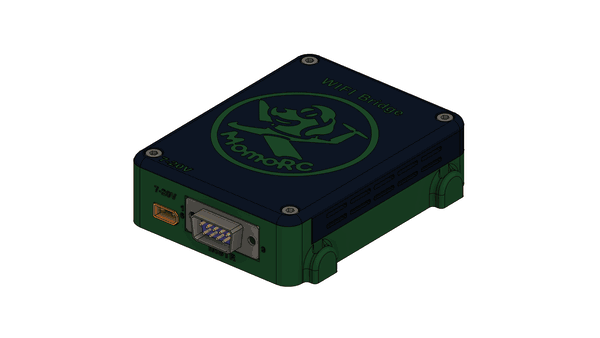

# 🛠️ Build guide

🏠 [Overview](../../README.md) › 🔧 Hardware › **Build guide**

The order in which to build one bridge, from parts to a passed bench check; each step links to the page with the details.

> [!NOTE]
> **Status:** the bench bridge was built along these steps and passed all bench checks ([roadmap](../project/roadmap.md#work-packages)). Aircraft installation comes later.

<a href="#parts"><picture><source media="(prefers-color-scheme: dark)" srcset="../images/nav/step-build-1-dark.svg"></picture></a> <a href="#housing"><picture><source media="(prefers-color-scheme: dark)" srcset="../images/nav/step-build-2-dark.svg"></picture></a> <a href="#plug"><picture><source media="(prefers-color-scheme: dark)" srcset="../images/nav/step-build-3-dark.svg"></picture></a> <a href="#harness"><picture><source media="(prefers-color-scheme: dark)" srcset="../images/nav/step-build-4-dark.svg"></picture></a> <a href="#firmware"><picture><source media="(prefers-color-scheme: dark)" srcset="../images/nav/step-build-5-dark.svg"></picture></a> <a href="#bench-check"><picture><source media="(prefers-color-scheme: dark)" srcset="../images/nav/step-build-6-dark.svg"></picture></a>

---

## 1. 🧭 Build steps

### 1.1 Get the parts

Order the modules, connectors and wire from the parts list. The cost page shows what one bridge costs.

→ [🛒 Parts list](modules.md#parts-list) · [💶 Cost](../project/cost.md)

### 1.2 Print the housing

Print the base, hood and holders in PETG with the starting values, then check the fit of the boards.

→ [🖨️ Print values](housing.md#print-values) · [📐 CAD files](../../cad/housing/housing-body-v1/README.md)

### 1.3 Build the instrument plug

Build the glider-side DE-9 plug from the existing instrument leads, using the solder-side view.

→ [🔌 Connect the bridge to your glider](wiring.md#overview)

### 1.4 Wire the harness

Lay the power harness, wire the RS-232 boards and the MAX490 header, fit the Becker pairs and close the housing. Read the supply and grounding page first.

→ [🪛 Wire installation](wire-installation.md) · [⚡ Power and grounding](power.md#supply)

### 1.5 Load the firmware

Flash the ready-made loader over USB once; every later image goes over Wi-Fi.

→ [📶 First flash over USB](../../firmware/ota-loader/README.md#flash-usb) · [💻 Bridge firmware](../../firmware/bridge/README.md#upload-over-wi-fi)

### 1.6 Check on the bench

Work through the bench bring-up with the aircraft equipment disconnected, then follow the [user manual](../manual/user-manual.md#quick-start) to connect a phone.

→ [🧪 Bench bring-up](wiring.md#bring-up)

---

## 2. 📚 Background

| Page | Read it for |
| --- | --- |
| [🧾 Schematic](schematic.md) | All boards and connections on one sheet |
| [🧱 Modules and parts](modules.md) | Orientation and checks of each module |
| [📦 Housing](housing.md) | Design rules, part sizes, connector mounting |
| [🏗️ Architecture](../design/architecture.md) | Why the bridge is built this way |

---

<kbd>[⬆️ Back to top](#top)</kbd> <kbd>[🏠 Overview](../../README.md)</kbd>
