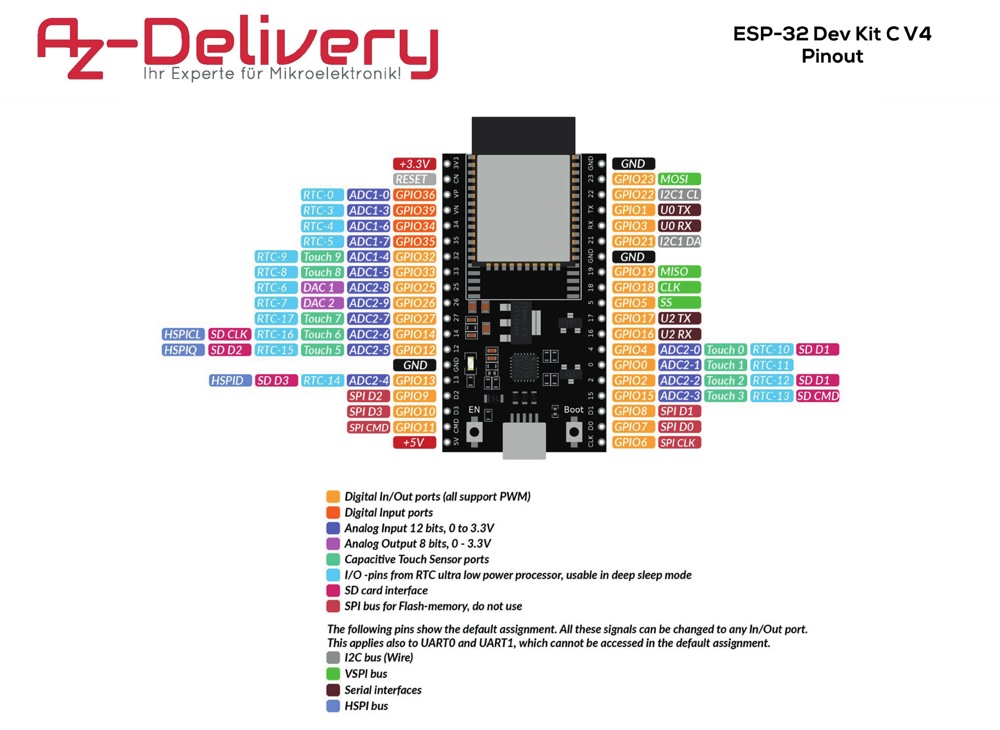
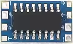
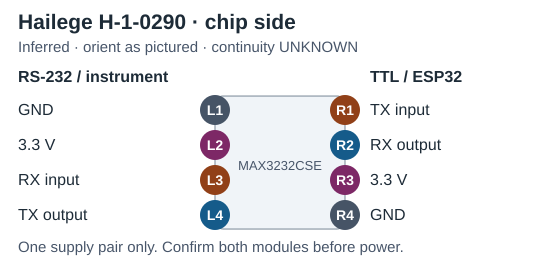
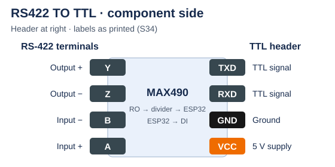
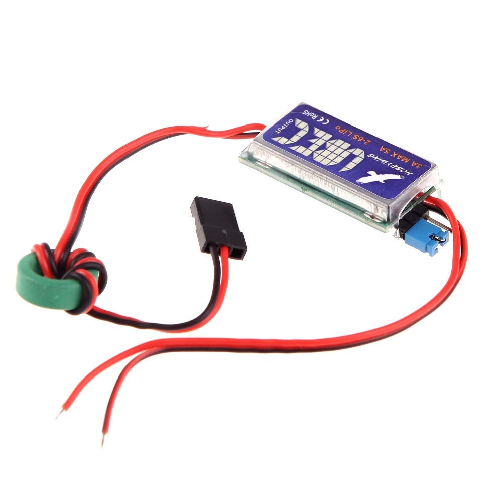
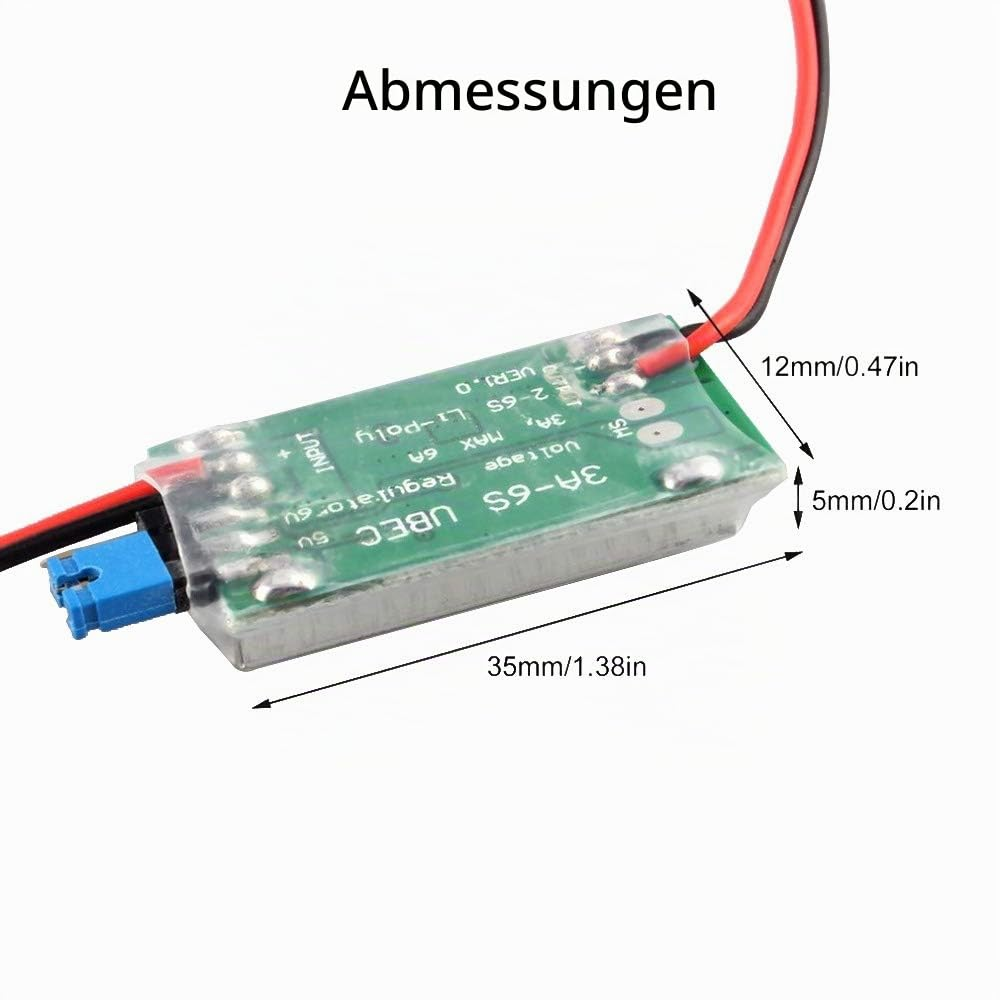

# 🧱 Modules and parts

🏠 [Overview](../../README.md) › 🔧 Hardware › **Modules and parts**

The modules the bridge is built from, how to orient them, and the shopping list for one bridge.

> [!NOTE]
> **Status:** all modules selected. Electrical specs come from seller listings or datasheets; physical sizes are recorded in [housing](housing.md#contents). Open checks: [bench hardware](../project/open-items.md#bench-hardware).

📑 **On this page:** <kbd>[1 · 📋 Module overview](#module-overview)</kbd> <kbd>[2 · 🧠 ESP32 board](#esp32-pinout)</kbd> <kbd>[3 · 🔁 RS-232 modules (Zander, FLARM)](#rs232-module)</kbd> <kbd>[4 · 📻 RS-422 board (Becker)](#rs422-board)</kbd> <kbd>[5 · 🔋 Power module (UBEC)](#ubec)</kbd> <kbd>[6 · 🛒 Parts list](#parts-list)</kbd>

Related: 🔌 [Signal wiring](wiring.md) · ⚡ [Power and grounding](power.md) · 📦 [Housing](housing.md) · 📚 [Sources](../research/sources.md)

---

## 1. 📋 Module overview

| Module | Use | Supply | Chip | Size |
| --- | --- | --- | --- | --- |
| [AZ-Delivery ESP32 WROOM dev module](#esp32-pinout) | Bridge controller | 5 V in, 3.3 V on board | ESP32-WROOM-32 | [Measured PCB size](housing.md#contents) |
| [Hailege H-1-0290](#rs232-module) (2×) | RS-232 for Zander and FLARM | 3.3 V | MAX3232CSE | [Measured size](housing.md#contents) |
| [RS-422 board](#rs422-board) | Becker radio | 5 V | MAX490 | 50 × 27 mm |
| [Hobbywing UBEC 3A (2–6S)](#ubec), part 86010010 | 12 V → 5 V | 5.5–26 V in; 5 V or 6 V out (jumper) at 3 A | — | 43 × 17 × 7 mm |

---

## 2. 🧠 ESP32 board

The AZ-Delivery board follows Espressif's DevKitC V4 layout (S32). View from the component side, antenna at the top, Micro-USB at the bottom: J2 is the left header, J3 the right; both are counted from the antenna end. RX and TX are from the ESP32's side.

| Position | J2 label | J2 bridge use | J3 label | J3 bridge use |
| ---: | --- | --- | --- | --- |
| 1 | `3V3` | **3.3 V to RS-232 modules and the three pull-ups** | `GND` | Ground |
| 2 | `EN` | — | `IO23` | — |
| 3 | `VP` | — | `IO22` | — |
| 4 | `VN` | — | `TX` | USB serial (boot only) |
| 5 | `IO34` | — | `RX` | USB serial (boot only) |
| 6 | `IO35` | — | `IO21` | — |
| 7 | `IO32` | **Zander RX** (UART0) | `GND` | Ground |
| 8 | `IO33` | Not connected | `IO19` | — |
| 9 | `IO25` | — | `IO18` | — |
| 10 | `IO26` | **FLARM RX** (UART1) | `IO5` | — |
| 11 | `IO27` | Not connected | `IO17` | **Becker TX** (UART2) |
| 12 | `IO14` | — | `IO16` | **Becker RX** via divider (UART2) |
| 13 | `IO12` | — | `IO4` | — |
| 14 | `GND` | Ground | `IO0` | — |
| 15 | `IO13` | — | `IO2` | — |
| 16 | `D2` | — | `IO15` | — |
| 17 | `D3` | — | `D1` | — |
| 18 | `CMD` | — | `D0` | — |
| 19 | `5V` | **5 V from UBEC** | `CLK` | — |

GPIO16/17 are free only on WROOM boards (WROVER boards use them for PSRAM). D0–D3, CMD and CLK belong to the flash; leave them free. The pin plan avoids the boot strapping pins (GPIO0, 2, 5, 12, 15). [Espressif header tables](https://docs.espressif.com/projects/esp-dev-kits/en/latest/esp32/esp32-devkitc/user_guide.html#header-block)

<b>🖼️ Show the AZ-Delivery pinout diagram</b> (click to expand)

[AZ-Delivery pinout PDF, page 1](https://cdn.shopify.com/s/files/1/1509/1638/files/ESP32_DevKit_C_V4_Pinout.pdf?v=1615364529)

---

## 3. 🔁 RS-232 modules (Zander, FLARM)

Hailege H-1-0290: a MAX3232 RS-232 ↔ 3.3 V converter with edge pads. The pad map is inferred from the seller image and the matching Sunrom layout (S26, S27); a continuity test confirms it.

| Chip side | Pad map |
| --- | --- |
|  |  |

> [!IMPORTANT]
> Both sides share one supply: connect 3.3 V and GND on the TTL side (R3/R4) only.

---

## 4. 📻 RS-422 board (Becker)

A blue "RS422 TO TTL" board with a 4-pin header (TXD/RXD/GND/VCC) and four screw terminals (Y/Z/B/A), S34. The seller lists a MAX490, 5 V supply, 120 Ω termination and ESD protection.

View from the component side, with the TTL header on the right and the screw terminals on the left.

| Component side | Pin map |
| --- | --- |
|  |  |

| Terminal | MAX490 function |
| --- | --- |
| A / B | Receiver input + / − (from the radio's TX2) |
| Y / Z | Driver output + / − (to the radio's RX2) |
| Header RXD / TXD | Receiver output (RO) and driver input (DI); assignment: [bench check](../project/open-items.md#bench-hardware) |
| Header GND / VCC | Bridge ground / 5 V supply |

> [!TIP]
> **Selected:** keep the 5 V board; its receiver output reaches the ESP32 only through a 2.2 kΩ / 3.3 kΩ divider. Details: [Becker wiring](wiring.md#becker).

---

## 5. 🔋 Power module (UBEC)

<table>
  <tr>
    <td></td>
    <td></td>
  </tr>
</table>

> [!WARNING]
> Set the jumper to 5 V before connecting anything. At 6 V the MAX490 board runs above its 5.25 V supply range (S34), and the RX divider puts 3.6 V on GPIO16, the ESP32's absolute limit.

The manual describes reverse-input protection (S14). Allow space for the jumper, leads and ferrite ring; the body alone is about 35 × 12 × 5 mm in the supplied image, 43 × 17 × 7 mm per the catalog.

---

## 6. 🛒 Parts list

For one bridge, bridge end only — the device-side connectors and harness already exist. The existing bridge stays as a backup.

| # | Ref | Qty | Part | Use |
| :-: | --- | :-: | --- | --- |
| 1 | MCU | 1 | AZ-Delivery ESP32 WROOM dev module | [Pinout](#esp32-pinout) |
| 2 | RS-232-mod1, mod2 | 2 | Hailege H-1-0290 | [Zander](wiring.md#zander), [FLARM](wiring.md#flarm) |
| 3 | RS-422 mod | 1 | MAX490 RS-422 board, 5 V | [Becker](wiring.md#becker) |
| 4 | PS1 | 1 | Hobbywing UBEC 3A (2–6S), 86010010, set to 5 V | [Power](power.md#supply) |
| 5 | R-B1, R-B2 | 1 each | 2.2 kΩ and 3.3 kΩ resistors, 0.125 W | Divider, MAX490 RO → GPIO16 (R-B2 to GND) |
| 6 | R-Z, R-F | 2 | 10 kΩ resistor, 0.125 W | Pull-up, RS-232 module R1 → 3.3 V |
| 7 | R-D | 1 | 10 kΩ resistor, 0.125 W | Pull-up, MAX490 DI → 3.3 V (quiet radio line during boot) |
| 8 | F1 | 1 | Supply fuse with housing-integrated holder; specification tracked in [open items](../project/open-items.md#bench-hardware) | [Power](power.md#supply) |
| 9 | — | existing | Becker harness, reused from its loose bridge-side ends | Check against [Becker wiring](wiring.md#becker); [inventory](../project/existing-installation.md#equipment) |
| 10 | — | 1 pair | Standard XT30 male housing connector and mating female harness connector | [Power](power.md#supply), [mounting](housing.md#connectors) |
| 11 | — | 1 pair | DE-9 female housing socket and male cable plug, solder cups and screw locking, with cable backshell and strain relief | [Combined instrument connector](wiring.md#overview) |

---

<kbd>[⬆️ Back to top](#top)</kbd> <kbd>[🏠 Overview](../../README.md)</kbd>
