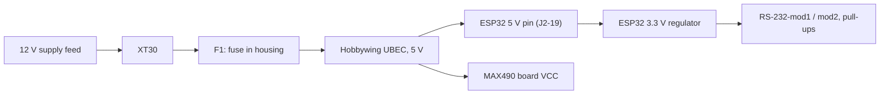
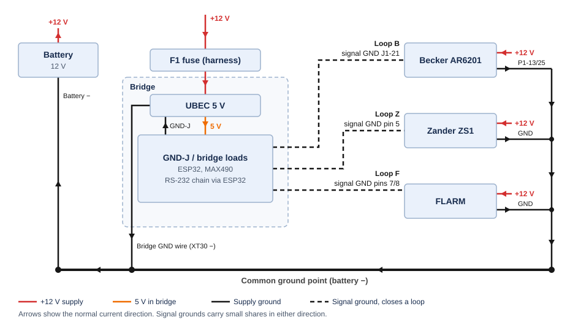

<a id="top"></a>

# ⚡ Power and grounding

🏠 [Overview](../../README.md) › 🔧 Hardware › **Power and grounding**

How the bridge is supplied and grounded, where ground loops close, which currents each wire carries, and what a broken wire does.

> [!NOTE]
> **Status:** bench design. The supply path and ground rule are selected; all currents are datasheet values or estimates, nothing is measured yet. Open checks: [bench hardware](../project/open-items.md#bench-hardware).

📑 **On this page:** <kbd>[1 · 🔋 Supply path](#supply)</kbd> <kbd>[2 · ⏚ Grounding and loops](#ground)</kbd> <kbd>[3 · 📊 Current assumptions](#currents)</kbd> <kbd>[4 · ✂️ Wire-break cases](#wire-breaks)</kbd> <kbd>[5 · 🛡️ Protection](#protection)</kbd>

Related: 🔌 [Signal wiring](wiring.md) · 🧱 [Modules and parts](modules.md) · 📚 [Sources](../research/sources.md)

---

<a id="supply"></a>

## 1. 🔋 Supply path

Use a dedicated standard XT30 male connector on the housing, mating with female contacts on the powered harness. Retain the housing connector in a snug printed pocket with a retaining shoulder and adhesive. Support the wires inside the housing so mating forces do not load the solder joints. Measure the actual connector and print a fit-test piece before finalizing the pocket.

The owner reports approximately 22 AWG wiring from the 12 V harness to the UBEC, with no upstream fuse currently fitted. Connector fit and supply-cable protection are tracked in [open items](../project/open-items.md#bench-hardware).



| From | To |
| --- | --- |
| UBEC input GND | The common ground point (where the radio's P1-13/25 return, S10), with its own wire |
| UBEC 5 V | ESP32 5V pin ([J2-19](modules.md#esp32-pinout)) and MAX490 board VCC |
| UBEC GND | ESP32 GND |
| ESP32 3V3 ([J2-1](modules.md#esp32-pinout)) | R3 (+) on both RS-232 modules; the pull-ups R-Z, R-F and R-D |
| ESP32 GND | R4 (−) on both RS-232 modules, MAX490 board GND |

> [!WARNING]
> Never connect USB and the UBEC 5 V at the same time: the board has no power selection. Unplug the UBEC before using USB.

> [!WARNING]
> Unplug J1 from the radio whenever USB is connected. On USB alone the MAX490 has no supply, but GPIO17 and R-D partly power it through DI, so its outputs to the radio are undefined. A laptop on its mains charger can also put leakage voltage on the USB ground, which would reach the radio through J1-21.

---

<a id="ground"></a>

## 2. ⏚ Grounding and loops

Treat the UBEC's input and output ground as connected, which is usual for this kind of regulator ([bring-up](wiring.md#bring-up) step 1 checks it). The bridge ground, the battery minus and the devices' signal grounds are then one circuit. Run the bridge's supply ground to the same ground point as the radio's supply ground, with a solid crimped or screwed connection.

J1-21 connects directly to the board GND, without a series resistor. Each device link has a signal ground as well as its own supply ground, so every link closes a loop through the ground point:



| Loop | Path | What flows in normal operation |
| --- | --- | --- |
| Loop B (Becker) | Bridge GND → J1-21 → radio → P1-13/25 → ground point → bridge ground wire | A share of the radio's return current: about 14 mA receiving, about 0.2 A transmitting ([estimate](#currents)) |
| Loop Z (Zander) | Bridge GND → ZS1 pin 5 → Zander supply ground → ground point | A small share of the Zander's supply current |
| Loop F (FLARM) | Bridge GND → FLARM pins 7/8 → FLARM supply ground (the same pins inside the FLARM, S23) → ground point | A small share of the FLARM's supply current |

The Becker cable shield is connected at the radio end only (J1-11) and the phone link is Wi-Fi, so neither forms a loop. Keep the device cables close to the bridge's power leads so the loops enclose little area.

---

<a id="currents"></a>

## 3. 📊 Current assumptions

Datasheet values carry their source ID; everything else is an estimate until the bench measurements in [open items](../project/open-items.md#bench-hardware) replace it.

| Branch | Wire | Normal | Peak | Worst single break | Basis |
| --- | --- | --- | --- | --- | --- |
| Bridge +12 V feed (XT30, F1, UBEC input) | About 22 AWG (owner) | ~0.15 A | Switch-on inrush, not measured | Short circuit, limited by F1 | Estimate |
| UBEC 5 V → ESP32 | Board header | ~250 mA | ~500 mA (Wi-Fi) | — | Typical datasheet values |
| UBEC 5 V → MAX490 board | Board header | ~30 mA | — | — | Typical datasheet value |
| ESP32 3.3 V → RS-232 modules, pull-ups | Board header | A few mA | — | — | Estimate |
| Bridge ground wire | Not yet selected | ~0.15 A + radio share | ~0.35 A while the radio transmits | ~3.2 A if the radio's P1 ground breaks | Estimate, S10 |
| J1-21 | Becker harness (gauge open) | ~14 mA radio share | ~0.2 A while the radio transmits | Up to 3 A if the radio's P1 ground breaks | Estimate, S10 |
| Zander pin 5 | Zander harness (gauge open) | Small share | — | The Zander's supply current | Not given in the ZS1 handbook (S22) |
| FLARM pins 7/8 | FLARM cable | Small share | — | The FLARM's supply current, below 500 mA | FLARM fuse requirement (S23) |
| Radio supply (P1-11/12, 13/25) | AWG 20 (Becker requirement) | 140 mA receiving | 1.8 A transmitting, 3 A maximum at 13.75 V | — | S10 |
| FLARM supply | Own fused feed | Below 500 mA | — | — | Must be fused at 500 mA, 8–26 V DC (S23) |
| Zander supply | Own feed | Not given | — | — | S22 |

The bridge load at 5 V adds up to about 0.3 A. At 12 V, assuming about 85 % UBEC efficiency:

```math
I_{12\text{ V}} \approx \frac{5\text{ V} \times 0.3\text{ A}}{12\text{ V} \times 0.85} \approx 0.15\text{ A}
```

The radio share assumes 1–1.5 m wires: two AWG 20 radio supply grounds against an AWG 24 J1-21 wire plus an AWG 22 bridge ground wire. Current divides by conductance, so roughly a tenth of the radio's return current takes the path through the bridge.

---

<a id="wire-breaks"></a>

## 4. ✂️ Wire-break cases

What a single broken wire does:

| Broken wire | Effect | Risk |
| --- | --- | --- |
| Radio supply ground (P1-13/25) | The radio's whole return current, up to 3 A (S10), flows through J1-21, the MAX490 board, the ESP32 board and the bridge ground wire. The radio keeps working. | 🔴 Overheated wiring; see the warning below |
| Bridge supply ground | The bridge's ~0.15 A returns through J1-21 and the Zander and FLARM grounds. The bridge keeps working. | 🟡 Low; bring-up step 7 catches a poor connection |
| Zander or FLARM supply ground | That device's supply current returns through its RS-232 ground and the bridge. | 🟡 Low; small currents |
| Bridge +12 V or F1 | The bridge switches off; its unpowered interfaces do not feed the devices. | 🟢 None |
| One signal ground (J1-21, Zander, FLARM) | The link stays referenced through the supply grounds. | 🟢 None |

> [!WARNING]
> The direct J1-21 wire depends on the radio's own supply ground. If P1-13/25 lost their connection, up to 3 A of radio current would run through the bridge's thin signal wiring without any visible symptom. Make sure both P1 ground pins are wired to the ground point and check them before connecting the bridge ([bring-up](wiring.md#bring-up) step 7).

---

<a id="protection"></a>

## 5. 🛡️ Protection

> [!TIP]
> **Selected:** integrate the F1 fuse holder into the housing, in the positive feed before the UBEC. The UBEC also has reverse-input protection (S14). Fuse specification and incoming-cable protection: [open items](../project/open-items.md#bench-hardware).

> [!WARNING]
> F1 does not protect the incoming cable against a short before the housing. Resolve supply-cable protection before connecting the bridge to the aircraft supply.

Size F1 using the measured running current and switch-on inrush, the wire's allowable current and the fuse's time-current curve and DC interrupting rating ([fuse selection, S31](../research/sources.md#source-register)). The load estimate alone does not establish a fuse rating.

---

<kbd>[⬆️ Back to top](#top)</kbd> <kbd>[🏠 Overview](../../README.md)</kbd>
