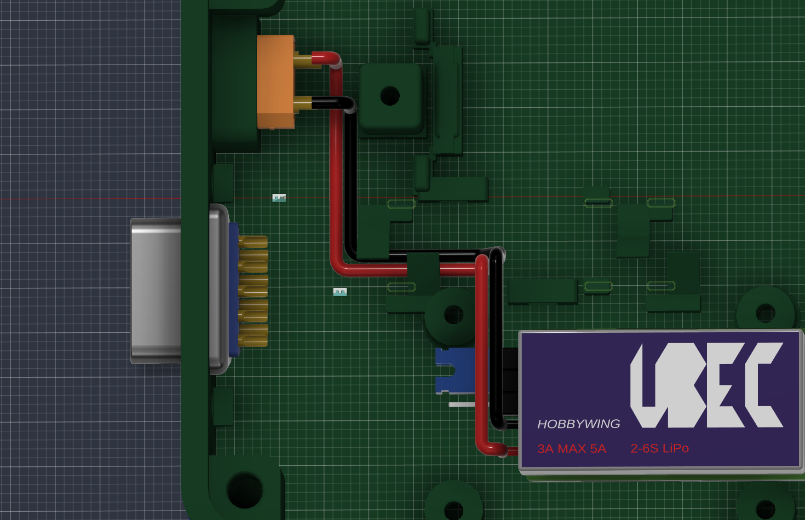
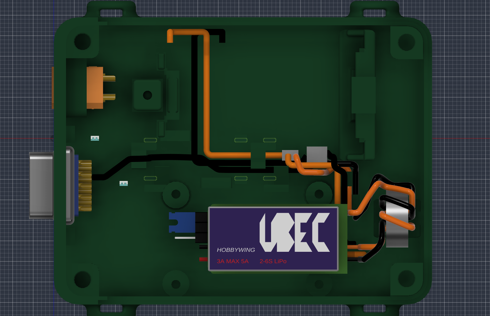
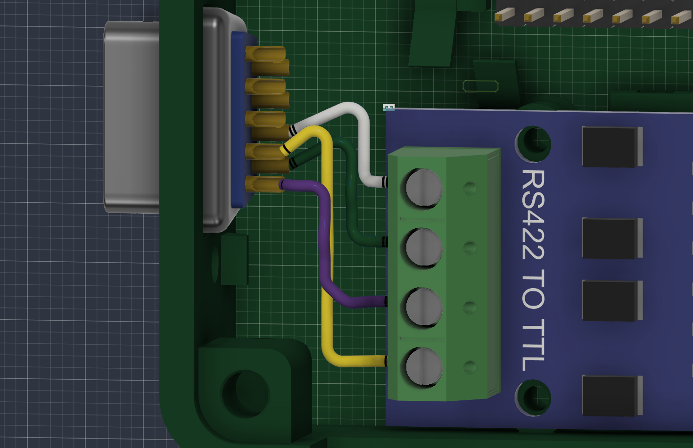

# 🪛 Wire installation

🏠 [Overview](../../README.md) › 🔧 Hardware › **Wire installation**

Install the bridge harness in housing v16, using the pictures to find each group of wires and its route.

> [!NOTE]
> **Status:** illustrated sequence from the accepted v16 Fusion model (S93). Fit, actual cut lengths and electrical operation are bench checks.

📑 **On this page:** <kbd>[1 · 🔌 Prepare the connectors](#connectors)</kbd> <kbd>[2 · ⚡ Lay the power harness](#floor-power)</kbd> <kbd>[3 · 🧩 Wire the RS-232 boards](#rs232-boards)</kbd> <kbd>[4 · 📡 Connect Zander and FLARM](#rs232-connector)</kbd> <kbd>[5 · 📻 Wire the MAX490 header](#max490-header)</kbd> <kbd>[6 · 🔀 Fit the Becker pairs](#becker-pairs)</kbd> <kbd>[7 · ✅ Close up and check](#finish)</kbd>

Start with the [loose-board bench checks](wiring.md#bring-up) and disconnect power before assembling. Use the [cutting table](housing.md#harness-cutting) to fit each conductor and leave enough slack to lift the carrier and clamp. Each picture shows the relevant wires in their final position, with other wires or obstructing parts hidden. The connector wall is on the left throughout.

---

## 1. 🔌 Prepare the connectors

1. With the connectors outside the tray, identify XT30 polarity from the moulded marks. Solder the red and black UBEC input leads to the corresponding cups. The UBEC is shown in its eventual position. Leave the carrier out for access.
2. Identify the DE-9 solder cups by their moulded numbers. Fit the tinned bridge across cups **3, 6 and 7**, and attach the black lead that goes to **GND-J**. Prepare the remaining DE-9 pigtail ends for steps 4 and 6 while the cups are accessible.
3. Fit the XT30 in its inside pocket. Fit the DE-9 from the outside, feeding the pigtail through the cutout without loading its solder joints. [Connector mounting](housing.md#connectors) · [DE-9 cup map](wiring.md#de9-pinout)

---

## 2. ⚡ Lay the power harness

1. Count the factory ferrite turns before moving the ring. Fit both UBEC output leads through the ferrite, preserving the factory turn count and winding sense. The picture shows the route envelope.
2. Make and insulate **5V-J** and **GND-J** separately on the bench near the ferrite end of the floor bus. The black DE-9 bridge lead joins GND-J. Fit one supply/return pair toward ESP32 **J2-19/J2-14** and the other toward MAX490 **VCC/GND**.
3. Pre-thread the floor ties. Feed loose ends one at a time through the staggered guide fingers, and feed both ferrite departure leads through the transverse guide. Lay in the splices, park the board ends above the tray and leave the ties loose for the fit check. [Power and ground tree](power.md#supply) · [Floor guides](housing.md#floor-guide)

---

## 3. 🧩 Wire the RS-232 boards

Solder the module pads on the bench. In this view, Zander **mod1** is on the left and FLARM **mod2** is on the right. Leave both **R1** pads open.

| Colour | Connection |
| --- | --- |
| Pink | ESP32 J2-1 → mod2 R3 → mod1 R3 |
| Black | ESP32 J2-14 → mod2 R4 → mod1 R4 |
| Light blue | mod1 R2 → ESP32 J2-7 (GPIO32) |
| Mint green | mod2 R2 → ESP32 J2-10 (GPIO26) |

Prepare the L3 ends in step 4 before seating the modules. Prepare the **mod2 L2** end of R-D on the bench while the pad is accessible. At the ESP32, **J2-14** takes both the mod2 return and the floor return from step 2. **J2-19** takes the orange floor feed. [Module pad map](modules.md#rs232-module) · [ESP32 header map](modules.md#esp32-pinout)

---

## 4. 📡 Connect Zander and FLARM

1. Route **brown** from DE-9 cup **1** to **mod1 L3** and **beige** from cup **2** to **mod2 L3**. Fit the routes through the centre guides before soldering the module ends.
2. Slide the prewired modules into the clamp. With the ESP32 in place, fit the clamp and finish the ESP32 header ends from step 3. Leave enough slack to lift the modules clear for service. [Clamp assembly order](housing.md#layout)

---

## 5. 📻 Wire the MAX490 header

Keep the UBEC carrier lifted off for header access. Identify **RO** and **DI** electrically on the actual board before using the model view to route the wires.

| Colour | Connection |
| --- | --- |
| Orange and black | Fit the parked 5V-J and GND-J branches to MAX490 **VCC** and **GND** |
| Turquoise | ESP32 **J3-11** → MAX490 **DI** |
| Blue | MAX490 **RO** → **R-B1** splice → ESP32 **J3-12** |

Fit **R-B2** across **J3-12 and J3-7**. Finish the **J3-11** end of **R-D** from **mod2 L2**. Insulate the resistors and their joints with heat-shrink. Support the leads next to the ESP32 so movement of the harness cannot load the joints. [Divider and pull-up wiring](wiring.md#becker)

---

## 6. 🔀 Fit the Becker pairs

Twist and fit each pair separately before trimming. The Fusion paths show the terminal approaches and routing space. Use the [DE-9 cup numbers](wiring.md#de9-pinout) and the MAX490 terminal labels at both ends.

| Pair | Wires |
| --- | --- |
| DE-9 **4/5** | Yellow **4 → A**, violet **5 → B** |
| DE-9 **8/9** | White **8 → Y**, green **9 → Z** |

---

## 7. ✅ Close up and check

- [ ] Seat the UBEC carrier and secure the ferrite in its cradle. Check for pinched wires under the carrier and clamp. [Carrier and ferrite mounting](housing.md#ubec-carrier)
- [ ] Check that service slack lets the carrier and clamp lift clear. Retain the floor wires and insulated resistor leads without pinching the insulation. Trial-fit the hood and check for contact with the harness.
- [ ] With the instruments disconnected, check continuity, polarity and shorts before applying power. Follow the [bench bring-up checklist](wiring.md#bring-up) before connecting any instrument.

---

<kbd>[⬆️ Back to top](#top)</kbd> <kbd>[🏠 Overview](../../README.md)</kbd>
