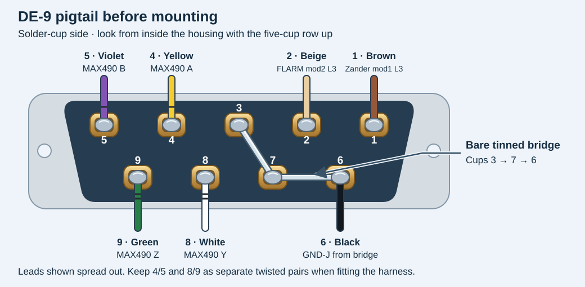
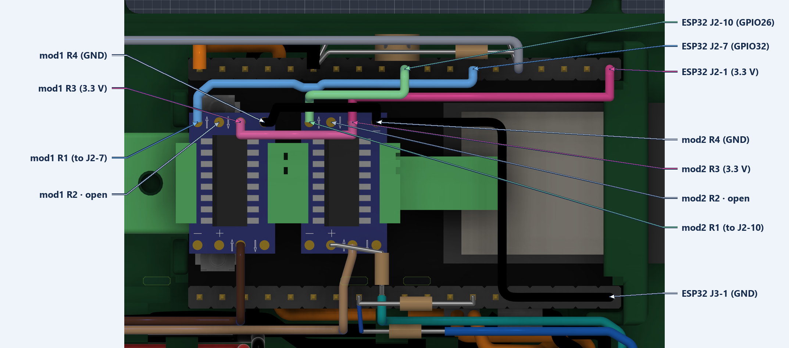
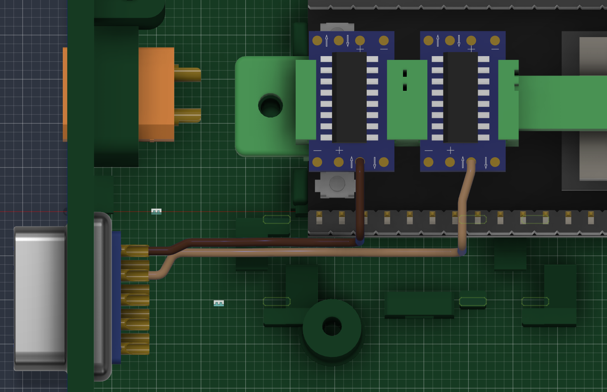
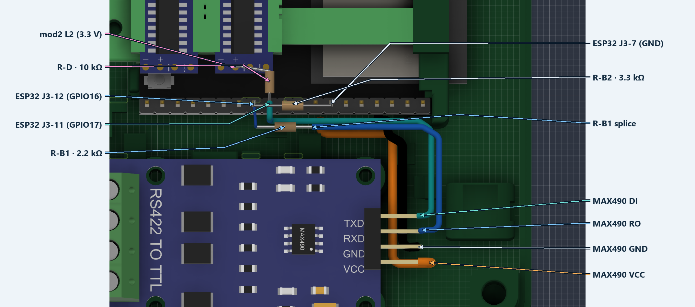
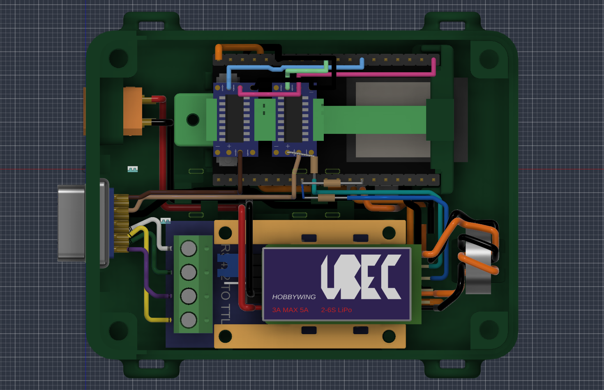

# 🪛 Wire installation

🏠 [Overview](../../README.md) › 🔧 Hardware › **Wire installation**

Install the bridge harness in housing v16, using the pictures to find each group of wires and its route.

> [!NOTE]
> **Status:** illustrated sequence from the accepted v16 Fusion model (S93). The [supply voltage sense](power.md#voltage-sense) (R-V1, R-V2, C-V and the grey wire) has its own picture in [section 3](#rs232-boards) (S128, S129); pictures 01, 03 and 07 do not show it. The assembled bench housing passed its fit check (S156). Trim each conductor to fit.

📑 **On this page:** <kbd>[1 · 🔌 Prepare the connectors](#connectors)</kbd> <kbd>[2 · ⚡ Lay the power harness](#floor-power)</kbd> <kbd>[3 · 🧩 Wire the RS-232 boards](#rs232-boards)</kbd> <kbd>[4 · 📡 Connect Zander and FLARM](#rs232-connector)</kbd> <kbd>[5 · 📻 Wire the MAX490 header](#max490-header)</kbd> <kbd>[6 · 🔀 Fit the Becker pairs](#becker-pairs)</kbd> <kbd>[7 · ✅ Close up and check](#finish)</kbd>

Start with the [loose-board bench checks](wiring.md#bring-up) and disconnect power before assembling. Use the [cutting table](housing.md#harness-cutting) to fit each conductor and leave enough slack to lift the carrier and clamp. The Fusion views show the relevant wires in their final position, with obstructing parts hidden where needed. The connector wall is on the left in each Fusion view. Arrowheads point to the labelled pin, pad, joint or wire.

🖨️ **Printable version:** [bridge wiring instructions (PDF)](../../output/pdf/bridge-wiring-instructions.pdf), built from this page and the [bench checks](wiring.md#bring-up). After changing either page, commit it, then run `python tools/wiring_pdf.py` and commit the PDF.

---

## 1. 🔌 Prepare the connectors

1. With the connectors outside the tray, identify XT30 polarity from the moulded marks. Solder the red and black UBEC input leads to the corresponding cups. Keep the UBEC loose until step 7. The picture shows its final location so you can see where the leads go.
2. Solder one lead of **R-V1 (100 kΩ)** into the **XT30 +** cup together with the red lead, or onto the red lead right behind the cup if the cup is full. Bend it up over the red lead and point the body toward the side wall next to the ESP32. Solder the **grey** sense wire to its free lead and cover R-V1 and both joints with heat-shrink, so no bare metal is left at the 12 V end. Leave the grey wire overlength. [Picture](#supply-sense-picture) · [Supply voltage sense](power.md#voltage-sense)
3. Wire the **entire DE-9 pigtail on the bench before fastening the connector**. Start with the lower row, which is hard to reach once mounted. Using the moulded cup numbers, solder **white to cup 8 (MAX490 Y)** and **green to cup 9 (MAX490 Z)**. Fit the tinned bridge across **3, 6 and 7**, clear of the other cups and shell. Attach one black lead from the bridge to **GND-J**. Then solder the remaining signal leads at cups **1, 2, 4 and 5**.
4. Leave the pigtail leads overlength at their free ends. Allow enough to feed the bundle through the front cutout, follow the guides and reach each termination with service slack. Check the cup assignments and isolation from neighbouring nets and the shell while the cups are accessible.
5. Fit the XT30 in its inside pocket. Feed the DE-9 pigtail through the cutout from outside, seat and fasten the connector without pulling on the solder joints. Route the free ends, then trim and strip them at their destinations. [Connector mounting](housing.md#connectors) · [DE-9 cup map](wiring.md#de9-pinout)

---

## 2. ⚡ Lay the power harness

1. Count the factory ferrite turns before moving the ring. Fit both UBEC output leads through the ferrite, preserving the factory turn count and winding sense. The picture shows the route envelope.
2. Make and insulate **5V-J** and **GND-J** separately on the bench near the ferrite end of the floor bus. The black DE-9 bridge lead joins GND-J. Fit one supply/return pair toward ESP32 **J2-19/J2-14** and the other toward MAX490 **VCC/GND**.
3. Pre-thread the floor ties. Feed loose ends one at a time through the staggered guide fingers, and feed both ferrite departure leads through the transverse guide. Lay in the splices, park the board ends above the tray and leave the ties loose for the fit check.
4. Leave the **grey** sense wire parked above the tray. It runs high along the side wall, not on the floor; it is fitted in step 3. Keep the UBEC and carrier out of the MAX490 mounting area. [Power and ground tree](power.md#supply) · [Floor guides](housing.md#floor-guide)

---

## 3. 🧩 Wire the RS-232 boards

Solder the module pads on the bench. In this view, Zander **mod1** is on the left and FLARM **mod2** is on the right. Leave both **R2** pads open; R1 is the pad whose arrow points off the board.

| Colour | Connection |
| --- | --- |
| Pink | ESP32 J2-1 → mod2 R3 → mod1 R3 |
| Black | ESP32 J3-1 → mod2 R4 → mod1 R4 |
| Light blue | mod1 R1 → ESP32 J2-7 (GPIO32) |
| Mint green | mod2 R1 → ESP32 J2-10 (GPIO26) |
| Grey | R-V1 at the XT30 → ESP32 J2-5 (GPIO34) |

Prepare the L3 ends in step 4 before seating the modules. At the ESP32, **J3-1** takes only the mod2 return. **J2-14** takes the floor return from step 2 and the ground lead of R-V2. **J2-19** takes the orange floor feed.

Route the **grey** wire from R-V1 up to pin-top height and along the side wall, above the J2-19 and J2-14 wires, to **J2-5**. Fit **R-V2 (10 kΩ)** at pin-top height beside the J2 header, between **J2-5** and **J2-14**. Bend and sleeve its leads to clear J2-6 through J2-13. Solder the grey wire to J2-5. The picture also shows C-V (100 nF) across R-V2. The bench bridge was built and measured with C-V omitted (S141, S148).

 [Module pad map](modules.md#rs232-module) · [ESP32 header map](modules.md#esp32-pinout)

---

## 4. 📡 Connect Zander and FLARM

1. Route the prewired **brown** lead from DE-9 cup **1** to **mod1 L3** and the **beige** lead from cup **2** to **mod2 L3**. Fit the routes through the centre guides, then trim and solder the module ends.
2. Slide the prewired modules into the clamp. With the ESP32 in place, fit the clamp and finish the ESP32 header ends from step 3. Leave enough slack to lift the modules clear for service. [Clamp assembly order](housing.md#layout)

---

## 5. 📻 Wire the MAX490 header

Set the MAX490 RS-422 board on its floor posts first. Keep the UBEC and carrier out so you can reach the MAX490 header and screw terminals. Identify **RO** and **DI** electrically on the actual board before using the model view to route the wires.

| Colour | Connection |
| --- | --- |
| Orange and black | Fit the parked 5V-J and GND-J branches to MAX490 **VCC** and **GND** |
| Turquoise | ESP32 **J3-11** → MAX490 **DI** |
| Blue | MAX490 **RO** → **R-B1** splice → ESP32 **J3-12** |

Fit **R-B2** across **J3-12 and J3-7**. Wire J3-11 directly to TXD. The CAD picture shows a third resistor, R-D. Omit it on the tested QYF-998 board (S145). Insulate the resistors and their joints with heat-shrink. Support the leads next to the ESP32 so movement of the harness cannot load the joints. [Divider wiring](wiring.md#becker)

---

## 6. 🔀 Fit the Becker pairs

Twist and fit each prewired pair separately, then trim and strip at the MAX490 end. The Fusion paths show the terminal approaches and routing space. Use the [DE-9 cup numbers](wiring.md#de9-pinout) and the MAX490 terminal labels at both ends.

| Pair | Wires |
| --- | --- |
| DE-9 **4/5** | Yellow **4 → A**, violet **5 → B** |
| DE-9 **8/9** | White **8 → Y**, green **9 → Z** |

---

## 7. ✅ Close up and check

- [ ] After finishing the MAX490 header and both Becker pairs, place the UBEC carrier over the MAX490. Fasten both with the shared four screws and secure the ferrite in its cradle. Check for pinched wires under the carrier and clamp. [Carrier and ferrite mounting](housing.md#ubec-carrier)
- [ ] Check that service slack lets the carrier and clamp lift clear. Retain the floor wires, the grey sense wire and the insulated component leads without pinching the insulation. Trial-fit the hood and check for contact with the harness.
- [ ] With the instruments disconnected, check continuity, polarity and shorts before applying power. Follow the [bench bring-up checklist](wiring.md#bring-up) before connecting any instrument.

---

<kbd>[⬆️ Back to top](#top)</kbd> <kbd>[🏠 Overview](../../README.md)</kbd>
