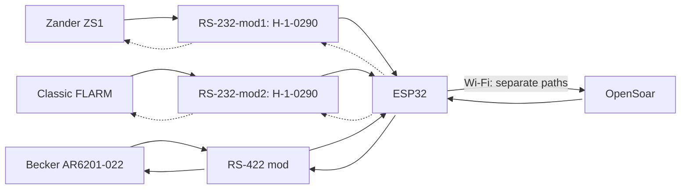
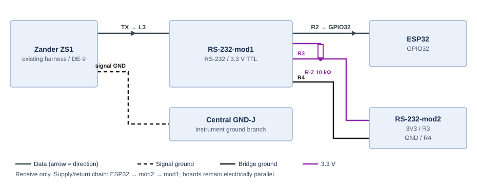
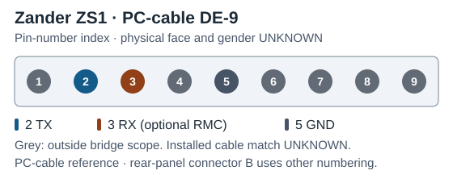
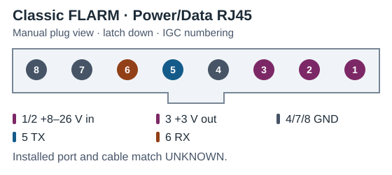
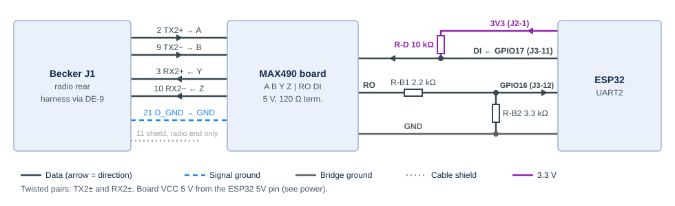
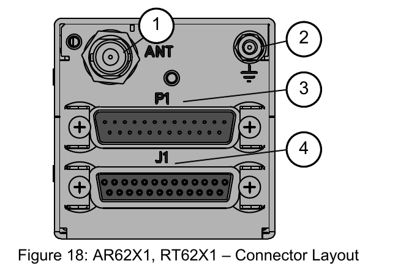
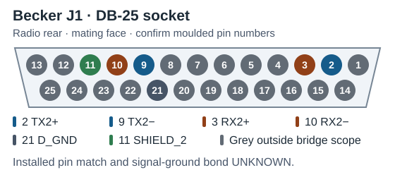
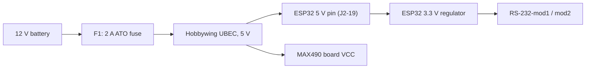

# 🔌 Wiring

🏠 [Overview](../../README.md) › 🔧 Hardware › **Wiring**

How the bridge connects to the Zander, the FLARM, the Becker radio and power — pin by pin. The device-side connectors and harness already exist in the aircraft; this page covers the bridge end only.

> [!NOTE]
> **Status:** bench design. Parts and wiring are decided; nothing is built or measured yet. Open checks: [bench hardware](../project/open-items.md#bench-hardware).

📑 **On this page:** <kbd>[1 · 🧭 Overview and UART plan](#overview)</kbd> <kbd>[2 · 📈 Zander ZS1](#zander)</kbd> <kbd>[3 · 📡 FLARM](#flarm)</kbd> <kbd>[4 · 📻 Becker radio](#becker)</kbd> <kbd>[5 · ⚡ Power](#power)</kbd> <kbd>[6 · 🧪 Bench bring-up](#bring-up)</kbd>

Related: 🧱 [Modules and parts](modules.md) · 📚 [Sources](../research/sources.md)

---

## 1. 🧭 Overview and UART plan

Dotted arrows are optional return paths to the navigation instruments. The Becker path must work in both directions.

### 1.1 UART plan

The ESP32 has three UARTs; each device gets one.

| Device | UART | ESP32 RX | ESP32 TX | Interface |
| --- | --- | --- | --- | --- |
| 📈 Zander ZS1 | UART0, remapped | GPIO32 | GPIO33 (optional) | RS-232-mod1 |
| 📡 FLARM | UART1 | GPIO26 | GPIO27 (optional) | RS-232-mod2 |
| 📻 Becker | UART2 | GPIO16, through a 2.2 kΩ / 3.3 kΩ divider | GPIO17 | MAX490 RS-422 board |

UART0 is also the USB serial port. The firmware moves it to GPIO32/33 after boot, so there is no USB serial log in operation; diagnostics go over Wi-Fi. Boot messages appear only on GPIO1, so they never reach a device. The firmware must switch the UART0 log console off; otherwise log output would go to the Zander's GPS input (GPIO33). Keeping the radio off UART0 means a stray log line can never reach the radio.

---

## 2. 📈 Zander ZS1

Use the ZS1 PC-cable DE9 ([ZS1 handbook pp.46/48](../reference/ZS1_Deutsch.pdf#page=46), S22).

| ZS1 PC cable | → / ← | RS-232 pads | TTL pads | → / ← | ESP32 |
| --- | :-: | --- | --- | :-: | --- |
| 2 () | → | **L3** RS-232 input | **R2** TTL output | → | GPIO32 () |
| *3 () — optional GPS (RMC) input* | *←* | *L4 RS-232 output* | *R1 TTL input* | *←* | *GPIO33 ()* |
| 5 () | — | L1 GND | R4 GND | — | GND |

R1 always gets a 10 kΩ pull-up (R-Z) to 3.3 V, so the return line idles correctly while the ESP32 boots or when GPIO33 is not wired.

---

## 3. 📡 FLARM

Use a free data port on the Classic FLARM ([installation manual v221 pp.6/7](https://www.flarm.com/wp-content/uploads/2024/04/FLARM_InstallationManual_D.pdf#page=6), S23).

| FLARM Power/Data | → / ← | RS-232 pads | TTL pads | → / ← | ESP32 |
| --- | :-: | --- | --- | :-: | --- |
| 5 () | → | **L3** RS-232 input | **R2** TTL output | → | GPIO26 () |
| *6 () — optional* | *←* | *L4 RS-232 output* | *R1 TTL input* | *←* | *GPIO27 ()* |
| 7/8 () | — | L1 GND | R4 GND | — | GND |

R1 gets a 10 kΩ pull-up (R-F) to 3.3 V, as for the Zander.

> [!WARNING]
> FLARM uses IGC pin numbering, which runs opposite to common RJ45 numbering. Pins 1–3 carry supply voltage: never connect them to the converter.

---

## 4. 📻 Becker radio

The radio's serial interface 2 on connector J1 ([Becker DV14307.03 Issue 06, p.59](https://www.becker-avionics.com/wp-content/uploads/00_Literature/6200_Series_IO_en.pdf#page=59), S10).

### 4.1 Radio side — board screw terminals

| J1 pin | Radio signal | MAX490 terminal | Meaning |
| --- | --- | --- | --- |
| 2 | TX2+ | A | Receiver input + |
| 9 | TX2− | B | Receiver input − |
| 3 | RX2+ | Y | Driver output + |
| 10 | RX2− | Z | Driver output − |
| 11 | SHIELD_2 | — (cable shield) | Shield of the auxiliary control interface |
| 21 | D_GND | GND | Signal reference |

Run TX2± and RX2± as two separate twisted pairs in a shielded cable, as Becker requires for the interface lines (S10). Connect the shield to J1-11 at the radio end only and leave it unconnected at the bridge end, so it carries no ground current. Connect J1-21 to the board GND with a separate wire in the same cable, not the shield or drain wire.

### 4.2 ESP32 side — board header

| Board signal | ESP32 |
| --- | --- |
| Receiver output (RO) | 2.2 kΩ (R-B1) to GPIO16; 3.3 kΩ (R-B2) from GPIO16 to GND () |
| Driver input (DI) | GPIO17, plus a 10 kΩ pull-up (R-D) to 3.3 V () |
| VCC | 5 V from the UBEC |
| GND | GND |

The board's TXD/RXD header labels may be named from either side; identify RO and DI on the board before wiring. ESP32 TX at 3.3 V drives DI directly (the MAX490 needs 2.0 V for a logic high). The pull-up R-D holds DI idle while the ESP32 boots, so no random bits reach the radio before the UART is set up.

> [!WARNING]
> The MAX490 runs at 5 V, so RO idles near 5 V — above the ESP32's 3.6 V input limit (S34). Never connect RO directly to GPIO16.

The divider brings RO's 5.0–5.25 V high level down to 3.0–3.15 V at GPIO16, inside the ESP32's input range, so no current flows into the pin's protection diode. A series resistor alone would rely on that diode, for which Espressif gives no current limit. The divider's low source impedance (about 1.3 kΩ) also keeps a clean logic low when the firmware enables the ESP32's internal RX pull-up (about 45 kΩ), as Arduino-ESP32 does by default (S35). RO is loaded with about 1 mA.

### 4.3 Connector reference

| Radio rear (callout 4 = J1) | J1 mating face |
| --- | --- |
|  |  |

Socket numbering follows the [Winford BRKDD25F-R-FT mating-face drawing](https://www.winford.com/products/cad/brkdd25f-r-ft_rev_a_dwg.pdf). Pin-view styling follows the [Pinout.xyz examples](https://github.com/pinout-xyz/Pinout.xyz/tree/main/graphics).

---

## 5. ⚡ Power

| From | To |
| --- | --- |
| UBEC 5 V | ESP32 5V pin ([J2-19](modules.md#esp32-pinout)) and MAX490 board VCC |
| UBEC GND | ESP32 GND |
| ESP32 3V3 ([J2-1](modules.md#esp32-pinout)) | R3 (+) on both RS-232 modules; the pull-ups R-Z, R-F and R-D |
| ESP32 GND | R4 (−) on both RS-232 modules, MAX490 board GND |

> [!TIP]
> **Protection:** F1 (2 A) close to the battery on the bridge's positive feed, plus the UBEC's own reverse-input protection (S14). No further protection stages.

> [!WARNING]
> Never connect USB and the UBEC 5 V at the same time: the board has no power selection. Unplug the UBEC before using USB.

### 5.1 Load estimate

Estimate from typical datasheet values, not measured.

| Load | Current at 5 V |
| --- | --- |
| ESP32 with Wi-Fi | about 250 mA average, 500 mA peaks |
| MAX490 driving the radio input | about 30 mA |
| Two MAX3232 modules | a few mA |
| **Total** | **about 0.3 A average** — about 0.15 A at 12 V |

The 2 A fuse leaves margin for switch-on inrush ([fuse selection, S31](../research/sources.md#source-register)). Confirm by measuring current and inrush on the bench.

---

## 6. 🧪 Bench bring-up

Before connecting any device:

1. Set the UBEC jumper to 5 V; measure the output with no load and with the ESP32 connected.
2. Match the ESP32 board's headers and module marking to the [pinout](modules.md#esp32-pinout).
3. Check continuity of both RS-232 modules against the [pad map](modules.md#rs232-module).
4. On the MAX490 board, identify RO and DI on the header and check the 120 Ω termination.
5. With the MAX490 powered and the radio line idle, measure GPIO16: about 3.0 V (high). Then hold B above A with a 1.5 V cell (+ to B, − to A) and check for a low below 0.5 V.
6. Measure the bridge's current and switch-on inrush at 12 V.
7. In the aircraft: listen for radio noise and check squelch with the bridge on and off.

---

<kbd>[⬆️ Back to top](#top)</kbd> <kbd>[🏠 Overview](../../README.md)</kbd>
