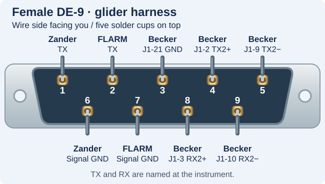
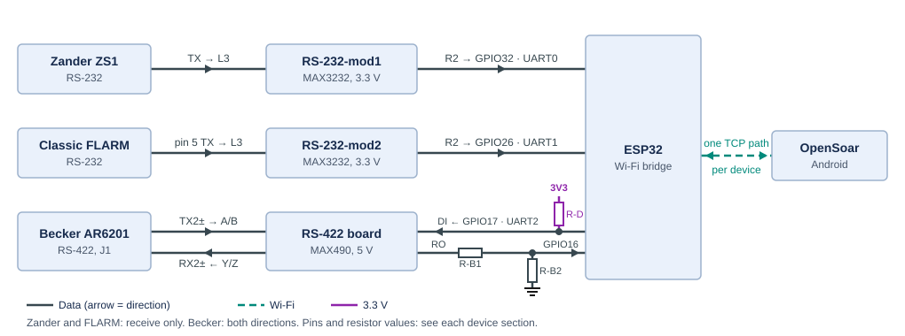
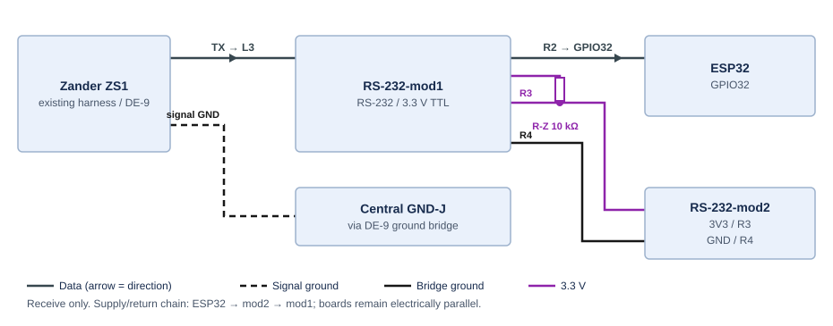
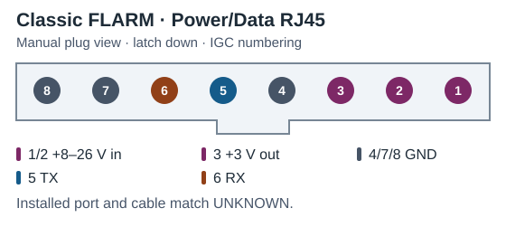
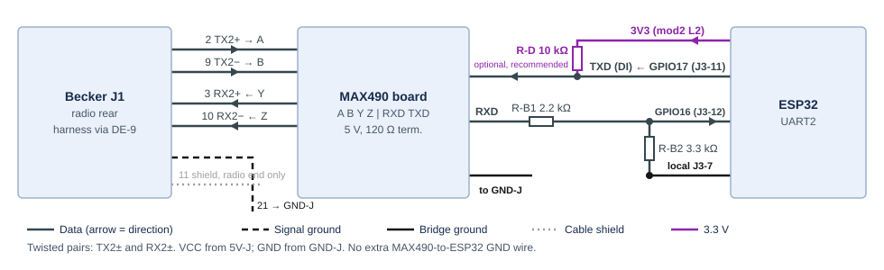

<a id="top"></a>

# 🔌 Signal wiring

🏠 [Overview](../../README.md) › 🔧 Hardware › **Signal wiring**

Use the existing instrument leads to build the glider-side plug for the bridge, then check the harness on the bench.

> [!NOTE]
> **Status:** bench bring-up complete (steps 1–13). Steps 14–16 follow at installation; remaining wiring decisions are in [open items](../project/open-items.md#bench-hardware).

<a href="#overview"><picture><source media="(prefers-color-scheme: dark)" srcset="../images/nav/menu-hardware-wiring-1-dark.svg"></picture></a> <a href="#zander"><picture><source media="(prefers-color-scheme: dark)" srcset="../images/nav/menu-hardware-wiring-2-dark.svg"></picture></a> <a href="#flarm"><picture><source media="(prefers-color-scheme: dark)" srcset="../images/nav/menu-hardware-wiring-3-dark.svg"></picture></a> <a href="#becker"><picture><source media="(prefers-color-scheme: dark)" srcset="../images/nav/menu-hardware-wiring-4-dark.svg"></picture></a> <a href="#bring-up"><picture><source media="(prefers-color-scheme: dark)" srcset="../images/nav/menu-hardware-wiring-5-dark.svg"></picture></a> <!-- page-menu -->

Related: ⚡ [Power and grounding](power.md) · 🧱 [Modules and parts](modules.md) · 📚 [Sources](../research/sources.md)

---

<a id="overview"></a>

## 1. 🧭 Connect the bridge to your glider

The box has two connections. Plug the instrument harness into the **male DE-9** on the box. Supply power through the separate [XT30 power connector](power.md#supply).

<a id="de9-pinout"></a>

### 1.1 Build the female instrument plug

Hold the loose **female DE-9** with the **solder cups facing you** and the **five-cup row on top**. Cup **1** is at the upper left. Match the moulded numbers before soldering.



| Solder cup | Glider harness lead | Contact at the instrument |
| ---: | --- | --- |
| 1 | [Zander ZS1](#zander) data out | Existing harness TX |
| 2 | [Classic FLARM](#flarm) data out | Power/Data 5 (IGC numbering) |
| 3 | [Becker](#becker) signal ground | J1-21 D_GND |
| 4 | Becker data out + | J1-2 TX2+ |
| 5 | Becker data out − | J1-9 TX2− |
| 6 | Zander signal ground | Existing harness signal ground |
| 7 | FLARM signal ground | Power/Data ground (IGC 7/8) |
| 8 | Becker data in + | J1-3 RX2+ |
| 9 | Becker data in − | J1-10 RX2− |

1. Identify each conductor on the existing harness by its instrument connection. Check the installed Becker model and revision against the [radio connector reference](#becker).
2. Fit any backshell parts that must slide over the cable before soldering. Land the three signal grounds individually on cups **3, 6 and 7**. The common link is already [inside the box](wire-installation.md#connectors).
3. Keep Becker **4/5** and **8/9** as two separate twisted pairs up to the cups. Insulate the shield drain at this end and connect the shield at the radio only.
4. With power off and instruments disconnected, do the [harness continuity check (step 16)](#bring-up). Fit the backshell, secure the cable in the strain relief and tighten the plug's locking screws when mated.

### 1.2 UART plan



Zander and FLARM are receive-only at the bridge. No return wires or connector contacts are fitted for their RX inputs. The Becker path works in both directions.

The ESP32 has three UARTs; each device gets one.

| Device | UART | ESP32 RX | ESP32 TX | Interface |
| --- | --- | --- | --- | --- |
| 📈 Zander ZS1 | UART0, remapped | GPIO32 | Not connected | RS-232-mod1 |
| 📡 FLARM | UART1 | GPIO26 | Not connected | RS-232-mod2 |
| 📻 Becker | UART2 | GPIO16, through a 2.2 kΩ / 3.3 kΩ divider | GPIO17 | MAX490 RS-422 board |

UART0 is also the USB serial port. The firmware remaps its receive input to GPIO32 after boot, so there is no USB serial log in operation; diagnostics go over Wi-Fi. Boot messages appear only on GPIO1, so they never reach a device. Keeping the radio off UART0 means a stray log line can never reach the radio.

> [!IMPORTANT]
> The firmware must switch the UART0 log console off when assigning UART0 to Zander reception. GPIO33 and the Zander return path are not wired.

---

<a id="zander"></a>

## 2. 📈 Zander ZS1



Start with the loose ends of the existing Zander harness ([installed wiring](../project/existing-installation.md#equipment)). The table identifies the required RS-232 signals, not a connector at the bridge. Match each loose conductor to its signal before connecting it; see [open items](../project/open-items.md#bench-hardware). Signal functions follow the ZS1 handbook (S22).

| Zander harness signal | → / ← | RS-232 pads | TTL pads | → / ← | ESP32 |
| --- | :-: | --- | --- | :-: | --- |
| TX from Zander | → | **L3** RS-232 input | **R1** TTL output | → | GPIO32 () |

Connect the Zander signal-ground conductor to GND-J. The module receives 3.3 V and ground through mod2; see the [supply chain](power.md#supply). Leave L1 without an extra ground wire.

Leave R2 (unused driver input), L4 and GPIO33 unconnected.

---

<a id="flarm"></a>

## 3. 📡 FLARM


Use a free data port on the Classic FLARM ([installation manual v221 pp.6/7](https://www.flarm.com/wp-content/uploads/2024/04/FLARM_InstallationManual_D.pdf#page=6), S23).

| FLARM Power/Data | → / ← | RS-232 pads | TTL pads | → / ← | ESP32 |
| --- | :-: | --- | --- | :-: | --- |
| 5 () | → | **L3** RS-232 input | **R1** TTL output | → | GPIO26 () |

Connect the FLARM signal-ground conductor (pins 7/8) to GND-J. Mod2 receives 3.3 V and ground from the ESP32 and passes both on to mod1; see the [supply chain](power.md#supply). Leave L1 without an extra ground wire.

Leave R2 (unused driver input), L4, GPIO27 and the FLARM RX conductor unconnected.

> [!WARNING]
> FLARM uses IGC pin numbering, which runs opposite to common RJ45 numbering. Pins 1–3 carry supply voltage: never connect them to the converter.



---

<a id="becker"></a>

## 4. 📻 Becker radio



The radio's serial interface 2 on connector J1 ([Becker DV14307.03 Issue 06, p.59](https://www.becker-avionics.com/wp-content/uploads/00_Literature/6200_Series_IO_en.pdf#page=59), S10).

Start at the loose ends of the existing Becker harness ([installed wiring](../project/existing-installation.md#equipment)). The J1 numbers below identify radio-side signal origins, not a bridge-side connector. Terminate the bridge end using the [selected DE-9 pinout](#de9-pinout).

### 4.1 Radio side — board screw terminals

| J1 pin | Radio signal | Bridge connection | Meaning |
| --- | --- | --- | --- |
| 2 | TX2+ | A | Receiver input + |
| 9 | TX2− | B | Receiver input − |
| 3 | RX2+ | Y | Driver output + |
| 10 | RX2− | Z | Driver output − |
| 11 | SHIELD_2 | — (cable shield) | Shield of the auxiliary control interface |
| 21 | D_GND | Central GND-J | Signal reference |

Run TX2± and RX2± as two separate twisted pairs in a shielded cable, as Becker requires for the interface lines (S10). Connect the shield to J1-11 at the radio end only and leave it unconnected at the bridge end, so it carries no ground current. Connect J1-21 to GND-J with a separate wire in the same cable, not the shield or drain wire. J1-21 also closes ground loop B; see [grounding and loops](power.md#ground).

> [!TIP]
> **Selected: no termination on A–B.** Leave the board's 120 Ω receive resistor unlinked, as delivered (S145). One driver feeds one receiver over the short harness at 9600 baud, so the line needs no termination, and the radio's TX2 driver carries no 120 Ω load.

### 4.2 TTL side — board header

> [!IMPORTANT]
> **The settings below apply to the delivered QYF-998 board only:** TXD = DI and RXD = RO, no extra DI pull-up and A–B open (S144, S145). Other "RS422 TO TTL" boards can differ in each of them. Run the [board check](modules.md#rs422-check) on any other or replacement board before wiring it.

| Board signal | Bridge connection |
| --- | --- |
| **RXD** · receiver output (RO) | 2.2 kΩ (R-B1) in the wire to GPIO16 (J3-12); 3.3 kΩ (R-B2) across the header pins J3-12 and J3-7 (GND) () |
| **TXD** · driver input (DI) | GPIO17 (J3-11), direct, no resistor () |
| VCC | Own branch from central 5V-J |
| GND | Own branch from central GND-J; no extra wire to ESP32 |

R-B1 sits at the J3-12 end of the RO wire. Cover each resistor and both its joints with heat-shrink and tie the wire down next to the ESP32, so vibration does not load the joints.

> [!IMPORTANT]
> **GPIO17 goes straight to DI; only RO goes through the divider.** A divider or series resistor in the TX line stops the driver from switching (S145). The header labels name the ESP32 signals, not the chip pins.

ESP32 TX at 3.3 V drives DI directly (the MAX490 needs 2.0 V for a logic high). While GPIO17 is not driven (reset, boot, flashing), DI must still idle high, so no random bits reach the radio before the UART is set up. The firmware sets no internal pull-up on GPIO17 (S140), and none could act before the firmware runs.

> [!TIP]
> **Selected: no extra pull-up on DI.** The board's own 1 kΩ + LED to VCC holds DI at 3.1 V with the ESP32 in reset, and the driver output stays high (Y–Z +4.6 V), S145.

> [!WARNING]
> The MAX490 runs at 5 V, so RO idles near 5 V — above the ESP32's 3.6 V input limit (S34). Never connect RO directly to GPIO16.

```math
V_{\text{GPIO16}} = V_{\text{RO}} \cdot \frac{3.3\text{ k}\Omega}{2.2\text{ k}\Omega + 3.3\text{ k}\Omega} = 0.6 \cdot V_{\text{RO}} \quad\Rightarrow\quad 5.0\text{ to }5.25\text{ V} \to 3.0\text{ to }3.15\text{ V}
```

The divider keeps GPIO16 inside the ESP32's input range, so no current flows into the pin's protection diode. A series resistor alone would rely on that diode, for which Espressif gives no current limit. The divider's low source impedance (about 1.3 kΩ) also keeps a clean logic low when the firmware enables the ESP32's internal RX pull-up (about 45 kΩ), as Arduino-ESP32 does by default (S35). RO is loaded with about 1 mA.

### 4.3 Connector reference

| Radio rear (callout 4 = J1) | J1 mating face |
| --- | --- |
|  |  |

Socket numbering follows the [Winford BRKDD25F-R-FT mating-face drawing](https://www.winford.com/products/cad/brkdd25f-r-ft_rev_a_dwg.pdf). Pin-view styling follows the [Pinout.xyz examples](https://github.com/pinout-xyz/Pinout.xyz/tree/main/graphics).

---

<a id="bring-up"></a>

## 5. 🧪 Bench bring-up

Keep all instruments disconnected during bench bring-up. Start with the supply and the loose boards, before soldering the harness.

- [x] **1.** With power off, check XT30 input polarity and continuity between the UBEC's input and output ground. Set the [UBEC jumper](modules.md#ubec) to 5 V and measure the output with no load before connecting a board. Closed for the bench bridge without the no-load reading: it runs from the UBEC at 5.1 V under load (S161, S175).
- [x] **2.** Match the ESP32 board's headers and module marking to the [pinout](modules.md#esp32-pinout). Switch off the bench supply before connecting the verified ESP32, then measure the UBEC output under load. Keep USB disconnected while the UBEC powers the ESP32 ([power rules](power.md#supply)). The assembled board matched the reference and the UBEC measured 5.1 V under load (S161).
- [x] **3.** Flash the [OTA loader](../design/architecture.md#adr-05) over USB with its board setting, the UBEC and all instruments unplugged. First run `esptool flash-id` and expect 4 MB flash. Then power the ESP32 from the UBEC with USB unplugged: check that it joins the bench network and accepts one OTA upload; switch the network off (or upload the [fallback test build](../../firmware/ota-loader/README.md#variants)), restart, and check that its hotspot appears and accepts a client and one OTA upload. For M3 the owner accepted a phone join in place of the hotspot upload, which the bench PC cannot reach ([milestones](../project/roadmap.md#milestones)).
- [x] **4.** Both RS-232 inputs passed the [DE-9 feed tests](#bus-test), accepted for the assembled bridge (S153). For replacement boards, use the following loose-board checks. With the RS-232 boards unpowered, check continuity from L2 to R3 and from L1 to R4 on each board. Verify the rest of the [pad map](modules.md#rs232-module) before soldering the harness. Then feed each board 3.3 V on R3 and GND on R4: with L3 open, R1 reads about 3.3 V; bridging L3 to L2 pulls R1 to about 0 V, while R2 does not follow. Do not touch L4, it drives about ±5.5 V.
- [x] **5.** For a replacement board, [identify DI/RO and check the DI bias](modules.md#rs422-check) before connecting the ESP32. With the replacement board alone at 5 V, DI must read between 2.0 V and GPIO17’s I/O supply + 0.3 V (3.6 V at nominal 3.3 V). Switch power off before wiring. On the assembled bridge, with power disconnected, check GPIO17 (J3-11) straight to TXD with no resistor, RXD through the divider to GPIO16, and the A–B resistance (no termination: tens of kΩ). Then, with the board at 5 V and the ESP32 held in reset (EN to GND), check that DI stays within the [board-check voltage limits](modules.md#rs422-check) and Y stays above Z. Passed on the bench bridge after the TX line was corrected (S145).
- [x] **6.** With the MAX490 powered and nothing else on A/B (loop links removed), drive the receiver input with a 1.5 V cell and measure GPIO16 both ways: + to A, − to B gives about 3.0 V (high); + to B, − to A gives below 0.5 V (low). Also record GPIO16 without the cell, with A and B open. Passed: about 3.0 V high, 0.15 V low, high with A and B open (S146).
- [x] **7.** Measure the bridge's running current at 12 V and update the [current assumptions](power.md#currents). Done: 60–90 mA (S147); switch-on inrush is not measured.
- [x] **8.** With power off and nothing plugged in, check the bridge's DE-9 with a continuity tester: no beep between pins 1, 2, 4, 5, 8 and 9, nor from any of them to pins 3, 6, 7 or the shell (4–5 reads about 32 kΩ through the MAX490 board, S145); pins 3, 6 and 7 beep to each other (GND-J). Bench check passed (S157). Signal continuity through each pin is covered by the bus-level test below.

<a id="bus-test"></a>

### 5.1 Bus-level test at the DE-9

Test the finished bridge from the DE-9 inward, with the instruments still disconnected. Once the modules are soldered, the jumper loop on the ESP32 is no longer allowed ([warning](../project/roadmap.md#firmware-plan)).

> [!TIP]
> **Selected:** a DE-9 female screw-terminal breakout as the test plug. Source for the Zander and FLARM inputs: an Arduino Uno with its main chip held in reset, so its USB-serial chip serves as the PC's serial port, driving a spare [Hailege MAX3232 board](modules.md#rs232-module) at 5 V (S153).

| Breakout terminal | Radio loop | RS-232 feed |
| ---: | --- | --- |
| 1 | — | Source RS-232 output, Zander test |
| 2 | — | Source RS-232 output, FLARM test |
| 3 | — | — |
| 4 | Link to 8 | — |
| 5 | Link to 9 | — |
| 6, 7 | — | Source ground |

| Test | Covers | Not covered |
| --- | --- | --- |
| Radio loop | DE-9 pins 4/5/8/9, MAX490 driver and receiver, divider, UART2, radio port | Pair polarity towards the radio: a loop with both pairs reversed still passes. Step 6 checks receiver polarity. Installation step 16 checks the instrument harness against the pinout |
| RS-232 feed | DE-9 pins 1/2/6/7, module receivers at RS-232 levels, GPIO32/26, baud rate, forwarding over TCP | The RS-232 transmit direction (not wired); device protocol and installed baud rates ([open items](../project/open-items.md#installed-equipment)) |

RS-232 source wiring. Pads by their board marks; the Uno pads are in the 4×3 block below the ISCP header (top row RX, TX, 5V, GND):

| Uno | MAX3232 board | Test plug |
| --- | --- | --- |
| RESET ↔ GND jumper on the power header | — | — |
| 5V | TTL side **+** | — |
| GND | TTL side **−** | — |
| RX (D0): carries the PC's data while the main chip is in reset | TTL side, arrow into the board | — |
| — | RS-232 side, arrow off the board | Terminal 1 or 2 |
| — | RS-232 side **−** | Terminal 6 |

Feed one input at a time. Zander and FLARM use the same baud rate, so swapped pins show up only when each input gets its own test. Run it with:

```bash
python tools/bridge_loop_test.py <bridge address> --feed <COM port> --input zander
```

- [x] **9.** Check the source: its RS-232 output idles below −3 V against ground. A TTL cable does not and cannot be used. Passed at −7.8 V (S153).
- [x] **10.** Radio loop: fit the links 4–8 and 5–9, plug the breakout in and run the radio-port loop test. Passed with links on the DE-9 pins (S145).
- [x] **11.** Zander input: source output on terminal 1, ground on 6. Bytes sent at the Zander baud rate arrive unchanged on the Zander port ([ports](../../firmware/bridge/README.md#project-settings)) over TCP; nothing arrives on the FLARM port. Passed (S153).
- [x] **12.** FLARM input: move the source output to terminal 2. Bytes arrive on the FLARM port only. Passed (S153).

### 5.2 Supply voltage sense

With firmware step 3d ([supply voltage](../project/roadmap.md#supply-voltage)) and the [divider](power.md#voltage-sense) fitted:

- [x] **13.** Compare the calibrated status reading with a multimeter at the XT30 at 7, 12, 14.6 and 20 V. Record the error at each point against the target of about ±0.1 V. Accepted by the owner without further measurements (S175): calibrated at 12 V against a meter (S142); against the supply display, errors at 7, 12, 14.6 and 18 V were +0.21, +0.02, −0.08 and −0.18 V (S148).

### 5.3 Aircraft integration

After bench validation and separate approval ([work packages](../project/roadmap.md#work-packages)):

- [ ] **14.** Before plugging in J1, check that the bridge ground and the radio's P1-13 and P1-25 each have low resistance (well under 1 Ω) to the common ground point ([why](power.md#wire-breaks)).
- [ ] **15.** Listen for radio noise and check squelch with the bridge on and off.
- [ ] **16.** Before the first connection, with power off and the instruments disconnected, use the moulded contact numbers to check each harness conductor end to end through the mated DE-9 against the [pinout](#de9-pinout). Check for unintended connections between signals and from signals to ground or the shell. Allow for the three ground contacts that share GND-J.

---

<kbd>[⬆️ Back to top](#top)</kbd> <kbd>[🏠 Overview](../../README.md)</kbd>
