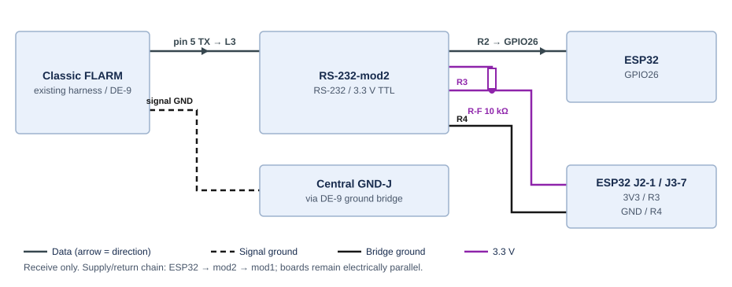
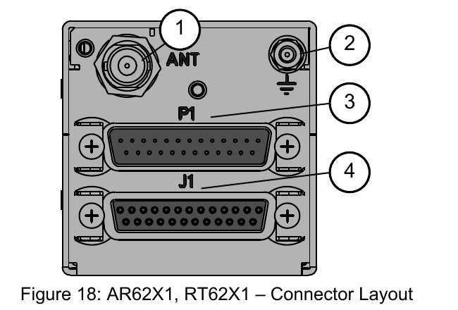
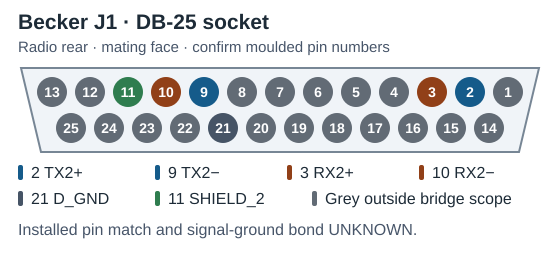

<a id="top"></a>

# 🔌 Signal wiring

🏠 [Overview](../../README.md) › 🔧 Hardware › **Signal wiring**

How the bridge's signals connect to the Zander, the FLARM and the Becker radio — pin by pin. Supply and grounding: [power and grounding](power.md). The device-side connectors and harness already exist in the aircraft; this page covers the bridge end only.

> [!NOTE]
> **Status:** wiring design in progress. See [open items](../project/open-items.md) for the remaining wiring decisions and [bench checks](../project/open-items.md#bench-hardware).

📑 **On this page:** <kbd>[1 · 🧭 Overview and UART plan](#overview)</kbd> <kbd>[2 · 📈 Zander ZS1](#zander)</kbd> <kbd>[3 · 📡 FLARM](#flarm)</kbd> <kbd>[4 · 📻 Becker radio](#becker)</kbd> <kbd>[5 · 🧪 Bench bring-up](#bring-up)</kbd>

Related: ⚡ [Power and grounding](power.md) · 🧱 [Modules and parts](modules.md) · 📚 [Sources](../research/sources.md)

---

<a id="overview"></a>

## 1. 🧭 Overview and UART plan


Zander and FLARM are receive-only at the bridge. No return wires or connector contacts are fitted for their RX inputs. The Becker path works in both directions.

### 1.1 Combined instrument connector

Use one standard-density DE-9 connector for Becker, Zander and FLARM: a male connector (pins) on the housing and a mating female cable connector, with solder-cup contacts and screw locking. Terminate the existing instrument wires directly in the cable connector and support the cables with a backshell and strain relief. Power uses the separate [XT30 connector](power.md#supply).

<a id="de9-pinout"></a>

> [!TIP]
> **Selected DE-9 pinout.** View the male housing connector from outside with the five-pin row up and the XT30 on the left. The housing-side solder-cup view is mirrored. Use the moulded contact numbers on both connector halves.

```text
XT30 side                         MAX490 side
      1      2      3      4      5
          6      7      8      9
```

| DE-9 pin | Instrument harness | Inside the bridge |
| ---: | --- | --- |
| 1 | [Zander ZS1](#zander) TX | RS-232 mod1 L3 |
| 2 | [FLARM](#flarm) TX | RS-232 mod2 L3 |
| 3 | [Becker](#becker) J1-21 D_GND | GND-J |
| 4 | Becker J1-2 TX2+ | MAX490 A |
| 5 | Becker J1-9 TX2− | MAX490 B |
| 6 | Zander ZS1 signal ground | GND-J |
| 7 | FLARM signal ground | GND-J |
| 8 | Becker J1-3 RX2+ | MAX490 Y |
| 9 | Becker J1-10 RX2− | MAX490 Z |

Inside the bridge, link solder cups 3, 6 and 7 with a short tinned bridge and run one instrument-ground wire from it to GND-J, sized for the [fault current](power.md#currents). Keep pins 4/5 and 8/9 as separate twisted pairs up to the solder cups. Follow the [Becker shield termination](#becker) and insulate the drain at the bridge end. Use the dedicated instrument harness with this custom pinout. See [housing](housing.md#connectors) for mounting and [open items](../project/open-items.md#bench-hardware) for parts and fit checks.

### 1.2 UART plan

The ESP32 has three UARTs; each device gets one.

| Device | UART | ESP32 RX | ESP32 TX | Interface |
| --- | --- | --- | --- | --- |
| 📈 Zander ZS1 | UART0, remapped | GPIO32 | Not connected | RS-232-mod1 |
| 📡 FLARM | UART1 | GPIO26 | Not connected | RS-232-mod2 |
| 📻 Becker | UART2 | GPIO16, through a 2.2 kΩ / 3.3 kΩ divider | GPIO17 | MAX490 RS-422 board |

UART0 is also the USB serial port. The firmware remaps its receive input to GPIO32 after boot, so there is no USB serial log in operation; diagnostics go over Wi-Fi. Boot messages appear only on GPIO1, so they never reach a device. Keeping the radio off UART0 means a stray log line can never reach the radio.

> [!IMPORTANT]
> The firmware must switch the UART0 log console off when assigning UART0 to Zander reception. GPIO33 and the Zander return path are not wired.

---

<a id="zander"></a>

## 2. 📈 Zander ZS1


Start with the loose ends of the existing Zander harness ([installed wiring](../project/existing-installation.md#equipment)). The table identifies the required RS-232 signals, not a connector at the bridge. Match each loose conductor to its signal before connecting it; see [open items](../project/open-items.md#bench-hardware). Signal functions follow the ZS1 handbook (S22).

| Zander harness signal | → / ← | RS-232 pads | TTL pads | → / ← | ESP32 |
| --- | :-: | --- | --- | :-: | --- |
| TX from Zander | → | **L3** RS-232 input | **R1** TTL output | → | GPIO32 () |

Connect the Zander signal-ground conductor to GND-J. The module receives 3.3 V and ground through mod2; see the [supply chain](power.md#supply). Leave L1 without an extra ground wire.

Leave R2 (unused driver input), L4 and GPIO33 unconnected.

---

<a id="flarm"></a>

## 3. 📡 FLARM



Use a free data port on the Classic FLARM ([installation manual v221 pp.6/7](https://www.flarm.com/wp-content/uploads/2024/04/FLARM_InstallationManual_D.pdf#page=6), S23).

| FLARM Power/Data | → / ← | RS-232 pads | TTL pads | → / ← | ESP32 |
| --- | :-: | --- | --- | :-: | --- |
| 5 () | → | **L3** RS-232 input | **R1** TTL output | → | GPIO26 () |

Connect the FLARM signal-ground conductor (pins 7/8) to GND-J. Mod2 receives 3.3 V and ground from the ESP32 and passes both on to mod1; see the [supply chain](power.md#supply). Leave L1 without an extra ground wire.

Leave R2 (unused driver input), L4, GPIO27 and the FLARM RX conductor unconnected.

> [!WARNING]
> FLARM uses IGC pin numbering, which runs opposite to common RJ45 numbering. Pins 1–3 carry supply voltage: never connect them to the converter.


---

<a id="becker"></a>

## 4. 📻 Becker radio


The radio's serial interface 2 on connector J1 ([Becker DV14307.03 Issue 06, p.59](https://www.becker-avionics.com/wp-content/uploads/00_Literature/6200_Series_IO_en.pdf#page=59), S10).

Start at the loose ends of the existing Becker harness ([installed wiring](../project/existing-installation.md#equipment)). The J1 numbers below identify radio-side signal origins, not a bridge-side connector. Terminate the bridge end using the [selected DE-9 pinout](#de9-pinout).

### 4.1 Radio side — board screw terminals

| J1 pin | Radio signal | Bridge connection | Meaning |
| --- | --- | --- | --- |
| 2 | TX2+ | A | Receiver input + |
| 9 | TX2− | B | Receiver input − |
| 3 | RX2+ | Y | Driver output + |
| 10 | RX2− | Z | Driver output − |
| 11 | SHIELD_2 | — (cable shield) | Shield of the auxiliary control interface |
| 21 | D_GND | Central GND-J | Signal reference |

Run TX2± and RX2± as two separate twisted pairs in a shielded cable, as Becker requires for the interface lines (S10). Connect the shield to J1-11 at the radio end only and leave it unconnected at the bridge end, so it carries no ground current. Connect J1-21 to GND-J with a separate wire in the same cable, not the shield or drain wire. J1-21 also closes ground loop B; see [grounding and loops](power.md#ground).

> [!TIP]
> **Selected: no termination on A–B.** Leave the board's 120 Ω receive resistor unlinked, as delivered (S145). One driver feeds one receiver over the short harness at 9600 baud, so the line needs no termination, and the radio's TX2 driver carries no 120 Ω load.

### 4.2 TTL side — board header

> [!IMPORTANT]
> **The settings below apply to the delivered QYF-998 board only:** TXD = DI and RXD = RO, no extra DI pull-up and A–B open (S144, S145). Other "RS422 TO TTL" boards can differ in each of them. Run the [board check](modules.md#rs422-check) on any other or replacement board before wiring it.

| Board signal | Bridge connection |
| --- | --- |
| **RXD** · receiver output (RO) | 2.2 kΩ (R-B1) in the wire to GPIO16 (J3-12); 3.3 kΩ (R-B2) across the header pins J3-12 and J3-7 (GND) () |
| **TXD** · driver input (DI) | GPIO17 (J3-11), direct, no resistor () |
| VCC | Own branch from central 5V-J |
| GND | Own branch from central GND-J; no extra wire to ESP32 |

R-B1 sits at the J3-12 end of the RO wire. Cover each resistor and both its joints with heat-shrink and tie the wire down next to the ESP32, so vibration does not load the joints.

> [!IMPORTANT]
> **GPIO17 goes straight to DI; only RO goes through the divider.** A divider or series resistor in the TX line stops the driver from switching (S145). The header labels name the ESP32 signals, not the chip pins.

ESP32 TX at 3.3 V drives DI directly (the MAX490 needs 2.0 V for a logic high). While GPIO17 is not driven (reset, boot, flashing), DI must still idle high, so no random bits reach the radio before the UART is set up. The firmware sets no internal pull-up on GPIO17 (S140), and none could act before the firmware runs.

> [!TIP]
> **Selected: no extra pull-up on DI.** The board's own 1 kΩ + LED to VCC holds DI at 3.1 V with the ESP32 in reset, and the driver output stays high (Y–Z +4.6 V), S145.

> [!WARNING]
> The MAX490 runs at 5 V, so RO idles near 5 V — above the ESP32's 3.6 V input limit (S34). Never connect RO directly to GPIO16.

```math
V_{\text{GPIO16}} = V_{\text{RO}} \cdot \frac{3.3\text{ k}\Omega}{2.2\text{ k}\Omega + 3.3\text{ k}\Omega} = 0.6 \cdot V_{\text{RO}} \quad\Rightarrow\quad 5.0\text{ to }5.25\text{ V} \to 3.0\text{ to }3.15\text{ V}
```

The divider keeps GPIO16 inside the ESP32's input range, so no current flows into the pin's protection diode. A series resistor alone would rely on that diode, for which Espressif gives no current limit. The divider's low source impedance (about 1.3 kΩ) also keeps a clean logic low when the firmware enables the ESP32's internal RX pull-up (about 45 kΩ), as Arduino-ESP32 does by default (S35). RO is loaded with about 1 mA.

### 4.3 Connector reference

| Radio rear (callout 4 = J1) | J1 mating face |
| --- | --- |
|  |  |

Socket numbering follows the [Winford BRKDD25F-R-FT mating-face drawing](https://www.winford.com/products/cad/brkdd25f-r-ft_rev_a_dwg.pdf). Pin-view styling follows the [Pinout.xyz examples](https://github.com/pinout-xyz/Pinout.xyz/tree/main/graphics).

---

<a id="bring-up"></a>

## 5. 🧪 Bench bring-up

Keep all instruments disconnected during bench bring-up. Start with the supply and the loose boards, before soldering the harness.

- [ ] **1.** With power off, check XT30 input polarity and continuity between the UBEC's input and output ground. Set the [UBEC jumper](modules.md#ubec) to 5 V and measure the output with no load before connecting a board.
- [ ] **2.** Match the ESP32 board's headers and module marking to the [pinout](modules.md#esp32-pinout). Switch off the bench supply before connecting the verified ESP32, then measure the UBEC output under load. Keep USB disconnected while the UBEC powers the ESP32 ([power rules](power.md#supply)).
- [x] **3.** Flash the [OTA loader](../design/architecture.md#adr-05) over USB with its board setting, the UBEC and all instruments unplugged. First run `esptool flash-id` and expect 4 MB flash. Then power the ESP32 from the UBEC with USB unplugged: check that it joins the bench network and accepts one OTA upload; switch the network off (or upload the [fallback test build](../../firmware/ota-loader/README.md#variants)), restart, and check that its hotspot appears and accepts a client and one OTA upload. For M3 the owner accepted a phone join in place of the hotspot upload, which the bench PC cannot reach ([milestones](../project/roadmap.md#milestones)).
- [ ] **4.** With both RS-232 boards unpowered, check continuity from L2 to R3 and from L1 to R4 on each board. Verify the rest of the [pad map](modules.md#rs232-module) before soldering the harness. Then feed each board 3.3 V on R3 and GND on R4: with L3 open, R1 reads about 3.3 V; bridging L3 to L2 pulls R1 to about 0 V, while R2 does not follow. Do not touch L4, it drives about ±5.5 V.
- [x] **5.** On the loose board, run the [board check](modules.md#rs422-check). With power disconnected, check GPIO17 (J3-11) straight to TXD with no resistor, RXD through the divider to GPIO16, and the A–B resistance (no termination: tens of kΩ). Then, with the board at 5 V and the ESP32 held in reset (EN to GND), check that DI reads at least 2 V and Y stays above Z, so the board's own pull-up [is enough](#becker). Passed on the bench bridge after the TX line was corrected (S145).
- [x] **6.** With the MAX490 powered and nothing else on A/B (loop links removed), drive the receiver input with a 1.5 V cell and measure GPIO16 both ways: + to A, − to B gives about 3.0 V (high); + to B, − to A gives below 0.5 V (low). Also record GPIO16 without the cell, with A and B open. Passed: about 3.0 V high, 0.15 V low, high with A and B open (S146).
- [ ] **7.** Measure the bridge's current and switch-on inrush at 12 V, and update the [current assumptions](power.md#currents).
- [ ] **8.** With power off and the instruments disconnected, use the moulded contact numbers to check each loose harness conductor end to end through the mated DE-9 against the [pinout](#de9-pinout). Check for unintended connections between signals and from signals to GND-J or the shell. Allow for the three ground contacts that share GND-J.

<a id="bus-test"></a>

### 5.1 Bus-level test at the DE-9

Test the finished bridge from the DE-9 inward, with the instruments still disconnected. Once the modules are soldered, the jumper loop on the ESP32 is no longer allowed ([warning](../project/roadmap.md#firmware-plan)).

> [!TIP]
> **Selected:** a DE-9 female screw-terminal breakout as the test plug, and a USB RS-232 adapter on the PC as the source for the Zander and FLARM inputs.

| Breakout terminal | Radio loop | RS-232 feed |
| ---: | --- | --- |
| 1 | — | Adapter TXD (adapter DE-9 pin 3), Zander test |
| 2 | — | Adapter TXD, FLARM test |
| 3 | — | — |
| 4 | Link to 8 | — |
| 5 | Link to 9 | — |
| 6, 7 | — | Adapter GND (adapter DE-9 pin 5) |

| Test | Covers | Not covered |
| --- | --- | --- |
| Radio loop | DE-9 pins 4/5/8/9, MAX490 driver and receiver, divider, UART2, radio port | Pair polarity towards the radio: a loop with both pairs reversed still passes. Items 6 and 8 cover it |
| RS-232 feed | DE-9 pins 1/2/6/7, module receivers at RS-232 levels, GPIO32/26, baud rate, forwarding over TCP | The RS-232 transmit direction (not wired); device protocol and installed baud rates ([open items](../project/open-items.md#installed-equipment)) |

Feed one input at a time. Zander and FLARM use the same baud rate, so swapped pins show up only when each input gets its own test. The PC test script drives the adapter; its serial mode comes with [firmware step 4](../project/roadmap.md#firmware-plan).

- [ ] **9.** Check the adapter: its TXD idles below −3 V against GND. A TTL cable does not and cannot be used.
- [x] **10.** Radio loop: fit the links 4–8 and 5–9, plug the breakout in and run the radio-port loop test. Passed with links on the DE-9 pins (S145).
- [ ] **11.** Zander input: adapter TXD on terminal 1, GND on 6 and 7. Bytes sent at the Zander baud rate arrive unchanged on the Zander port ([ports](../../firmware/bridge/README.md#project-settings)) over TCP; nothing arrives on the FLARM port.
- [ ] **12.** FLARM input: move TXD to terminal 2. Bytes arrive on the FLARM port only.

### 5.2 Supply voltage sense

With firmware step 3d ([supply voltage](../project/roadmap.md#supply-voltage)) and the [divider](power.md#voltage-sense) fitted:

- [ ] **13.** Supply the bridge at 12.5 V, enter the multimeter reading at the XT30 on the settings page to calibrate, then compare the status page with the meter at 7, 12, 14.6 and 20 V. Record the errors; the plan expects about ±0.1 V.

### 5.3 Aircraft integration

After bench validation and separate approval ([work packages](../project/roadmap.md#work-packages)):

- [ ] **14.** Before plugging in J1, check that the bridge ground and the radio's P1-13 and P1-25 each have low resistance (well under 1 Ω) to the common ground point ([why](power.md#wire-breaks)).
- [ ] **15.** Listen for radio noise and check squelch with the bridge on and off.

---

<kbd>[⬆️ Back to top](#top)</kbd> <kbd>[🏠 Overview](../../README.md)</kbd>
