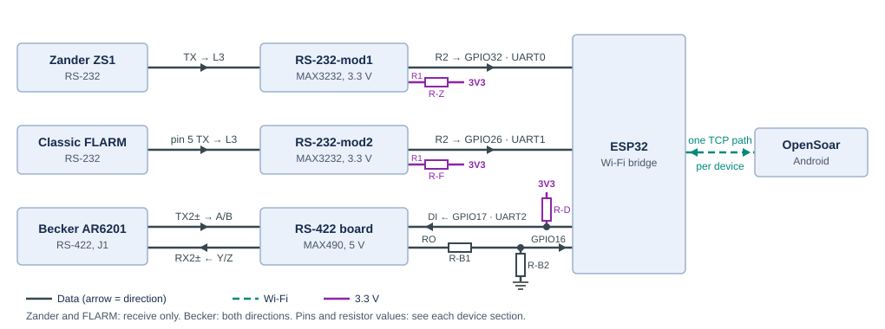

<a id="top"></a>

# 🔌 Signal wiring

🏠 [Overview](../../README.md) › 🔧 Hardware › **Signal wiring**

How the bridge's signals connect to the Zander, the FLARM and the Becker radio — pin by pin. Supply and grounding: [power and grounding](power.md). The device-side connectors and harness already exist in the aircraft; this page covers the bridge end only.

> [!NOTE]
> **Status:** bench design. Parts and wiring are decided; nothing is built or measured yet. Open checks: [bench hardware](../project/open-items.md#bench-hardware).

📑 **On this page:** <kbd>[1 · 🧭 Overview and UART plan](#overview)</kbd> <kbd>[2 · 📈 Zander ZS1](#zander)</kbd> <kbd>[3 · 📡 FLARM](#flarm)</kbd> <kbd>[4 · 📻 Becker radio](#becker)</kbd> <kbd>[5 · 🧪 Bench bring-up](#bring-up)</kbd>

Related: ⚡ [Power and grounding](power.md) · 🧱 [Modules and parts](modules.md) · 📚 [Sources](../research/sources.md)

---

<a id="overview"></a>

## 1. 🧭 Overview and UART plan



Zander and FLARM are receive-only at the bridge. No return wires or connector contacts are fitted for their RX inputs. The Becker path works in both directions.

### 1.1 Combined instrument connector

Use one standard-density DE-9 connector for Becker, Zander and FLARM: a male connector (pins) on the housing and a mating female cable connector, with solder-cup contacts and screw locking. Terminate the existing instrument wires directly in the cable connector and support the cables with a backshell and strain relief. Power uses the separate [XT30 connector](power.md#supply).

| Device | Signals through the connector | Contacts |
| --- | --- | ---: |
| Becker | Two differential pairs and signal ground | 5 |
| Zander | Data to bridge and ground | 2 |
| FLARM | Data to bridge and ground | 2 |
| **Total** | **No spare contacts or navigation return lines** | **9** |

This is a custom combined instrument connection, not a standard PC serial port. Connector pin assignments, exact parts and housing fit are tracked in [open items](../project/open-items.md#bench-hardware); mechanical mounting: [housing](housing.md#connectors). Keep the Becker shield treatment described in [Becker wiring](#becker).

### 1.2 UART plan

The ESP32 has three UARTs; each device gets one.

| Device | UART | ESP32 RX | ESP32 TX | Interface |
| --- | --- | --- | --- | --- |
| 📈 Zander ZS1 | UART0, remapped | GPIO32 | Not connected | RS-232-mod1 |
| 📡 FLARM | UART1 | GPIO26 | Not connected | RS-232-mod2 |
| 📻 Becker | UART2 | GPIO16, through a 2.2 kΩ / 3.3 kΩ divider | GPIO17 | MAX490 RS-422 board |

UART0 is also the USB serial port. The firmware remaps its receive input to GPIO32 after boot, so there is no USB serial log in operation; diagnostics go over Wi-Fi. Boot messages appear only on GPIO1, so they never reach a device. Keeping the radio off UART0 means a stray log line can never reach the radio.

> [!IMPORTANT]
> The firmware must switch the UART0 log console off when assigning UART0 to Zander reception. GPIO33 and the Zander return path are not wired.

---

<a id="zander"></a>

## 2. 📈 Zander ZS1


Start with the loose ends of the existing Zander harness ([installed wiring](../project/existing-installation.md#equipment)). The table identifies the required RS-232 signals, not a connector at the bridge. Match each loose conductor to its signal before connecting it; see [open items](../project/open-items.md#bench-hardware). Signal functions follow the ZS1 handbook (S22).

| Zander harness signal | → / ← | RS-232 pads | TTL pads | → / ← | ESP32 |
| --- | :-: | --- | --- | :-: | --- |
| TX from Zander | → | **L3** RS-232 input | **R2** TTL output | → | GPIO32 () |
| Signal GND | — | L1 GND | R4 GND | — | GND |

Leave L4 and GPIO33 unconnected. Keep the existing 10 kΩ pull-up (R-Z) from R1 to 3.3 V to hold the unused converter driver input at a defined level.

---

<a id="flarm"></a>

## 3. 📡 FLARM


Use a free data port on the Classic FLARM ([installation manual v221 pp.6/7](https://www.flarm.com/wp-content/uploads/2024/04/FLARM_InstallationManual_D.pdf#page=6), S23).

| FLARM Power/Data | → / ← | RS-232 pads | TTL pads | → / ← | ESP32 |
| --- | :-: | --- | --- | :-: | --- |
| 5 () | → | **L3** RS-232 input | **R2** TTL output | → | GPIO26 () |
| 7/8 () | — | L1 GND | R4 GND | — | GND |

Leave L4, GPIO27 and the FLARM RX conductor unconnected. Keep the existing 10 kΩ pull-up (R-F) from R1 to 3.3 V, as for the Zander.

> [!WARNING]
> FLARM uses IGC pin numbering, which runs opposite to common RJ45 numbering. Pins 1–3 carry supply voltage: never connect them to the converter.


---

<a id="becker"></a>

## 4. 📻 Becker radio


The radio's serial interface 2 on connector J1 ([Becker DV14307.03 Issue 06, p.59](https://www.becker-avionics.com/wp-content/uploads/00_Literature/6200_Series_IO_en.pdf#page=59), S10).

Start at the loose ends of the existing Becker harness ([installed wiring](../project/existing-installation.md#equipment)). The J1 numbers below identify radio-side signal origins, not a bridge-side connector. Bridge termination is tracked in [open items](../project/open-items.md#bench-hardware).

### 4.1 Radio side — board screw terminals

| J1 pin | Radio signal | MAX490 terminal | Meaning |
| --- | --- | --- | --- |
| 2 | TX2+ | A | Receiver input + |
| 9 | TX2− | B | Receiver input − |
| 3 | RX2+ | Y | Driver output + |
| 10 | RX2− | Z | Driver output − |
| 11 | SHIELD_2 | — (cable shield) | Shield of the auxiliary control interface |
| 21 | D_GND | GND | Signal reference |

Run TX2± and RX2± as two separate twisted pairs in a shielded cable, as Becker requires for the interface lines (S10). Connect the shield to J1-11 at the radio end only and leave it unconnected at the bridge end, so it carries no ground current. Connect J1-21 to the board GND with a separate wire in the same cable, not the shield or drain wire. J1-21 also closes ground loop B; see [grounding and loops](power.md#ground).

### 4.2 ESP32 side — board header

| Board signal | ESP32 |
| --- | --- |
| Receiver output (RO) | 2.2 kΩ (R-B1) to GPIO16; 3.3 kΩ (R-B2) from GPIO16 to GND () |
| Driver input (DI) | GPIO17, plus a 10 kΩ pull-up (R-D) to 3.3 V () |
| VCC | 5 V from the UBEC |
| GND | GND |

> [!IMPORTANT]
> The board's TXD/RXD header labels may be named from either side. Identify RO and DI on the board before wiring.

ESP32 TX at 3.3 V drives DI directly (the MAX490 needs 2.0 V for a logic high). The pull-up R-D holds DI idle while the ESP32 boots, so no random bits reach the radio before the UART is set up.

> [!WARNING]
> The MAX490 runs at 5 V, so RO idles near 5 V — above the ESP32's 3.6 V input limit (S34). Never connect RO directly to GPIO16.

```math
V_{\text{GPIO16}} = V_{\text{RO}} \cdot \frac{3.3\text{ k}\Omega}{2.2\text{ k}\Omega + 3.3\text{ k}\Omega} = 0.6 \cdot V_{\text{RO}} \quad\Rightarrow\quad 5.0\text{ to }5.25\text{ V} \to 3.0\text{ to }3.15\text{ V}
```

The divider keeps GPIO16 inside the ESP32's input range, so no current flows into the pin's protection diode. A series resistor alone would rely on that diode, for which Espressif gives no current limit. The divider's low source impedance (about 1.3 kΩ) also keeps a clean logic low when the firmware enables the ESP32's internal RX pull-up (about 45 kΩ), as Arduino-ESP32 does by default (S35). RO is loaded with about 1 mA.

### 4.3 Connector reference

| Radio rear (callout 4 = J1) | J1 mating face |
| --- | --- |
|  |  |

Socket numbering follows the [Winford BRKDD25F-R-FT mating-face drawing](https://www.winford.com/products/cad/brkdd25f-r-ft_rev_a_dwg.pdf). Pin-view styling follows the [Pinout.xyz examples](https://github.com/pinout-xyz/Pinout.xyz/tree/main/graphics).

---

<a id="bring-up"></a>

## 5. 🧪 Bench bring-up

Before connecting any device, work through this list in order:

- [ ] **1.** Set the UBEC jumper to 5 V; measure the output with no load and with the ESP32 connected. Check continuity between the UBEC's input and output ground.
- [ ] **2.** Match the ESP32 board's headers and module marking to the [pinout](modules.md#esp32-pinout).
- [ ] **3.** Check continuity of both RS-232 modules against the [pad map](modules.md#rs232-module).
- [ ] **4.** On the MAX490 board, identify RO and DI on the header and check the 120 Ω termination.
- [ ] **5.** With the MAX490 powered and the radio line idle, measure GPIO16: about 3.0 V (high). Then hold B above A with a 1.5 V cell (+ to B, − to A) and check for a low below 0.5 V.
- [ ] **6.** Measure the bridge's current and switch-on inrush at 12 V, and update the [current assumptions](power.md#currents).
- [ ] **7.** Before plugging in J1, check that the bridge ground and the radio's P1-13 and P1-25 each have low resistance (well under 1 Ω) to the common ground point ([why](power.md#wire-breaks)).
- [ ] **8.** In the aircraft: listen for radio noise and check squelch with the bridge on and off.

---

<kbd>[⬆️ Back to top](#top)</kbd> <kbd>[🏠 Overview](../../README.md)</kbd>
