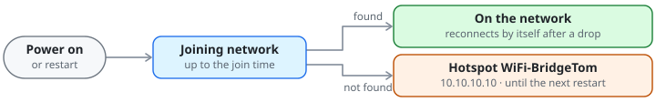
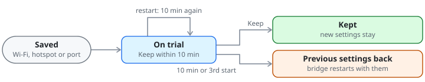
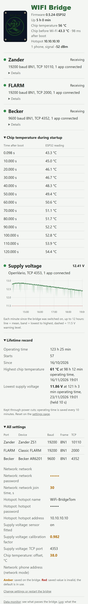
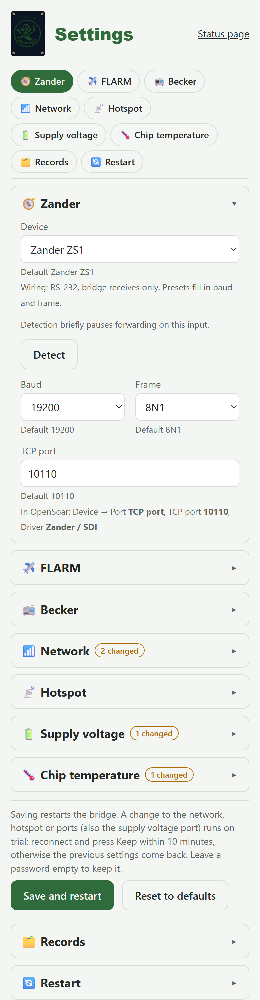
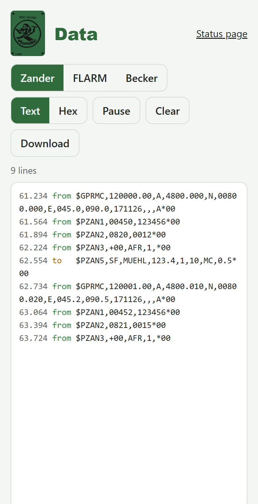

# 📖 User manual

🏠 [Overview](../../README.md) › 📖 Manual › **User manual**

How to connect the bridge to OpenSoar, how it behaves and what to do when something looks wrong.

> [!NOTE]
> **Status:** describes bridge firmware 0.5.24 on the bench bridge (the bridge dials the app in hotspot and network mode, [step 4a](../project/roadmap.md#firmware-plan)). Hotspot mode passed on the owner's Pixel: Wi-Fi off/on, restart and hard power cuts (S215, S220). Network mode bench-tested with the PC as phone (S219). A phone in network mode and a second phone are still open ([roadmap](../project/roadmap.md#work-packages)).

<a href="#quick-start"><picture><source media="(prefers-color-scheme: dark)" srcset="../images/nav/menu-manual-user-manual-1-dark.svg"></picture></a> <a href="#behaviour"><picture><source media="(prefers-color-scheme: dark)" srcset="../images/nav/menu-manual-user-manual-2-dark.svg"></picture></a> <a href="#web-pages"><picture><source media="(prefers-color-scheme: dark)" srcset="../images/nav/menu-manual-user-manual-3-dark.svg"></picture></a> <a href="#troubleshooting"><picture><source media="(prefers-color-scheme: dark)" srcset="../images/nav/menu-manual-user-manual-4-dark.svg"></picture></a> <!-- page-menu -->

---

## 1. 🚀 Quick start

<a href="#power-on"><picture><source media="(prefers-color-scheme: dark)" srcset="../images/nav/step-use-1-dark.svg"></picture></a> <a href="#join-wifi"><picture><source media="(prefers-color-scheme: dark)" srcset="../images/nav/step-use-2-dark.svg"></picture></a> <a href="#open-status"><picture><source media="(prefers-color-scheme: dark)" srcset="../images/nav/step-use-3-dark.svg"></picture></a> <a href="#connect-opensoar"><picture><source media="(prefers-color-scheme: dark)" srcset="../images/nav/step-use-4-dark.svg"></picture></a>

### 1.1 Power on

Switch on the avionics supply. The bridge first looks for its stored network (see [Wi-Fi start-up](#wifi-startup)). In the glider there is none, so after the join time it opens its own hotspot. Without a stored network it opens the hotspot at once.

### 1.2 Join the Wi-Fi

| | |
| --- | --- |
| Network | `WiFi-BridgeTom` |
| Password | `BridgeTom-setup` by default ([logins](#logins)) |
| Bridge address | `10.10.10.10` |

The hotspot has no internet. The phone keeps its mobile internet; the bridge reaches OpenSoar over Wi-Fi by itself ([Connect OpenSoar](#connect-opensoar)). Set the phone up once:

- [ ] Join `WiFi-BridgeTom`.
- [ ] Android reports *no internet* and asks whether to stay connected: choose **Stay connected** (*Verbunden bleiben*). From now on the phone rejoins the hotspot by itself (S209).
- [ ] For mobile internet on the hotspot (R20): switch the phone's **Wi-Fi off and on once**. Until then the phone sends its internet traffic to the hotspot and has no internet; after the automatic rejoin it uses mobile data again. The instrument data does not depend on this step.

> [!TIP]
> After this setup, never tap `WiFi-BridgeTom` in the Wi-Fi list. A network picked by hand becomes the phone's main network for that connection, and mobile internet stops until the next automatic rejoin. If the phone is not on the hotspot, switch Wi-Fi off and on instead. Keep OpenSoar on screen: with the screen locked, Android rejoins the hotspot only after unlocking (S215).

**Default logins.** Every firmware build has these logins ([`config.h`](../../firmware/bridge/config.h)). Anyone with this repository knows them.

| Login | Where | User | Default password | Change it |
| --- | --- | --- | --- | --- |
| Hotspot | Wi-Fi `WiFi-BridgeTom` | — | `BridgeTom-setup` | [Settings page](#settings), hotspot fields |
| Settings | `/settings` and its [API calls](../../firmware/bridge/README.md#settings-page) | — | None: anyone on the bridge's Wi-Fi can change settings | — |
| Firmware upload (OTA) | The bridge's address (`10.10.10.10` on the hotspot), port 3232 | — | `BridgeTom-ota` | Only in a build with your own `OTA_PASSWORD` ([build](../../firmware/bridge/README.md#build)) |
| Network to join | Your own network | — | None built in; until one is set, the hotspot opens at once | [Settings page](#settings), network fields |

> [!IMPORTANT]
> Before the bridge goes into the aircraft, change the hotspot password and build with your own OTA password. The settings page has no login: whoever can join the bridge's Wi-Fi can change its settings, and with the defaults anyone near the glider can also upload firmware.

### 1.3 Open the status page

Switch **Mobile data** off, type `http://10.10.10.10/` in the phone's browser, and switch mobile data on again when done. With mobile data on, the browser goes out over mobile data and does not reach the bridge (S207, S209). A green dot per device means data is arriving. More: [web pages](#web-pages).

### 1.4 Connect OpenSoar

Add one device per instrument in OpenSoar, each as a **TCP port** (OpenSoar listens; the bridge connects to it):

| Instrument | Port type and port | OpenSoar driver |
| --- | --- | --- |
| 📈 Zander ZS1 | TCP port `10110` | `Zander / SDI` |
| 📡 Classic FLARM | TCP port `2000` | `FLARM` |
| 📻 Becker AR6201 | TCP port `4352` | `AR62xx` ([driver](../research/becker-driver.md#consequences)) |
| 🔋 Supply voltage (optional) | TCP port `4353` | `OpenVario` |

The bridge connects to every phone on its hotspot on these four ports, a new attempt every 3 s until OpenSoar answers. After a power cut, a restart or a Wi-Fi gap the connections come back by themselves; nothing to press in OpenSoar (S207, S211).

On a network (bridge and phone on the same Wi-Fi) the bridge dials one phone: the **Phone address** from the [settings page](#settings), else the last phone that connected to a bridge port, else the network's gateway. With only *TCP port* entries the phone never connects to the bridge itself, so on a shared Wi-Fi enter the phone's address (S219).

*TCP client* entries to `10.10.10.10` with the same ports still work, as on the bridge already in the glider ([existing installation](../project/existing-installation.md#configuration)), but only while mobile data is off. Use either kind per instrument, not both.

---

## 2. 🚦 How it behaves

### 2.1 Wi-Fi start-up

<picture><source media="(prefers-color-scheme: dark)" srcset="../images/nav/state-wifi-startup-dark.svg"></picture>

| State | Bridge | You |
| --- | --- | --- |
| Joining network | Tries the stored network for the join time (default 15 s, changeable on the settings page) | Wait |
| On the network | Reachable at the address the router gave it (listed there as `wifi-bridgetom`). Rejoins by itself after a drop. Dials the phone's *TCP port* entries ([Connect OpenSoar](#connect-opensoar)) | Use this on the bench; set the phone address on the settings page |
| Hotspot | Opens `WiFi-BridgeTom` at `10.10.10.10` on 2.4 GHz channel 11 and **stays in hotspot mode until the next restart**; it does not look for the network again | Connect the phone to the hotspot. To get back to the network, [restart](#restart) the bridge |

### 2.2 Changing Wi-Fi, hotspot or port settings

<picture><source media="(prefers-color-scheme: dark)" srcset="../images/nav/state-settings-trial-dark.svg"></picture>

| State | Bridge | You |
| --- | --- | --- |
| On trial | Restarts with the new settings. A banner on the settings page shows the time left | Reconnect, open the settings page and press **Keep** within 10 minutes |
| Restart during the trial | Counts as one of 3 starts without *Keep*; the 10 minutes start again | Press *Keep* after reconnecting |
| Kept | The new settings stay | — |
| Previous settings back | After 10 minutes, or at the 3rd start without *Keep*: restores the settings from before and restarts | Reconnect with the old settings |

Baud rate and serial frame changes apply at once, without a trial.

### 2.3 Other situations

| Situation | Bridge |
| --- | --- |
| **Restart bridge** (settings page or status page) | Restarts with the stored settings; nothing is written. It closes the app connections first, so the apps reconnect by themselves, as after a settings change or firmware update (S198) |
| **Reset to defaults** | Forgets all saved settings and restarts with the firmware defaults |
| Power cut | Keeps the settings, the [lifetime record](../../firmware/bridge/README.md#lifetime-record) and the saved log. The web log and the supply voltage chart start empty |
| Several apps on Zander or FLARM | Up to 4 apps per port and **6 app connections in all** (one phone with four devices uses 4); a further one is refused. An app that falls behind skips data and catches up; one that takes no data for 60 s is closed |
| Becker port | One app at a time owns the radio, whether the bridge dialed it or the app connected. A second one is refused until the first closes; the bridge dials the next phone only then |
| Phone leaves the hotspot | The bridge closes that phone's connections at once and dials it again when it is back |
| Phone vanishes while the bridge keeps running | The bridge closes unresponsive connections after about 15 s, including on quiet ports |
| Bridge stops taking connections or its web pages stop | It restarts by itself: after 3 failed self-checks 30 s apart, or after 60 s without a sign of life from its web task. Apps are closed first and the bridge dials them again |
| Supply below 11.5 V for 10 s | Warning in the web log; forwarding continues |
| Chip sensor at 100 °C for 1 min (before the [offset](#chip-calibration)) | Warning in the web log; forwarding continues. The chip runs hotter than the air in the housing |

---

## 3. 📱 Web pages

Open them in the phone's browser at `http://10.10.10.10/` (hotspot, with mobile data off) or at the address from the router (network).

| Page | Address | What it shows | Password |
| --- | --- | --- | --- |
| Status | `/` | Firmware, uptime, Wi-Fi signal; one row per device with a green dot while data arrives, baud rate, port, connected apps, errors; *All settings* | — |
| Settings | `/settings` | One section per topic, opened from the menu at the top; *n changed* marks unsaved edits, *check* a refused field. Device profile, baud, frame and port per device, each port with the matching OpenSoar entry; network, join time and phone address; hotspot; supply voltage; chip temperature offset ([calibration](#chip-calibration)). **Detect** finds the baud rate on the Zander and FLARM inputs. **Save and restart**, **Keep**, **Restart bridge**, **Reset to defaults** | — |
| Data monitor | `/monitor` | The data passing each device, as text or hex; pause and download | — |
| Web log | `/log` | What the bridge did since the last power cut | — |
| Saved log | `/saved` | Errors and warnings kept through power cuts | — |

Passwords are never shown. Leave a password field empty to keep the current one.

  

Details for each page: [firmware reference](../../firmware/bridge/README.md#status-page).

### 3.1 Calibrating the chip temperature

The ESP32's sensor reads far too high, by a different amount on each chip (about +38 °C on the bench bridge, S187). Until an offset is stored, every chip temperature shows as *uncorrected*.

- [ ] Switch the bridge off for at least 30 minutes, in the place where it stays.
- [ ] Switch it on and open **Settings** › *Chip temperature* › **Calibrate chip temperature**.
- [ ] Tick *The bridge was off for at least 30 minutes, in the same place as now.*
- [ ] Enter the room temperature in °C (0 to 45) and press **Calibrate and restart**.

The bridge subtracts the room temperature from its earliest reading of this start and stores the difference (0 to 60 °C) as the offset; the result is accurate to about ±5 °C. Calibration is offered only after a start from power off. The offset stays through restarts and updates; set it by hand in the same field, or 0 to remove it. A new offset also corrects the highest chip temperature already in the lifetime record.

---

## 4. 🛠️ Troubleshooting

| Symptom | Likely cause | Do this |
| --- | --- | --- |
| Hotspot `WiFi-BridgeTom` not visible | The bridge found its stored network, or is still joining | Wait for the join time. On the bench, open the bridge's address from the router instead |
| Need the hotspot on the bench | The stored network is in range | Switch the network off, or change the network name on the settings page; the change runs on [trial](#trial) and comes back by itself |
| Status page does not open | Mobile data is on: the browser goes out over mobile data (S207, S209) | Switch **Mobile data** off, open `http://10.10.10.10/`, switch it on again |
| No mobile internet while on the hotspot | The hotspot was picked by hand in the Wi-Fi list, so it is the phone's main network for this connection (S209) | Switch Wi-Fi off and on; after the automatic rejoin the phone uses mobile data again |
| Phone does not rejoin the hotspot after a bridge restart | *Stay connected* was never chosen for `WiFi-BridgeTom`, so Android does not rejoin it by itself (S207, S208) | Forget the network and repeat the [setup](#join-wifi) |
| OpenSoar devices stay at *Verbinde…* while the phone is on the hotspot | They are *TCP client* entries and mobile data is on | Change them to *TCP port* entries ([Connect OpenSoar](#connect-opensoar)) |
| Phone joins another Wi-Fi network after a bridge restart in hotspot mode | Android auto-joined a saved network | Turn off *auto-connect* for the competing network during the bench check |
| Network mode: after a power cut, devices that were receiving show *No data* | The app still holds old TCP connections (S190, S193–S195, S197; planned restarts close them, S198) | Switch the phone's Wi-Fi off and on once; the apps reopen all ports within about 30 s. Or in the app, go to **Menu → Config → Devices**, select each affected bridge device and press **Reconnect**. Check that fresh data returns on the active feeds |
| Settings changed back by themselves | *Keep* was not pressed in time | Save again, reconnect and press *Keep* |
| OpenSoar cannot connect to the radio | Another device already owns the Becker port | Close OpenSoar on the other device |
| No green dot for Zander or FLARM | Wrong baud rate, or the instrument is off | Press **Detect** on the settings page; check the [wiring](../hardware/wiring.md#overview) |

---

<kbd>[⬆️ Back to top](#top)</kbd> <kbd>[🏠 Overview](../../README.md)</kbd>
