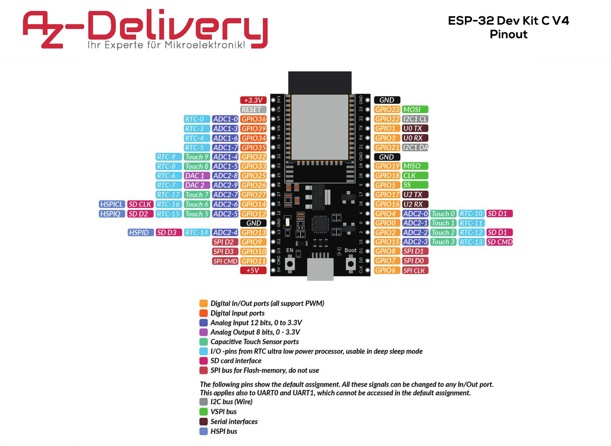
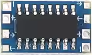
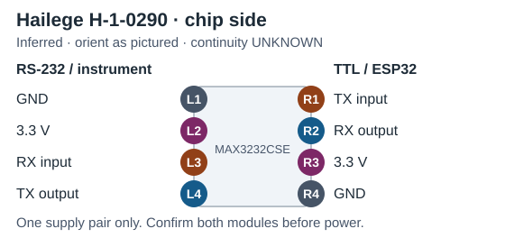

# Module specs

[Wiring guide](connections.md)

| Module | Power | Chip | Reported size |
| --- | --- | --- | --- |
| Hailege H-1-0290 (Zander and FLARM) | 3.3 V | MAX3232CSE (reported) | 9.4 × 15.9 mm |
| Becker RS-422 board (model TBD) | 3.3 V required | [Chip candidates](#becker-rs422-chips) | TBD |
| AZ-Delivery ESP32 WROOM dev module | 5 V input, 3.3 V regulator | — | — |
| Hobbywing UBEC 3A (2–6S), 86010010 | 5.5–26 V input, jumper-selectable 5 V or 6 V at 3 A. Selected setting: 5 V | — | 43 × 17 × 7 mm (catalog) |

Verify clearance on the delivered unit including the jumper, leads, ferrite ring and connector. The owner-supplied image marks 35 × 12 × 5 mm around the pictured body. The dimension boundaries are unverified.

[Power module sources (S14, S16, S17, S19)](sources.md#source-register)

## Becker 3.3 V RS-422 chip candidates

The board needs a 3.3 V supply, ESP32-compatible UART logic and separate differential transmit and receive pairs for full duplex. These parts meet the chip-level supply and duplex requirements. Board selection and Becker compatibility checks remain open.

| Chip | Rated data rate | Enable pins | Datasheet evidence |
| --- | --- | --- | --- |
| **MAX3490** (Analog Devices) | 10 Mbit/s | None | [Rev. 2, selection table and electrical characteristics](https://www.analog.com/media/en/technical-documentation/data-sheets/MAX3483-MAX3491.pdf#page=2) |
| **SP3490** (MaxLinear) | 10 Mbit/s | None | [Rev. 1.0.3, pp. 1–2](https://www.maxlinear.com/ds/sp3490_sp3491.pdf?productId=9712) |
| ADM3490 (Analog Devices) | 10 Mbit/s | None | [Rev. E, specifications and pin configuration](https://www.analog.com/media/en/technical-documentation/data-sheets/ADM3483_3485_3488_3490_3491.pdf) |
| MAX3488 (Analog Devices) | 250 kbit/s | None | [Rev. 2, selection table](https://www.analog.com/media/en/technical-documentation/data-sheets/MAX3483-MAX3491.pdf#page=2). Slew-rate limited |
| MAX3491 / SP3491 | 10 Mbit/s | DE and active-low RE | Same family datasheets as above. Check how the board drives both enables |
| THVD1451 (Texas Instruments) | 50 Mbit/s | None | [Rev. E, device comparison and operating conditions](https://www.ti.com/lit/ds/symlink/thvd1451.pdf). Operates from 3.0 to 5.5 V. Verify 3.3 V operation on the board |

Verify the assembled board's supply and UART levels in both directions, terminal polarity, termination, reference or isolation arrangement, and behavior when the bridge is unpowered. A two-wire half-duplex board (such as one based on MAX3485) cannot provide the two independent pairs. The chip rates are interface ratings. Use the serial settings matched to the Becker radio.

## ESP32 DevKitC V4 pinout

**Candidate for the AZ-Delivery WROOM-32 board.** View from the component side with the antenna at the top and Micro-USB at the bottom. J2 is on the left and J3 on the right. Count both headers from the antenna end. Header labels below follow Espressif's reference. RX and TX are from the ESP32's perspective.

AZ-Delivery pinout diagram

[AZ-Delivery pinout PDF, page 1](https://cdn.shopify.com/s/files/1/1509/1638/files/ESP32_DevKit_C_V4_Pinout.pdf?v=1615364529)

| Position | J2 label | J2 bridge use | J3 label | J3 bridge use |
| ---: | --- | --- | --- | --- |
| 1 | `3V3` | Navigation converters' 3.3 V supply | `GND` | Logic ground |
| 2 | `EN` | — | `IO23` | — |
| 3 | `VP` | — | `IO22` | — |
| 4 | `VN` | — | `TX` | UART0 TX (USB serial) |
| 5 | `IO34` | — | `RX` | UART0 RX (USB serial) |
| 6 | `IO35` | — | `IO21` | — |
| 7 | `IO32` | Zander RX | `GND` | Logic ground |
| 8 | `IO33` | Zander TX (optional) | `IO19` | — |
| 9 | `IO25` | — | `IO18` | — |
| 10 | `IO26` | FLARM RX | `IO5` | — |
| 11 | `IO27` | FLARM TX (optional) | `IO17` | Becker TX |
| 12 | `IO14` | — | `IO16` | Becker RX |
| 13 | `IO12` | — | `IO4` | — |
| 14 | `GND` | Logic ground | `IO0` | — |
| 15 | `IO13` | — | `IO2` | — |
| 16 | `D2` | — | `IO15` | — |
| 17 | `D3` | — | `D1` | — |
| 18 | `CMD` | — | `D0` | — |
| 19 | `5V` | 5 V BEC input | `CLK` | — |

> [!IMPORTANT]
> Before wiring, match the board's module marking, two 19-pin headers, silkscreen and power contacts to the reference. The proposed Becker pins GPIO16/17 are available on WROOM boards and reserved internally on WROVER boards. Leave D0–D3, CMD and CLK free for flash. Verify regulator capacity for the navigation converters. The Becker board's 3.3 V rail is TBD.

[Espressif header tables and pin layout](https://docs.espressif.com/projects/esp-dev-kits/en/latest/esp32/esp32-devkitc/user_guide.html#header-block) · [Evidence (S32)](sources.md#source-register)

## Hailege H-1-0290 · RS-232

| Chip-side reference | Inferred pad view |
| --- | --- |
|  |  |

[S26–S27](sources.md#source-register)
