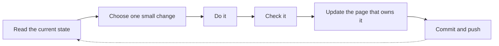
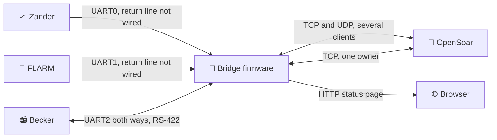

# 🗺️ Roadmap

🏠 [Overview](../../README.md) › 📋 Project › **Roadmap**

The single work queue: which work package comes next and what finishes it.

> [!NOTE]
> **Status:** WP3 continues with wiring and bench validation. Software packages (WP4–WP6) wait until WP3 is complete. A [bridge firmware plan](#firmware-plan) is proposed and waits for the owner's approval. Every implementation step needs the owner's approval.

📑 **On this page:** <kbd>[1 · 📦 Work packages](#work-packages)</kbd> <kbd>[2 · 💻 Bridge firmware plan](#firmware-plan)</kbd> <kbd>[3 · 🏁 Milestones](#milestones)</kbd> <kbd>[4 · ✅ Test coverage for the software phase](#test-coverage)</kbd>

Related: ❓ [Open items](open-items.md) · 🎯 [Requirements](../design/requirements.md)

---

## 1. 📦 Work packages

| Package | Status | Next step | Done when |
| --- | --- | --- | --- |
| **WP3 Hardware** | 🟡 **Current focus** — [housing v16](../hardware/housing.md) accepted for the bench prototype (S93); wiring and validation remain | Start with [bench bring-up](../hardware/wiring.md#bring-up): verify the UBEC and identify the delivered boards before soldering. Run the [housing fit checks](open-items.md#housing) during assembly; fit the harness before cutting. Keep the [schematic](../hardware/schematic.md) in step with the pin tables ([ADR-06](../design/architecture.md#adr-06)). | Wiring design complete, bench bridge built and all bench checks passed |
| WP1 Installed equipment | 🟡 Photos and equipment report reviewed ([review](../research/reviews/2026-11-09-installation-claims.md)) | Get the [installed-equipment facts](open-items.md#installed-equipment) from Tom | Inventory, connector map and navigation baseline complete |
| WP0 Documentation | ✅ Done | — | — |
| WP2 Interfaces and protocol | ⏸️ Driver research done ([Becker driver](../research/becker-driver.md)) | Matching radio protocol reference or independent captures | Manual, settings, framing and reply rules confirmed |
| WP4 Driver plan | ⏸️ Send defect analysed | After hardware: counted-send fix and caller/state/UI mapping | One small change and regression test per step |
| WP5 Host tests | ⏸️ Send regression only ([review](../research/reviews/2026-11-08-becker-send.md)) | After WP4 scope is approved | Framing, state, reply and reconnect cases pass |
| WP6 Bridge firmware | ⏸️ [Plan proposed](#firmware-plan) | Owner approval of the plan and its [open decisions](open-items.md#firmware-decisions) | Radio path byte-exact, single owner, navigation unaffected. Verify link monitoring if included in the approved scope |
| WP8 Aircraft integration | ⬜ Later | Needs verified hardware and separate approval | Installation, protection and approval requirements met |

### 1.1 Claude handover and recovery

| Restore point | How to reopen |
| --- | --- |
| Claude handover, published Step 4 | Git commit [`7207a63`](https://github.com/MomoRC-tech/Becker-AR6201-to-OpenSoar/commit/7207a63), including the [Step 4 F3D archive at that commit](https://github.com/MomoRC-tech/Becker-AR6201-to-OpenSoar/blob/7207a63d5f699fc7f18654ec6b911e9aa324b8e3/cad/housing/housing-body-v1/housing-power-routing.f3d). In Fusion, open version 10 of `Housing body - revised power routing` from its version history. |
| Step 5 continuation draft | Open version 11 of the same Fusion document. It includes Claude's unsaved Step 5 geometry and Codex's four routing corrections. The exact unsaved Claude draft had no separate saved version. |

Work loop for each step:

---

## 2. 💻 Bridge firmware plan

> [!TIP]
> **Proposed, not approved:** build the bridge firmware (WP6) from Yuri's ESP-Serial-Bridge 130f731 ([ADR-02](../design/architecture.md#adr-02), [review](../research/reviews/2026-11-16-yuri-adoption.md)), in five small steps. Steps 1–3 need only an ESP32 and can run while the bench hardware is being built.

### 2.1 Target

One Arduino sketch in `firmware/bridge/`, built like the [OTA loader](../../firmware/ota-loader/README.md): same toolchain, partition scheme, credentials file and OTA upload.

| Part | Plan |
| --- | --- |
| Zander, FLARM | Both directions stay in the firmware, as upstream: several TCP clients plus UDP. The transmit direction uses GPIO33 (Zander) and GPIO27 (FLARM), the pins [signal wiring](../hardware/wiring.md#overview) leaves free. No return line is wired today; one can be added later without a firmware change |
| TCP ports | Today's ports, so the OpenSoar device entries stay the same: Zander 10110, FLARM 2000, Becker 4352 ([configuration](existing-installation.md#configuration)) |
| Becker (RS-422) | Both ways on UART2 ↔ its own TCP port ([ADR-01](../design/architecture.md#adr-01)). TCP only: no UDP and no Bluetooth on this port. One client owns the radio; a second is refused. Writes are counted; on overflow or a stalled client the session closes instead of dropping bytes silently |
| Status page | Read-only page on port 80 plus `/api/status` as JSON ([R14](../design/requirements.md#requirements)): firmware version, uptime, Wi-Fi mode and phone signal ([R10](../design/requirements.md#requirements)), and per device the baud rate, bytes, time since last data, clients and errors. Served from its own low-priority task, so it cannot hold up forwarding. Open to everyone on the bridge's Wi-Fi while it is read-only |
| Wi-Fi and OTA | The loader's start-up (network, then hotspot) is added as a third Wi-Fi mode next to the two upstream modes and is the project setting; OTA gets its password ([ADR-05](../design/architecture.md#adr-05)) |
| Log output | Upstream `DEBUG` switch off, because UART0 serves the Zander; the OTA messages follow the same switch. Diagnostics go to the status page |
| Kept from upstream | Nothing is removed. Every removal needs the owner's answer first; [selections](#upstream-features) below |
| Kept simple | Arduino-ESP32 core libraries only; no file system; settings in one header at build time; no protocol handling in the bridge |

### 2.2 Upstream features

> [!TIP]
> **Selected:** keep all upstream features. Ask the owner before removing any.

| Upstream feature | Selection |
| --- | --- |
| Transmit direction on the RS-232 ports | Keep for Zander and FLARM |
| UDP | Keep for Zander and FLARM; not on the radio port |
| Bluetooth | Keep in the code, switched off as upstream. The build refuses the radio port as its target |
| ESP8266 support | Keep the upstream branches unchanged. Project additions (radio port rules, status page) are ESP32 only; the ESP8266 build is not tested |
| `BATTERY_SAVER` | Keep, and fix it so the switch really lowers the Wi-Fi transmit power; off by default |

### 2.3 Steps

Each step: build, upload over Wi-Fi, check, update the owning pages, commit.

| # | Step | Needs | Done when |
| :-: | --- | --- | --- |
| 1 | **Baseline.** Import the upstream sketch unchanged with its MIT license; set the project pins; extend the build script | ESP32 | Builds with the pinned toolchain; the upload keeps OTA working |
| 2 | **Project settings.** Pins, baud rates and ports; add the loader's Wi-Fi start-up and the OTA password; log output off; UDP limited to Zander and FLARM; fix `BATTERY_SAVER`. No upstream feature removed | ESP32, one jumper wire | Looped from the Zander output pin to the FLARM input and back the other way, test data arrives byte for byte on the receiving port, over TCP and UDP; UDP sent to the radio port reaches nothing; OTA works in both Wi-Fi modes |
| 3 | **Status page.** Read-only page and JSON | ESP32, phone | The page shows live counters on the phone; the step 2 check passes with the page open |
| 4 | **Radio port.** Single owner, counted writes, no blocking calls in the forwarding loop | Wired MAX490 path; loopback plug: DE-9 socket with pin 8 linked to 4 and pin 9 to 5 ([pinout](../hardware/wiring.md#de9-pinout)) | Through the loopback plug every byte value, bursts and split writes return unchanged; nothing arrives after a restart; a second client is refused; navigation data keeps flowing |
| 5 | **Bench acceptance.** One PC test script for the [bridge tests](#test-coverage): slow and vanishing clients, Wi-Fi loss and return, power cycle, one-hour run on all three ports | Finished bench bridge | No byte errors; results recorded; bridge part of M4 |

Later, each needing its own approval: password-protected settings page (baud rates and Wi-Fi stored on the ESP32), firmware upload from the browser, radio byte monitor for [protocol captures](open-items.md#software-and-acceptance).

The firmware alone does not tune the radio: OpenSoar's driver cuts frames that contain zero bytes ([Becker driver](../research/becker-driver.md#opensoar-driver)). WP4 and WP5 stay separate packages and follow once the bridge passes step 5.

---

## 3. 🏁 Milestones

| Milestone | Reached when | Status |
| --- | --- | --- |
| M1 | Installed equipment and interfaces are understood | ⬜ Open |
| M2 | Hardware design and driver plan are selected | 🟡 Mechanical design accepted; WP3 wiring and bench validation in progress |
| M3 | Bench ESP32 updatable over Wi-Fi: OTA loader flashed over USB, joins the configured network or opens its hotspot, and accepts an OTA upload in both modes ([ADR-05](../design/architecture.md#adr-05), [bring-up](../hardware/wiring.md#bring-up) step 3) | ✅ Done (S97–S99); hotspot OTA accepted on the fallback test and a phone join, without an upload over the hotspot |
| M4 | Software verified | ⬜ Open |

---

## 4. ✅ Test coverage for the software phase

| Layer | Tests |
| --- | --- |
| Driver and protocol | Independent framing, CRC and channel vectors; zero and A5 bytes; short or invalid frames; unknown or stale state; local tuning; two instances; reconnect; documented replies |
| Bridge | Exact bytes and order; split and merged reads; bursts; slow clients; partial writes; disconnects; single writer; boot and debug output kept away from devices; navigation in parallel |

Radio acceptance and reply bytes are checked on the real radio, not inferred from a successful write.

---

<kbd>[⬆️ Back to top](#top)</kbd> <kbd>[🏠 Overview](../../README.md)</kbd>
