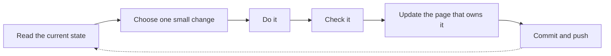
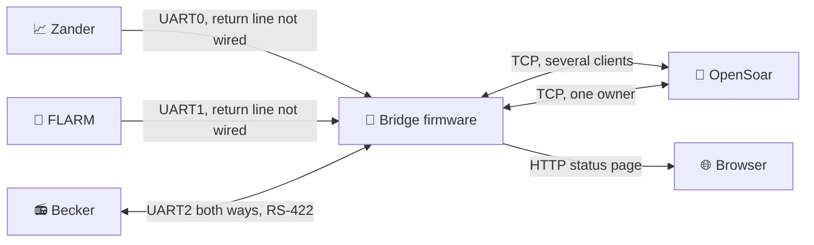

# 🗺️ Roadmap

🏠 [Overview](../../README.md) › 📋 Project › **Roadmap**

The single work queue: which work package comes next and what finishes it.

> [!NOTE]
> **Status:** WP3 continues with wiring and bench validation. In the [bridge firmware plan](#firmware-plan) (WP6), steps 1–3b are done and step 4 firmware is on the standalone ESP32. Step 3c, a web log, is done on the standalone ESP32. The wired checks for steps 4 and 5 remain. The software part of the device profiles (WP9) is brought forward and runs on the standalone ESP32. The driver packages (WP4, WP5) wait until WP3 is complete. Work outside the approved plan needs the owner's approval.

📑 **On this page:** <kbd>[1 · 📦 Work packages](#work-packages)</kbd> <kbd>[2 · 💻 Bridge firmware plan](#firmware-plan)</kbd> <kbd>[3 · 🏁 Milestones](#milestones)</kbd> <kbd>[4 · ✅ Test coverage for the software phase](#test-coverage)</kbd>

Related: ❓ [Open items](open-items.md) · 🎯 [Requirements](../design/requirements.md)

---

## 1. 📦 Work packages

| Package | Status | Next step | Done when |
| --- | --- | --- | --- |
| **WP3 Hardware** | 🟡 **Current focus** — [housing v16](../hardware/housing.md) accepted for the bench prototype (S93); wiring and validation remain | Start with [bench bring-up](../hardware/wiring.md#bring-up): verify the UBEC and identify the delivered boards before soldering. Run the [housing fit checks](open-items.md#housing) during assembly; fit the harness before cutting. Keep the [schematic](../hardware/schematic.md) in step with the pin tables ([ADR-06](../design/architecture.md#adr-06)). | Wiring design complete, bench bridge built and all bench checks passed |
| WP1 Installed equipment | 🟡 Photos and equipment report reviewed ([review](../research/reviews/2026-11-09-installation-claims.md)) | Get the [installed-equipment facts](open-items.md#installed-equipment) from Tom | Inventory, connector map and navigation baseline complete |
| WP0 Documentation | ✅ Done | — | — |
| WP2 Interfaces and protocol | ⏸️ Driver research done ([Becker driver](../research/becker-driver.md)) | Matching radio protocol reference or independent captures | Manual, settings, framing and reply rules confirmed |
| WP4 Driver plan | ⏸️ Send defect analysed | After hardware: counted-send fix and caller/state/UI mapping | One small change and regression test per step |
| WP5 Host tests | ⏸️ Send regression only ([review](../research/reviews/2026-11-08-becker-send.md)) | After WP4 scope is approved | Framing, state, reply and reconnect cases pass |
| WP6 Bridge firmware | 🟡 Step 4 firmware checked on the standalone ESP32 (S114) | Run the step 4 [wired checks](#firmware-plan), then step 5 | Radio path byte-exact, single owner, navigation unaffected; phone signal readable on the status page in hotspot mode ([R10](../design/requirements.md#requirements)) |
| WP8 Aircraft integration | ⬜ Later | Needs verified hardware and separate approval | Installation, protection and approval requirements met |
| WP9 Device profiles | 🟡 Software part brought forward: [profiles](#device-profiles) in firmware 0.4.1 on the standalone ESP32 (S115) | Replace the candidate preset values once the [installed settings](open-items.md#installed-equipment) are known; check them on the wired bridge | Presets and manual settings work on compatible ports, survive restart and OTA, and preserve existing configurations |

### 1.1 Work loop

For each step:

### 1.2 Device profiles (WP9)

- Choose an instrument preset per port on the [settings page](#settings-page) to fill in its baud rate and serial frame. Use **Custom** for manual values. Keep the TCP port editable independently so the OpenSoar connection can stay the same.
- First presets: Zander ZS1, Classic FLARM and Becker AR6201, with the candidate values from `config.h` until the installed settings are verified. The page shows each port's wiring and offers presets only where wiring and direction fit ([firmware](../../firmware/bridge/README.md#settings-page)). Candidate additions are LXNAV S80/S100, PowerFLARM Fusion, TQ KRT2 and f.u.n.k.e. ATR833, subject to model and interface checks.
- Keep device protocol handling in OpenSoar and retain [one writer on the dedicated radio port](../design/architecture.md#adr-01).

---

## 2. 💻 Bridge firmware plan

> [!TIP]
> **Selected:** build the bridge firmware (WP6) from Yuri's ESP-Serial-Bridge 130f731 ([ADR-02](../design/architecture.md#adr-02), [review](../research/reviews/2026-11-16-yuri-adoption.md)), in small steps. Check step 4 TCP ownership on the standalone ESP32 before the wired checks.

### 2.1 Target

One Arduino sketch in `firmware/bridge/`, built like the [OTA loader](../../firmware/ota-loader/README.md): same toolchain, partition scheme, credentials file and OTA upload.

| Part | Plan |
| --- | --- |
| Zander, FLARM | Both directions stay in the firmware, as upstream: several TCP clients. The transmit direction uses GPIO33 (Zander) and GPIO27 (FLARM), the pins [signal wiring](../hardware/wiring.md#overview) leaves free. No return line is wired today; one can be added later without a firmware change |
| Board | The bench ESP32, updated over Wi-Fi; no second board |
| Hotspot address | 10.10.10.10, as on today's bridge, so the OpenSoar device entries fit both bridges ([ADR-05](../design/architecture.md#adr-05)) |
| TCP ports | Today's ports, so the OpenSoar device entries stay the same: Zander 10110, FLARM 2000, Becker 4352 ([configuration](existing-installation.md#configuration)) |
| Becker (RS-422) | Both ways on UART2 ↔ its own TCP port ([ADR-01](../design/architecture.md#adr-01)). TCP only, no Bluetooth on this port. One client owns the radio; a second is refused, so two devices with the Becker entry never fight over it. A dead owner is dropped: short TCP keepalive (about 15 s) on the radio connection only, and in hotspot mode the connections of a phone that leaves the Wi-Fi are closed at once, so OpenSoar gets back on after a Wi-Fi drop ([check](../research/reviews/2026-11-17-bridge-projects-check.md)). Writes are counted; on overflow or a stalled client the session closes instead of dropping bytes silently |
| Status page | Read-only page on port 80 plus `/api/status` as JSON ([R14](../design/requirements.md#requirements)): firmware version, uptime, Wi-Fi mode and phone signal ([R10](../design/requirements.md#requirements)), and per device the baud rate, bytes, time since last data, clients and errors. Served from its own low-priority task, so it cannot hold up forwarding. Open to everyone on the bridge's Wi-Fi while it is read-only |
| Wi-Fi and OTA | The loader's start-up (network, then hotspot) is added as a third Wi-Fi mode next to the two upstream modes and is the project setting; OTA gets its password ([ADR-05](../design/architecture.md#adr-05)) |
| Log output | Upstream `DEBUG` switch off, because UART0 serves the Zander. Log lines and the ESP32 system messages go to the [web log](#web-log) instead, never to a UART |
| Kept from upstream | Everything except UDP, which the owner removed. Every further removal needs the owner's answer first; [selections](#upstream-features) below |
| Kept simple | Arduino-ESP32 core libraries only; no file system; defaults in one header at build time, changes from the [settings page](#settings-page) stored on the ESP32; no protocol handling in the bridge |

### 2.2 Upstream features

> [!TIP]
> **Selected:** keep the upstream features except UDP. Ask the owner before removing any other.

| Upstream feature | Selection |
| --- | --- |
| Transmit direction on the RS-232 ports | Keep for Zander and FLARM |
| UDP | Not implemented: removed by the owner, 2026-11-17. OpenSoar connects by TCP; broadcast over Wi-Fi lost single datagrams on the bench (S112) |
| Bluetooth | Keep in the code, switched off as upstream. The build refuses the radio port as its target |
| ESP8266 support | Keep the upstream branches unchanged. Project additions (radio port rules, status page) are ESP32 only; the ESP8266 build is not tested |
| `BATTERY_SAVER` | Keep, and fix it so the switch really lowers the Wi-Fi transmit power; off by default |

### 2.3 Steps

Each step: build, upload over Wi-Fi, check, update the owning pages, commit.

| # | Step | Needs | Done when |
| :-: | --- | --- | --- |
| 1 | ✅ **Baseline.** Import the upstream sketch unchanged with its MIT license; set the project pins, ports and hotspot address; add a build script | PC only | Done: [`firmware/bridge/`](../../firmware/bridge/README.md) builds with the pinned toolchain (S104). Not uploaded: the upstream start-up has no hotspot fallback and no OTA password ([R13](../design/requirements.md#requirements)) |
| 2 | ✅ **Project settings.** Pins, baud rates and ports; add the loader's Wi-Fi start-up and the OTA password; log output off; fix `BATTERY_SAVER` | Bench ESP32, one jumper wire or a USB RS-232 adapter | First upload. Test data arrives byte for byte on the receiving port: looped from the Zander output pin to the FLARM input and back the other way, or fed in at the DE-9. OTA works in both Wi-Fi modes, with the hotspot at its new address. Done (S105, S106): accepted by the owner without OTA over the hotspot, which the bench PC cannot reach; OTA over the network passed |
| 3 | ✅ **Status page.** Read-only page and JSON | Bench ESP32, phone | The page shows live counters on the phone; the step 2 check passes with the page open. Done (S107) |
| 3a | ✅ **Settings page.** Stored settings and a password-protected page, [design](#settings-page). Four commits: settings module used at start-up; active values and their origin on the status page; settings page; bench checks | Bench ESP32, phone | With nothing stored, the step 2 loop test passes unchanged. A changed baud rate works after the restart and survives an OTA update. A wrong network falls back to the hotspot. An unconfirmed Wi-Fi, hotspot or port change reverts after 10 min. A wrong password saves nothing. Power loss during a save leaves the old or the new values, never a mix. Forwarding is unaffected with the page open. Reset restores the defaults. Done (S109–S111), except the power-loss check, which needs the owner to pull the USB cable during a save |
| 3b | ✅ **Data monitor.** Live view of the bytes from and to each device on its own page `/monitor`, [design](#data-monitor) | Bench ESP32, phone, PC | Looped test data appears on the monitor in the right port and direction, NMEA as readable lines and radio bytes as hex; Pause and Download work; the loop test passes with the monitor open; nothing is collected while no one watches. Done (S112): byte-exact with the monitor open. Pause and Download still to try on a phone |
| 3c | ✅ **Web log.** Event log page `/log` with level and source filters, Copy and Save, kept across a restart, [design](#web-log) | Bench ESP32, phone, PC | Start-up, Wi-Fi, app, radio and settings events appear with the right level and source; the filters, Copy and Save work on the phone; lines from before a restart stay readable with the reset reason; the loop test passes with the log open; nothing reaches a UART. Done (S116); Copy and Save still to try on a phone |
| 4 | **Radio port.** Single owner with dead-owner check, counted writes. Client writes keep the core's blocking behaviour until step 5 has measured it. Standalone TCP ownership, clean close and byte-exact loopback checked (S114) | Wired bench bridge; [bus-level test](../hardware/wiring.md#bus-test): DE-9 breakout with the radio loop, USB RS-232 adapter; serial-feed mode in the test script | Through the radio loop every byte value, bursts and split writes return unchanged; the Zander and FLARM inputs pass the RS-232 feed; nothing arrives after a restart; a second client is refused; after the owner's Wi-Fi is cut, a new client gets the radio port within 45 s; navigation data keeps flowing |
| 5 | **Bench acceptance.** One PC test script for the [bridge tests](#test-coverage): slow and vanishing clients, including a second phone that stays connected with its screen off or OpenSoar in the background; Wi-Fi loss and return; one-hour run on all three ports. With OpenSoar on the phone: bridge power cycle in network and hotspot mode, and a run with mobile data on | Finished bench bridge, phone with OpenSoar | No byte errors; a client that stops reading does not delay data on the other clients or ports, otherwise non-blocking client writes are added before aircraft use; after each power cycle OpenSoar gets data on all three ports again without a manual reconnect; with mobile data on, all three ports connect and stay connected; results recorded; bridge part of M4 |

> [!WARNING]
> Use the jumper loop only while GPIO16, GPIO26 and GPIO32 are not yet soldered to the MAX490 or the RS-232 modules. Once they are, the module output and the jumper would drive the same pin against each other: use the [bus-level test](../hardware/wiring.md#bus-test) at the DE-9 instead.

Later, each needing its own approval: firmware upload from the browser, contributing general fixes back to [Yuri's project](https://github.com/yuri-rage/ESP-Serial-Bridge) (for example `BATTERY_SAVER` and the Arduino-ESP32 3.x `accept()` rename). Keep each such fix in its own commit so it can be offered upstream.

The firmware alone does not tune the radio: OpenSoar's driver cuts frames that contain zero bytes ([Becker driver](../research/becker-driver.md#opensoar-driver)). WP4 and WP5 stay separate packages and follow once the bridge passes step 5.

### 2.4 Settings page (step 3a)

> [!TIP]
> **Selected:** settings stored on the ESP32 and changed on a password-protected page, without rebuilding the firmware. A bad Wi-Fi, hotspot or port change reverts by itself ([R15](../design/requirements.md#requirements), [storage check](../research/reviews/2026-11-17-bridge-projects-check.md#pro)).

| Part | Plan |
| --- | --- |
| Editable | Per port: baud rate, data bits, parity, stop bits, TCP port. Network to join (name, password) and join time. Hotspot name, password and address |
| Fixed at build time | Pins; radio port rules (one owner, no Bluetooth); features; hostname; OTA password |
| Defaults | `config.h` and `credentials.h`. The ESP32 stores only changed values, so an empty or erased store behaves like a fresh build |
| Storage | `Preferences` (NVS partition, 20 KB in the selected partition scheme), namespace `bridge`, one key per setting plus a format version. Survives restarts and OTA updates |
| Loading | Once at start-up. Every value is checked (allowed baud rates, port range, text length); an invalid value falls back to its default and is flagged on the page |
| Protection | HTTP basic authentication with the OTA password for the settings page and every save. The status page stays open and read-only |
| Applying | "Save and restart". Nothing changes while the bridge runs |
| Confirm or revert | Changes to Wi-Fi, hotspot or ports apply as a trial after the restart; the previous values stay stored. Without "Keep" on the settings page within 10 min, the bridge restores them and restarts. Serial-only changes apply directly |
| Reset | "Reset to defaults" on the page clears the stored values and restarts. Full erase over USB on the bench |
| Page | Built into the firmware like the status page and served by the same low-priority task on port 80; no file system |
| Display | The status page shows each active value as default or changed |
| Wi-Fi library | `WiFi.persistent(false)`, so the core keeps no second copy of the network password |

### 2.5 Data monitor (step 3b)

> [!TIP]
> **Selected:** a read-only live view of the data passing the bridge, to check data inflow and to capture radio traffic ([R16](../design/requirements.md#requirements)).

| Part | Plan |
| --- | --- |
| Page | `/monitor`, linked from the status page and from each device's details; no password, like the status page, since any client on the bridge Wi-Fi can already read the TCP ports |
| View | Per device the latest bytes in both directions, each line marked from or to the device with its time. Text (NMEA lines) or hex (radio frames), switchable; Pause; Download of the shown data as a text file, also for [protocol captures](open-items.md#software-and-acceptance) |
| Collection | One ring buffer per device and direction, about 2 KB each, filled by the forwarding loop only while the page is open; no blocking, nothing written to flash |
| Documentation | Screenshot with demo data only, since real data contains positions |

### 2.6 Web log (step 3c)

> [!TIP]
> **Selected:** a read-only log page built into the firmware like the data monitor ([R17](../design/requirements.md#requirements)). Not the WebSerial library: it is AGPL-3.0, needs a second web server next to port 80, and drops every line sent while no page is open, which loses the start-up.

| Part | Plan |
| --- | --- |
| Page | `/log`, linked from the status page; no password, like the status page |
| Levels | Error, Warning, Info, Debug |
| Sources | Wi-Fi, Ports, Radio, Settings, System |
| Views | **Important**: errors and warnings. **Events** (default): adds Info, for functional work. **All**: adds Debug, for debugging. One toggle per source on top. The browser remembers the choice |
| Export | **Copy** puts the shown lines on the clipboard; **Save** downloads them as a text file. One click each, with a header line: firmware, save time and view. Each line carries the bridge time and the clock time estimated from the phone |
| Collection | Always on, in RAM: the last 96 Error, Warning and Info lines and, separately, the last 48 Debug lines, so debug chatter cannot push out events. About 16 kB |
| Restart | The lines survive a restart, crash or watchdog reset, but not a power cut. The page marks where the bridge restarted and why |
| Forwarding loop | Logs only rare events (radio owner changes). Counters (receive errors, short writes, connected apps, data arriving) are compared once per second by the web task: a flood of receive errors makes one line per 5 s, not one per byte |
| System messages | ESP32 system messages (ESP-IDF log, errors only in this core build) are redirected into the log, so none goes out of UART0 on the Zander transmit pin. Upstream debug prints go to Debug/System |
| Not included | Commands typed into the page (as WebSerial's input line), text search. Each later only with its own approval |

| Source | Level | Messages |
| --- | --- | --- |
| System | Info / Warning | Start with firmware version and reset reason; Warning after a crash, watchdog or brownout |
| System | Info / Error | Firmware update started, received; Error when it fails, with the reason. Progress in 25 % steps as Debug |
| System | Error / Warning | ESP32 system messages |
| System | Debug | Every 60 s: free memory, lowest free memory, Wi-Fi signal. Upstream debug prints |
| Wi-Fi | Info | Joining the network, connected with its address, hotspot open, a phone joined or left the hotspot |
| Wi-Fi | Warning | Network not reached, hotspot instead; connection lost with the reason. Retries as Debug |
| Ports | Info | App connected or disconnected per device, with the number of apps; data arriving, no data for 10 s |
| Ports | Warning | Receive errors per 5 s with the kind (wrong baud or frame gives framing errors), short writes |
| Radio | Info | App took the radio port, with its address; released (closed, phone left the hotspot, connection lost) |
| Radio | Warning | Second app refused; session closed after a short write |
| Settings | Info | Loaded with the number of changed values, saved, kept, reset |
| Settings | Warning | Invalid stored value (default in use), settings from another firmware version, trial running or reverted, save refused, wrong password |

---

## 3. 🏁 Milestones

| Milestone | Reached when | Status |
| --- | --- | --- |
| M1 | Installed equipment and interfaces are understood | ⬜ Open |
| M2 | Hardware design and driver plan are selected | 🟡 Mechanical design accepted; WP3 wiring and bench validation in progress |
| M3 | Bench ESP32 updatable over Wi-Fi: OTA loader flashed over USB, joins the configured network or opens its hotspot, and accepts an OTA upload in both modes ([ADR-05](../design/architecture.md#adr-05), [bring-up](../hardware/wiring.md#bring-up) step 3) | ✅ Done (S97–S99); hotspot OTA accepted on the fallback test and a phone join, without an upload over the hotspot |
| M4 | Software verified | ⬜ Open |

---

## 4. ✅ Test coverage for the software phase

| Layer | Tests |
| --- | --- |
| Driver and protocol | Independent framing, CRC and channel vectors; zero and A5 bytes; short or invalid frames; unknown or stale state; local tuning; two instances; reconnect; documented replies |
| Bridge | Exact bytes and order; split and merged reads; bursts; slow clients; partial writes; disconnects; single writer; boot and debug output kept away from devices; navigation in parallel |

Radio acceptance and reply bytes are checked on the real radio, not inferred from a successful write.

---

<kbd>[⬆️ Back to top](#top)</kbd> <kbd>[🏠 Overview](../../README.md)</kbd>
