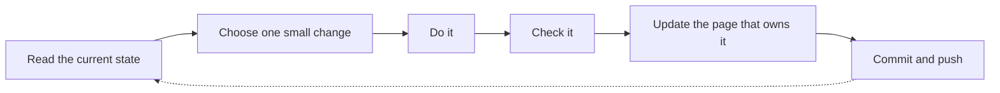

# 🗺️ Roadmap

🏠 [Overview](../../README.md) › 📋 Project › **Roadmap**

The single work queue: which work package comes next and what finishes it.

> [!NOTE]
> **Status:** WP3 hardware is the current focus. Software packages (WP4–WP6) wait until the hardware is finished. Every implementation step needs the owner's approval.

📑 **On this page:** <kbd>[1 · 📦 Work packages](#work-packages)</kbd> <kbd>[2 · 🏁 Milestones](#milestones)</kbd> <kbd>[3 · ✅ Test coverage for the software phase](#test-coverage)</kbd>

Related: ❓ [Open items](open-items.md) · 🎯 [Requirements](../design/requirements.md)

---

## 1. 📦 Work packages

| Package | Status | Next step | Done when |
| --- | --- | --- | --- |
| **WP3 Hardware** | 🟡 **Current focus** — parts and wiring decided ([wiring](../hardware/wiring.md), [power](../hardware/power.md), [parts](../hardware/modules.md#parts-list), [housing](../hardware/housing.md)) | Fit-print the [UBEC carrier](../hardware/housing.md#ubec-carrier) and base with the offset 12 mm screws; collect the remaining [housing inputs](open-items.md#housing) and work through the [bench hardware checks](open-items.md#bench-hardware), then build and bring up the bench bridge | Bench bridge built and all bench checks passed |
| WP1 Installed equipment | 🟡 Photos and equipment report reviewed ([review](../research/reviews/2026-11-09-installation-claims.md)) | Get the [installed-equipment facts](open-items.md#installed-equipment) from Tom | Inventory, connector map and navigation baseline complete |
| WP0 Documentation | ✅ Done | — | — |
| WP2 Interfaces and protocol | ⏸️ Driver research done ([Becker driver](../research/becker-driver.md)) | Matching radio protocol reference or independent captures | Manual, settings, framing and reply rules confirmed |
| WP4 Driver plan | ⏸️ Send defect analysed | After hardware: counted-send fix and caller/state/UI mapping | One small change and regression test per step |
| WP5 Host tests | ⏸️ Send regression only ([review](../research/reviews/2026-11-08-becker-send.md)) | After WP4 scope is approved | Framing, state, reply and reconnect cases pass |
| WP6 Bridge firmware | ⏸️ Planned | After WP3 and WP5 | Radio path byte-exact, single owner, navigation unaffected |
| WP8 Aircraft integration | ⬜ Later | Needs verified hardware and separate approval | Installation, protection and approval requirements met |

Work loop for each step:

---

## 2. 🏁 Milestones

| Milestone | Reached when | Status |
| --- | --- | --- |
| M1 | Installed equipment and interfaces are understood | ⬜ Open |
| M2 | Hardware design and driver plan are selected | 🟡 Hardware selected |
| M3 | Software verified | ⬜ Open |

---

## 3. ✅ Test coverage for the software phase

| Layer | Tests |
| --- | --- |
| Driver and protocol | Independent framing, CRC and channel vectors; zero and A5 bytes; short or invalid frames; unknown or stale state; local tuning; two instances; reconnect; documented replies |
| Bridge | Exact bytes and order; split and merged reads; bursts; slow clients; partial writes; disconnects; single writer; boot and debug output kept away from devices; navigation in parallel |

Radio acceptance and reply bytes are checked on the real radio, not inferred from a successful write.

---

<kbd>[⬆️ Back to top](#top)</kbd> <kbd>[🏠 Overview](../../README.md)</kbd>
