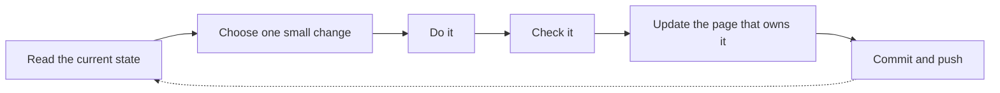
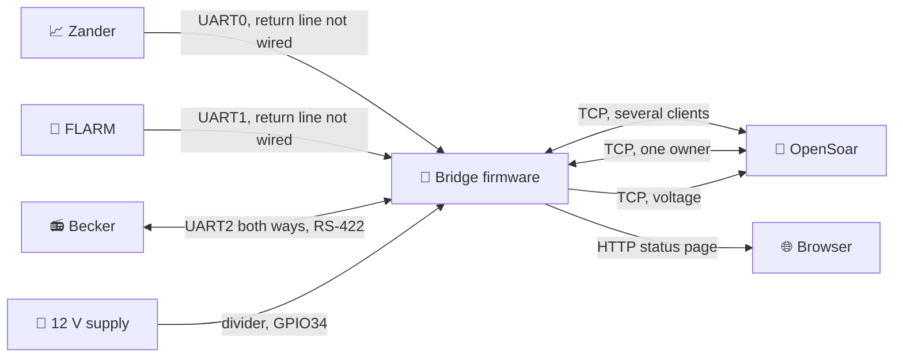

# 🗺️ Roadmap

🏠 [Overview](../../README.md) › 📋 Project › **Roadmap**

The single work queue: which work package comes next and what finishes it.

> [!NOTE]
> **Status:** WP3 bench hardware is complete (S175). **Current focus:** WP6 one-phone acceptance on the normal build. Dial recovery passed on the 0.5.27 bench build (S225). The normal 0.5.28 build and its dial-status snapshot passed host checks (S226). The [remaining firmware review item](open-items.md#software-and-acceptance) is Becker owner handover.

<a href="#work-packages"><picture><source media="(prefers-color-scheme: dark)" srcset="../images/nav/menu-project-roadmap-1-dark.svg"></picture></a> <a href="#firmware-plan"><picture><source media="(prefers-color-scheme: dark)" srcset="../images/nav/menu-project-roadmap-2-dark.svg"></picture></a> <a href="#milestones"><picture><source media="(prefers-color-scheme: dark)" srcset="../images/nav/menu-project-roadmap-3-dark.svg"></picture></a> <a href="#test-coverage"><picture><source media="(prefers-color-scheme: dark)" srcset="../images/nav/menu-project-roadmap-4-dark.svg"></picture></a> <!-- page-menu -->

Related: ❓ [Open items](open-items.md) · 🎯 [Requirements](../design/requirements.md)

---

## 1. 📦 Work packages

| Package | Status | Next step | Done when |
| --- | --- | --- | --- |
| **WP6 Bridge firmware** | 🟡 **Current focus** | Run the [one-phone hotspot check](open-items.md#software-and-acceptance) and the sustained bench run with both navigation inputs | Fresh app data returns automatically and the wired paths pass together. See [step 5](#firmware-plan) |
| WP1 Installed equipment | 🟡 Photos and equipment report reviewed ([review](../research/reviews/2026-11-09-installation-claims.md)) | Get the [installed-equipment facts](open-items.md#installed-equipment) from Tom | Inventory, connector map and navigation baseline complete |
| WP0 Documentation | ✅ Done — [user manual](../manual/user-manual.md), [build guide](../hardware/build-guide.md) and [documentation index](../README.md) with generated navigation graphics (`tools/nav_graphics.py`) | Update the manual with the OpenSoar phone checks (WP6 step 5) | — |
| WP3 Hardware | ✅ Done — replacement roof-grille hood CAD and slice checked (S205), [physical comparison pending](open-items.md#housing). Original [housing](../hardware/housing.md) accepted for the bench prototype (S93, S156); bench bridge built and all [bench checks](../hardware/wiring.md#bring-up) 1–13 passed or closed by the owner (S141–S161, S175) | — | Wiring design complete, bench bridge built and all bench checks passed |
| WP2 Interfaces and protocol | ⏸️ Tandem operation documented (S163). [Standby tuning](../design/requirements.md#requirements) deferred pending protocol evidence | See [protocol evidence](open-items.md#software-and-acceptance) | Matching settings, framing and reply rules confirmed |
| WP4 OpenSoar integration | 🟡 [Built-in Becker AR62xx driver](../research/becker-driver.md#consequences) selected | Check the stock Android app over TCP with navigation connected | Radio behaviour checked on the Becker front panel, local controls and navigation work |
| WP5 Host tests | Stock driver send behaviour characterised with synthetic frames (S12) | Compare against captures from the installed app during WP4 | Frame length and bytes checked against independent protocol evidence |
| WP8 Aircraft integration | ⬜ Later | Needs separate approval and the [installation items](open-items.md#bench-hardware) | Installation, protection and approval requirements met |
| WP9 Device profiles | 🟡 [Profiles](#device-profiles) and optional [navigation detection](#navigation-detection) in firmware 0.5.7 (S115, S154) | Replace the candidate preset values once the [installed settings](open-items.md#installed-equipment) are known; check them on the wired bridge | Presets and manual settings work on compatible ports, survive restart and OTA, and preserve existing configurations |

### 1.1 Work loop

For each step:

### 1.2 Device profiles (WP9)

- Choose an instrument preset per port on the [settings page](#settings-page) to fill in its baud rate and serial frame. Use **Custom** for manual values. Keep the TCP port editable independently so the OpenSoar connection can stay the same.
- First presets: Zander ZS1, Classic FLARM and Becker AR6201, with the candidate values from `config.h` until the installed settings are verified. The page shows each port's wiring and offers presets only where wiring and direction fit ([firmware](../../firmware/bridge/README.md#settings-page)). Candidate additions are LXNAV S80/S100, PowerFLARM Fusion, TQ KRT2 and f.u.n.k.e. ATR833, subject to model and interface checks.
- Keep device protocol handling in OpenSoar and retain [one writer on the dedicated radio port](../design/architecture.md#adr-01).

### 1.3 Navigation baud and protocol detection (WP9)

Firmware 0.5.7 adds **Detect** to the two RS-232 inputs on the [settings page](../../firmware/bridge/README.md#settings-page). The radio uses its existing preset or manual settings.

| Check | Coverage |
| --- | --- |
| Recognition | Three matching sentences at one setting. Zander, FLARM, both protocols, generic NMEA, undecodable activity or silence (S22–S24, S154). |
| Settings | The scan restores the original UART before review. The user can copy the suggestion into the form, adjust it or discard it. TCP ports and other edits stay independent. |
| Bench acceptance | [Wired scan checks](../../tools/nav_scan_test.py) and remaining instrument checks in S154 and [installed equipment](open-items.md#installed-equipment). |

---

## 2. 💻 Bridge firmware plan

> [!TIP]
> **Selected:** build the bridge firmware (WP6) from Yuri's ESP-Serial-Bridge 130f731 ([ADR-02](../design/architecture.md#adr-02), [review](../research/reviews/2026-11-16-yuri-adoption.md)), in small steps.

### 2.1 Target

One Arduino sketch in `firmware/bridge/`, built like the [OTA loader](../../firmware/ota-loader/README.md): same toolchain, partition scheme and OTA upload; public default logins in `config.h`.

| Part | Plan |
| --- | --- |
| Zander, FLARM | Both directions stay in the firmware, as upstream: several TCP clients. The transmit direction uses GPIO33 (Zander) and GPIO27 (FLARM), the pins [signal wiring](../hardware/wiring.md#overview) leaves free. No return line is wired today; one can be added later without a firmware change |
| Board | The bench ESP32, updated over Wi-Fi; no second board |
| Hotspot address | 10.10.10.10, as on today's bridge, so the OpenSoar device entries fit both bridges ([ADR-05](../design/architecture.md#adr-05)) |
| TCP ports | Today's ports, so the OpenSoar device entries stay the same: Zander 10110, FLARM 2000, Becker 4352 ([configuration](existing-installation.md#configuration)). Supply voltage 4353, new ([step 3d](#supply-voltage)) |
| Becker (RS-422) | Both ways on UART2 ↔ its own TCP port ([ADR-01](../design/architecture.md#adr-01)). TCP only. One client owns the radio. The bridge closes the radio owner's socket when it sees that phone leave the hotspot. Short TCP keepalive applies to every app port (S191). On write overflow or a stall, the bridge closes the radio session to preserve frame integrity |
| Bridge dials the app | The bridge connects to OpenSoar's *TCP port* entries so the app can replace a stale session after a power cut or Wi-Fi gap (S200, S204). [Setup](../manual/user-manual.md#connect-opensoar) · [Dial targets and retries](../../firmware/bridge/README.md#project-settings) |
| Slow apps | Navigation apps skip data under backpressure and disconnect after 60 s without progress. Becker closes the session on overflow to preserve frame integrity. [Forwarding behavior](../../firmware/bridge/README.md#project-settings) |
| Status page | Read-only page on port 80 plus `/api/status` as JSON ([R14](../design/requirements.md#requirements)): firmware version, uptime, Wi-Fi mode and phone signal ([R10](../design/requirements.md#requirements)), and per device the baud rate, bytes, time since last data, clients and errors. Served from its own low-priority task, so it cannot hold up forwarding. Open to everyone on the bridge's Wi-Fi while it is read-only |
| Wi-Fi and OTA | The loader's start-up (network, then hotspot) is added as a third Wi-Fi mode next to the two upstream modes and is the project setting; OTA gets its password ([ADR-05](../design/architecture.md#adr-05)) |
| Log output | Upstream `DEBUG` switch off, because UART0 serves the Zander. Log lines and the ESP32 system messages go to the [web log](#web-log) instead, never to a UART |
| Kept from upstream | Everything except UDP, which the owner removed. Every further removal needs the owner's answer first; [selections](#upstream-features) below |
| Kept simple | Arduino-ESP32 core libraries only. Settings stored on the ESP32, saved warnings in LittleFS. Forwarded instrument data stays separate from the bridge voltage report ([ADR-07](../design/architecture.md#adr-07)) |

### 2.2 Upstream features

> [!TIP]
> **Selected:** keep the upstream features except UDP. Ask the owner before removing any other.

| Upstream feature | Selection |
| --- | --- |
| Transmit direction on the RS-232 ports | Keep for Zander and FLARM |
| UDP | Not implemented: removed by the owner, 2026-11-17. OpenSoar connects by TCP; broadcast over Wi-Fi lost single datagrams on the bench (S112) |
| Bluetooth | Classic Bluetooth stays disabled. The build refuses the radio port as its target. See the [BLE operating mode decision](#bluetooth-decision) |
| ESP8266 support | Keep the upstream branches unchanged. Project additions (radio port rules, status page) are ESP32 only; the ESP8266 build is not tested |
| `BATTERY_SAVER` | Keep, and fix it so the switch really lowers the Wi-Fi transmit power; off by default |

### 2.3 Steps

Each step: build, upload over Wi-Fi, check, update the owning pages, commit.

| # | Step | Needs | Done when |
| :-: | --- | --- | --- |
| 1 | ✅ **Baseline.** Import the upstream sketch unchanged with its MIT license; set the project pins, ports and hotspot address; add a build script | PC only | Done: [`firmware/bridge/`](../../firmware/bridge/README.md) builds with the pinned toolchain (S104). Not uploaded: the upstream start-up has no hotspot fallback and no OTA password ([R13](../design/requirements.md#requirements)) |
| 2 | ✅ **Project settings.** Pins, baud rates and ports; add the loader's Wi-Fi start-up and the OTA password; log output off; fix `BATTERY_SAVER` | Bench ESP32, one jumper wire or a USB RS-232 adapter | First upload. Test data arrives byte for byte on the receiving port: looped from the Zander output pin to the FLARM input and back the other way, or fed in at the DE-9. OTA works in both Wi-Fi modes, with the hotspot at its new address. Done (S105, S106): accepted by the owner without OTA over the hotspot, which the bench PC cannot reach; OTA over the network passed |
| 3 | ✅ **Status page.** Read-only page and JSON | Bench ESP32, phone | The page shows live counters on the phone; the step 2 check passes with the page open. Done (S107) |
| 3a | ✅ **Settings page.** [Settings and automatic rollback](#settings-page) | Bench ESP32, phone | Settings survive restart and OTA, temporary port changes revert, and reset restores defaults (S109–S111, S162). Firmware 0.5.8 stores the active and rollback settings together and reports failed writes. See [power-loss check](open-items.md#software-and-acceptance) |
| 3b | ✅ **Data monitor.** Live view of the bytes from and to each device on its own page `/monitor`, [design](#data-monitor) | Bench ESP32, phone, PC | Looped test data appears on the monitor in the right port and direction, NMEA as readable lines and radio bytes as hex; Pause and Download work; the loop test passes with the monitor open; nothing is collected while no one watches. Done (S112): byte-exact with the monitor open. Pause and Download still to try on a phone |
| 3c | ✅ **Web log.** Event log page `/log` with level and source filters, Copy and Save, kept across a restart, [design](#web-log) | Bench ESP32, phone, PC | Start-up, Wi-Fi, app, radio and settings events appear with the right level and source; the filters, Copy and Save work on the phone; lines from before a restart stay readable with the reset reason; the loop test passes with the log open; nothing reaches a UART. Done (S116–S118); Copy and Save still to try on a phone |
| 3d | ✅ **Supply voltage.** Measure the 12 V input and send it to OpenSoar on its own port, with a chart, [design](#supply-voltage). Wired bridge: XCSoar display, chart retention, sensor switch and screenshots checked (S158). Calibration survived OTA (S142). The XT30 meter check covers 12 V (S142). Bench step 13 used the supply display up to 18 V (S148) and was accepted by the owner without the meter comparison (S175). A voltage client stayed connected during the wired FLARM feed and radio loop (S159) | Standalone ESP32 with the divider on a breadboard, bench supply, multimeter, phone with XCSoar or OpenSoar (same OpenVario voltage parsing, S155) | Readings match the meter at 7, 12, 14.6 and 20 V within about ±0.1 V after calibration (error table recorded); the OpenVario device on port 4353 shows the voltage in XCSoar or OpenSoar; the chart shows the minutes since start and survives a restart; with the sensor switched off nothing is sent; calibration survives a restart and an OTA update; the loop test passes with the voltage port connected; new page screenshots |
| 3e | **Chip temperature.** Show the ESP32's own temperature on the status page and in the web log; no shutdown, [firmware](../../firmware/bridge/README.md#chip-temperature). Standalone reading, log and loop checked (S132). The wired bridge completed a [two-hour FLARM load and cold-start reference](../../firmware/bridge/README.md#thermal-bench) (S167–S169). Pre-Wi-Fi reading and startup series verified on 0.5.9 (S170). [Per-board calibration proposal](#temperature-calibration) | Standalone ESP32, phone; wired bridge for the heat check | The page and `/api/status` show a value or *no reading*; the log has the first reading; the loop test passes; new page screenshots. In the [heat check](open-items.md#housing) the chip reading is logged next to the measured temperatures. Warning level 100 °C by owner decision, firmware 0.5.6 (S142) |
| 3f | **Lifetime record** survives power cuts. [Firmware reference](../../firmware/bridge/README.md#lifetime-record) | Bench ESP32 | Start count and record persistence checked with the write load (S134) |
| 3g | **Saved log** keeps warnings, errors and starts through power cuts. [Firmware reference](../../firmware/bridge/README.md#saved-log) | Bench ESP32 | Save, clear and persistence checked with the write load (S135) |
| 3h | ✅ **Restart from the web.** The settings page restarts with stored settings. A restart during a trial counts as a start without *Keep*. | Bench ESP32, PC | Settings preserved and start count advanced (S178). The owner later removed the settings login (S191) |
| 4 | ✅ **Radio port.** Single owner with dead-owner check, counted writes. Standalone TCP ownership, clean close and byte-exact loopback checked (S114) | Wired bench bridge; [bus-level test](../hardware/wiring.md#bus-test): DE-9 breakout with the radio loop, RS-232 source; serial-feed mode in the test script | Through the radio loop every byte value, bursts and split writes return unchanged; the Zander and FLARM inputs pass the RS-232 feed; nothing arrives after a restart; a second client is refused; after the owner's Wi-Fi is cut, a new client gets the radio port within 45 s; navigation data keeps flowing. Done: radio loop, ownership, restart and dead-owner takeover (S150); RS-232 feed on both inputs, also while an app holds the radio port (S153) |
| 4a | ✅ **Bridge dials the app.** Automatic phone learning, dial status and reconnect are implemented. Slot reuse passed the host regression (S224) and 0.5.27 passed the follow-up bench check (S225). The 0.5.28 status snapshot passed host verification (S226). | Bench bridge, stock OpenSoar | The [step 5 checks](open-items.md#software-and-acceptance) confirm the normal build on the phone |
| 5 | **Bench acceptance.** One phone with stock OpenSoar on the hotspot. Sustained wired run with Zander and FLARM feeds, Becker DE-9 loop and supply voltage at 160 MHz. Network mode uses the bench PC. | Finished bridge, phone, two serial sources | Fresh data returns after reconnect. Under sustained load the normal readers get all expected bytes and the bridge does not restart. Record coverage in the [acceptance checklist](open-items.md#software-and-acceptance) |

> [!WARNING]
> Use the jumper loop only while GPIO16, GPIO26 and GPIO32 are not yet soldered to the MAX490 or the RS-232 modules. Once they are, the module output and the jumper would drive the same pin against each other: use the [bus-level test](../hardware/wiring.md#bus-test) at the DE-9 instead.

Later, each needing its own approval: firmware upload from the browser, contributing general fixes back to [Yuri's project](https://github.com/yuri-rage/ESP-Serial-Bridge) (for example `BATTERY_SAVER` and the Arduino-ESP32 3.x `accept()` rename). Keep each such fix in its own commit so it can be offered upstream.

### 2.4 Firmware reference

| Feature | Reference |
| --- | --- |
|  Settings and automatic rollback | [Settings](../../firmware/bridge/README.md#settings-page) |
|  Data monitor | [Monitor](../../firmware/bridge/README.md#data-monitor) |
|  Web log | [Logging and export](../../firmware/bridge/README.md#web-log) |
|  Supply voltage | [Voltage report](../../firmware/bridge/README.md#supply-voltage), [circuit](../hardware/power.md#voltage-sense), [bench step 13](../hardware/wiring.md#bring-up) |

---

### 2.5 Proposed chip temperature calibration

| Step | Planned behaviour |
| --- | --- |
| Prepare | Leave the bridge unpowered until it reaches the local air temperature. Measure beside the bridge, or mark the reference as an estimate. A unit warmed by an earlier run or direct sun needs a fresh soak. |
| Review | In authenticated Settings, show this boot’s pre-Wi-Fi reading, its capture time and the subsequent 10 s readings through 120 s. The later samples show warm-up and scatter. Use the first valid **pre-Wi-Fi** sample as the reference. A missing pre-Wi-Fi value or a software restart requires a new cold power-on. |
| Calibrate | Enter the local temperature in °C, identify it as measured or estimated and confirm the unit was cold. Preview the signed offset: **reference air °C − raw pre-Wi-Fi °C**. Bind the preview to this boot and recheck it on save. |
| Apply | On explicit save, store one optional `chip_offset_c` for this board in the existing settings store, with its reference and source. Show **estimated chip °C = raw chip °C + offset** alongside the raw reading. Preserve raw history, lifetime records and the existing raw warning thresholds. Offer clear/recalibrate and keep existing boards uncalibrated until saved. |
| Verify | Repeat cold starts at a measured room temperature and check repeatability. Try both offset signs, an estimated reference, missing samples, warm reboot, reboot between preview and save, persistence through restart/OTA and clear. An independent second temperature reference checks how well one offset holds across temperatures. |

Planning only. No additional hardware cost to use the existing sensor.

---

## 3. 🏁 Milestones

| Milestone | Reached when | Status |
| --- | --- | --- |
| M1 | Installed equipment and interfaces are understood | ⬜ Open |
| M2 | Hardware design and driver plan are selected | 🟡 Housing and wiring validated on the bench (WP3). Fuse, F1 holder and DE-9 mating parts are [open](open-items.md#bench-hardware) |
| M3 | Bench ESP32 updatable over Wi-Fi: OTA loader flashed over USB, joins the configured network or opens its hotspot, and accepts an OTA upload in both modes ([ADR-05](../design/architecture.md#adr-05), [bring-up](../hardware/wiring.md#bring-up) step 3) | ✅ Done (S97–S99); hotspot OTA accepted on the fallback test and a phone join, without an upload over the hotspot |
| M4 | Software verified | ⬜ Open. Acceptance of the three-port Wi-Fi bridge in WP6 step 5 triggers the [Bluetooth decision](#bluetooth-decision). |

### 3.1 Bluetooth Low Energy with Wi-Fi off

**Goal:** reduce energy use at the bridge’s 12 V input. Use BLE for normal operation and start Wi-Fi on demand for settings and firmware updates.

**Decision gate:** after WP6 step 5 passes (including both navigation feeds, the Becker loop and stock OpenSoar phone reconnect checks), the owner decides whether to start a prototype. M4 can close with Wi-Fi only.

If the owner approves the prototype:

- [ ] **FLARM first.** Build a read-only [NimBLE feed](../research/bridge-firmware.md#softrf) for the current ESP32 and OTA slot. Check static RAM and image size. With only one stack started at a time, measure minimum free internal heap and the largest free block under load in Wi-Fi and BLE modes (S218). Stall and reconnect the phone. Count drops, check that fresh sentences resume and repeat the step 5 Wi-Fi delay and byte checks with the Becker loop running.
- [ ] **Stock OpenSoar with Wi-Fi fully off.** Try FLARM and Zander on one Zander / SDI entry. Keep sentences intact and select the GPS source when both provide fixes. Check LK8EX1 for supply voltage on the same stream (S216–S217). Evaluate a separate bidirectional Becker connection with the stock AR62xx driver. If a supported path is found, get owner approval before changing the TCP-only radio design, then check byte order, reconnects and single ownership on the bench loop.
- [ ] **Measure energy savings.** At 12 V, compare whole-bridge average input current in Wi-Fi-only and BLE-only modes using the same serial traffic, phone workload and measurement interval. Record the difference in mA and Wh over five hours. Use the [existing supply readings](../hardware/power.md#currents) (S147) as context.
- [ ] **On-demand maintenance.** Test a deliberate way to start the password-protected hotspot from BLE and a recovery path if pairing fails. Open the existing settings page, save a setting and run the existing Wi-Fi OTA update. Keep the hotspot awake throughout the update, then verify it shuts down and BLE operation resumes. Retain USB for initial flashing and recovery.
- [ ] **Decide on adoption.** Review simultaneous instrument support and measured savings with the owner before enabling the mode. Consider a Web Bluetooth settings page or BLE firmware updater separately only if maintenance also needs to work with Wi-Fi off.

---

## 4. ✅ Test coverage for the software phase

| Layer | Tests |
| --- | --- |
| Driver and protocol | Independent framing, CRC and channel vectors; zero and A5 bytes; short or invalid frames; unknown or stale state; local tuning; two instances; reconnect; documented replies |
| Bridge | Exact bytes and order; split and merged reads; bursts; slow clients; partial writes; disconnects; single writer; boot and debug output kept away from devices; navigation in parallel |

Radio acceptance and reply bytes are checked on the real radio, not inferred from a successful write.

---

<kbd>[⬆️ Back to top](#top)</kbd> <kbd>[🏠 Overview](../../README.md)</kbd>
