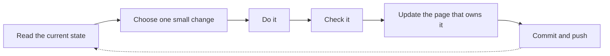
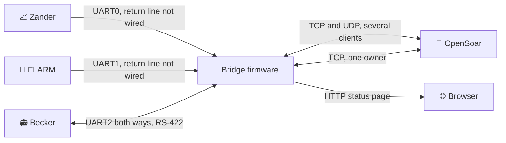

# 🗺️ Roadmap

🏠 [Overview](../../README.md) › 📋 Project › **Roadmap**

The single work queue: which work package comes next and what finishes it.

> [!NOTE]
> **Status:** WP3 continues with wiring and bench validation. The [bridge firmware plan](#firmware-plan) (WP6) is approved and runs in parallel; steps 1–3 are done; steps 4 and 5 wait for the wired bench bridge. The driver packages (WP4, WP5) wait until WP3 is complete. Work outside the approved plan needs the owner's approval.

📑 **On this page:** <kbd>[1 · 📦 Work packages](#work-packages)</kbd> <kbd>[2 · 💻 Bridge firmware plan](#firmware-plan)</kbd> <kbd>[3 · 🏁 Milestones](#milestones)</kbd> <kbd>[4 · ✅ Test coverage for the software phase](#test-coverage)</kbd>

Related: ❓ [Open items](open-items.md) · 🎯 [Requirements](../design/requirements.md)

---

## 1. 📦 Work packages

| Package | Status | Next step | Done when |
| --- | --- | --- | --- |
| **WP3 Hardware** | 🟡 **Current focus** — [housing v16](../hardware/housing.md) accepted for the bench prototype (S93); wiring and validation remain | Start with [bench bring-up](../hardware/wiring.md#bring-up): verify the UBEC and identify the delivered boards before soldering. Run the [housing fit checks](open-items.md#housing) during assembly; fit the harness before cutting. Keep the [schematic](../hardware/schematic.md) in step with the pin tables ([ADR-06](../design/architecture.md#adr-06)). | Wiring design complete, bench bridge built and all bench checks passed |
| WP1 Installed equipment | 🟡 Photos and equipment report reviewed ([review](../research/reviews/2026-11-09-installation-claims.md)) | Get the [installed-equipment facts](open-items.md#installed-equipment) from Tom | Inventory, connector map and navigation baseline complete |
| WP0 Documentation | ✅ Done | — | — |
| WP2 Interfaces and protocol | ⏸️ Driver research done ([Becker driver](../research/becker-driver.md)) | Matching radio protocol reference or independent captures | Manual, settings, framing and reply rules confirmed |
| WP4 Driver plan | ⏸️ Send defect analysed | After hardware: counted-send fix and caller/state/UI mapping | One small change and regression test per step |
| WP5 Host tests | ⏸️ Send regression only ([review](../research/reviews/2026-11-08-becker-send.md)) | After WP4 scope is approved | Framing, state, reply and reconnect cases pass |
| WP6 Bridge firmware | 🟡 [Plan](#firmware-plan) approved, in parallel with WP3; steps 1–3 done | Step 4 of the [firmware plan](#firmware-plan), once the MAX490 path is wired | Radio path byte-exact, single owner, navigation unaffected; phone signal readable on the status page in hotspot mode ([R10](../design/requirements.md#requirements)) |
| WP8 Aircraft integration | ⬜ Later | Needs verified hardware and separate approval | Installation, protection and approval requirements met |

### 1.1 Work loop

For each step:

---

## 2. 💻 Bridge firmware plan

> [!TIP]
> **Selected:** build the bridge firmware (WP6) from Yuri's ESP-Serial-Bridge 130f731 ([ADR-02](../design/architecture.md#adr-02), [review](../research/reviews/2026-11-16-yuri-adoption.md)), in five small steps. Steps 1–3 run now, in parallel with the bench build; steps 4 and 5 wait for the wired bench bridge.

### 2.1 Target

One Arduino sketch in `firmware/bridge/`, built like the [OTA loader](../../firmware/ota-loader/README.md): same toolchain, partition scheme, credentials file and OTA upload.

| Part | Plan |
| --- | --- |
| Zander, FLARM | Both directions stay in the firmware, as upstream: several TCP clients plus UDP. The transmit direction uses GPIO33 (Zander) and GPIO27 (FLARM), the pins [signal wiring](../hardware/wiring.md#overview) leaves free. No return line is wired today; one can be added later without a firmware change |
| Board | The bench ESP32, updated over Wi-Fi; no second board |
| Hotspot address | 10.10.10.10, as on today's bridge, so the OpenSoar device entries fit both bridges ([ADR-05](../design/architecture.md#adr-05)) |
| TCP ports | Today's ports, so the OpenSoar device entries stay the same: Zander 10110, FLARM 2000, Becker 4352 ([configuration](existing-installation.md#configuration)) |
| Becker (RS-422) | Both ways on UART2 ↔ its own TCP port ([ADR-01](../design/architecture.md#adr-01)). TCP only: no UDP and no Bluetooth on this port. One client owns the radio; a second is refused, so two devices with the Becker entry never fight over it. A dead owner is dropped: short TCP keepalive (about 15 s) on the radio connection only, and in hotspot mode the connections of a phone that leaves the Wi-Fi are closed at once, so OpenSoar gets back on after a Wi-Fi drop ([check](../research/reviews/2026-11-17-bridge-projects-check.md)). Writes are counted; on overflow or a stalled client the session closes instead of dropping bytes silently |
| Status page | Read-only page on port 80 plus `/api/status` as JSON ([R14](../design/requirements.md#requirements)): firmware version, uptime, Wi-Fi mode and phone signal ([R10](../design/requirements.md#requirements)), and per device the baud rate, bytes, time since last data, clients and errors. Served from its own low-priority task, so it cannot hold up forwarding. Open to everyone on the bridge's Wi-Fi while it is read-only |
| Wi-Fi and OTA | The loader's start-up (network, then hotspot) is added as a third Wi-Fi mode next to the two upstream modes and is the project setting; OTA gets its password ([ADR-05](../design/architecture.md#adr-05)) |
| Log output | Upstream `DEBUG` switch off, because UART0 serves the Zander; the OTA messages follow the same switch. Diagnostics go to the status page |
| Kept from upstream | Nothing is removed. Every removal needs the owner's answer first; [selections](#upstream-features) below |
| Kept simple | Arduino-ESP32 core libraries only; no file system; settings in one header at build time; no protocol handling in the bridge |

### 2.2 Upstream features

> [!TIP]
> **Selected:** keep all upstream features. Ask the owner before removing any.

| Upstream feature | Selection |
| --- | --- |
| Transmit direction on the RS-232 ports | Keep for Zander and FLARM |
| UDP | Keep for Zander and FLARM; not on the radio port |
| Bluetooth | Keep in the code, switched off as upstream. The build refuses the radio port as its target |
| ESP8266 support | Keep the upstream branches unchanged. Project additions (radio port rules, status page) are ESP32 only; the ESP8266 build is not tested |
| `BATTERY_SAVER` | Keep, and fix it so the switch really lowers the Wi-Fi transmit power; off by default |

### 2.3 Steps

Each step: build, upload over Wi-Fi, check, update the owning pages, commit.

| # | Step | Needs | Done when |
| :-: | --- | --- | --- |
| 1 | ✅ **Baseline.** Import the upstream sketch unchanged with its MIT license; set the project pins, ports and hotspot address; add a build script | PC only | Done: [`firmware/bridge/`](../../firmware/bridge/README.md) builds with the pinned toolchain (S104). Not uploaded: the upstream start-up has no hotspot fallback and no OTA password ([R13](../design/requirements.md#requirements)) |
| 2 | ✅ **Project settings.** Pins, baud rates and ports; add the loader's Wi-Fi start-up and the OTA password; log output off; UDP limited to Zander and FLARM; fix `BATTERY_SAVER`. No upstream feature removed | Bench ESP32, one jumper wire or a USB RS-232 adapter | First upload. Test data arrives byte for byte on the receiving port, over TCP and UDP: looped from the Zander output pin to the FLARM input and back the other way, or fed in at the DE-9. UDP sent to the radio port reaches nothing; OTA works in both Wi-Fi modes, with the hotspot at its new address. Done (S105, S106): accepted by the owner without OTA over the hotspot, which the bench PC cannot reach; OTA over the network passed |
| 3 | ✅ **Status page.** Read-only page and JSON | Bench ESP32, phone | The page shows live counters on the phone; the step 2 check passes with the page open. Done (S107); UDP broadcast output stays best-effort |
| 4 | **Radio port.** Single owner with dead-owner check, counted writes. Client writes keep the core's blocking behaviour until step 5 has measured it | Wired bench bridge; [bus-level test](../hardware/wiring.md#bus-test): DE-9 breakout with the radio loop, USB RS-232 adapter; serial-feed mode in the test script | Through the radio loop every byte value, bursts and split writes return unchanged; the Zander and FLARM inputs pass the RS-232 feed; nothing arrives after a restart; a second client is refused; after the owner's Wi-Fi is cut, a new client gets the radio port within 45 s; navigation data keeps flowing |
| 5 | **Bench acceptance.** One PC test script for the [bridge tests](#test-coverage): slow and vanishing clients, including a second phone that stays connected with its screen off or OpenSoar in the background; Wi-Fi loss and return; one-hour run on all three ports. With OpenSoar on the phone: bridge power cycle in network and hotspot mode, and a run with mobile data on | Finished bench bridge, phone with OpenSoar | No byte errors; a client that stops reading does not delay data on the other clients or ports, otherwise non-blocking client writes are added before aircraft use; after each power cycle OpenSoar gets data on all three ports again without a manual reconnect; with mobile data on, all three ports connect and stay connected; results recorded; bridge part of M4 |

> [!WARNING]
> Use the jumper loop only while GPIO16, GPIO26 and GPIO32 are not yet soldered to the MAX490 or the RS-232 modules. Once they are, the module output and the jumper would drive the same pin against each other: use the [bus-level test](../hardware/wiring.md#bus-test) at the DE-9 instead.

Later, each needing its own approval: password-protected settings page (baud rates and Wi-Fi stored on the ESP32), firmware upload from the browser, radio byte monitor for [protocol captures](open-items.md#software-and-acceptance), contributing general fixes back to [Yuri's project](https://github.com/yuri-rage/ESP-Serial-Bridge) (for example `BATTERY_SAVER` and the Arduino-ESP32 3.x `accept()` rename). Keep each such fix in its own commit so it can be offered upstream.

The firmware alone does not tune the radio: OpenSoar's driver cuts frames that contain zero bytes ([Becker driver](../research/becker-driver.md#opensoar-driver)). WP4 and WP5 stay separate packages and follow once the bridge passes step 5.

---

## 3. 🏁 Milestones

| Milestone | Reached when | Status |
| --- | --- | --- |
| M1 | Installed equipment and interfaces are understood | ⬜ Open |
| M2 | Hardware design and driver plan are selected | 🟡 Mechanical design accepted; WP3 wiring and bench validation in progress |
| M3 | Bench ESP32 updatable over Wi-Fi: OTA loader flashed over USB, joins the configured network or opens its hotspot, and accepts an OTA upload in both modes ([ADR-05](../design/architecture.md#adr-05), [bring-up](../hardware/wiring.md#bring-up) step 3) | ✅ Done (S97–S99); hotspot OTA accepted on the fallback test and a phone join, without an upload over the hotspot |
| M4 | Software verified | ⬜ Open |

---

## 4. ✅ Test coverage for the software phase

| Layer | Tests |
| --- | --- |
| Driver and protocol | Independent framing, CRC and channel vectors; zero and A5 bytes; short or invalid frames; unknown or stale state; local tuning; two instances; reconnect; documented replies |
| Bridge | Exact bytes and order; split and merged reads; bursts; slow clients; partial writes; disconnects; single writer; boot and debug output kept away from devices; navigation in parallel |

Radio acceptance and reply bytes are checked on the real radio, not inferred from a successful write.

---

<kbd>[⬆️ Back to top](#top)</kbd> <kbd>[🏠 Overview](../../README.md)</kbd>
