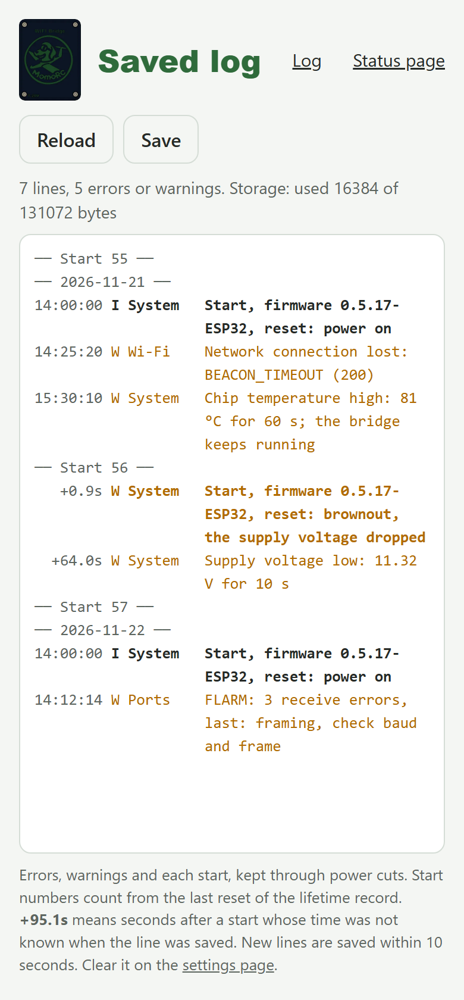

# Bridge firmware

Wi-Fi bridge firmware for Zander, FLARM and Becker, based on ESP-Serial-Bridge ([ADR-02](../../docs/design/architecture.md#adr-02)). The standalone ESP32 runs step 4 firmware with single-client radio ownership (S114) and the [web log](#web-log) (S116). Firmware 0.5.1 adds the [supply voltage](#supply-voltage) (step 3d), 0.5.2 the [chip temperature](#chip-temperature) (step 3e), 0.5.3 the [lifetime record](#lifetime-record) (step 3f), 0.5.4 the [saved log](#saved-log) (step 3g). 0.5.5 starts the low-voltage and chip-temperature warning timers correctly ([review](../../docs/research/reviews/2026-11-19-firmware-0.5.4-review.md), S138); 0.5.6 raises the chip-temperature warning to 100 °C. The assembled bench bridge runs 0.5.9 with a pre-Wi-Fi chip reading and two minutes of startup temperatures (S170). See the [firmware plan](../../docs/project/roadmap.md#firmware-plan) for the remaining wired checks. Firmware 0.5.10 applies the fixes from the [code review](../../docs/research/reviews/2026-11-23-code-review.md) (S176, S177): flash writes from the saved log at most every 10 s, a radio receive error closes the radio session, and a lagging Zander or FLARM app skips whole lines.

## Origin and license

| Item | Value |
| --- | --- |
| Upstream | [yuri-rage/ESP-Serial-Bridge](https://github.com/yuri-rage/ESP-Serial-Bridge) |
| Pinned commit | [`130f731416d43c89bce5626ef989b3e65918c9ce`](https://github.com/yuri-rage/ESP-Serial-Bridge/tree/130f731416d43c89bce5626ef989b3e65918c9ce) |
| Imported files | `ESP-Serial-Bridge.ino` as [`bridge.ino`](bridge.ino) (arduino-cli needs the sketch named after its folder), [`config.h`](config.h), [`LICENSE`](LICENSE) |
| License | MIT, see [`LICENSE`](LICENSE); keep the notice with every copy |
| Line endings | CRLF as at the import; [`.gitattributes`](.gitattributes) keeps them, so `git diff 56d1b23 -- firmware/bridge` shows every project change. Each change is marked `// Project:` |

<a id="project-settings"></a>

## Project settings

Set in `config.h`; everything else is upstream.

| Device | UART | RX | TX | TCP port | Baud |
| --- | --- | --- | --- | --- | --- |
| 📈 Zander | UART0 | GPIO32 | GPIO33 | 10110 | 19200 |
| 📡 FLARM | UART1 | GPIO26 | GPIO27 | 2000 | 19200 |
| 📻 Becker | UART2 | GPIO16 | GPIO17 | 4352 | 9600 |

- Pins: [UART plan](../../docs/hardware/wiring.md#overview). TCP ports and the hotspot address: [firmware plan](../../docs/project/roadmap.md#firmware-plan).
- Baud rates: Zander and FLARM are candidates from the device documents (S22, S23); the Becker value 9600 8N1 is the best lead found, from independent controller code, not a Becker document (S108). The installed settings are [open items](../../docs/project/open-items.md#installed-equipment).
- UDP is not implemented: the upstream UDP broadcast is removed, OpenSoar connects by TCP. Reason: broadcast over Wi-Fi has no acknowledgement and lost single datagrams on the bench, with and without load (S112, [issue #1](https://github.com/MomoRC-tech/Becker-AR6201-to-OpenSoar/issues/1)). The build stops if `PROTOCOL_UDP` is defined.

| Setting | Value |
| --- | --- |
| Wi-Fi start-up | `MODE_STA_AP`: join the network in `credentials.h` for 15 s, otherwise open hotspot `WiFi-BridgeTom` at 10.10.10.10 and stay there until the next restart. The join can miss 15 s, at about −90 dBm (S142) and once at −45 dBm (S149); the bench bridge uses 30 s, set on the settings page. The upstream modes `MODE_STA` and `MODE_AP` stay selectable |
| Hostname | `wifi-bridgetom`, for mDNS and OTA, as the OTA loader |
| OTA | ArduinoOTA with the password from `credentials.h`, in both Wi-Fi modes |
| Log output | `DEBUG` off: UART0 serves the Zander, so nothing is printed there. `WEB_LOG` shows the log lines and the ESP32 system messages on the [web log](#web-log); the build stops if both are on |
| UART receive buffer | 4096 bytes per UART, so bytes are kept while the loop waits on a UART write |
| Build-time checks | The build stops if UDP is switched on, if Bluetooth is pointed at the radio port, or if not exactly one Wi-Fi mode is selected |
| `BATTERY_SAVER` | Fixed so it lowers the transmit power; off |
| Version | `VERSION` in `config.h`, `0.<plan step>` until bench acceptance; shown on the status page |
| Stored settings | `STORED_SETTINGS`: baud rates, frames, TCP ports, the network and the hotspot in this file are defaults; valid values saved on the [settings page](#settings-page) override them in `MODE_STA_AP`. An invalid stored value falls back to its default |
| Status page | `STATUS_PAGE`: read-only page on port 80 and `/api/status` as JSON, open to everyone on the bridge's Wi-Fi; see below |
| Supply voltage | `SUPPLY_SENSE`: 12 V input on GPIO34, OpenVario port 4353 and chart; pin, divider, port and warning levels under *Supply voltage* in `config.h`; see [below](#supply-voltage) |
| Chip temperature | `CHIP_TEMP`: the ESP32's own temperature on the status page and in the web log, no shutdown; warning levels under *Chip temperature* in `config.h`; see [below](#chip-temperature) |
| Lifetime record | `LIFETIME_RECORD`: starts, operating time and extremes kept in NVS through power cuts; see [below](#lifetime-record) |
| Saved log | `SAVED_LOG`: errors, warnings and each start kept in LittleFS through power cuts, page `/saved`; see [below](#saved-log) |

<a id="status-page"></a>

## Status page

Open `http://<bridge address>/` (10.10.10.10 in hotspot mode) in a browser. In hotspot mode, answer Android's prompt to stay connected without internet with yes, then type `http://10.10.10.10/`; mobile data can stay on (S152). If the page still does not open, switch mobile data off. TCP apps reach the bridge either way (S151). [`status_page.h`](status_page.h) holds the page; the forwarding loop only adds to counters, and a low-priority task on the other CPU core serves it. The page refreshes its values every 2 s in place, so opened sections stay open. Light or dark follows the phone.


| Part | Shows |
| --- | --- |
| Header | Photo of the housing lid ([`device_image.h`](device_image.h), made by `tools/device_image.py`), firmware version, uptime, [chip temperature](#chip-temperature), Wi-Fi: network address and the bridge's signal to the router, or hotspot address and the signal of each connected phone (no device addresses) |
| Device row | Live dot (green while data arrives, pulses on new bytes), state (receiving, quiet for how long, no data yet), baud rate and frame, TCP port, connected apps; receive errors and short writes in red when not zero |
| Details (collapsed) | Bytes from and to the device since start, receive errors (buffer full, FIFO overflow, framing, parity, break), short writes (data an app could not take: skipped in whole lines for a Zander or FLARM app, session closed on the radio port). A receive error on the radio line also closes the radio session, so no damaged reply reaches the app; link to the [data monitor](#data-monitor) |
| Supply voltage | Value of the last second, OpenVario port and connected apps, and the [chart](#supply-voltage) |
| Lifetime record (collapsed) | Operating time, starts, highest chip temperature and lowest supply voltage, with when they happened; see [below](#lifetime-record) |
| All settings (collapsed) | Active baud, frame and TCP port per device; network, join time, hotspot name and address; supply voltage settings. Amber: saved on the bridge; red: saved value invalid, default in use. Passwords are never sent |

| Address | Content |
| --- | --- |
| `/` | The page, about 7.4 kB |
| `/device.webp` | Lid photo, 5.3 kB, cached for a day |
| `/api/status` | Live counters, the supply voltage, the chip temperature and the lifetime record as JSON |
| `/api/settings` | Active settings, their defaults and source (`default`, `changed`, `invalid`), the trial state and the device profiles with the presets that fit each port, as JSON |
| `/monitor`, `/api/monitor` | [Data monitor](#data-monitor) |
| `/log`, `/api/log` | [Web log](#web-log) |
| `/api/supply` | [Supply voltage](#supply-voltage) chart data |
| `/saved`, `/api/saved` | [Saved log](#saved-log) |

After any change to the status, settings, monitor or log page, take new screenshots from the running bridge and commit them with the change: `python tools/status_screenshot.py <bridge address>`. It masks the network name, shows hotspot mode and uses demo data for the monitor and the log, since the repository is public.

<a id="settings-page"></a>

## Settings page

Open *Change settings* under *All settings*, or `http://<bridge address>/settings`. The browser asks for a login: user `bridge`, password = the OTA password from `credentials.h`. [`settings_page.h`](settings_page.h) holds the page and its handlers; [`settings.h`](settings.h) checks and stores the values.


| What | How it works |
| --- | --- |
| Detect | On either navigation input, press **Detect** for a one-time receive-only scan. Only that input pauses. The bridge tries its current settings, measures the incoming bit rate, then tries supported rates with 8N1. Three matching sentences identify Zander or FLARM. The result can also report both streams, generic NMEA, undecodable activity or silence. The bridge restores forwarding before showing the result, even if the browser leaves. **Use these settings** fills the form. **Save and restart** applies it. The Becker port stays manual. |
| Values | Per device: device profile, baud, frame, TCP port. Wi-Fi: network name and password, join time, hotspot name, password and address. Supply voltage: sensor fitted, calibration factor, TCP port. Pins, radio port rules, hostname and OTA password stay fixed in the firmware |
| Device profiles | Choose the instrument on a port: Zander ZS1, Classic FLARM, Becker AR6201 or Custom. A preset fills in baud and frame; changing either by hand selects Custom. Only presets that fit the port's wiring are offered and accepted: Zander and FLARM ports (RS-232, bridge receives only) take ZS1 or Classic FLARM, the Becker port (RS-422, both ways) takes AR6201. The page shows the port's wiring under the choice. Preset values are the candidates in `config.h`. Settings saved before profiles existed keep working: a preset that no longer matches its baud and frame shows as Custom. The TCP port stays separate
| Checks | Every field is checked on the bridge; a refused save names each wrong field and changes nothing. TCP ports, including the supply voltage port, may not repeat and may not be 80 |
| Passwords | Never shown. Leave the field empty to keep the current one |
| Save and restart | Values equal to the default show as default. The bridge restarts after a successful save. A flash write failure shows an error and skips the restart |
| Trial | A change to Wi-Fi, hotspot or ports runs on trial. Reconnect, open the settings page and press *Keep* within 10 minutes. Otherwise the bridge restores the values from before and restarts; after the 3rd start without *Keep* it restores them at once. Serial-only changes apply directly |
| Reset to defaults | Forgets all stored values, including a trial, and restarts with the firmware defaults |
| Storage | One NVS record in `bridge-state` holds the overrides, rollback values and trial state. Firmware 0.5.8 reads legacy `bridge` / `bridge-prev` settings and writes the new record on the first change or during trial recovery. The legacy keys stay until a reset, so firmware downgraded to 0.5.7 reads the old configuration. Settings survive restarts and OTA updates. A full USB flash erase clears them |

| Address | Content |
| --- | --- |
| `GET /settings` | The page (password) |
| `POST /api/nav-scan`, `GET /api/nav-scan` | Start with form field `port=0` or `port=1`, cancel with `cancel=<scan id>`, or read progress with GET (password). Baud and frame describe the setting used to decode the stream. |
| `POST /api/settings` | Check and save form fields named by their keys (`p0`, `b0`, `f0`, `t0` ... `ns`, `np`, `nj`, `hs`, `hp`, `ha`, `vs`, `vc`, `vt`), then restart (password) |
| `POST /api/keep` | Keep settings on trial (password) |
| `POST /api/reset` | Forget all stored values, then restart (password) |
| `POST /api/lifetime/reset` | Start a new [lifetime record](#lifetime-record) (password) |
| `POST /api/saved/clear` | Delete the [saved log](#saved-log) (password) |

Use `python tools/settings_test.py <bridge address> [--revert]` on a spare bridge in network mode. The script ends with a factory reset. For a configured bench bridge, compare its settings and origins before and after OTA, then let a temporary change on an unused TCP port revert and verify that the original settings and listener return.

<a id="data-monitor"></a>

## Data monitor

Open *Data monitor* at the bottom of the status page, *Show data* in a device's details, or `http://<bridge address>/monitor`. No password, like the status page: any client on the bridge's Wi-Fi can already read the TCP ports. [`monitor.h`](monitor.h) holds the page and the buffers.


- **What it shows:** the latest data of one device, both directions in time order: *from* = sent by the device to the apps, *to* = sent by an app to the device. Times are seconds since the bridge started.
- **Text or hex:** text joins NMEA into lines (Zander and FLARM start in text); hex shows every byte (the Becker radio starts in hex). Non-printable bytes show as a dot in text.
- **Pause, Clear, Download:** Download saves the shown lines as a text file, for example for radio protocol captures.
- **Collection:** 64 chunks of up to 64 bytes per device, in RAM only. The forwarding loop copies bytes in only while a monitor page has asked for data in the last 10 s; otherwise nothing is collected. If more arrives between two polls than the buffer holds, the page says so.
- **Data:** `GET /api/monitor?port=<0-2>&since=<sequence>` returns the newer chunks as hex in JSON.

Bench check: `python tools/monitor_test.py <bridge address>` with the step 2 jumpers.

<a id="web-log"></a>

## Web log

Open *Log* at the bottom of the status page, or `http://<bridge address>/log`. No password, like the status page. [`weblog.h`](weblog.h) keeps the lines; [`log_page.h`](log_page.h) holds the page. Message kinds per source: [plan](../../docs/project/roadmap.md#web-log).


| Control | What it does |
| --- | --- |
| **Important / Events / All** | Errors and warnings / adds Info, what the bridge does (default) / adds Debug details |
| Source buttons | Show or hide Wi-Fi, Ports, Radio, Settings, System. The browser remembers view and sources |
| **Pause**, **Clear** | Freeze the view (lines keep arriving) / empty the view; the bridge keeps its lines |
| **Copy** | Puts the shown lines on the clipboard, with a header: firmware, save time, view. Works over plain `http`, where the browser's clipboard API is blocked, through the older copy command |
| **Save** | Downloads the same text as `bridge-log-<date>-<time>.txt`. Columns: date and time with milliseconds (`-` when not known), seconds since start, start number, level, source, message |

- **Lines:** clock time, level letter (E, W, I, D), source, message. A date line marks each new day. On a PC, hover over the time for the seconds since the start.
- **Clock:** the bridge has no clock of its own. The log page sends the phone's time with every request; the first one sets the ESP32 clock, and the lines of this start logged before it get their time from it ("Clock set from a phone"). A phone more than 2 s off corrects it ("Clock corrected"). The order of the lines is the order the bridge wrote them; times always run in that order: each start has one clock offset, a line takes its time and its number together under the lock, and a correction re-dates every line of that start, also on an open page. The clock keeps running through a restart, so lines after it get their time at once; after a power cut the time is unknown until a phone opens the log. Unknown times show as seconds after the start, for example `+95.1s`.
- **Restarts:** grey lines are from before a restart; a separator marks it, and the first line after it names the reset reason (power on, restart by the firmware, crash, watchdog, brownout).
- **Collection:** errors and warnings also go to the [saved log](#saved-log), which survives a power cut. Always on, in RAM: the last 96 Error/Warning/Info lines and, separately, the last 48 Debug lines (about 16 kB). The buffers sit in `.noinit` RAM, so they survive a restart, crash or watchdog reset, not a power cut. A line is copied under a short lock; nothing blocks and nothing goes to a UART.
- **Counters as lines:** once per second the web task compares the port counters: apps connected, data arriving or quiet for 10 s, receive errors and short writes (at most one line per port every 5 s, with the kind of the last receive error). A refused radio app is logged at most every 30 s, with the number of further refusals. Memory and Wi-Fi signal as Debug every 60 s.
- **ESP32 system messages:** the ESP-IDF log output is redirected into the log as source System, so none goes out of UART0 on the Zander transmit pin. This core build compiles in only its error messages.
- **Data:** `GET /api/log?since=<sequence>&clock=<phone time in Unix ms>` returns the newer lines as JSON, oldest first, with `o`, the clock offset of the current start (Unix ms minus ms since start, 0 = not known): `q` sequence, `b` start number, `t` ms since that start, `c` clock time in Unix ms UTC (0 = not known), `l` level, `s` source, `m` message. `lost` is true when lines were overwritten before they were fetched.
- **Privacy:** saved logs contain the network name and app addresses. Do not commit them to this public repository unredacted.

Bench check: `python tools/log_test.py <bridge address>`, and after an OTA upload `--kept` to check that the lines from before the restart remain.

<a id="supply-voltage"></a>

## Supply voltage

The bridge measures its 12 V input through the [divider](../../docs/hardware/power.md#voltage-sense) on GPIO34 and sends it to OpenSoar ([ADR-07](../../docs/design/architecture.md#adr-07), [plan](../../docs/project/roadmap.md#supply-voltage)). [`supply.h`](supply.h) holds the measurement, the OpenVario port and the chart data. Everything runs in the status task; the forwarding loop is not touched. Value and chart are on the [status page](#status-page) (screenshot with demo data).

| Part | How it works |
| --- | --- |
| Reading | Every 100 ms the mean of 16 calibrated ADC samples (`analogReadMilliVolts`, 11 dB); × 11 for the divider, × the calibration factor. One value per second for OpenSoar and the status page |
| Plausible | 5–30 V. Outside it nothing is sent, the page shows *No reading*, and after 10 s the log warns once |
| OpenSoar | `$POV,V,12.62*hh` once per second on TCP 4353, up to 4 apps. In OpenSoar: add a device **OpenVario**, TCP client, the bridge address, port 4353. Data from OpenSoar (MacCready, ballast, bugs, polar) is read and dropped. An app that falls behind skips sentences; one that takes nothing for 60 s is closed |
| Chart | One point per minute: mean as a line, lowest to highest as a band, from the 100 ms values. The whole time the bridge is on, up to 12 hours (720 points) without scrolling; then the oldest drop out. Times on the axis are the phone's clock. A dashed line marks the warning level. The page reloads the chart every 30 s |
| Kept | The minute points sit in `.noinit` RAM like the web log: kept through a restart, crash or OTA update, cleared at power on. The minute running during a restart is lost |
| Web log | Source System: the first reading after start; a warning after 10 s below 11.5 V, and Info when it is back above 12.0 V |
| Settings | *Sensor fitted* on or off (default on; switch it off on a board without the divider, whose open pin reads noise); *Calibration factor* 0.900–1.100, with a helper: enter the multimeter reading at the XT30 and press *Set factor*; *TCP port*. A port change runs on trial, like the other ports |

`GET /api/supply` returns `points`, the full minutes oldest first as `[lowest, mean, highest]` in hundredths of a volt (`null` = no reading that minute), `current` for the minute still running, and `age_s`, the seconds since the newest full minute ended.

Bench check: `python tools/supply_test.py <bridge address>` checks the status block, the sentences and their checksum, that data from an app is dropped without closing it, and the chart data. With the sensor switched off: `--expect-off`. Accuracy against a multimeter: [bring-up step 13](../../docs/hardware/wiring.md#bring-up).

<a id="chip-temperature"></a>

## Chip temperature

The ESP32 reads its own internal temperature sensor ([plan](../../docs/project/roadmap.md#firmware-plan), step 3e). [`chiptemp.h`](chiptemp.h) runs in the status task; the forwarding loop is not touched.

| Part | How it works |
| --- | --- |
| What it measures | The ESP32 chip, not the air in the housing. On the classic ESP32 the sensor is undocumented, with no specified accuracy (S131); offsets are reported to differ from chip to chip. Read it as a trend |
| Reading | Once per second, shown as the mean of the last 10 s |
| Status page | Header line *Chip temperature*, red at or above the warning level; *no reading* when the chip's sensor does not work (it then returns 128 °F at every read) |
| Startup temperature | At entry to `setup()`, before Wi-Fi or the startup delay, take one sample. Then take one at each 10 s mark through 120 s, including while Wi-Fi connects. **Chip before Wi-Fi** shows the first reading and its time. Expand **Chip temperature during startup** for the full series. |
| `/api/status` | `chip_temp.celsius` is the live mean and `warn_c` the warning level. `chip_temp.boot_samples` grows to 13 entries, each with `ms` (actual milliseconds since firmware boot) and `celsius` (single reading, or `null` if unavailable). Entries stay in RAM until restart. |
| Web log | Source System: the first reading after start; a warning after 60 s at or above 100 °C; Info when it is back below 95 °C. The Debug memory line every 60 s ends with the chip temperature. Without a working sensor, one Info line 30 s after start |
| No shutdown | The bridge keeps forwarding at any temperature. Losing FLARM and radio data in flight is worse than running warm |
| Warning level | 100 °C, set by the owner to cover the sensor's offset: the assembled bridge read 72–80 °C open on a desk at 23 °C room temperature while the ESP32 stayed barely warm to the touch at 0.8 W input (S142) |

<a id="thermal-bench"></a>

### Two-hour FLARM load and cold-start reference

| Bench observation | Result on this ESP32 |
| --- | --- |
| Two-hour load, 21 Nov 2026 | Firmware 0.5.8, FLARM input on DE-9 pin 2 at 19,200 baud, 8N1. The PC sent 1,536 bytes/s (80% line rate) and read the stream over Wi-Fi. |
| Chip sensor | **81.2 °C** at the start, **93.8 °C** peak, **90.7 °C** at two hours. Median over the last 30 minutes was **89.9 °C**. |
| Supply and forwarding | 12.03–12.08 V, zero restarts, UART errors or TCP disconnects. The first frame arrived two bytes short. All subsequent bytes matched. |
| Cold start, 22 Nov 2026 | After an unpowered soak in a room at about **24 °C**, the first status reading was **59.4 °C at 2 s** of reported uptime. First readings at 10, 30 and 60 s were 60.3, 62.3 and 64.7 °C. |


**Rough estimate of peak chip temperature: about 58 °C.** The sensor peak was 34.4 °C above the next morning’s first reading (93.8 − 59.4). Adding that difference to the reported room temperature gives 58.4 °C. This assumes a constant sensor offset and a chip still at room temperature at the first reading. Any earlier self-heating would raise the estimate by the same amount under that assumption. The available records and published data do not quantify it.

The chart shows the sensor readings. Enclosure, regulator and clamp temperatures require the separate [housing heat check](../../docs/project/open-items.md#housing). [Bench evidence and thermal references](../../docs/research/sources.md#thermal-bench-evidence)

<a id="lifetime-record"></a>

## Lifetime record

A few values kept through power cuts ([plan](../../docs/project/roadmap.md#firmware-plan), step 3f). [`lifetime.h`](lifetime.h) runs in the status task; the forwarding loop never writes to the flash.

| Value | How it is counted |
| --- | --- |
| Operating time | Seconds since the record was started, counted from each ESP32 start |
| Starts | Every start, also restarts by the firmware |
| Highest chip temperature | Highest 1 min mean of the [chip temperature](#chip-temperature), from 2 min after each start, with the operating time and, if the bridge knows the clock, the date. Single readings scatter by several degrees and run high just after a start (S134) |
| Lowest supply voltage | Lowest [supply voltage](#supply-voltage) held for 10 s, so a short dip or the decay at switch-off does not count; with operating time and date. Only with the sensor switched on |

| Part | How it works |
| --- | --- |
| Storage | One NVS blob, namespace `lifetime`, in the partition the settings use. *Reset to defaults* on the settings page does not touch it; a full flash erase over USB clears it |
| Flash writes | At every start; then every 10 min; at most once a minute while a new extreme is being set; before a restart by the firmware. A power cut loses at most the last 10 min of operating time |
| Status page | *Lifetime record*, collapsed, above *All settings* |
| Reset | Settings page, *Records*, *Reset lifetime record* (password). Starts a new record with this start as the first |
| Web log | Info at each start with the start number and operating time; a warning if the storage cannot be opened or a save fails |

> [!IMPORTANT]
> While the flash is written, the ESP32 pauses code from flash on both cores, and the UART receive interrupt of this core build does not run (S133). Keep flash writes rare and out of the forwarding loop. `python tools/records_test.py <bridge address> --write-load 120` runs the step 5 acceptance test while the record is written every 2 s.

Bench check: `python tools/records_test.py <bridge address>` checks the status block, the password, the reset, and that the record survives a restart with one more start. It resets the record of that board. Survival of a power cut needs the USB cable pulled by hand.

<a id="saved-log"></a>

## Saved log

Errors, warnings and one line per start, kept through power cuts ([plan](../../docs/project/roadmap.md#firmware-plan), step 3g). Open *saved log* at the bottom of the status page or the log page, or `http://<bridge address>/saved`. [`savedlog.h`](savedlog.h) holds the file handling and the page.



| Part | How it works |
| --- | --- |
| What is kept | Error and Warning lines of the [web log](#web-log), and one line per start with the firmware and the reset reason. Info and Debug stay in RAM only |
| Start numbers | From the [lifetime record](#lifetime-record), so they keep counting through power cuts; *Reset lifetime record* starts them again at 1 |
| Times | The clock time if the bridge knew it when the line was saved, otherwise seconds after that start (`+95.1s`) |
| Flash writes | The status task appends new lines at most every 10 s, in one write; opening the page does not add a write, so the last few seconds may follow on the next reload. A wrong settings password is logged at most once per 30 s. Lines written just before a crash or restart are still in RAM at the next start and are saved then. If more lines arrive than the RAM log holds before they are saved, a warning line says so |
| Storage | LittleFS on the 128 kB `spiffs` partition, formatted on first use. File `/saved.log`; above 32 kB it becomes `/saved.old` and the older one is deleted, so both stay below about 64 kB. Survives OTA updates; a full flash erase over USB clears it |
| Page | Lines grouped by start, errors red, warnings amber; *Reload*, *Save* as a text file. Read-only, no password |
| Clear | Settings page, *Records*, *Clear saved log* (password) |

`GET /api/saved` returns `# used <bytes> of <bytes>`, then one line each, oldest first, tab-separated: start number, clock time in Unix ms (0 = not known), ms since that start, level, source, message.

Bench check: `python tools/records_test.py <bridge address>` also checks the saved log: this start's line, a warning saved within 10 s, both kept through a restart, the password for clearing. `--write-load 120` adds a warning every 2 s during the acceptance test.

## Build

Same toolchain and partition scheme as the [OTA loader](../ota-loader/README.md#build): Arduino-ESP32 3.3.x, board **ESP32 Dev Module**, Partition Scheme **Minimal SPIFFS (1.9MB APP with OTA/190KB SPIFFS)**.

Copy [`credentials.example.h`](credentials.example.h) to `credentials.h` and fill in the network and two passwords of at least 8 characters each; the OTA loader's `credentials.h` has the same format. `credentials.h` is ignored by Git; never commit it. The built image contains the passwords and stays in `build/bridge/`.

```bash
python tools/build_bridge.py
```

The script builds in `build/bridge/` at the repository root, outside the sketch, and prints toolchain, duration, image size and any sketch warnings. A build takes between 1 and 5 minutes (S104, S105).

To test the hotspot fallback without switching off the network, build `python tools/build_bridge.py fallback-test` (in `build/bridge-fallback-test/`) and upload it. It joins a network that does not exist, so the hotspot opens after 15 s. Without an OTA upload it boots the previous image after 10 minutes, so it never stays installed by accident. The variant is selected by a generated `bridge_variant.h`, ignored by Git and removed after the build.

## Upload over Wi-Fi

The board must run an image with an OTA receiver (OTA loader or this firmware). Arduino IDE: network port `wifi-bridgetom`. Command line, with `espota.py` from the esp32 board package:

```bash
python espota.py -i <bridge address> -a "<OTA password>" -f build/bridge/bridge.ino.bin
```

There is no serial log; see the [web log](#web-log). Find the address through mDNS (`wifi-bridgetom.local`) or the router; in hotspot mode it is 10.10.10.10.

<a id="loop-check"></a>

## Loop check (step 2)

Fit jumper wires on the bare board (positions in [modules](../../docs/hardware/modules.md#esp32-pinout)): J2-8 IO33 → J2-10 IO26, J2-11 IO27 → J2-7 IO32, J3-11 IO17 → J3-12 IO16. Then, from a PC on the same network:

```bash
python tools/bridge_loop_test.py <bridge address> --radio-loop
```

It sends every byte value and a pseudo-random block over TCP and checks that the looped port returns exactly the same bytes, and that UDP sent to the former upstream UDP ports reaches no device. Use the jumpers only while these pins are not soldered to the modules ([warning](../../docs/project/roadmap.md#firmware-plan)).

Add `--radio-owner` for step 4. It checks that a second radio client is refused, navigation keeps flowing, and the radio port accepts the next client after a clean TCP close. The [wired checks](../../docs/project/roadmap.md#firmware-plan) cover the MAX490 path and recovery after Wi-Fi loss.

<a id="slow-app-check"></a>

## Slow-app check (step 5)

**Assembled bridge.** Disconnect the instruments. Use the [DE-9 breakout and RS-232 source wiring](../../docs/hardware/wiring.md#bus-test). Fit links 4–8 and 5–9 for `--radio-loop`. Run the PC checks with the navigation and radio clients on the phone disconnected. Wired mode needs pyserial and reads the active TCP ports, baud rates and serial formats from the bridge.

```bash
python tools/bridge_acceptance_test.py <bridge address> --feed COM4 --input flarm --radio-loop --baseline --seconds 15
python tools/bridge_acceptance_test.py <bridge address> --feed COM4 --input flarm --radio-loop --seconds 30
python tools/bridge_acceptance_test.py <bridge address> --feed COM4 --input flarm --radio-loop --seconds 120
```

| Run | What to check |
| --- | --- |
| Baseline | The selected input receives every byte in order at 80% of its line rate. The other input stays quiet. The radio returns each probe through the final echo. The default delay limit is 2 s. |
| Short slow-client run | The healthy reader and radio still pass while a second navigation client falls behind. The bridge reports skipped data for the slow client and keeps it connected. |
| Sustained slow-client run | The bridge log records a closure after 60 s without send progress. The healthy reader and radio continue. A client can stop reading before its TCP buffers fill, so elapsed test time alone cannot establish a stall. |
| One hour on all three ports | Connect two independent RS-232 sources, one to each navigation input, plus the DE-9 radio loop. Use the command below with the actual PC port names. The sources send different streams so swapped inputs fail. The radio carries random 1–64-byte bursts with every byte value, and nothing may follow the final echo. Every minute the script reads the bridge log: a restart fails the run, and the lowest free memory is printed. `--supply` also reads port 4353 and expects about one valid `$POV` sentence per second. |
| Radio robustness | `radio_robustness_test.py` with the DE-9 radio loop: a second client is refused, an owner that never reads is closed, the next owner receives no stale bytes (also after an owner that closes mid-echo), and the owner keeps its echo through repeated refused connections. The dead-owner takeover after a Wi-Fi cut stays a manual check. |

```bash
python tools/bridge_acceptance_test.py <bridge address> --zander-feed COM5 --flarm-feed COM4 --radio-loop --supply --seconds 3600
python tools/radio_robustness_test.py <bridge address>
```

**Phone checks.** Disconnect the PC test clients so OpenSoar can own the radio port. Feed recognizable Zander and FLARM sentences for the phone checks. Verify all three device connections and that fresh navigation data appears in OpenSoar. The Becker loop checks the transport only. Power-cycle the bridge in network mode and hotspot mode, then drop and restore phone Wi-Fi. Record which ports resume automatically, how long they take, and whether the phone needed a manual reconnect. Repeat with mobile data enabled. With a second phone, put its navigation client in the background or turn its screen off and check the first phone keeps receiving current data. Record the app version and Wi-Fi mode with each result. For the setup guide, capture the three stock OpenSoar device entries and a recognizable sentence from each navigation feed in the app monitor. Use synthetic bench data and crop private network details. [Step 5 acceptance criteria](../../docs/project/roadmap.md#firmware-plan)

**Bare ESP32 only.** The original `--radio-loop --baseline` and `--radio-loop` commands without serial-feed options use the step 2 GPIO jumpers (S120). Never fit GPIO jumpers once the converters are soldered.
